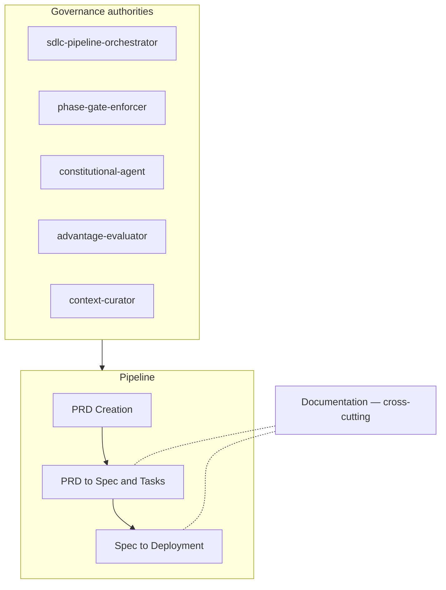
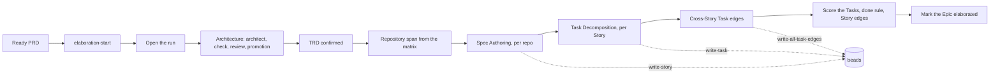
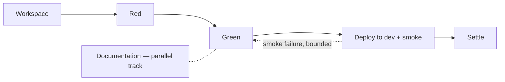

# Inside the Agentic SDLC Workforce

178 agents. Five task categories. Two pipelines, one upstream creation phase, one cross-cutting documentation team, and a governance tier that no one outranks. This is a complete software delivery lifecycle staffed entirely by bounded specialist agents — and the central design bet is that none of them is trusted very much.

The doctrine behind the system is simple to state: the agent is not the unit of trust; the workflow is. Every agent has a narrow purpose, explicit decision boundaries, least-privilege tools, and exactly one task category — *plan*, *orchestrate*, *execute*, *approve*, or *test*. An agent that plans never decides. An agent that builds never approves its own output. An agent that finds a flaw never fixes it. Work moves between agents through explicit artifacts. Where a composite gates a phase, the gate has three possible outcomes: pass, loop with structured feedback, or escalate upstream.

## The workflows

The system is a designed thing: two pipelines, a row of gates, a 178-agent doctrine of separated authorities. But doctrine is not what runs. What runs is deterministic code: `Workflow` scripts for the build pipeline, and a Python orchestrator for elaboration that runs the steps of a step journal. Both call agents as isolated sessions and route the next step from the facts each step returns. The agent is not the unit of trust; the script is. An agent produces work; it never decides whether its own work passed. The script reads the phase's reported facts (`greenConfirmed`, `deployedToDev`, `smokePassed`); the script alone owns what happens next.

The two pipelines are conceptual. Their realization is composable: small single-phase **minis** stitched into **composites**, with Documentation running as a parallel track. The doctrine below describes the shape; the status section says how much of that shape is wired.



### Governance — the separated authorities

Above both pipelines sits a small set of standalone specialists, each holding exactly one authority. The `sdlc-pipeline-orchestrator` sequences phases and routes gate outcomes — workflow only, no evaluation. The `phase-gate-enforcer` referees the constitutive criteria at every gate that carries one: constitutive failures are hard stops; competitive criteria never reach it and are recorded as flags by the gate script. The `constitutional-agent` is the appeals court for novel constitutive conflicts; no workflow currently dispatches it. The `advantage-evaluator` rules a gate whose loops are spent when `gate-enforce` runs in `exhaustion` mode, and the `context-curator` guarantees constitutive constraints survive context compaction verbatim. No agent holds more than one authority.

The realized substrate matches this separation. Orchestration is native `Workflow` scripts — no external state machine. Beads holds work state (which bead is ready, which is in progress, what was decided). Agent Mail holds file reservations and build slots so concurrent work does not collide. Where a gate runs, the script calls the gate agent separately from the producing agent, which makes segregation of duties a property of the code rather than a request to a model.

### Phase 0 — PRD Creation

Upstream of everything, the PRD Creation team turns raw stakeholder requests into a structured intake brief, persona profiles, an OKR cascade, and a draft PRD. No pipeline picks its draft up: `prd-to-spec` starts only from a ready PRD.

### PRD to Spec and Tasks

`prd-to-spec` elaborates one ready Epic from a PRD that the run reads and never writes. One dispatch is one pass over the Epic's step journal: the journal lists the steps, the run starts at the first step that is not done, and nothing else decides where it begins. The outermost steps are Open the run, Architecture, TRD, Specs and Stories, Tasks, Task edges, Score the Tasks, Apply the done rule, Story edges and Mark the Epic elaborated. Opening the run brings the Epic's PRD row and the document rows in the matrix up to date and writes the architecture context file. In the Architecture step one agent, `aws-solutions-architect`, establishes the architecture the PRD needs and has the TRD written with it (see *The architecture step* below). The TRD step confirms the reviewed TRD: every source it cites resolves, and the Epic bead carries its path and digest. The TRD is the CARRIER: the single point at which architecture-imposed obligations enter the build chain, since the Specs, Stories and Tasks are built from it. Its requirements come from the PRD requirements that need a technical obligation, from the standing obligations of the approved architecture and section 2 that apply to an element this PRD involves, and from each shared capability the design uses, as one requirement of kind `reuse`; each has a checkable value, a source and the matrix element it applies to. It cites arc42 rather than restating it. A Story is one repository's share of what the Epic's architecture adds or changes. The repository span is read from the architect's result: what the Stories build is the services, components, infrastructure and events it lists under `addedOrChangedElements`, each event with the service or component that publishes it (an event is a fact with a meaning, its name, its publisher and when it is triggered, and it is built as part of its publisher, never as a Story or Task of its own). The matrix is used only to find the stack the architecture side places each in and that stack's repository; everything else the Epic reaches is context, handed to the Tasks as what they depend on or use. A stack that names no repository is given the name the project's naming rules give it, and a repository the inventory lacks is created from the template its stacks' type names, only when a Story builds in it. Under Specs and Stories each repository of the span has its own container of steps: the repository context; for a frontend repository the UI bundle listing, the UI sources session and its check against the bundles; the contracts session and the data-model session, which run together; the UI section; the acceptance-criteria session; one review against the implementation criteria, whose findings go once to each author, with a disputed finding ruled on by `spec-decider`; the Story document; and the Story bead write. Under Tasks each repository has the decomposition context, the `task-decomposer` session, the plan (coherent Tasks that each cover several of the things the Story builds, every thing cited by some Task, sized, in build order, with one correction session when a thing the Story builds is uncited or a Task is unsized), one step per Task bead write, the step that retires Task beads the plan no longer names, and the written record. An open Task of another Epic in the same repository that already plans the work is not duplicated: the Tasks that need it get a `blocks` edge onto it. Task edges derives the edges the elements' `requires` relations make between Stories, has `task-dependency-mapper` map further ones when the span has more than one repository, and writes them. Then the Tasks are scored, the done rule is applied, Story edges are written and the Epic is marked elaborated. Each step takes its inputs from the artifacts of the steps its `inputs` name and records its output in the journal right after writing it; the Story bead write and each Task bead write also create that bead's own journal. Every bead write is keyed by the durable elaboration key (`bead_metadata.KEY_ELAB_KEY`, defined in `skills/beads-contract/schemas/bead-metadata.schema.json`), so a step that runs again updates the Story or Task it finds and creates no second one.

`prd-to-spec` owns the Epic's elaboration lifecycle, and every door into elaboration passes through it. The pipeline's driver starts it, and selects an Epic only when it is open, carries a WSJF score, depends (through `tracks` edges, which record architecture dependencies: an architecture decision it rests on is established from that Epic's requirements first) on no Epic whose elaboration is not done, and is ready, or in progress with no live run owning it. At the start of a dispatch `elaboration.start` refuses, with a named reason, an Epic that is not open, whose elaboration is done, or that another run owns; otherwise it marks the Epic's elaboration as started under an owner token. The elaboration-state keys and their values are defined once, in `skills/beads-contract/schemas/bead-metadata.schema.json` (`bead_metadata.KEY_ELABORATION_STATE`, `ELABORATION_STATES`, `ELABORATION_CAUSES`). Each Task inherits the Epic's value and time criticality, carries its own judged size, and is written with every WSJF component. Until its elaboration is done the Epic is sized by its judged estimate, never by the Tasks written so far. Build dependencies are Task-to-Task `blocks` edges only — a Story only groups Tasks. Two business requirements the architecture decider finds no design can satisfy together, a design that only works against a section 2 constraint, or a GitHub sign-in or organisation membership the run needs before it can create a span repository holds the Epic for a person with one named command. The scoring step (`elaboration.finish`, with its scope limited to the Epic's Tasks) scores the Epic's Tasks with RR-OE counted across Stories and writes no WSJF value on the Epic; the last step sets the Epic's elaboration state to done (`bead_metadata.ELABORATION_DONE`) when every Task is scored; the Epic itself stays open until its work is released.



### The architecture step

The architecture lives in the architecture directory (the run's `archPath`, from `ATW_ARCH_PATH`; see *Project configuration*): the effective documents in `arc42/`, one folder per arc42 section, and, in `built/<element>/`, what a Story built that differs from them. The architecture documentation model in `reference/` defines both and what each section holds. Section 2 holds the owner's constraints: the pipeline reads them and never writes them. Each document's front matter (`view_type`, `scope`, `subject`, `shows`, `lifecycle_state`) is its catalog entry. `lifecycle_state` is per file: `effective` was reviewed and approved; `in-review` is input to check, never assumed vetted. The matrix, read and written through `atw-matrix`, records how repositories, stacks, elements, PRDs, features, design facts and documents relate, which content is approved and which code is trusted.

The Architecture step of the Epic's journal holds these steps:

1. **Establish.** `aws-solutions-architect` has single responsibility for the architecture the PRD needs until it is ready for review. It reads the PRD, asks the matrix what exists and is approved, writes its state file, and builds out what is missing. Inside its own session it starts only the agents a gap needs: a design specialist or a diagram author for one question or one bounded task, `trd-author` to draft the TRD early and update it in place, `architecture-maintainer` to write its decisions into the arc42 documents, each fact in its one home, and `polyrepo-steward` to place a new element. It records each as a child step of its own step and ends with its result, which answers every architecture and technical-requirement criterion of `skills/effective-architecture/review-criteria.json`. An agent left running when a session stops is launched by the script from its saved request.
2. **Check.** A script checks what code can check (the matrix file, the documents it indexes, an answer for every criterion) and lists what is not approved for the Epic. A defect goes back to the architect, at most 3 times. A matter the architect lists as unsettled goes to `architecture-team-lead`.
3. **Review.** The rules of the criteria file select the reviewers from the kinds of unapproved content and from the review signals in the architect's result. Each reviewer is handed only the unapproved items its criteria apply to, and the reviewers run at the same time. A finding about anything else is dropped and counted.
4. **Route.** Only when a review returns a finding or asks for alternatives, `architecture-team-lead` decides what each item needs: nothing, one correction by the architect with a re-check by the reviewer that raised it, an opinion from one specialist, a competing design, or a ruling by `architecture-decider`, the last resort. It adds those steps to the journal and the script runs them. Only two business requirements that no design can satisfy together, or a conflict with section 2, hold the Epic for the owner.
5. **Promote.** A script marks the reviewed content approved in the matrix, sets the reviewed documents to `effective`, and commits and pushes them in the vault.

`built-version` records what a Story built, after the Story's deploy to AWS dev verifies and before its pull request. A `built-architecture-comparer` session compares the code on the Story branch with the approved arc42 headings that describe the stacks and entries the Story's Tasks state (`atw-matrix built --story`, then `atw-matrix story-scope` for each stack); a Story whose Tasks state nothing is not compared, and writes each difference as an `in-review` view in `built/<element>/`, citing `file:line`. When a difference exists, the `architecture-maintainer` corrects the effective version from the built views, the `architecture-conformance-reviewer` checks the correction (at most 2 correction passes), `depscore.py arch-approve` sets the corrected files to `effective`, and `depscore.py arch-built-remove` deletes the built views the effective version now matches — a built view the maintainer reports matched and the reviewer confirms — and commits the removal. `depscore.py arch-snapshot` measures what each session wrote: the comparison writes only under `built/<element>/`, and every file the correction wrote is reviewed, reported or not. A Story with no difference writes nothing. `built-version` runs as the child steps of the Story's `deploy:built-version` journal step (snapshot, compare, then correct, review, approve and remove when a difference exists) and reports each one to the Story's step journal, so a restarted run begins at the first child step that is not done; a review with findings adds a correction and another review.

### From artifact to Beads issue

Each artifact in the PRD-to-Spec pipeline answers a different question and lands in Beads as a different issue type. A single PRD's requirement stays alive across the whole chain as one Epic; everything downstream links back to it.

| Artifact | Answers | Built from | Beads issue type | Notes |
| --- | --- | --- | --- | --- |
| PRD | What | Stakeholder request / intake brief | `epic` | One Epic tracks the requirement end to end. |
| TRD | How | The PRD and the approved architecture | *(no standing issue — incidental coordination only)* | Coordinates whichever specialists the architecture calls for (persistence, integration, security, and so on). Each piece of incidental specialist work is tracked as a **Whisp**, not its own Epic or Story — it exists to get the TRD written, not to persist past it. |
| Spec | Specifics | The TRD and the elements the matrix places in one repository — one TRD may produce several Specs, each scoped to a single repository | `story` | Granular functionality, data flow, and testing criteria, ready for decomposition. |
| Task | — | Decomposing a Spec's Story | `task` | Individually implementable, WSJF-scored; its build dependencies are `blocks` edges onto other Tasks, in its own Story or another. |

**A Bug is not in this table, and that is the point.** A bug is a **reporting
mechanism**, not an artifact in the chain and not a unit of work. It is never
worked directly: every bug is **TRIAGED** — a judgment call requiring reason and
common sense, made by a person — and becomes an Epic, a Task, or a closure as a
non-defect. Bugs never have parents. Both routers SKIP a bug and name triage, and
the driver dispatches none. A build that finds a defect fixes it in that run.
See [A Bug is never routed](workflows/ROUTING.md#a-bug-is-never-routed).

**Beads types.** `bd`'s installed type enum is `bug|feature|task|epic|chore|decision`; `story` and `whisp` are not native types; a project registers them as custom types (`types.custom` in `.beads/config.yaml`). The routers and `ROUTING.md` route `story`, and the Task steps of `prd-to-spec` write only type `task`.

### Spec to Deployment

`task-to-deploy` builds a Task on its Story's branch. A Story is scoped to one repository and has one worktree and one branch, cut from the repository's `main` by `workspace` when its first Task starts and reused by each later Task, which starts from the branch as the previous Task left it. `task-to-deploy` runs the steps the Task's step journal lists: it reads the journal once, begins at the first step that is not done, hands each step the artifacts earlier steps recorded, and reports each step started, done with its artifacts and the steps its result adds, or failed with its cause, on its log, where the driver applies it to the journal file. A restarted build therefore continues on the tree as the stopped run left it, at exactly the next step. The step kinds, what each records and reads, which steps a result adds and the steps planned up front are defined once, in the `pipeline-contracts` skill (`schemas/pipeline-steps.json`). A Task with an infrastructure type or label (the infrastructure vocabulary the `artifact-handoff` skill defines in `schemas/infra-vocabulary.schema.json`; the caller runs the skill's `scripts/infra_vocabulary.py` and passes its output as `infraVocabulary`) first runs `infra-intent`, which authors the provisioning intent; its `cdk synth` assertion criterion joins the acceptance criteria and `cdk-stack-author` is its Green implementer.

Green is measured, not reported. `suite-run` runs the one test command the repository declares — in its `AGENTS.md` or `CLAUDE.md`, or as the `test` task in its Taskfile — and returns the exit code and the failing tests. The command is followed by an echo of its exit status on a `SUITE-EXIT` line, and the exit code is read from that line in the verbatim output; a run whose output lacks it counts as no result. Each failure is reported as a test that failed or a test file that could not be loaded, with its file and test name, whatever the test runner. A repository that declares none stops the Task at `baseline` with a required human action. The command is resolved once, at the baseline run before any change, and every later run in the Task uses it. No phase's own report decides anything: `greenConfirmed`, `noRegressions`, `redConfirmed` and `testsGreen` are information only.

- **Red**: Test Design writes failing tests from the Task's acceptance criteria — unit tests with the AWS services mocked and, for a criterion about the CDK stacks, `cdk synth` assertion tests in the language of the repository's CDK app — one test agent after another, each its own step, then a check step runs the suite. Red holds when a test in a file Red wrote or edited fails, no test file stops loading that loaded at the baseline, and no test that passed at the baseline fails. A check where Red does not hold adds the test agents' steps and another check; the fourth such check stops the Task with `red-unsatisfied`, and a check where the suite fails exactly as at the check before stops it with `no-progress`.
- **Green**: each selected implementer writes code in its own step, then a check step runs the suite; a check that is not green adds the implementers' steps and another check, until the whole suite exits 0, including tests that were already failing at the baseline. The eighth check since the implementers were selected stops the Task with `green`. Implementation writes the minimum code and does not change tests: Red's test files are fingerprinted at each check, and a change to one stops the Task with `green-modified-tests`. A test it names in `testIssues` (obsolete under the contract, defective, or missing configuration the contract now requires) goes to `tdd-unit-test-generator` in update mode, which updates, deletes or keeps each one, citing the contract. Something outside the Task that does not exist yet, named in `upstreamMissing`, stops the Task with `blocked-upstream`. A round that changes no file and leaves the suite failing exactly as the round before stops it with `no-progress`.
- **Refactor** ends green: when the suite fails after the refactor, the tree is restored to the snapshot the refactor recorded and the suite runs again.

Documentation follows, the suite runs a final time, and `settle` with `commitOnly` commits the Task to the Story branch only when that run exits 0. A Task deploys nothing and opens no pull request: the run succeeds when the repository's whole suite passes and its work is committed.

When a Story's last Task is done, the Story deploys. First `deploy-mechanism` asks the `polyrepo-steward` what the Story's repository publishes and deploys: a package to CodeArtifact (with the publish command the repository declares), a CDK deployment, or both. A Taskfile is a convenience and does not decide this. A repository that does neither — the control repository and the documentation vault among them — stops with stage `no-deploy-mechanism`. The remaining steps are the host's scripts, not agents: they publish the package when the repository publishes one, then, when it deploys with CDK, synthesize the Story branch, check that every SSM parameter the templates read exists in AWS dev (a missing one holds only the deploy, and the Story stays in progress), `cdk deploy` the repository's stacks to AWS dev, and verify that the deploy exited 0 and every stack reports `CREATE_COMPLETE` or `UPDATE_COMPLETE`. On a publish, synth, deploy or verification failure `story-deploy-fix` runs as the child steps of the Story's `deploy:fix` journal step — a `cdk-stack-author` diagnoses the failure and fixes it on the Story branch, the files it changed are read from git and the repository's synth assertion tests are run, and the fix is committed — and the Story tries again. A fix that changes no file stops the deploy with stage `no-change`, and a failure after three fixes stops it. Every step of the deploy is a step of the Story's step journal (`schemas/pipeline-steps.json`, pipeline `deploy`), so a restarted deploy begins at the first step that is not done. It never goes back to Green. Once the deploy verifies, `built-version` records what the Story built in the architecture's `built/<element>/` and corrects the effective version from it (see *The architecture step*). Then the Story opens ONE pull request with the project PR command, a script waits for GitHub to report it `MERGED`, and on the merge the Story is closed and its worktree removed.



### Cross-cutting — Documentation

The Documentation team runs alongside implementation and deployment rather than as a phase. Code is not done until its documentation is current: the currency audit names the stale docs, the writers update them in the worktree before the deploy, and Settle lands them with the code.

### How the pipeline is built — composites, minis, and gates

The doctrine is realized as `Workflow` scripts of two kinds. A **leaf mini** is one phase: it calls `agent()` or `parallel()` and returns an artifact. It does no nesting — a mini that calls `workflow()` throws. A **composite** stitches minis together with `workflow('name', args)`, owns the loop and escalate control flow, and runs Documentation as a parallel track. Nesting is one level deep on purpose: composites stay flat, and a full feature run sequences composites from outside (a router, `/loop`, or an on-demand call), never by nesting one composite inside another.

The build-and-deploy work is a **shared tail** of minis — `tdd-red`, `tdd-green`, `tdd-refactor`, `adversarial`, `deploy`. `task-to-deploy` runs `tdd-red`, `tdd-green` and `tdd-refactor`, judged by `suite-run`. It builds from the build contract on the Task, with `infra-intent` in front for an infrastructure Task.

**Deploying and landing are different things, and they happen in that order.** `deploy` puts the code in the AWS dev environment and smoke-checks the deployed endpoints; it opens no pull request and requires none. A run's deploy succeeds when `deployedToDev` and `smokePassed` are both true; a pull request is never evidence that anything was deployed. A smoke failure against the deployed environment re-enters Green, then redeploys and re-smokes, up to `maxDeployIterations` (default 3). Afterwards the composite's **Settle** step lands the work in git — commit, push, PR — on every exit path. The two facts are reported separately: `deployedToDev` for AWS, `settled` / `prUrl` / `landingStage` for git.

The gate is itself a reusable mini. `gate-enforce` takes a phase artifact, a list of pass criteria, deterministic checks, and a set of escalate targets, and returns one of three verdicts:

- **pass** — every criterion holds. Non-blocking quality concerns ride along as flags, and so does every `competitive` criterion: it is recorded as a flag and never adjudicated. Deterministic checks are measured against the artifact first, and only `constitutive` criteria go to the `phase-gate-enforcer`; a gate with none passes on its checks with no agent session.
- **loop** — a criterion failed and the cause is inside this phase. The gate returns feedback specific enough to retry without interpretation; the composite re-runs the phase, up to `maxLoops`. With `mode: 'exhaustion'`, `gate-enforce` asks the `advantage-evaluator` to rule a gate whose loops are spent: proceed, or one directed revision.
- **escalate** — the failure originates upstream (the phase got bad inputs). The gate names which upstream phase it goes back to.

The gate is never the agent that produced the artifact under review.

| Script | Kind | Purpose |
| --- | --- | --- |
| `gate-enforce` | gate | Deterministic checks first; constitutive criteria to an independent judge, competitive ones recorded as flags; pass / loop / escalate; `exhaustion` mode asks the `advantage-evaluator` to rule a spent gate. |
| `workspace` | mini | Reuses the worktree registered for the bead or cuts one on a feature branch; refuses a default branch or detached HEAD. |
| `settle` | mini | Commits, pushes the branch and opens the pull request with the project PR command; with `commitOnly` it commits on the branch and stops. |
| `suite-run` | mini | One session runs the repository's declared test command once and returns `exitCode`, `failing`, `tail` and `summary`; with no command given it resolves the one the repository declares, or returns `resolveError`. |
| `tdd-red` | shared-tail mini | Test writers derived from the contract surfaces (unit always), one after another, write failing tests that encode the acceptance criteria and confirm they fail. In update mode `tdd-unit-test-generator` rules on each test the implementer named: update, delete or keep. |
| `tdd-green` | shared-tail mini | Writes the minimum production code to pass the failing tests without changing tests; names contradicting tests in `testIssues` and missing things outside the Task in `upstreamMissing`. |
| `tdd-refactor` | shared-tail mini | One `code-refactoring-specialist` session refactors the changed code without changing behavior, keeps the suite green, and reverts the tree when it cannot; with `restoreTo` one session restores the tree to a recorded snapshot. |
| `adversarial` | shared-tail mini | Attack lanes in test environments only; one adjudicator rules each confirmed finding, and the script returns the count of open constitutive findings as `constitutiveOpen`. |
| `deploy` | shared-tail mini | Authors a smoke suite (or reuses the one passed in), rolls the one repository out to AWS dev, and runs the smoke tests against the deployed endpoints. Never deploys to qa or prod. |
| `documentation` | cross-cutting mini | Parallel track: audits doc currency and updates stale docs in the worktree before the deploy, so Settle lands them with the code. |
| `task-to-deploy` | composite | Runs the steps of the Task's step journal (`schemas/pipeline-steps.json`, pipeline `build`), from the first that is not done: Workspace (the Story's branch), Infra Intent (an infrastructure Task), Regression Scope, Baseline, the test agents and a Red check that adds another round when Red does not hold, the implementers and a Green check that adds a test ruling or another round when the suite is not green (each implementer's brief opens with the shared capabilities the Task must use, read with `atw-matrix uses --ids` for the matrix ids the Task states), Reuse Audit (`atw-matrix check-reuse` over the changed files, with `shared-capability-reviewer` ruling each definition the command cannot rule on, a duplicate being a violation; violations sent back to the implementers once, and a violation that remains stops the Task with stage `reuse-violation`), Refactor, CDS Audit (a `web-ui` Task, by the design source selected before the build from the bundles supplied then; the design-source values are `bead_metadata.CDS_DESIGN_SOURCE_BUNDLE`, `CDS_DESIGN_SOURCE_CDS` and `CDS_DESIGN_SOURCE_NONE` from `skills/beads-contract/schemas/bead-metadata.schema.json` — a design-system Task whose artifact now has a bundle builds from it, a bundle Task builds from the newest bundle of its artifact and stops blocked-upstream when none remains: a bundle Task runs the cds plugin's `tools/audit-app.py` over the Task's changes against the supplied bundle, its report verified against the digest the script prints, with `cds:audit-against-system` on what the script cannot rule on; a design-system Task runs `cds:audit-against-system` against the live design system; a Task with no design change runs no audit; violations sent back to the implementers once, the verdict returned as `cdsAudit`), Documentation, then a final green `suite-run`, the regression mapping and its verification, and the commit to the Story branch. No deploy, no pull request. |
| `deploy-mechanism` | mini | The first agent step of a Story's deploy: one `polyrepo-steward` rules what the Story's repository publishes (a CodeArtifact package and its publish command) and deploys (CDK). Read-only. |
| `story-deploy-fix` | mini | The fix step of a Story's deploy, run as the child steps of the Story's `deploy:fix` journal step: one `cdk-stack-author` fixes a failed publish, synth, deploy or verification on the Story branch; the changed files are read from git and the synth assertion tests run; the fix is committed. A fix that changes no file returns `no-change`. Never deploys and never re-enters Green. |
### Run modes

A composite runs two ways. **On-demand**, a single call drives one unit of work: `/agent-teams-workforce:work-bead <bead id>` routes one bead to the composite that owns it and dispatches it. **Unattended**, a self-paced `/loop` runs until `bd ready` is empty — each tick claims the next ready bead, routes it to the composite that matches its type, and reports. A bead with no matching composite is skipped and reported, never force-fit into the wrong pipeline.

### Safety

`deploy` stops at dev. It authors smoke tests, deploys to the AWS dev environment and smoke-tests the deployed endpoints; deploying to dev is not human-gated. The pipeline does not run `cdk deploy` to qa or production. Outward-facing rollout is a separate, human-gated action triggered by a person, not by a composite. Adversarial agents operate in designated test environments only; the attack lanes are instructed never to touch production, and the composite ends with `deployedToProd: false`.

### Project configuration

The plugin knows nothing about the project it is installed in. Everything project-specific reaches it through these environment variables, which the project exports (in its shell profile, or in the environment of whatever launches its sessions). A workflow script has no process access, so the commands and skills that dispatch a workflow read these variables and pass their values as the named arguments; hooks and skill scripts read them directly. A required variable that is unset stops the step that needs it, by name.

The names of the `ATW_*` variables below that the plugin's code reads are defined in one place, the `pipeline-contracts` skill's `schemas/driver-surface.schema.json` (`$defs.DriverEnvironment`, one `x-constant` per variable, exported by the generated `scripts/driver_surface_types.py`, for example `ARCH_PATH_ENV`), and every command, skill and script reads the name through that constant. That schema defines names only: which variables a project must set, and what reads each, are this table's. The SkillSpoke driver sets these variables for its child sessions from the same schema; there its `required` list describes the driver's child environment, not the project configuration below.

| Variable | Meaning | Required | Reaches |
|---|---|---|---|
| `ATW_PR_COMMAND` | Absolute path of an executable that, run inside a worktree as `<cmd> --title T --body B`, pushes the current branch and opens its pull request (a PR that already exists for the branch is success). Exit 0: PR open and auto-merge armed; exit 3: PR open (URL on stdout) but auto-merge not armed, which callers report rather than treat as no PR; any other non-zero: no PR | Yes, for any composite that lands work | the host opens a Story's pull request with it |
| `ATW_ARCH_PATH` (`ARCH_PATH_ENV`) | The architecture directory: the folder holding `reference/` (the architecture documentation model), the effective version in `arc42/` (one folder per section), and the `built/` version | Yes, for elaboration, dependency assessment and scoring | the dispatch argument `archPath` of `prd-to-spec`; `archPath` on `dependency-assessment` and `wsjf-scoring`, which `/dependency-assessment` and `/wsjf-scoring` refuse to dispatch without |
| `ATW_PRD_DIR` (`PRD_DIR_ENV`) | The directory PRDs live under | Yes, for elaborating an Epic and for the matrix's PRD rows | read by `orchestrator/flows/prd_to_spec.py`, `scripts/portfolio/matrix.py`, `scripts/portfolio/matrixcli.py` |
| `ATW_CONTROL_REPO` (`CONTROL_REPO_ENV`) | The root repository that holds the tracker — the central beads database every pipeline bead is read and written in; its beads `issue_prefix` is the project's issue prefix | Yes: `atw-bd` and `beads-contract.py` run `bd` against it from any repository or worktree (unset, they fall back to the working directory and warn) | read by `bin/atw-bd`, `skills/beads-contract/scripts/beads_contract.py`, `scripts/portfolio/beadgraph.py`, `skills/polyrepo-beads/scripts/*.sh`, `skills/polyrepo-repo/scripts/polyrepo.py`, `skills/resource-naming/scripts/naming.py` |
| `ATW_PROJECT_ROOT` (`PROJECT_ROOT_ENV`) | The directory recorded artifact and spec paths are relative to | No — without it, no root-relative path is recorded on a bead | `projectRoot` on `prd-to-spec`, `dependency-assessment` and `wsjf-scoring` |
| `ATW_PRD_EPIC_SYNC` (`PRD_EPIC_SYNC_ENV`) | Command that brings a PRD's Epic into line with the document: `<cmd> --only <slug> --apply` | No — without it, the PRD writer reports the slug needing sync | read by the `prd-writer` agent and skill |
| `ATW_PRD_EPIC_VERIFY` (`PRD_EPIC_VERIFY_ENV`) | Command that checks one PRD against its Epic: `<cmd> <slug> [--apply]` | No | read by the `prd-writer` skill |
| `designSystem.packagesDir` | The folder of mockups the owner supplied: zero or more single-artifact cds bundles, each `<change-slug>-<timestamp>/` with its own `styles/`, `spec/build-spec.md`, `design/<kind>.html` and `bundle.json`; the newest `created_at` of a kind and slug is the supplied one | No; absent or empty supplies no bundle | the spec steps of `prd-to-spec` list the bundles (script step `cdsbundles.list_bundles`) and give each `ui` item its design source, one of `$defs.DesignSource` in the `artifact-handoff` skill's `schemas/recon.schema.json` (`bundle`, a supplied bundle; `cds`, the CDS design system; `none`, no design change); the Task steps hand the packages directory to the Task plan, so every bundle a Task cites sits in it; `task-to-deploy` reads it again before each build, so a mockup can arrive any time before its Task is built |
| `CUSTOMIZABLE_DESIGN_SYSTEM_MOCKS_DIR`, `CUSTOMIZABLE_DESIGN_SYSTEM_SHELLS_DIR` | Composed page mocks and Shells | No | `designSystem.mocksDir` and `designSystem.shellsDir`; intent references, not substitutes for an unresolved UI package |
| `RESOURCE_NAMING_CONFIG` | The project's resource naming config (`.resource-naming.yaml`): project id, segment styles, domain table and one pattern per resource type | No — without it, `$ATW_CONTROL_REPO/.resource-naming.yaml`, then the nearest `.resource-naming.yaml` above the working directory; with none, the script exits 2 (no defaults) | read by `bin/atw-naming`, `skills/resource-naming/scripts/naming.py` |
| `ATW_BEADS_PORT` | The shared Dolt server port | No — `3308` | read by `skills/polyrepo-beads/scripts/*.sh` |

### Status

The shared tail, the `documentation` track, the `gate-enforce` gate, `workspace` and `settle` exist as scripts. Elaboration, `prd-to-spec`, runs in the Python orchestrator (`orchestrator/run.py`, with its steps in `orchestrator/flows/`) as a loop over the Epic's step journal, and is not a workflow script. `prd-validation`, `built-version`, and the build composite `task-to-deploy` (with `suite-run`, and `infra-intent` for an infrastructure Task) exist as workflow scripts. `prd-to-spec` does not dispatch `prd-validation`: validation runs on its own.

## The doctrine, principles, and rules

The narrative above describes the workforce as it is built. This section is the doctrine it implements and the rules every agent obeys. These rules bind every agent in the workforce; they supplement the workflow designs, and **where an agent definition and these rules conflict, these rules win.**

### Why the workforce is built this way

The goal is not to maximize individual agent autonomy. The goal is to maximize system-level delivery reliability. A large, broadly scoped agent introduces avoidable risk: it can silently blend requirement analysis, architecture, implementation, review, and approval into one coherent-looking response. Such an agent may:

- resolve ambiguity without surfacing it
- optimize for a local concern instead of the larger system
- choose familiar tools over appropriate patterns
- hallucinate missing facts
- drift from the original intent
- collapse trade-offs into unsupported conclusions
- review its own reasoning with the same flawed assumptions
- exceed its authority without making that visible

Specialized agents reduce these risks by limiting the scope of reasoning, context, tool access, and decision authority. A narrowly defined agent can still be wrong, but its failure is easier to detect, isolate, and correct. Agents are not trusted because they are broadly capable; they are useful because they are constrained.

### What every agent has

A project delivery agentic workforce is designed around bounded specialist agents, explicit handoff contracts, independent review, and read-only coordination. Each agent has:

- a narrow purpose
- a defined scope
- explicit responsibilities
- limited authority
- role-specific context
- role-specific skills
- least-privilege tool access
- required inputs
- required outputs
- defined review paths
- clear escalation triggers

### Design philosophy

The workforce is designed using the same principles that guide durable software architecture: separation of concerns, least privilege, bounded context, explicit interfaces, single responsibility, independent review, dependency control, artifact-driven collaboration, testability, auditability, and escalation over silent assumption. The system prefers explicit coordination over broad autonomy. The design makes it difficult for any single agent to silently become planner, implementer, reviewer, approver, and historian for the same work.

### Foundational principles

**Specialization by responsibility.** Agents are defined by responsibility, not by broad professional title. Broad titles such as *Architect*, *Engineer*, *Developer*, *Reviewer*, or *Analyst* are too vague unless further scoped. Preferred agent names describe the specific work performed:

| Broad role | Better specialized roles |
| --- | --- |
| Architect | Integration Pattern Architect |
| Architect | Domain Boundary Architect |
| Architect | Persistence Architecture Specialist |
| Developer | Lambda Implementation Specialist |
| Developer | CDK Construct Implementer |
| Reviewer | Security Controls Reviewer |
| Reviewer | Operational Readiness Reviewer |
| Writer | API Documentation Writer |

**Bounded authority.** Every agent has explicit decision boundaries. Each definition states what the agent may decide, may recommend, may create, may modify, may review, may *not* decide, and when it must escalate. Capability does not imply authority — an agent may be capable of a task and still be forbidden from doing it.

**Least context.** Agents receive only the context required for their role, distributed through role-specific context packets rather than a universal project dump. This reduces irrelevant anchoring, stale assumptions, conflicting instructions, scope creep, context-window pollution, and accidental authority expansion.

**Least tool access.** Agents have access only to the tools and MCP servers their purpose requires. Read-only is the default; write access is granted only when mutation is part of the agent's charter. Tool access is a form of authority: an agent with broad access can affect the delivery system even if its written role appears narrow.

**No self-approval.** No agent may approve its own work, and no agent may independently plan, execute, review, and approve the same deliverable — across architecture, code, infrastructure, documentation, tests, schemas, runbooks, deployment plans, and release decisions. Every agent must review its own work for correctness, completeness, and risk, but it may not approve it. Where an independent reviewer's verdict can change what gets built, that review is mandatory (Rule 4); where it cannot, the output is judged by the phase that consumes it, never approved by the agent that made it.

**Separation of intent, design, implementation, and review.** The workforce separates these concerns; no single agent owns the full chain:

| Concern | Responsibility |
| --- | --- |
| Intent | Understand what is being requested |
| Requirements | Define required outcomes and constraints |
| Domain framing | Establish business meaning and boundaries |
| Architecture | Select structural patterns |
| Platform mapping | Translate architecture into platform-specific implementation |
| Implementation | Produce concrete deliverables |
| Review | Challenge correctness, risk, and completeness |
| Decision recording | Capture rationale and trade-offs |
| Delivery readiness | Confirm release and operational fitness |

**Architecture before platform preference.** Platform implementation agents must respect upstream architectural decisions. An AWS Serverless Specialist may recommend the best AWS implementation for an approved architecture, but may not independently replace the approved pattern because another service appears cheaper, easier, or more familiar. If a platform agent believes an upstream decision is flawed, it must raise a formal exception — it may not silently override the architecture.

**Read-only coordination.** Team leaders coordinate work; they do not perform it. A team leader may route tasks, enforce workflow rules, verify required inputs, assign agents, track open questions, require reviews, detect missing artifacts, escalate unresolved conflicts, and assemble approved outputs. A team leader may not create architecture, write implementation code, modify deliverables, approve its own team's work, override specialist disagreement, or silently resolve trade-offs. Team leaders own process integrity, not subject-matter authority.

**Artifact-first collaboration.** Agents collaborate through explicit artifacts — intake brief, requirements brief, domain model, context map, architecture option analysis, architecture decision record, API contract, data schema, threat model, implementation plan, test plan, review report, release readiness checklist, handoff packet. Informal agent conversation is not enough; the durable record is the artifact.

**Explicit conflict handling.** Agent disagreement is expected and useful, and must be surfaced as a structured conflict rather than hidden inside compromise language:

| Conflict type | Example |
| --- | --- |
| Architecture conflict | Event-driven architecture vs workflow orchestration |
| Platform conflict | DynamoDB vs Aurora |
| Cost conflict | Lower cost vs greater operability |
| Security conflict | Developer convenience vs least privilege |
| Delivery conflict | Faster implementation vs long-term maintainability |
| Domain conflict | Technical model does not match business model |

When conflict exceeds predefined rules, it must be escalated.

### The five task categories

Every unit of work belongs to exactly one of five categories:

| Category | Meaning |
| --- | --- |
| plan | Produce analysis, options, designs, estimates, or recommendations |
| orchestrate | Delegate, route, sequence, and track work performed by other agents |
| execute | Build, write, or modify a project artifact (code, spec, doc, infra) |
| approve | Decide from collected evidence, adjudicate findings, or pass/fail a gate |
| test | Challenge, verify, validate, or attack another agent's output |

**For any single task, an agent may perform work in no more than ONE of these categories.** Supporting constraints:

- Every agent definition declares exactly one task category in its charter; the other four are forbidden to that agent.
- If completing a task would require work in a second category, the agent stops and reports the remaining work to its manager. It never performs or assigns that work itself.
- An orchestrating agent never produces, evaluates, or approves the artifacts it routes — it owns process integrity only.
- A planning agent never decides among the options it produced; deciding is approve-category work performed by a different agent.
- An executing agent never approves its own output and never writes the tests that gate its own output.
- A testing agent reports findings; it never fixes what it finds.
- An approving agent never generates the evidence it decides from.

**No self-tasking.** If an agent determines that work needs to be done, it reports that finding to its manager, who routes the work to an appropriate agent. The originating agent never performs or assigns the work it identified.

**Task atomicity is scoped.** A task is atomic for the receiving agent. A manager's atomic task may be "coordinate architecture analysis," which it decomposes by routing to workers; a worker's atomic task may be "analyze DynamoDB access patterns." The hierarchy handles decomposition.

**Separation of analysis and decision.** Providing analysis is one task; making a decision from that analysis is a separate task; the two are performed by different agents. No agent both analyzes options and decides among them. In the PRD-to-Spec pipeline this separation is enforced in the architecture step, where `aws-solutions-architect` designs, reviewers who produced none of it check the unapproved content, and `architecture-decider` rules only on what the team could not settle. The effective architecture is a current-state description kept by an execute-category agent (`architecture-maintainer`), never a decision artifact; the `architecture-conformance-reviewer` checks each correction from built the `architecture-maintainer` makes.

**Iteration limits.** A step whose result calls for a correction adds the steps that make and confirm it, and declines to add another when its limit is reached, failing with the cause instead; the limits are stated per step kind in `schemas/pipeline-steps.json`. `task-to-deploy`: a Red check fails with `red-unsatisfied` at the fourth check that does not show Red, and a Green check with `green` at the eighth check since the implementers were selected or an audit sent violations back; either fails with `no-progress` when nothing changed and the suite fails exactly as at the check before. A Story's deploy: a failure after three fixes stops it. The architecture step: at most 3 corrections of mechanical defects before review; what a review's finding needs is the lead's routing. A spec document gets one correction for the review's findings and one revision after a ruling, and a Task plan with a gap gets one correction. `built-version`: a review fails the step when the correction does not conform after 2 corrections that answered findings. (The three gate outcomes — pass, loop, escalate — and the constitutive-versus-competitive distinction are described under *How the pipeline is built* above.)

### Workforce creation rules

**Rule 1 — every agent must have a charter.** An agent is defined by its front-matter fields (`name`, `description`, `tools`/`disallowedTools`, `model`, `permissionMode`, `maxTurns`, `skills`, `mcpServers`, `hooks`, `memory`, `background`, `effort`, `isolation`, `color`, `initialPrompt`) and, in the body, at minimum: Team, Agent Type, Purpose, Primary Responsibility, Scope, Out of Scope, Allowed Decisions, Forbidden Decisions, Inputs Required, Outputs Produced, Required Reviewers, Escalation Triggers, Acceptance Criteria, Anti-Goals. If these cannot be completed clearly, the agent is not yet well-defined.

**Named dispatch and delivered contracts.** Every workflow agent call resolves through a registry generated from this plugin's agent definitions. Missing, generic and foreign identities fail before dispatch; MCP-enabled definitions use the plugin-owned user-level mirror described below. Each dispatch receives the canonical subagent and artifact-handoff contracts directly. Applicable domain skills must be explicitly loaded with Skill; a frontmatter name is not proof of delivery. Shared source documents remain authoritative at their file or vault references. Makers write only assigned artifacts, reviewers use the same completion criteria, and durable checkpoints preserve completed work without counting as accepted results. JSON artifact publication and acceptance use the deterministic handoff scripts; agents return references rather than duplicate the document payload.

**AWS architecture evidence.** For AWS choices, consult AWS MCP documentation and associated skills as the leading technical guidance, applying relevant Well-Architected principles to actual requirements and deployment constraints. Existing generated drafts are not owner approval. Cite the guidance and tradeoffs, surface conflicts, and report unavailable guidance explicitly. `aws-solutions-architect` decides from that evidence and asks a specialist when a gap needs one.

**MCP agents run from the user-level agents directory.** Claude Code ignores `mcpServers` on an agent defined in a plugin. Every agent whose frontmatter has an `mcpServers:` entry therefore runs from its copy in `~/.claude/agents/` (`$CLAUDE_CONFIG_DIR/agents`), which every session loads whatever repository it runs in, and wins over the plugin's copy by precedence. Every agent, with or without `mcpServers`, is started and recorded by its plain front-matter name (`cdk-stack-author`, `uml-diagram-author`), never under the `agent-teams-workforce:` prefix; Claude Code loads the definition and preloads the skills its front matter lists, and no code reads an agent's or a skill's text to start or configure it. The `hooks/sync-user-agents.cjs` hook copies those agents from the newest install of the plugin that `plugins/installed_plugins.json` records when a copy is missing or differs, removes a copy whose agent no longer declares `mcpServers`, and writes only the files named in `~/.claude/agents/.agent-teams-workforce-owned.json`. Claude Code has no hook event for a plugin install, update or reload, so the hook runs at SessionStart, which also has Claude Code watch `installed_plugins.json`, and again on FileChanged when an install or update rewrites that file. A copy it writes takes effect in the next session. `scripts/check-agent-types.mjs` fails a dispatch that names any agent under the plugin prefix.

**Rule 2 — one primary responsibility.** Each agent has one primary responsibility; related responsibilities may exist only if they support it. An API documentation writer should not also redesign the API, approve the contract, define authentication, and generate SDKs.

**Rule 3 — a defined output.** Every worker agent produces a defined output (recommendation memo, architecture option analysis, OpenAPI fragment, documentation draft, schema proposal, implementation patch, review findings, test plan, risk register entry, handoff packet). If an agent produces no defined output, its role should be questioned.

**Rule 4 — independent review only where its verdict can change what gets built.** An output gets an independent reviewer when that reviewer's verdict can change what gets built — send the artifact back, stop the run, or change what the next phase receives. It never gets a second review of a question already decided: a property a deterministic check measures is decided by the check, and no agent re-judges it; a question an earlier reviewer ruled on is not reviewed again downstream. An output no verdict could change has no reviewer, and is still not approved by its author — it is judged where it is used. So the `trd-author` writes the TRD in one pass with no checker; the spec makers author with no reviewer; the Documentation writers have no accuracy reviewer; `task-to-deploy` decides each phase from the exit code `suite-run` returns, with no gate agent; and `adversarial` counts the adjudicator's open constitutive findings rather than judging them again. The `architecture-conformance-reviewer` does review each integration of the architecture, because its findings send the integration back to the `architecture-maintainer` for correction. A review whose verdict nothing reads, or that repeats a decided question, does not exist (Rule 12).

**Rule 5 — agents must state assumptions.** Every substantive output includes Assumptions, Open Questions, Constraints Followed, Constraints at Risk, and Scope Exceptions. This protects against silent ambiguity resolution.

**Rule 6 — separate facts, assumptions, recommendations, and decisions.** Outputs distinguish provided facts, inferred facts, assumptions, recommendations, decisions, and unresolved questions, so recommendations are not mistaken for approved decisions.

**Rule 7 — escalate scope violations.** If a task requires authority outside the agent's charter, the agent stops and raises a scope exception rather than acting.

**Rule 8 — competitive review for high-risk judgment.** Competitive or adversarial agents are used when the task involves architectural trade-offs, security-sensitive design, persistence strategy, cost/performance decisions, data modeling, migration planning, release readiness, ambiguous requirements, or irreversible implementation choices. Competition is not used by default for routine mechanical work.

**Rule 9 — model diversity is targeted.** Different LLM models are used when independent failure modes matter — adversarial review, architecture validation, security review, ambiguous requirement analysis, final synthesis, unsupported-claim detection — not merely to make a workflow appear more sophisticated.

**Rule 10 — consolidation requires justification.** First-pass design favors granular specialization. Agents may be consolidated later only with clear benefit and without removing a required control boundary. Valid reasons: agents always require the same context; always produce the same artifact; review separation adds no value; handoff overhead exceeds risk reduction; skills and MCP access are effectively identical; responsibilities cannot realistically be separated. Invalid reasons: the names sound similar; a human would normally do both; the model is capable of both; the spreadsheet feels too large; the workflow diagram looks too busy.

**Rule 11 — consolidation must preserve control boundaries.** Agents must not be consolidated if doing so removes an independent review Rule 4 requires, separation of concerns, conflict visibility, authority boundaries, least-privilege tool access, or meaningful escalation points. It may be reasonable to consolidate API Documentation Writer and API Example Generator; it is not reasonable to consolidate API Contract Designer and API Contract Reviewer.

**Rule 12 — contracts are consumer-defined.** A consumer declares the schema it needs; a producer produces to that schema. A producer never invents a requirement and never decides unilaterally what must be produced. Every required field, section, or artifact must therefore **name the consumer that reads it**, in the form `Consumed by: <workflow/agent/script> — <what it does with it>`. If nothing downstream consumes it, **the requirement does not exist** — it is deleted, not softened to optional or advisory. Advisory ceremony still costs the reader's attention and still shows up as a finding, so demoting an unread requirement does not retire it. The same test governs gate criteria: a criterion asserts a property, and something downstream must depend on that property holding. A criterion no step reads, checks, or branches on is ceremony, not rigor.

### Team and specialist charters

**Agent team model.** Agents are organized into teams by delivery function. Each team has a read-only team leader and orchestrator, and may contain sub-orchestrators or sub-leaders depending on scope. The team leader coordinates the work but does not perform subject-matter production.

**Team leader charter.** Beyond what every agent requires, a team leader: delegates 100% of work to the team; is responsible for the quality and completion of all work the team produces; may not blame any team member for low quality, incompetence, or incomplete work; owns communication to, between, and from team members; ensures all rules, guidelines, and best practices are followed; and is honest and transparent above all else. A team leader is never allowed to perform work itself (including work that does not touch project artifacts) on behalf of the team, or to compensate for the team's inadequacies by doing their work or covering up their problems.

**Specialist agent charter.** Beyond what every agent requires, a specialist: always uses the skills and MCP servers provided over its own internal training; always provides an audit trail of decisions, including confidence level, reasoning, alternatives considered and dismissed, questions whose answers might have changed the outcome, and pros/cons and risks; and is honest and transparent above all else.

### Illustrative flows

**A potential architectural decision workflow.**

```text
1. Request Intake Analyst creates the intake brief.
2. Requirements Clarifier identifies required outcomes, constraints, ambiguities, and acceptance criteria.
3. Domain Boundary Architect defines domain ownership, business concepts, and bounded contexts.
4. Integration Pattern Architect recommends the appropriate integration pattern.
5. Competing Pattern Reviewer challenges the recommended pattern and identifies viable alternatives.
6. Architecture Trade-off Reviewer compares the recommendation against rejected alternatives.
7. Platform Implementation Specialist maps the approved architecture to platform-specific services.
8. Cost Reviewer challenges cost assumptions and scaling risks.
9. Security Reviewer challenges trust boundaries, permissions, and abuse cases.
10. Operational Readiness Reviewer challenges observability, failure handling, supportability, and recovery.
12. Architecture Team Leader verifies that all required workflow steps occurred and prepares the decision packet.
```

**An example handoff contract.** Every handoff has a contract (in practice, strict JSON to prevent ambiguity):

```text
Handoff: Integration Pattern Architect → AWS Serverless Implementation Specialist
Request: Map the approved event-driven architecture to AWS serverless services.
Upstream Decision: The solution must use event-driven decoupling between producer and consumer domains.
Constraints:
- Preserve producer/consumer decoupling.
- Preserve domain ownership boundaries.
- Do not replace the event-driven architecture with centralized workflow orchestration unless raising a formal architecture exception.
Allowed Decisions:
- Select AWS-native event routing services.
- Recommend retry and dead-letter handling.
- Recommend observability hooks.
- Recommend deployment considerations.
- Identify AWS-specific risks and trade-offs.
Forbidden Decisions:
- Change the approved integration pattern.
- Collapse producer and consumer boundaries.
- Redefine domain ownership.
- Select a non-event-driven architecture without escalation.
Required Output: AWS implementation recommendation with service choices, trade-offs, risks, assumptions, and operational considerations.
Required Reviewers: Cloud Cost Reviewer, Security Reviewer, Operational Readiness Reviewer.
```

### Minimal guidance for creating an agent

Collecting these values gives enough structure to define both the agent and the governance model around it:

| Column | Purpose |
| --- | --- |
| Agent ID | Stable unique identifier |
| Agent Name | Human-readable role name |
| Team | Functional team assignment |
| Agent Type | Worker, reviewer, coordinator, decision-support, recorder |
| Purpose | Why the agent exists |
| Primary Responsibility | The agent's main responsibility |
| Scope | What the agent covers |
| Out of Scope | What the agent must not cover |
| Allowed Decisions | Decisions the agent may make |
| Forbidden Decisions | Decisions the agent may not make |
| Authority Level | Recommend, create, modify, review, approve, route |
| Mutation Rights | None, draft-only, patch, merge, deploy |
| Inputs Required | Required upstream artifacts |
| Outputs Produced | Required output artifacts |
| Required Skills | Attached Agent Skills |
| Required MCPs | Required tools or MCP servers |
| MCP Permissions | Read-only, comment-only, write, admin |
| Upstream Agents | Agents that feed this agent |
| Downstream Agents | Agents that consume this agent's output |
| Required Reviewers | Agents that must review this output |
| Conflict Partners | Agents expected to challenge this agent |
| Escalation Triggers | Conditions requiring escalation |
| Acceptance Criteria | What good output means |
| Anti-Goals | Explicit behaviors to avoid |
| Consolidation Candidate | Yes, no, or later |
| Consolidation Rationale | Reason consolidation may be valid |
| Risk If Too Broad | Failure mode caused by excessive scope |
| Risk If Too Narrow | Failure mode caused by excessive fragmentation |
| Notes | Additional information |

### Final operating standard

The workforce is optimized for reliable project delivery, not individual agent autonomy. Agents are small by default. Authority is explicit. Context is limited. Tools are least-privilege. Review is independent. Coordination is read-only. Disagreement is surfaced. Decisions are recorded. Consolidation is earned. The system makes it difficult for any single agent to silently expand its role, collapse trade-offs, approve its own work, or substitute local optimization for project-level judgment.

## The taxonomy

Every agent is described by a role and one or more character types. Team membership is not stamped on the agent — a team is a composition its lead owns, and an agent may serve on more than one team.

### Roles

| Role | Authority |
| --- | --- |
| Manager | Has subordinates. Routes tasks to the right agent. Validates process outcomes (DoD met? redo?) |
| Worker | Performs a single atomic task. Returns result to Manager. |
| Specialist | No manager, no team. Performs assigned tasks on demand. |

### Character Types

An agent typically has multiple character types. These are behavioral constraints, not roles.

| Type | Behavior |
| --- | --- |
| Orchestrator | Manages agreement protocols, validates sub-task outputs. |
| Delegator | Cannot use execution tools. Emits task assignments only. |
| Executor | Receives delegated work, produces output. |
| Validator | Reviews, tests, asserts, evaluates another agent’s results. |
| Adversary | Validator with intentionally hostile intent — breaks, disproves, rejects, competes. |
| Advisor | Analyzes, optimizes, guides. Read-only — produces recommendations, not decisions. |
| Decider | Receives collected evidence from multiple agents. Produces a decision + rationale. Does not generate the evidence it decides from. |

### Team Types

| Concept | Definition |
| --- | --- |
| Execution Team | Contains Workers. The common case. |
| Supervisor Team | Contains only other Managers. Top-of-house coordination. |

Each delivery team below is an Execution Team: a Manager lead plus Workers. The supervisor tier — the pipeline orchestrator coordinating all 13 team leads — functions as the Supervisor Team: it contains only coordinators, and none of them may perform, evaluate, or approve the work they route. Governance agents are Specialists: no manager, no team, invoked on demand.

## The teams — every agent, by team

### Governance — Standalone Specialists

Cross-workflow separated authorities: workflow orchestration, gate refereeing, constitutional rulings, advantage evaluation, context integrity. 5 agents.

| Agent | Role | Character Types |
| --- | --- | --- |
| `sdlc-pipeline-orchestrator` | Specialist | Delegator, Orchestrator |
| `phase-gate-enforcer` | Specialist | Validator, Decider (Referee) |
| `constitutional-agent` | Specialist | Decider |
| `advantage-evaluator` | Specialist | Validator, Decider |
| `context-curator` | Specialist | Executor |

### PRD Creation — Execution Team

PRD-to-Spec pipeline, phase 0 — creates the PRD from stakeholder intake, personas, and OKRs. 4 agents.

| Agent | Role | Character Types |
| --- | --- | --- |
| `stakeholder-request-intake-writer` | Worker | Executor |
| `prd-writer` | Worker | Executor |
| `persona-profile-writer` | Worker | Executor |
| `okr-writer` | Worker | Executor |

### PRD Validation — Execution Team

`prd-to-spec`, which starts from a ready PRD, does not dispatch the `prd-validation` workflow; validation runs on its own. 9 agents.

| Agent | Role | Character Types |
| --- | --- | --- |
| `requirements-clarifier` | Worker | Advisor |
| `ambiguity-detector` | Worker | Validator |
| `requirements-conflict-detector` | Worker | Validator |
| `brd-traceability-auditor` | Worker | Validator |
| `constraint-extractor` | Worker | Executor |
| `domain-boundary-validator` | Worker | Validator |
| `dependency-graph-extractor` | Worker | Executor |
| `completeness-checker` | Worker | Validator |
| `nfr-analyst` | Worker | Advisor |

### Architecture Analysis — Execution Team

PRD-to-Spec pipeline — the Architecture step. `aws-solutions-architect` establishes the architecture a PRD needs and starts the design specialists, the diagram authors, `trd-author`, `architecture-maintainer` and `polyrepo-steward` it needs; reviewers selected by rule review the unapproved content; `architecture-team-lead` routes what a review found; `architecture-decider` rules on what the team could not settle. `built-version` starts `built-architecture-comparer`, `architecture-maintainer` and `architecture-conformance-reviewer` to record and correct what a Story built. No workflow dispatches `ubiquitous-language-writer`, `architecture-impact-analyst` or `architecture-fitness-function-author`. 28 agents.

| Agent | Role | Character Types |
| --- | --- | --- |
| `integration-pattern-architect` | Worker | Advisor |
| `persistence-architecture-specialist` | Worker | Advisor |
| `security-architecture-designer` | Worker | Advisor |
| `cdk-infrastructure-designer` | Worker | Advisor |
| `event-schema-designer` | Worker | Executor |
| `api-contract-designer` | Worker | Executor |
| `cost-architecture-reviewer` | Worker | Advisor |
| `bounded-context-mapper` | Worker | Advisor |
| `domain-event-modeler` | Worker | Executor |
| `ubiquitous-language-writer` | Worker | Executor |
| `architecture-pattern-challenger` | Worker | Adversary |
| `architecture-tradeoff-skeptic` | Worker | Adversary |
| `architecture-boundary-guardian` | Worker | Validator |
| `architecture-impact-analyst` | Worker | Analyst |
| `cost-impact-reviewer` | Worker | Adversary |
| `operational-readiness-reviewer` | Worker | Validator |
| `architecture-decider` | Worker | Decider |
| `architecture-fitness-function-author` | Worker | Executor |
| `architecture-diagram-author` | Worker | Executor |
| `graphql-schema-designer` | Worker | Executor |
| `failure-mode-analyst` | Worker | Advisor |
| `aws-solutions-architect` | Worker | Executor |
| `architecture-team-lead` | Worker | Orchestrator |
| `c4-diagram-author` | Worker | Executor |
| `uml-diagram-author` | Worker | Executor |
| `architecture-maintainer` | Worker | Executor |
| `architecture-conformance-reviewer` | Worker | Validator |
| `built-architecture-comparer` | Worker | Validator |

### TRD Authoring — Execution Team

PRD-to-Spec pipeline — the carrier that takes the architecture's obligations into the build chain, holding both the PRD requirements that need a technical obligation and the obligations the approved architecture imposes on the elements this PRD involves; it cites the architecture rather than restating it. `aws-solutions-architect` starts `trd-author` to draft the TRD early and to update it in place, and `trd-validator` reviews its unapproved requirements with the architecture reviewers; no workflow dispatches `prd-trd-traceability-verifier` or `trd-decider`. 4 agents.

| Agent | Role | Character Types |
| --- | --- | --- |
| `trd-author` | Worker | Executor |
| `trd-validator` | Worker | Validator |
| `prd-trd-traceability-verifier` | Worker | Validator |
| `trd-decider` | Worker | Decider |

### Spec Authoring — Execution Team

PRD-to-Spec pipeline — one Spec per repository: the spec steps start `api-specification-author` and `data-model-specification-author` together, then `acceptance-criteria-writer`; `openapi-contract-reviewer` reviews the three documents against the implementation criteria and `spec-decider` rules on a finding an author disputes; a script step writes the Story document. Nothing starts `user-story-writer` or the other spec reviewers; `prd-creation` dispatches `prd-alignment-verifier` and the `spec-decider` on its PRD draft. 11 agents.

| Agent | Role | Character Types |
| --- | --- | --- |
| `acceptance-criteria-writer` | Worker | Executor |
| `definition-of-done-enforcer` | Worker | Executor |
| `api-specification-author` | Worker | Executor |
| `data-model-specification-author` | Worker | Executor |
| `prd-alignment-verifier` | Worker | Validator |
| `acceptance-criteria-reviewer` | Worker | Validator |
| `openapi-contract-reviewer` | Worker | Validator |
| `event-schema-reviewer` | Worker | Validator |
| `dynamodb-schema-access-pattern-reviewer` | Worker | Validator |
| `graphql-schema-reviewer` | Worker | Validator |
| `spec-decider` | Worker | Decider |

### Task Decomposition — Execution Team

PRD-to-Spec pipeline — `task-decomposer` decomposes a Spec's Story into sized, dependency-mapped Beads tasks, and `task-dependency-mapper` derives the Task dependencies that cross Stories. 7 agents.

| Agent | Role | Character Types |
| --- | --- | --- |
| `task-decomposer` | Worker | Executor |
| `task-dependency-mapper` | Worker | Executor |
| `wsjf-scorer` | Worker | Executor |
| `wsjf-scoring-reviewer` | Worker | Validator |
| `user-story-writer` | Worker | Executor |
| `user-story-reviewer` | Worker | Validator |
| `beads-format-validator` | Worker | Validator |

### Spec Freshness — Execution Team

No workflow dispatches `spec-currency-validator` or `dependency-change-detector`. 2 agents.

| Agent | Role | Character Types |
| --- | --- | --- |
| `spec-currency-validator` | Worker | Validator |
| `dependency-change-detector` | Worker | Validator |

### Test Design — Execution Team

Spec-to-Deploy pipeline, TDD Red — failing tests define done before implementation. `tdd-red` dispatches `tdd-unit-test-generator` and the writers the contract surfaces select. 15 agents.

| Agent | Role | Character Types |
| --- | --- | --- |
| `tdd-unit-test-generator` | Worker | Executor (test author) |
| `consumer-driven-contract-test-writer` | Worker | Executor (test author) |
| `security-test-case-designer` | Worker | Executor (test author) |
| `aws-integration-test-writer` | Worker | Executor (test author) |
| `playwright-e2e-web-test-writer` | Worker | Executor (test author) |
| `performance-benchmark-writer` | Worker | Executor (test author) |
| `test-plan-strategy-reviewer` | Worker | Validator |
| `test-coverage-gap-reviewer` | Worker | Validator |
| `xcuitest-writer` | Worker | Executor (test author) |
| `espresso-test-writer` | Worker | Executor (test author) |
| `mobile-e2e-test-writer` | Worker | Executor (test author) |
| `ml-evaluation-tester` | Worker | Executor (test author) |
| `data-pipeline-test-writer` | Worker | Executor (test author) |
| `test-isolation-specialist` | Worker | Validator |
| `test-strategy-decider` | Worker | Decider |

### Implementation — Execution Team

Spec-to-Deploy pipeline, TDD Green — minimum code to pass the failing tests. 29 agents.

| Agent | Role | Character Types |
| --- | --- | --- |
| `implementation-lead` | Manager | Delegator, Orchestrator |
| `chassis-extension-implementer` | Worker | Executor |
| `api-gateway-cdk-implementer` | Worker | Executor |
| `event-api-client-implementer` | Worker | Executor |
| `dynamodb-access-layer-implementer` | Worker | Executor |
| `event-driven-consumer-implementer` | Worker | Executor |
| `power-tools-configuration-implementer` | Worker | Executor |
| `cognito-lambda-trigger-implementer` | Worker | Executor |
| `nextjs-component-implementer` | Worker | Executor |
| `appsync-client-subscription-implementer` | Worker | Executor |
| `matching-algorithm-implementer` | Worker | Executor |
| `vector-search-embeddings-implementer` | Worker | Executor |
| `ios-swiftui-implementer` | Worker | Executor |
| `android-compose-implementer` | Worker | Executor |
| `react-native-implementer` | Worker | Executor |
| `recommendation-engine-implementer` | Worker | Executor |
| `bedrock-integration-implementer` | Worker | Executor |
| `behavioral-signals-implementer` | Worker | Executor |
| `llm-observability-implementer` | Worker | Executor |
| `glue-etl-implementer` | Worker | Executor |
| `kinesis-stream-implementer` | Worker | Executor |
| `dynamodb-streams-cdc-implementer` | Worker | Executor |
| `s3-data-lake-implementer` | Worker | Executor |
| `athena-redshift-analytics-implementer` | Worker | Executor |
| `webauthn-implementer` | Worker | Executor |
| `appsync-cdk-implementer` | Worker | Executor |
| `payments-integration-implementer` | Worker | Executor |
| `email-notification-implementer` | Worker | Executor |
| `mcp-server-implementer` | Worker | Executor |

### Code Quality — Execution Team

Spec-to-Deploy pipeline, TDD Refactor, run by `task-to-deploy` — refactor without breaking tests. 8 agents. `tdd-refactor` dispatches one `code-refactoring-specialist` session. No workflow dispatches `complexity-analyzer`, the optimizers, `code-correctness-reviewer` or `accessibility-validator`.

| Agent | Role | Character Types |
| --- | --- | --- |
| `complexity-analyzer` | Worker | Advisor |
| `code-refactoring-specialist` | Worker | Executor |
| `lambda-performance-optimizer` | Worker | Executor |
| `dynamodb-cost-optimizer` | Worker | Executor |
| `code-style-and-linting-enforcer` | Worker | Executor |
| `code-correctness-reviewer` | Worker | Validator |
| `frontend-performance-optimizer` | Worker | Executor |
| `accessibility-validator` | Worker | Validator |

### Integration Testing — Execution Team

Spec-to-Deploy pipeline — integration, E2E, and contract runs across the event chain. 9 agents. No workflow dispatches this team.

| Agent | Role | Character Types |
| --- | --- | --- |
| `integration-testing-lead` | Manager | Delegator, Orchestrator |
| `aws-integration-test-runner` | Worker | Validator |
| `event-flow-tester` | Worker | Validator |
| `data-consistency-checker` | Worker | Validator |
| `cross-service-contract-tester` | Worker | Validator |
| `test-environment-orchestrator` | Worker | Executor |
| `root-cause-analyst` | Worker | Advisor |
| `flaky-test-detector` | Worker | Validator |
| `cross-repo-integration-test-coordinator` | Worker | Orchestrator |

### Adversarial Validation — Execution Team

Spec-to-Deploy pipeline, run by the `adversarial` mini — authorized adversarial attack on the project's own code; the script counts the open constitutive findings. 10 agents.

| Agent | Role | Character Types |
| --- | --- | --- |
| `injection-attack-tester` | Worker | Adversary |
| `auth-bypass-tester` | Worker | Adversary |
| `permission-escalation-tester` | Worker | Adversary |
| `race-condition-tester` | Worker | Adversary |
| `contract-violation-tester` | Worker | Adversary |
| `dependency-cve-auditor` | Worker | Validator |
| `dos-resilience-tester` | Worker | Adversary |
| `data-exposure-scanner` | Worker | Validator |
| `infrastructure-security-scanner` | Worker | Validator |
| `adversarial-critique-adjudicator` | Worker | Decider (Referee) |

### Deployment — Execution Team

Spec-to-Deploy pipeline — `deploy` dispatches `smoke-test-author` and `cdk-stack-author`, which rolls out to AWS dev and runs the smoke tests; `workspace` and `settle` dispatch `github-actions-pipeline-implementer` to provision and land the worktree. 10 agents.

| Agent | Role | Character Types |
| --- | --- | --- |
| `cdk-stack-author` | Worker | Executor |
| `github-actions-pipeline-implementer` | Worker | Executor |
| `worktree-independent-verifier` | Worker | Validator |
| `cdk-infrastructure-drift-detector` | Worker | Validator |
| `slo-error-budget-designer` | Worker | Advisor |
| `smoke-test-author` | Worker | Executor (test author) |
| `production-readiness-review-facilitator` | Worker | Orchestrator |
| `finops-analyst` | Worker | Advisor |
| `incident-response-runbook-designer` | Worker | Executor |
| `deployment-strategy-decider` | Worker | Decider |

### Documentation — Execution Team

Cross-cutting — runs alongside implementation and deployment; the stale docs are updated in the worktree before the deploy. 6 agents.

| Agent | Role | Character Types |
| --- | --- | --- |
| `api-documentation-writer` | Worker | Executor |
| `readme-writer` | Worker | Executor |
| `changelog-writer` | Worker | Executor |
| `user-guide-writer` | Worker | Executor |
| `documentation-currency-auditor` | Worker | Validator |
| `documentation-accuracy-reviewer` | Worker | Validator |

## The full roster, in detail

Every agent, with the team it is rostered under, its role, character types, task category, responsibility, and the skills and tools it is granted.

| Agent | Team | Team Type | Role | Character Types | Category | Responsibility | Skills | Tools |
| --- | --- | --- | --- | --- | --- | --- | --- | --- |
| `sdlc-pipeline-orchestrator` | Governance | Standalone Specialists | Specialist | Delegator, Orchestrator | orchestrate | Top-level workflow-only orchestrator for both SDLC pipelines (PRD-to-Spec and Spec-to-Deployment) | subagent-contract, agent-orchestration, how-to-delegate, delegate, polyrepo-router | Read, Glob, Grep, Agent, SendMessage, Bash |
| `phase-gate-enforcer` | Governance | Standalone Specialists | Specialist | Validator, Decider (Referee) | approve | Referee for every phase gate in both workflows | subagent-contract, validation-protocol | Read, Glob, Grep, Write |
| `constitutional-agent` | Governance | Standalone Specialists | Specialist | Decider | approve | Appeals court for novel constitutive-constraint conflicts; no workflow currently dispatches it | subagent-contract, validation-protocol | Read, Glob, Grep, Write |
| `advantage-evaluator` | Governance | Standalone Specialists | Specialist | Validator, Decider | approve | Evaluates competitive (non-constitutive) conflicts via speculative execution with rollback: lets the pipeline proceed under a flag, observes the outcome, then commits or reverts | subagent-contract, validation-protocol | Read, Glob, Grep, Write |
| `context-curator` | Governance | Standalone Specialists | Specialist | Executor | execute | Owns context integrity across the workforce: assembles role-specific context packets per the least-context principle, and guarantees constitutive constraints survive context compaction verbatim — they are never summarized away | subagent-contract, validation-protocol | Read, Write, Edit, Glob, Grep |
| `stakeholder-request-intake-writer` | PRD Creation | Execution Team | Worker | Executor | execute | Converts raw stakeholder requests into a structured intake brief: requestor, problem, desired outcome, constraints, urgency. | subagent-contract, validation-protocol, product-discovery | Read, Write, Edit, Glob, Grep, Bash |
| `prd-writer` | PRD Creation | Execution Team | Worker | Executor | execute | Produces the full PRD from the intake brief, persona profiles, and OKR cascade: feature scope, requirements, success metrics, competitive context. | subagent-contract, validation-protocol, product-discovery | Read, Write, Edit, Glob, Grep, Bash |
| `persona-profile-writer` | PRD Creation | Execution Team | Worker | Executor | execute | Generates data-driven persona profiles from research inputs: behavioral segments, jobs-to-be-done, empathy maps. | subagent-contract, validation-protocol, product-discovery, product-analytics | Read, Write, Edit, Glob, Grep, Bash |
| `okr-writer` | PRD Creation | Execution Team | Worker | Executor | execute | Derives the OKR cascade from strategy documents and the intake brief: objectives, measurable key results, leading versus lagging indicators. | subagent-contract, validation-protocol, product-strategist, product-analytics | Read, Write, Edit, Glob, Grep, Bash |
| `requirements-clarifier` | PRD Validation | Execution Team | Worker | Advisor | plan | Identifies ambiguous, incomplete, or conflicting requirements | subagent-contract, product-discovery | Read, Glob, Grep, Write |
| `ambiguity-detector` | PRD Validation | Execution Team | Worker | Validator | test | Scans the PRD for vague quantifiers, missing boundary conditions, and unstated assumptions | subagent-contract, validation-protocol, product-discovery | Read, Glob, Grep, Bash, Write |
| `requirements-conflict-detector` | PRD Validation | Execution Team | Worker | Validator | test | Identifies requirements that contradict each other | subagent-contract, validation-protocol, product-discovery | Read, Glob, Grep, Bash, Write |
| `brd-traceability-auditor` | PRD Validation | Execution Team | Worker | Validator | test | Optional, informational only: maps PRD requirements to a supplied BRD's objectives; never a verdict on the PRD | subagent-contract, validation-protocol, product-discovery | Read, Glob, Grep, Bash, Write |
| `constraint-extractor` | PRD Validation | Execution Team | Worker | Executor | execute | Extracts technical constraints from the PRD | subagent-contract, validation-protocol, product-discovery | Read, Write, Edit, Glob, Grep, Bash |
| `domain-boundary-validator` | PRD Validation | Execution Team | Worker | Validator | test | Confirms the PRD stays within a single bounded context | subagent-contract, validation-protocol, product-discovery | Read, Glob, Grep, Bash, Write |
| `dependency-graph-extractor` | PRD Validation | Execution Team | Worker | Executor | execute | Produces the dependency manifest: services, APIs, events, data contracts | subagent-contract, validation-protocol, product-discovery | Read, Write, Edit, Glob, Grep, Bash |
| `completeness-checker` | PRD Validation | Execution Team | Worker | Validator | test | Validates each requirement has an actor, an action, an observable outcome, and acceptance criteria. | subagent-contract, validation-protocol, product-discovery | Read, Glob, Grep, Bash, Write |
| `nfr-analyst` | PRD Validation | Execution Team | Worker | Advisor | plan | Extracts non-functional requirements | subagent-contract, product-discovery | Read, Glob, Grep, Write |
|  `integration-pattern-architect` | Architecture Analysis | Execution Team | Worker | Advisor | plan | Answers a question or does a bounded piece of design for the solutions architect on service boundaries, synchronous and event integration, and delivery and failure behaviour. | subagent-contract, senior-architect, aws-serverless-eda, effective-architecture | Read, Glob, Grep, Write  |
|  `persistence-architecture-specialist` | Architecture Analysis | Execution Team | Worker | Advisor | plan | Answers a question or does a bounded piece of design for the solutions architect on which block owns each store, what it holds, consistency and data lifecycle. | subagent-contract, dynamodb, database-schema-designer, effective-architecture | Read, Glob, Grep, Write  |
|  `security-architecture-designer` | Architecture Analysis | Execution Team | Worker | Advisor | plan | Answers a question or does a bounded piece of design for the solutions architect on trust boundaries, identities, authorization, IAM, encryption and threat mitigation. | subagent-contract, senior-security, iam, secrets-manager, effective-architecture | Read, Glob, Grep, Write  |
|  `cdk-infrastructure-designer` | Architecture Analysis | Execution Team | Worker | Advisor | plan | Answers a question or does a bounded piece of design for the solutions architect on repositories, CDK stacks, where each block runs and shared infrastructure. | subagent-contract, aws-cdk-development, resource-naming, effective-architecture | Read, Glob, Grep, Write  |
|  `event-schema-designer` | Architecture Analysis | Execution Team | Worker | Executor | execute | Answers a question or does a bounded piece of design for the solutions architect on event types, their publishers, consumers and delivery paths. | subagent-contract, aws-serverless-eda, eventbridge, effective-architecture, skillspoke-events | Read, Write, Edit, Glob, Grep, Bash  |
|  `api-contract-designer` | Architecture Analysis | Execution Team | Worker | Executor | execute | Answers a question or does a bounded piece of design for the solutions architect on REST interfaces, which block exposes each, who may call it and how it stays compatible. | subagent-contract, api-design-reviewer, effective-architecture | Read, Write, Edit, Glob, Grep, Bash  |
|  `cost-architecture-reviewer` | Architecture Analysis | Execution Team | Worker | Advisor | plan | Reviews the unapproved architecture and TRD content of one Epic against the criteria of its reviewer group: the cost of new billable resources. | subagent-contract, aws-cost-operations, effective-architecture | Read, Glob, Grep, Write  |
|  `bounded-context-mapper` | Architecture Analysis | Execution Team | Worker | Advisor | plan | Answers a question or does a bounded piece of design for the solutions architect on bounded contexts, domain responsibilities and service ownership. | subagent-contract, senior-architect, effective-architecture | Read, Glob, Grep, Write  |
|  `domain-event-modeler` | Architecture Analysis | Execution Team | Worker | Executor | execute | Answers a question or does a bounded piece of design for the solutions architect on domain events as facts, who owns each and what triggers it. | subagent-contract, aws-serverless-eda, effective-architecture, skillspoke-events | Read, Write, Edit, Glob, Grep, Bash  |
| `ubiquitous-language-writer` | Architecture Analysis | Execution Team | Worker | Executor | execute | Captures the ubiquitous language for the bounded context: terms, definitions, and usage rules shared by the domain model and the code. | subagent-contract, validation-protocol, senior-architect | Read, Write, Edit, Glob, Grep, Bash |
|  `architecture-pattern-challenger` | Architecture Analysis | Execution Team | Worker | Adversary | test | Reviews the unapproved architecture and TRD content of one Epic against the criteria of its reviewer group: new patterns and the choices made between alternatives. | subagent-contract, senior-architect, aws-solution-architect, effective-architecture | Read, Glob, Grep, Bash, Write  |
|  `architecture-tradeoff-skeptic` | Architecture Analysis | Execution Team | Worker | Adversary | test | Reviews the unapproved architecture and TRD content of one Epic against the criteria of its reviewer group: the trade-offs behind the choices made. | subagent-contract, senior-architect, effective-architecture | Read, Glob, Grep, Bash, Write  |
|  `architecture-boundary-guardian` | Architecture Analysis | Execution Team | Worker | Validator | test | Reviews the unapproved architecture and TRD content of one Epic against the criteria of its reviewer group: ownership and boundaries, one home per fact, and readable diagrams. | subagent-contract, senior-architect, effective-architecture | Read, Glob, Grep, Bash, Write  |
| `architecture-impact-analyst` | Architecture Analysis | Execution Team | Worker | Analyst | test | Judges what an architecture change reaches: given the views an integration changed, created or deleted, finds every Epic, Story, Task and document citing those views or showing their elements, and rules each unaffected / not-yet-elaborated / elaborated-but-unbuilt / already-built. Read-only. No workflow dispatches it. | subagent-contract, beads-contract, validation-protocol, senior-architect | Read, Glob, Grep, Bash |
|  `cost-impact-reviewer` | Architecture Analysis | Execution Team | Worker | Adversary | test | Reviews the unapproved architecture and TRD content of one Epic against the criteria of its reviewer group: changed billable limits and volumes. | subagent-contract, aws-cost-operations, effective-architecture | Read, Glob, Grep, Bash, Write  |
|  `operational-readiness-reviewer` | Architecture Analysis | Execution Team | Worker | Validator | test | Reviews the unapproved architecture and TRD content of one Epic against the criteria of its reviewer group: how new runtime resources are operated. | subagent-contract, observability-designer, effective-architecture | Read, Glob, Grep, Bash, Write  |
|  `architecture-decider` | Architecture Analysis | Execution Team | Worker | Decider | approve | Rules on a matter the architecture team could not settle, between the positions and from the evidence they carry. The last resort. | effective-architecture, subagent-contract, validation-protocol, senior-architect, aws-solution-architect | Read, Glob, Grep, Write, Bash  |
| `architecture-fitness-function-author` | Architecture Analysis | Execution Team | Worker | Executor | execute | Defines testable assertions from the owner's constraints and the patterns the effective architecture establishes, such as 'no service reads another service's table'. | subagent-contract, validation-protocol, senior-architect, python-coding | Read, Write, Edit, Glob, Grep, Bash |
|  `architecture-diagram-author` | Architecture Analysis | Execution Team | Worker | Executor | execute | Draws one architecture diagram of a settled design for the solutions architect. | subagent-contract, architecture-diagramming, c4-diagramming, uml-diagramming, effective-architecture | Read, Write, Glob, Grep, Bash  |
|  `graphql-schema-designer` | Architecture Analysis | Execution Team | Worker | Executor | execute | Answers a question or does a bounded piece of design for the solutions architect on GraphQL interfaces, which block exposes and resolves each operation and who may call it. | subagent-contract, api-design-reviewer, effective-architecture | Read, Write, Edit, Glob, Grep, Bash  |
|  `failure-mode-analyst` | Architecture Analysis | Execution Team | Worker | Advisor | plan | Reviews the unapproved architecture and TRD content of one Epic against the criteria of its reviewer group: failure, retry and recovery behaviour. | subagent-contract, senior-architect, observability-designer, effective-architecture | Read, Glob, Grep, Write  |
|  `aws-solutions-architect` | Architecture Analysis | Execution Team | Worker | Executor | execute | Holds single responsibility for the architecture a PRD needs, from the first read of the PRD until the architecture and the TRD are ready for review; starts only the agents a gap needs. | effective-architecture, subagent-contract, senior-architect, aws-solution-architect, aws-serverless-eda, senior-security, graphrag-lookup | Read, Glob, Grep, Bash, Write, Skill, Agent, SendMessage  |
|  `architecture-team-lead` | Architecture Analysis | Execution Team | Worker | Orchestrator | orchestrate | Routes what a review found or what the solutions architect could not settle, so that the team settles it with the least further work. Exists only when there is something to route. | effective-architecture, subagent-contract | Read, Glob, Grep, Bash, Write  |
|  `c4-diagram-author` | Architecture Analysis | Execution Team | Worker | Executor | execute | Draws one C4 diagram of a settled design for the solutions architect. | subagent-contract, architecture-diagramming, c4-diagramming, effective-architecture | Read, Write, Glob, Grep, Bash  |
|  `uml-diagram-author` | Architecture Analysis | Execution Team | Worker | Executor | execute | Draws one UML diagram of a settled design for the solutions architect. | subagent-contract, architecture-diagramming, uml-diagramming, effective-architecture | Read, Write, Glob, Grep, Bash  |
|  `architecture-maintainer` | Architecture Analysis | Execution Team | Worker | Executor | execute | Writes the solutions architect's decisions into the arc42 documents, each fact in its one home with links from the documents that need it, and corrects the documents from what a Story built. Never writes section 2. | effective-architecture, subagent-contract, arc42-maintain, c4-diagramming, uml-diagramming | Read, Write, Edit, Glob, Grep, Bash, Skill  |
| `architecture-conformance-reviewer` | Architecture Analysis | Execution Team | Worker | Validator | test | In `built-version`, checks one correction of the effective documents from what a Story built and reports findings without fixing them: each element reads as the built documents show it, every document the catalog lists for a changed element was updated, and no contradicting content was left. | subagent-contract, validation-protocol, arc42 | Read, Glob, Grep, Bash, Write |
| `built-architecture-comparer` | Architecture Analysis | Execution Team | Worker | Validator | test | In `built-version`, records each difference between a Story's code and the effective documents in `built/<element>/`. | subagent-contract, validation-protocol | Read, Glob, Grep, Bash, Write |
|  `trd-author` | TRD Authoring | Execution Team | Worker | Executor | execute | Writes and keeps current the Technical Requirements Document at the solutions architect's request: the technical obligations of this PRD and its architecture, each with a checkable value, a source and the element it applies to. It cites the architecture rather than restating it. | subagent-contract, effective-architecture | Read, Write, Edit, Glob, Grep, Bash  |
|  `trd-validator` | TRD Authoring | Execution Team | Worker | Validator | test | Reviews the unapproved TRD requirements of one Epic against the technical-requirement criteria. | subagent-contract, validation-protocol, effective-architecture | Read, Glob, Grep, Write  |
| `prd-trd-traceability-verifier` | TRD Authoring | Execution Team | Worker | Validator | test | Validates that every TRD technical requirement is anchored to a PRD requirement or an architecture view, and that every PRD requirement needing technical elaboration is answered; the relation is not 1:1 | subagent-contract, validation-protocol, product-discovery | Read, Glob, Grep, Bash, Write |
| `trd-decider` | TRD Authoring | Execution Team | Worker | Decider | approve | Rules on competing TRD approaches, maker-checker deadlocks, and checker conflicts; generates no TRD content or analysis | subagent-contract, validation-protocol, senior-architect, cove-prompt-design | Read, Glob, Grep, Write |
|  `acceptance-criteria-writer` | Spec Authoring | Execution Team | Worker | Executor | execute | Writes testable acceptance criteria per requirement (given/when/then), specific enough for test agents to derive tests from. | subagent-contract, validation-protocol, senior-qa, artifact-handoff | Read, Write, Edit, Glob, Grep, Bash  |
| `definition-of-done-enforcer` | Spec Authoring | Execution Team | Worker | Executor | execute | Writes the Definition of Done as independently verifiable statements, not checklists. | subagent-contract, validation-protocol, senior-qa | Read, Write, Edit, Glob, Grep, Bash |
|  `api-specification-author` | Spec Authoring | Execution Team | Worker | Executor | execute | Produces detailed API specifications from contract drafts (schemas, error codes, rate limits, examples) and specifies each event as event type name, values passed to the shared-events-service API and optional payload schema. | subagent-contract, validation-protocol, api-design-reviewer, artifact-handoff, skillspoke-events, effective-architecture | Read, Write, Edit, Glob, Grep, Bash  |
|  `data-model-specification-author` | Spec Authoring | Execution Team | Worker | Executor | execute | Writes DynamoDB table specifications: keys, GSI/LSI, access patterns, capacity estimates. | subagent-contract, validation-protocol, dynamodb, database-schema-designer, artifact-handoff, effective-architecture | Read, Write, Edit, Glob, Grep, Bash  |
| `prd-alignment-verifier` | Spec Authoring | Execution Team | Worker | Validator | test | Verifies traceability: PRD requirement to spec section to acceptance criteria | subagent-contract, validation-protocol, product-discovery | Read, Glob, Grep, Bash, Write |
| `acceptance-criteria-reviewer` | Spec Authoring | Execution Team | Worker | Validator | test | Validates acceptance criteria are testable, complete, and unambiguous. | subagent-contract, validation-protocol, senior-qa | Read, Glob, Grep, Bash, Write |
|  `openapi-contract-reviewer` | Spec Authoring | Execution Team | Worker | Validator | test | Validates API specifications match the architecture decisions and established contract patterns. | subagent-contract, validation-protocol, api-design-reviewer, skillspoke-events, artifact-handoff, effective-architecture | Read, Glob, Grep, Bash, Write  |
| `event-schema-reviewer` | Spec Authoring | Execution Team | Worker | Validator | test | Validates event contracts against the SkillSpoke standard event and each event's payload schema. | subagent-contract, validation-protocol, aws-serverless-eda, skillspoke-events | Read, Glob, Grep, Bash, Write |
| `dynamodb-schema-access-pattern-reviewer` | Spec Authoring | Execution Team | Worker | Validator | test | Validates the specified access patterns are implementable and performant. | subagent-contract, validation-protocol, dynamodb | Read, Glob, Grep, Bash, Write |
| `graphql-schema-reviewer` | Spec Authoring | Execution Team | Worker | Validator | test | Validates GraphQL schemas match the architecture decisions and AppSync contract patterns. | subagent-contract, validation-protocol, api-design-reviewer | Read, Glob, Grep, Bash, Write |
|  `spec-decider` | Spec Authoring | Execution Team | Worker | Decider | approve | Rules on every spec artifact the independent reviewer rejects; the owning maker enacts a ruling that sends its artifact back. Started by the spec review of `prd-to-spec` when an author disputes a finding, and by `prd-creation` on a PRD maker-checker deadlock. | subagent-contract, validation-protocol, senior-architect, cove-prompt-design, artifact-handoff, effective-architecture | Read, Glob, Grep, Write  |
|  `task-decomposer` | Task Decomposition | Execution Team | Worker | Executor | execute | Breaks the spec into tasks, each a coherent piece of the Story's work one agent can test and build in one session. | subagent-contract, validation-protocol, beads-contract, graphrag-lookup, artifact-handoff, wsjf | Read, Write, Edit, Glob, Grep, Bash  |
|  `task-dependency-mapper` | Task Decomposition | Execution Team | Worker | Executor | execute | Derives the Task-to-Task build dependencies that cross Stories of one Epic | subagent-contract, validation-protocol, beads-contract, artifact-handoff | Read, Write, Edit, Glob, Grep, Bash  |
| `wsjf-scorer` | Task Decomposition | Execution Team | Worker | Executor | execute | Judges each task's job size; value and time criticality are inherited from the Epic and RR-OE is computed, so the WSJF is arithmetic over the size. | subagent-contract, validation-protocol, product-strategist | Read, Write, Edit, Glob, Grep, Bash |
| `wsjf-scoring-reviewer` | Task Decomposition | Execution Team | Worker | Validator | test | Validates task job sizes are consistent and defensible. | subagent-contract, validation-protocol, product-strategist | Read, Glob, Grep, Bash, Write |
| `user-story-writer` | Task Decomposition | Execution Team | Worker | Executor | execute | Writes user stories per task with acceptance criteria drawn from the spec. | subagent-contract, validation-protocol, product-discovery | Read, Write, Edit, Glob, Grep, Bash |
| `user-story-reviewer` | Task Decomposition | Execution Team | Worker | Validator | test | Validates stories are complete, testable, and properly scoped. | subagent-contract, validation-protocol, product-discovery | Read, Glob, Grep, Bash, Write |
| `beads-format-validator` | Task Decomposition | Execution Team | Worker | Validator | test | Validates Beads issue format: title, acceptance criteria, DoD, dependencies, spec link, and the hierarchy rule. | subagent-contract, validation-protocol | Read, Glob, Grep, Bash, Write |
| `spec-currency-validator` | Spec Freshness | Execution Team | Worker | Validator | test | Validates the spec still matches current project reality before implementation begins. | subagent-contract, validation-protocol | Read, Glob, Grep, Bash, Write |
| `dependency-change-detector` | Spec Freshness | Execution Team | Worker | Validator | test | Detects dependency version or contract changes since the spec was written. | subagent-contract, validation-protocol, dependency-auditor | Read, Glob, Grep, Bash, Write |
| `tdd-unit-test-generator` | Test Design | Execution Team | Worker | Executor (test author) | test | Writes failing unit tests from spec acceptance criteria before implementation exists. | subagent-contract, validation-protocol, tdd-guide, python-coding | Read, Write, Edit, Glob, Grep, Bash |
| `consumer-driven-contract-test-writer` | Test Design | Execution Team | Worker | Executor (test author) | test | Writes consumer-driven contract tests ensuring API consumers and providers agree. | subagent-contract, validation-protocol, api-test-suite-builder, python-coding | Read, Write, Edit, Glob, Grep, Bash |
| `security-test-case-designer` | Test Design | Execution Team | Worker | Executor (test author) | test | Designs security test cases from the threat model: abuse cases, negative paths, authorization matrices. | subagent-contract, validation-protocol, senior-security, python-coding | Read, Write, Edit, Glob, Grep, Bash |
| `aws-integration-test-writer` | Test Design | Execution Team | Worker | Executor (test author) | test | Writes integration tests against AWS infrastructure covering the event delivery path the effective architecture describes, hop by hop. | subagent-contract, validation-protocol, aws-serverless-eda, python-coding | Read, Write, Edit, Glob, Grep, Bash |
| `playwright-e2e-web-test-writer` | Test Design | Execution Team | Worker | Executor (test author) | test | Writes Playwright end-to-end web tests for UI and API flows. | subagent-contract, validation-protocol, senior-qa, a11y-audit | Read, Write, Edit, Glob, Grep, Bash |
| `performance-benchmark-writer` | Test Design | Execution Team | Worker | Executor (test author) | test | Writes performance benchmarks with explicit budgets derived from the NFRs. | subagent-contract, validation-protocol, senior-qa, python-coding | Read, Write, Edit, Glob, Grep, Bash |
| `test-plan-strategy-reviewer` | Test Design | Execution Team | Worker | Validator | test | Reviews the test plan strategy: pyramid balance, risk coverage, environment needs. | subagent-contract, validation-protocol, senior-qa | Read, Glob, Grep, Bash, Write |
| `test-coverage-gap-reviewer` | Test Design | Execution Team | Worker | Validator | test | Before Red authors anything, names which acceptance criteria existing tests already encode and which are gaps; when none is a gap, runs only those tests and rules red / already-satisfied / not-encoded. No workflow dispatches it. | subagent-contract, validation-protocol, senior-qa | Read, Glob, Grep, Bash, Write |
| `xcuitest-writer` | Test Design | Execution Team | Worker | Executor (test author) | test | Writes failing XCUITest suites for iOS features from spec acceptance criteria. | subagent-contract, validation-protocol, senior-qa, tdd-guide | Read, Write, Edit, Glob, Grep, Bash |
| `espresso-test-writer` | Test Design | Execution Team | Worker | Executor (test author) | test | Writes failing Espresso test suites for Android features from spec acceptance criteria. | subagent-contract, validation-protocol, senior-qa, tdd-guide | Read, Write, Edit, Glob, Grep, Bash |
| `mobile-e2e-test-writer` | Test Design | Execution Team | Worker | Executor (test author) | test | Writes failing Detox and Maestro end-to-end tests for React Native and cross-platform mobile flows. | subagent-contract, validation-protocol, senior-qa | Read, Write, Edit, Glob, Grep, Bash |
| `ml-evaluation-tester` | Test Design | Execution Team | Worker | Executor (test author) | test | Writes and runs evaluation suites for ML components: matching quality, recommendation relevance, embedding drift, regression thresholds. | subagent-contract, validation-protocol, senior-ml-engineer, senior-data-scientist, python-coding | Read, Write, Edit, Glob, Grep, Bash |
| `data-pipeline-test-writer` | Test Design | Execution Team | Worker | Executor (test author) | test | Writes failing tests for data pipelines: ETL correctness, CDC ordering, data quality assertions, replay safety. | subagent-contract, validation-protocol, senior-data-engineer, python-coding | Read, Write, Edit, Glob, Grep, Bash |
| `test-isolation-specialist` | Test Design | Execution Team | Worker | Validator | test | Validates test independence: no shared mutable state, order-independent execution, isolated fixtures | subagent-contract, validation-protocol, tdd-guide, test-failure-mindset | Read, Glob, Grep, Bash, Write |
| `test-strategy-decider` | Test Design | Execution Team | Worker | Decider | approve | Receives test strategy analyses and reviewer findings | subagent-contract, validation-protocol, senior-qa, cove-prompt-design | Read, Glob, Grep, Write |
| `implementation-lead` | Implementation | Execution Team | Manager | Delegator, Orchestrator | orchestrate | Selects the implementer(s) whose specialties cover a Task, in build order, from the Task's build contract; `tdd-green` dispatches them. | subagent-contract, agent-orchestration, how-to-delegate, delegate, polyrepo-router | Read, Glob, Grep, Agent, SendMessage |
| `chassis-extension-implementer` | Implementation | Execution Team | Worker | Executor | execute | Implements Lambda handlers as chassis superclass extensions for API endpoints and event consumers. | subagent-contract, validation-protocol, lambda, aws-serverless-eda, python-coding | Read, Write, Edit, Glob, Grep, Bash |
| `api-gateway-cdk-implementer` | Implementation | Execution Team | Worker | Executor | execute | Implements API Gateway resources, methods, and authorizers in CDK. | subagent-contract, validation-protocol, api-gateway, aws-cdk-development, python-coding | Read, Write, Edit, Glob, Grep, Bash |
| `event-api-client-implementer` | Implementation | Execution Team | Worker | Executor | execute | Implements the calls a service makes to the shared-events-service API to publish SkillSpoke events | subagent-contract, validation-protocol, aws-serverless-eda, skillspoke-events, python-coding | Read, Write, Edit, Glob, Grep, Bash |
| `dynamodb-access-layer-implementer` | Implementation | Execution Team | Worker | Executor | execute | Implements DynamoDB access patterns from the data model specification: single-table patterns, GSI queries, conditional writes. | subagent-contract, validation-protocol, dynamodb, python-coding | Read, Write, Edit, Glob, Grep, Bash |
| `event-driven-consumer-implementer` | Implementation | Execution Team | Worker | Executor | execute | Implements consumers of the SkillSpoke standard event on the delivery path the effective architecture describes | subagent-contract, validation-protocol, sqs, aws-serverless-eda, sns, skillspoke-events, python-coding | Read, Write, Edit, Glob, Grep, Bash |
| `power-tools-configuration-implementer` | Implementation | Execution Team | Worker | Executor | execute | Configures Lambda Power Tools: structured logging, tracing, metrics, idempotency, validation | subagent-contract, validation-protocol, lambda, secrets-manager, python-coding | Read, Write, Edit, Glob, Grep, Bash |
| `cognito-lambda-trigger-implementer` | Implementation | Execution Team | Worker | Executor | execute | Implements Cognito Lambda triggers for authentication flows. | subagent-contract, validation-protocol, cognito, lambda, python-coding | Read, Write, Edit, Glob, Grep, Bash |
| `nextjs-component-implementer` | Implementation | Execution Team | Worker | Executor | execute | Implements the non-visual React/Next.js work (state, data fetching, routing); visual UI goes to cds:cds-ui-author. | subagent-contract, validation-protocol, senior-frontend, a11y-audit, senior-fullstack | Read, Write, Edit, Glob, Grep, Bash |
| `appsync-client-subscription-implementer` | Implementation | Execution Team | Worker | Executor | execute | Implements AppSync client subscriptions for real-time web features. | subagent-contract, validation-protocol, senior-frontend | Read, Write, Edit, Glob, Grep, Bash |
| `matching-algorithm-implementer` | Implementation | Execution Team | Worker | Executor | execute | Implements matching and recommendation algorithm components for ML features. | subagent-contract, validation-protocol, senior-ml-engineer, python-coding | Read, Write, Edit, Glob, Grep, Bash |
| `vector-search-embeddings-implementer` | Implementation | Execution Team | Worker | Executor | execute | Implements vector search and embeddings components for ML features. | subagent-contract, validation-protocol, rag-architect, python-coding | Read, Write, Edit, Glob, Grep, Bash |
| `ios-swiftui-implementer` | Implementation | Execution Team | Worker | Executor | execute | Implements iOS features in SwiftUI — including StoreKit, CoreML, and WebAuthn integration — to make failing XCUITest suites pass. | subagent-contract, validation-protocol | Read, Write, Edit, Glob, Grep, Bash |
| `android-compose-implementer` | Implementation | Execution Team | Worker | Executor | execute | Implements Android features in Kotlin and Jetpack Compose — including ML Kit integration — to make failing Espresso suites pass. | subagent-contract, validation-protocol | Read, Write, Edit, Glob, Grep, Bash |
| `react-native-implementer` | Implementation | Execution Team | Worker | Executor | execute | Implements React Native features for cross-platform mobile flows to make failing Detox and Maestro tests pass. | subagent-contract, validation-protocol, senior-frontend | Read, Write, Edit, Glob, Grep, Bash |
| `recommendation-engine-implementer` | Implementation | Execution Team | Worker | Executor | execute | Implements recommendation engine components for ML features. | subagent-contract, validation-protocol, senior-ml-engineer, python-coding | Read, Write, Edit, Glob, Grep, Bash |
| `bedrock-integration-implementer` | Implementation | Execution Team | Worker | Executor | execute | Implements Bedrock foundation-model integrations: model invocation, prompt assembly, embeddings generation. | subagent-contract, validation-protocol, bedrock, senior-ml-engineer, senior-prompt-engineer, aws-agentic-ai, python-coding | Read, Write, Edit, Glob, Grep, Bash |
| `behavioral-signals-implementer` | Implementation | Execution Team | Worker | Executor | execute | Implements behavioral signal capture and the feature pipelines that feed matching and recommendation models. | subagent-contract, validation-protocol, senior-data-engineer, senior-data-scientist, product-analytics, python-coding | Read, Write, Edit, Glob, Grep, Bash |
| `llm-observability-implementer` | Implementation | Execution Team | Worker | Executor | execute | Implements LLM observability: prompt and response logging, token and cost metrics, quality signals, drift alerts. | subagent-contract, validation-protocol, senior-ml-engineer, observability-designer, senior-prompt-engineer, aws-agentic-ai, python-coding | Read, Write, Edit, Glob, Grep, Bash |
| `glue-etl-implementer` | Implementation | Execution Team | Worker | Executor | execute | Implements Glue ETL jobs for batch data processing. | subagent-contract, validation-protocol, senior-data-engineer, python-coding | Read, Write, Edit, Glob, Grep, Bash |
| `kinesis-stream-implementer` | Implementation | Execution Team | Worker | Executor | execute | Implements Kinesis stream producers and consumers for streaming data. | subagent-contract, validation-protocol, senior-data-engineer, aws-serverless-eda, python-coding | Read, Write, Edit, Glob, Grep, Bash |
| `dynamodb-streams-cdc-implementer` | Implementation | Execution Team | Worker | Executor | execute | Implements change data capture from DynamoDB Streams. | subagent-contract, validation-protocol, senior-data-engineer, dynamodb, python-coding | Read, Write, Edit, Glob, Grep, Bash |
| `s3-data-lake-implementer` | Implementation | Execution Team | Worker | Executor | execute | Implements S3 data lake layout, partitioning, and lifecycle policies. | subagent-contract, validation-protocol, senior-data-engineer, s3, python-coding | Read, Write, Edit, Glob, Grep, Bash |
| `athena-redshift-analytics-implementer` | Implementation | Execution Team | Worker | Executor | execute | Implements Athena queries and Redshift analytics models over the data lake. | subagent-contract, validation-protocol, senior-data-engineer, python-coding | Read, Write, Edit, Glob, Grep, Bash |
| `webauthn-implementer` | Implementation | Execution Team | Worker | Executor | execute | Implements WebAuthn passkey flows across web clients and the Cognito-backed auth stack. | subagent-contract, validation-protocol, senior-frontend, cognito, python-coding | Read, Write, Edit, Glob, Grep, Bash |
| `appsync-cdk-implementer` | Implementation | Execution Team | Worker | Executor | execute | Implements AppSync GraphQL APIs in CDK: schema wiring, resolvers, data sources, authorization. | subagent-contract, validation-protocol, aws-cdk-development, python-coding | Read, Write, Edit, Glob, Grep, Bash |
| `payments-integration-implementer` | Implementation | Execution Team | Worker | Executor | execute | Implements payment features against Stripe: checkout sessions, webhook handlers, subscription lifecycle, refunds, and idempotent payment operations | subagent-contract, validation-protocol, stripe-integration-expert, secrets-manager, python-coding | Read, Write, Edit, Glob, Grep, Bash |
| `email-notification-implementer` | Implementation | Execution Team | Worker | Executor | execute | Implements transactional and notification email features: responsive email templates, rendering pipelines, delivery via AWS messaging services, bounce and complaint handling. | subagent-contract, validation-protocol, email-template-builder, sns, python-coding | Read, Write, Edit, Glob, Grep, Bash |
| `mcp-server-implementer` | Implementation | Execution Team | Worker | Executor | execute | Implements MCP servers hosted on AWS, including AgentCore Gateway-fronted deployments: tool definitions and schemas, authorization, transport configuration, and the CDK wiring to deploy them. | subagent-contract, validation-protocol, mcp-server-builder, aws-agentic-ai, aws-mcp-setup, python-coding | Read, Write, Edit, Glob, Grep, Bash |
| `complexity-analyzer` | Code Quality | Execution Team | Worker | Advisor | plan | Analyzes complexity and duplication. No workflow dispatches it. | subagent-contract, tech-debt-tracker, python-coding | Read, Glob, Grep, Write |
| `code-refactoring-specialist` | Code Quality | Execution Team | Worker | Executor | execute | Restructures existing code for clarity and cohesion without changing behavior. | subagent-contract, validation-protocol, code-reviewer, python-coding | Read, Write, Edit, Glob, Grep, Bash |
| `lambda-performance-optimizer` | Code Quality | Execution Team | Worker | Executor | execute | Optimizes Lambda cold start, memory sizing, and hot paths without breaking tests. | subagent-contract, validation-protocol, lambda, python-coding | Read, Write, Edit, Glob, Grep, Bash |
| `dynamodb-cost-optimizer` | Code Quality | Execution Team | Worker | Executor | execute | Optimizes DynamoDB capacity, access patterns, and cost without changing behavior. | subagent-contract, validation-protocol, dynamodb, aws-cost-operations, python-coding | Read, Write, Edit, Glob, Grep, Bash |
| `code-style-and-linting-enforcer` | Code Quality | Execution Team | Worker | Executor | execute | Runs the project linters and applies formatting and style fixes. | subagent-contract, validation-protocol, code-reviewer, python-coding | Read, Write, Edit, Glob, Grep, Bash |
| `code-correctness-reviewer` | Code Quality | Execution Team | Worker | Validator | test | Reviews refactored code for correctness regressions and behavioral drift. No workflow dispatches it. | subagent-contract, validation-protocol, code-reviewer, python-coding | Read, Glob, Grep, Bash, Write |
| `frontend-performance-optimizer` | Code Quality | Execution Team | Worker | Executor | execute | Optimizes frontend performance without breaking tests: bundle size, rendering paths, Core Web Vitals. | subagent-contract, validation-protocol, senior-frontend | Read, Write, Edit, Glob, Grep, Bash |
| `accessibility-validator` | Code Quality | Execution Team | Worker | Validator | test | Validates UI changes against WCAG 2.2 Level A and AA: automated scans plus heuristics for contrast, keyboard navigation, ARIA semantics, focus management, and screen-reader flows. No workflow currently dispatches it; it reports and never edits, so it is not a refactor optimizer | subagent-contract, validation-protocol, a11y-audit, senior-frontend | Read, Glob, Grep, Bash, Write |
| `integration-testing-lead` | Integration Testing | Execution Team | Manager | Delegator, Orchestrator | orchestrate | Routes test runs, aggregates results, reports to Gate 3, and routes escalations to the target the Root Cause Analyst identifies. | subagent-contract, agent-orchestration, how-to-delegate, delegate, polyrepo-router | Read, Glob, Grep, Agent, SendMessage |
| `aws-integration-test-runner` | Integration Testing | Execution Team | Worker | Validator | test | Runs the AWS integration test suites and reports structured results. | subagent-contract, validation-protocol, test-failure-mindset | Read, Glob, Grep, Bash, Write |
| `event-flow-tester` | Integration Testing | Execution Team | Worker | Validator | test | Tests event flows end-to-end through every hop of the event delivery path the effective architecture describes. | subagent-contract, validation-protocol, aws-serverless-eda, python-coding | Read, Glob, Grep, Bash, Write |
| `data-consistency-checker` | Integration Testing | Execution Team | Worker | Validator | test | Verifies data consistency across services and stores after test runs. | subagent-contract, validation-protocol, dynamodb | Read, Glob, Grep, Bash, Write |
| `cross-service-contract-tester` | Integration Testing | Execution Team | Worker | Validator | test | Runs contract tests across service and repository boundaries. | subagent-contract, validation-protocol, api-test-suite-builder | Read, Glob, Grep, Bash, Write |
| `test-environment-orchestrator` | Integration Testing | Execution Team | Worker | Executor | execute | Provisions and resets the integration test environments. | subagent-contract, validation-protocol, senior-devops, aws-mcp-setup | Read, Write, Edit, Glob, Grep, Bash |
| `root-cause-analyst` | Integration Testing | Execution Team | Worker | Advisor | plan | Diagnoses a bug bead read-only — reproduction, root cause, enumerated defects, affected files, blast radius, touched surfaces, repository. No workflow currently dispatches it. | subagent-contract, find-cause, test-failure-mindset | Read, Glob, Grep, Write |
| `flaky-test-detector` | Integration Testing | Execution Team | Worker | Validator | test | Identifies intermittent test failures and their root causes | subagent-contract, validation-protocol, test-failure-mindset, find-cause | Read, Glob, Grep, Bash, Write |
| `cross-repo-integration-test-coordinator` | Integration Testing | Execution Team | Worker | Orchestrator | orchestrate | Coordinates integration testing across repository boundaries: sequences cross-repo test runs over the event chain, aligns environment state between repos, and routes results back to integration-testing-lead | subagent-contract, agent-orchestration, how-to-delegate, delegate, polyrepo-router | Read, Glob, Grep, SendMessage |
| `injection-attack-tester` | Adversarial Validation | Execution Team | Worker | Adversary | test | Probes the project's own endpoints for injection paths (SQL, NoSQL, command, template) | subagent-contract, validation-protocol, senior-secops | Read, Glob, Grep, Bash, Write |
| `auth-bypass-tester` | Adversarial Validation | Execution Team | Worker | Adversary | test | Attempts authentication bypass against the project's own auth flows in test environments | subagent-contract, validation-protocol, senior-secops, cognito | Read, Glob, Grep, Bash, Write |
| `permission-escalation-tester` | Adversarial Validation | Execution Team | Worker | Adversary | test | Attempts privilege and permission escalation within the project's own IAM and authorization model | subagent-contract, validation-protocol, senior-secops, iam | Read, Glob, Grep, Bash, Write |
| `race-condition-tester` | Adversarial Validation | Execution Team | Worker | Adversary | test | Probes concurrent flows for race conditions and idempotency gaps | subagent-contract, validation-protocol, senior-secops | Read, Glob, Grep, Bash, Write |
| `contract-violation-tester` | Adversarial Validation | Execution Team | Worker | Adversary | test | Sends contract-violating inputs across the project's own service boundaries | subagent-contract, validation-protocol, api-test-suite-builder | Read, Glob, Grep, Bash, Write |
| `dependency-cve-auditor` | Adversarial Validation | Execution Team | Worker | Validator | test | Audits Python and Node dependencies for known CVEs and scores severity. | subagent-contract, validation-protocol, dependency-auditor | Read, Glob, Grep, Bash, Write |
| `dos-resilience-tester` | Adversarial Validation | Execution Team | Worker | Adversary | test | Evaluates resilience to load and resource-exhaustion patterns within designated test environments only | subagent-contract, validation-protocol, senior-secops | Read, Glob, Grep, Bash, Write |
| `data-exposure-scanner` | Adversarial Validation | Execution Team | Worker | Validator | test | Scans the project's own responses, logs, and storage for unintended data exposure. | subagent-contract, validation-protocol, senior-secops | Read, Glob, Grep, Bash, Write |
| `infrastructure-security-scanner` | Adversarial Validation | Execution Team | Worker | Validator | test | Scans IaC and deployed test infrastructure for security misconfigurations. | subagent-contract, validation-protocol, senior-secops, aws-cdk-development | Read, Glob, Grep, Bash, Write |
| `adversarial-critique-adjudicator` | Adversarial Validation | Execution Team | Worker | Decider (Referee) | approve | Decides the severity of each adversarial finding and whether it is constitutive (hard stop) or competitive (plays advantage) | subagent-contract, validation-protocol, senior-security | Read, Glob, Grep, Write |
| `cdk-stack-author` | Deployment | Execution Team | Worker | Executor | execute | Authors AWS CDK stacks in Python for the feature's infrastructure. | subagent-contract, validation-protocol, aws-cdk-development, cloudformation, python-coding | Read, Write, Edit, Glob, Grep, Bash |
| `github-actions-pipeline-implementer` | Deployment | Execution Team | Worker | Executor | execute | Implements GitHub Actions workflows: OIDC auth, caching, build, test, and deploy stages. | subagent-contract, validation-protocol, senior-devops | Read, Write, Edit, Glob, Grep, Bash |
| `worktree-independent-verifier` | Workspace | Execution Team | Worker | Validator | test | Independently reports the raw git facts about a provisioned path — git-dir, git-common-dir, branch, and the caller repo's common-dir and default branch — No workflow dispatches it. | subagent-contract, validation-protocol | Read, Glob, Grep, Bash |
| `cdk-infrastructure-drift-detector` | Deployment | Execution Team | Worker | Validator | test | Detects drift between deployed infrastructure and the CDK stacks. | subagent-contract, validation-protocol, aws-cdk-development, cloudformation | Read, Glob, Grep, Bash, Write |
| `slo-error-budget-designer` | Deployment | Execution Team | Worker | Advisor | plan | Designs SLOs and error budgets for the deployed feature. | subagent-contract, observability-designer, cloudwatch | Read, Glob, Grep, Write |
| `smoke-test-author` | Deployment | Execution Team | Worker | Executor (test author) | test | Writes post-deployment smoke tests. | subagent-contract, validation-protocol, senior-qa, python-coding | Read, Write, Edit, Glob, Grep, Bash |
| `production-readiness-review-facilitator` | Deployment | Execution Team | Worker | Orchestrator | orchestrate | Coordinates the production readiness review: collects required artifacts, routes them to reviewers, and assembles the readiness packet | subagent-contract, agent-orchestration, how-to-delegate, delegate, polyrepo-router | Read, Glob, Grep, SendMessage |
| `finops-analyst` | Deployment | Execution Team | Worker | Advisor | plan | Analyzes the cost posture of the feature before deployment: unit economics, scaling cost curves, budget impact | subagent-contract, aws-cost-operations | Read, Glob, Grep, Write |
| `incident-response-runbook-designer` | Deployment | Execution Team | Worker | Executor | execute | Produces operational runbooks for the deployed feature: incident response, rollback steps, disaster recovery. | subagent-contract, validation-protocol, senior-devops, observability-designer | Read, Write, Edit, Glob, Grep, Bash |
| `deployment-strategy-decider` | Deployment | Execution Team | Worker | Decider | approve | Receives deployment analyses — rollout strategies, risk assessments, FinOps recommendations | subagent-contract, validation-protocol, senior-devops, cove-prompt-design | Read, Glob, Grep, Write |
| `api-documentation-writer` | Documentation | Execution Team | Worker | Executor | execute | Generates human-readable API documentation from OpenAPI and GraphQL specs: endpoint guides, examples, SDK snippets. | subagent-contract, validation-protocol, api-design-reviewer | Read, Write, Edit, Glob, Grep, Bash |
| `readme-writer` | Documentation | Execution Team | Worker | Executor | execute | Writes and maintains README files for repositories and directories: setup instructions, usage, onboarding flows. | subagent-contract, validation-protocol | Read, Write, Edit, Glob, Grep, Bash |
| `changelog-writer` | Documentation | Execution Team | Worker | Executor | execute | Generates changelog entries from merged work: conventional commit parsing, semantic version notes. | subagent-contract, validation-protocol, changelog-generator | Read, Write, Edit, Glob, Grep, Bash |
| `user-guide-writer` | Documentation | Execution Team | Worker | Executor | execute | Writes user-facing feature documentation and guides from specs and shipped behavior. | subagent-contract, validation-protocol, roadmap-communicator | Read, Write, Edit, Glob, Grep, Bash |
| `documentation-currency-auditor` | Documentation | Execution Team | Worker | Validator | test | Audits that documentation was updated when code shipped, and names the roster writer that owns each stale doc | subagent-contract, validation-protocol | Read, Glob, Grep, Bash, Write |
| `documentation-accuracy-reviewer` | Documentation | Execution Team | Worker | Validator | test | Reviews produced documentation against actual shipped behavior for accuracy and completeness. | subagent-contract, validation-protocol | Read, Glob, Grep, Bash, Write |

## References

- [Agents directory](./AGENT-ROSTER.md)
