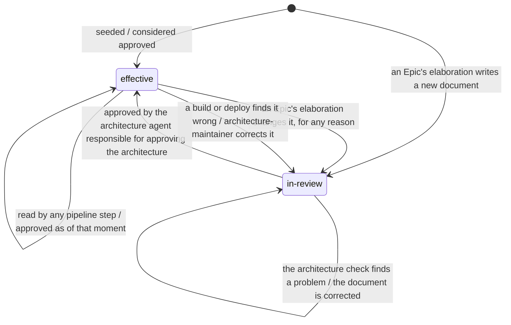
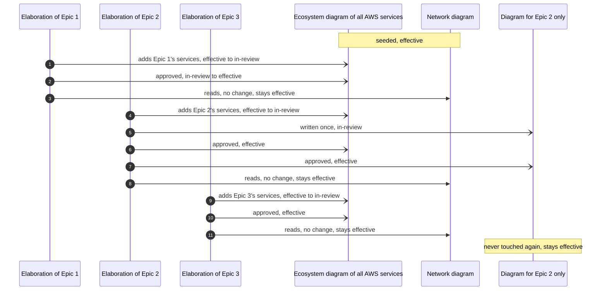
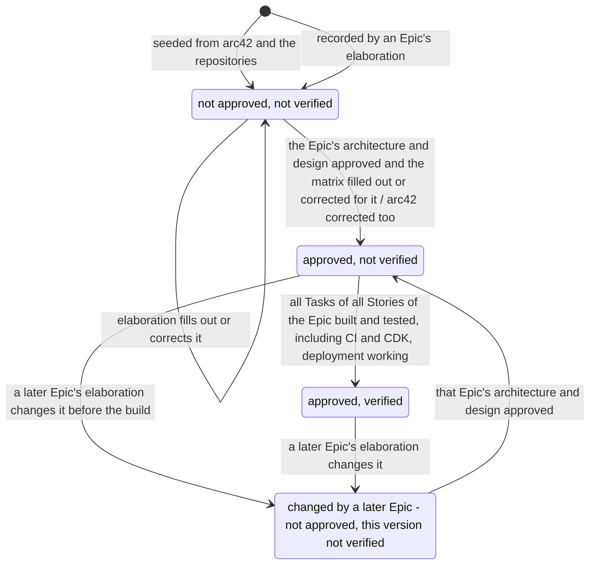
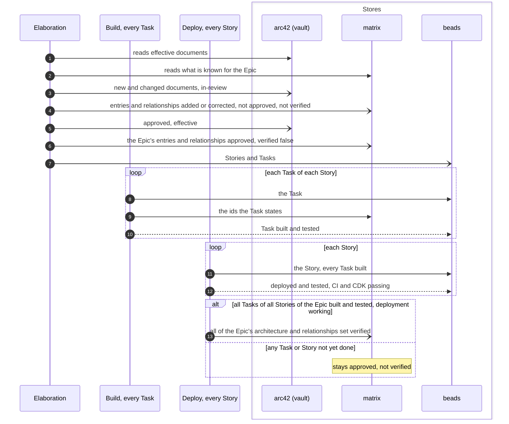
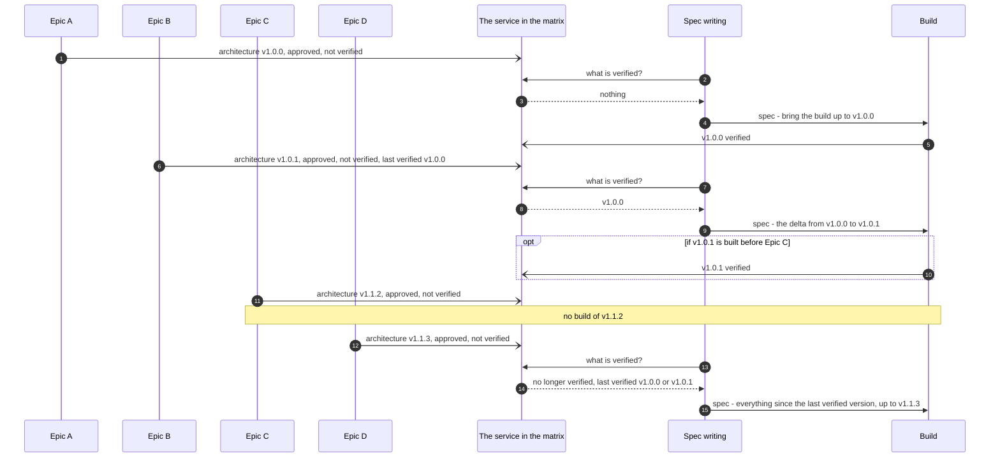

# The pipelines: architecture and matrix states

Parent: [The pipelines: overview](pipelines.md)

This document draws when an arc42 document is written, goes `in-review`, becomes `effective` and
goes back to `in-review`, and when matrix entries and relationships are added or corrected, set
approved and set verified, across one Epic and across many. Every diagram shows what the
owner wants, from the owner's messages of 2026-10-19 (Part 1 of the elaboration plan, items 1.8,
1.10 and 1.13) and from [requirements/matrix.md](../requirements/matrix.md) where it agrees with the
owner's words. Points the owner has not decided are open questions, listed at the end. The stages that make these
changes are drawn in [The pipelines: elaboration](pipelines-elaboration.md),
[build](pipelines-build.md) and [deploy](pipelines-deploy.md).

## Legend

| Notation | Meaning |
|---|---|
| `[*] --> S` | The state a thing starts in |
| `S1 --> S2 : event [guard] / effect` | What moves it from one state to another |
| `A ->> B` / `B -->> A` (sequence) | A call, and its return |
| `A -) Store` (sequence) | A write to a store, nothing returned |
| effective, in-review | The state of an arc42 document, in its front matter |
| approved, verified | The two flags the matrix keeps on its entries and relationships |

Three states are kept apart. The owner: "The approved flag is similar to, but IS NOT the same as
the `effective` field in arc42." and "The matrix has 2 flag fields that help determine the states
the information in the matrix. I do not recallk the exact names, but there is one for verified,
and one for approved." The matrix keeps them as the `approved` and `verified` members of every entry and
relationship ([the matrix design](matrix.md), section 1.4); `approved` replaced the earlier
`architectureApproved` attribute, so there is one record of approval.

## 1. An arc42 document

**Subject:** one architecture or design document: an arc42 document, or a detailed architecture
document under the vault's `docs/tech/architecture/` outside `arc42/`.
**Scope:** its life across every Epic that touches it.
**Purpose:** what `effective` and `in-review` mean and what moves a document between them.
**Boundary:** the content of the document is not drawn.
**Sources:** The owner: "When it is `effective` it means (and please pay attention to
this) the document has been approved by the architecture agent responsble for approving the
architecture. It does not mean that architecture document is fixed, or static, or permenant, or
unchangable. It means, for this exact mement in time, until something else changes it, this is
have been approved." and "We seeded a bunch of architecture documentation in arc42 that we
consider approved (a.k.a. `effective`)."

Notes on the diagram:

- `effective` is trusted "for this exact mement in time, until something else changes it". It
  does not say the document covers the PRD in hand
  ([requirements/matrix.md](../requirements/matrix.md) section 3.5, R23).
- When the matrix is corrected, arc42 is corrected too. The owner: "Any updates or corrections to
  arc42 must also be made."
- What the build finds wrong in the architecture is cleaned up too. The owner: "The architecture
  process is designed to clean up the matrix is it works, and the same with the build." What the
  build or deploy finds wrong is recorded against the element and sent to the architecture stage,
  where `architecture-maintainer` corrects the document (it goes `in-review`, then `effective` when
  approved) and the matrix, because one approver of architecture keeps one source of truth.

### Three kinds of document over time

**Subject:** three documents at different levels.
**Scope:** three Epics elaborated one after another.
**Purpose:** that how often a document changes depends on its level, not on a rule.
**Boundary:** reviews are folded into "approved".
**Sources:** The owner: "A network diagram may not change very often and sit perpetually
in an `effectve` or approed state, and a diagram for a specific Epic may get generated once, set
to effective and never touched again." and "But some documents, like a diagram for an entire echo
system of AWS Services, for example, may get updated every single time an Epic goes through
elaboration, constantly flipping from `effective` to `in-review`."

The three Epics and the order of the writes illustrate the owner's three kinds of document; the
owner's statements give the kinds and how often each changes.

## 2. A matrix entry or relationship

**Subject:** one entry (a node) or one relationship (a link) in the matrix.
**Scope:** from seeding or first recording to verified, and back when a later Epic changes it.
**Purpose:** when approved and verified are set, and what clears them.
**Boundary:** the content of the entry is not drawn.
**Sources:** The owner: "so the initial state of what we seeded in the matrix (using arc42
as a source) is not approved.", "Once an Epic flows through elaboration, and validates and fills
out the architecture and design (lower-level details) for the Epic, and then all of that is
approved, and when information in the matrix is filled out or corrected for that Epic, then if
gets set to approved.", "The verified flag remain false or unverified. This means we have an
approved, but unverified architecture for that Epic as documented in the matrix, but none of has
been verofied by building and testing.", "Once all of the tasks for all of the stories for and
Epic have been built and tested (including CI (CDK), which means deployemen must also work), then
all of the architecture and rellationships for the Epic can be set to verified." and "The linkage
could have a verified flag. The node could have a verified flag. Neither wold be required for
every situation." The clearing of approved when a later Epic changes an entry is from
[requirements/matrix.md](../requirements/matrix.md) R57, and the version example in section 4 shows
that a later Epic's change leaves the element no longer verified.

Notes on the diagram:

- Everything in the matrix is used, approved or not, verified or not
  ([requirements/matrix.md](../requirements/matrix.md) R26). Not approved means the architecture
  agents do due diligence on it; not verified means it may still have to be built.
- In "changed by a later Epic", the last verified version stays known. That is what a spec reads
  (section 4).
- The matrix does not record Stories or Tasks, and does not record what is deployed. The owner:
  "The matrix does not include stories and tasks (it isn't a build tracker), and it doesn't care
  about what has actually been deployed."

Whether approved and verified are kept on every kind of entry and link, as the owner's "verified
flag is available to just about anything" says, follows plan item 1.13: the verified flag is
available on every entry and every link and required on none.

## 3. One Epic through the pipelines

**Subject:** the arc42 and matrix writes made for one Epic.
**Scope:** elaboration, the build of every Task and the deploy of every Story of the Epic.
**Purpose:** which stage makes each state change.
**Boundary:** the work inside each stage is in its own document.
**Sources:** the statements quoted in sections 1 and 2.

A deterministic step that runs when the last Story of the Epic closes sets the verified flag, with
no agent judgment, because the owner's condition is factual (all Tasks of all Stories built and
tested, CI and CDK deployment working) and the owner wants "contracs being deterministic in files
and code".

## 4. Versions, and what a spec covers

**Subject:** the architecture of one service changed by several Epics.
**Scope:** four Epics, with and without builds between them.
**Purpose:** that a spec's work comes from the last verified version, not from one Epic's
architecture change.
**Boundary:** the content of each version is not drawn.
**Sources:** The owner: "A spec's delta NEVER was supposed to come from an architecture
delta.", "1. v1.0.0 of the architecture for a specific service is developed. A spec needs to get
the build (meaning the code, IaC, etc) up to the architecture's version for that service (this is
where the verified flag comes in to play). 2. Let's assunme want to update the architecture for
that same service for a new Epic, making the architecture for that service v1.0.1. In this case
because the v1.0.0 architecure for that service is verified, the spec can focus on the delta
between v1.0.0 and v1.0.1. 3. Now let's update the architecture again for that service to v1.1.2
on behalf of another Epic 4. But another Epic goes through architecure, before the build of
v1.1.2, and makes another change, brining the architecture for that serivce to v1.1.3. 5. Now when
the spec is written for an Epic, it sees that the architecture for that service is no longer
verified." and "This is not an easy or perfect processess to keep track of, and even the
verification flag concept isn't perfct".

The version numbers are the owner's illustration ("Think of the everuything in terms of version
numbers"). The matrix records, on each element, the verified flag with the commit it was proved at, and links
each later approved change to the Epic that approved it, so a spec reads the last verified point and
every approved change after it without a scan. Whether v1.0.1 is built before Epic C does not change
the rule: the spec covers everything since the last verified version, whichever that is.
