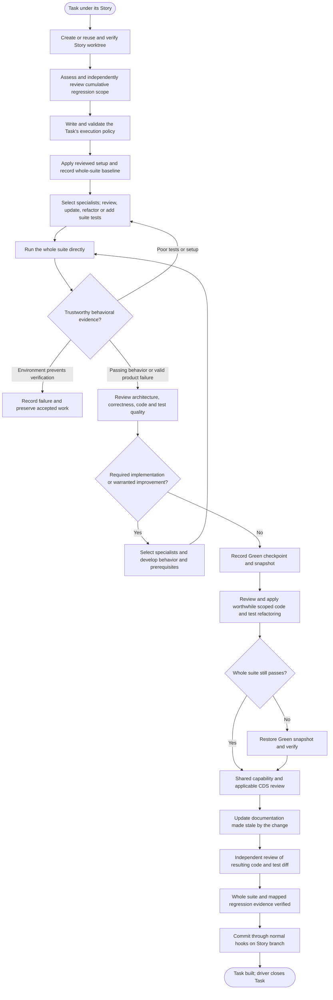

# The pipelines: build

Parent: [The pipelines: overview](pipelines.md)

The build takes a Task under a Story and produces code and tests committed in the Story's
worktree, with its complete repository suite passing. SkillSpoke Tier-1 Stories branch from develop; workspace provisioning refreshes origin/HEAD and rejects another integration base before creating a worktree. The Python orchestrator owns ordering,
subprocesses, artifacts, correction bounds and journal transitions. Headless agent sessions do
reasoning, code, test and documentation work. No model session relays a command or parses its
exit status.

Documentation selection records `documentationSelection`. Its parameterless dispatcher plans
one following `build:docs-specialist` step per selected agent, passing its `agent` parameter.
An empty selection completes without writers. Each writer records `documentationWork` before
the final independent review of the resulting diff.

## Execution and resumption

`orchestrator/flows/task_to_deploy.py` is the `task-to-deploy` composite. The driver dispatches it
through `orchestrator/run.py`. `pipeline-steps.json` defines the up-front build plan and its
script keys. The shared journal reader/writer and `JournalRunner` preserve each step's UUID,
accepted artifacts and failure. Existing `build:*` keys remain valid across the Python cutover.
An interrupted build begins at its first unfinished step; accepted work is not discarded.

The driver validates transport arguments for the selected flow, then the shared
`task-build-args.schema.json` validates the build leaf. Its Task brief keeps the Story under
`bead.story` and the design choice under `bead.cdsDesignSource`, matching the actual producer.
Story deploy leaves use their own exact argument definitions. Host execution identity is
separate from leaf fields; obsolete relay and PR-command settings are not sent to Python builds.
The producer-contract checker includes the real dispatch builder/parser and checks the projected
Task fields against the canonical bead metadata.

Regression preparation includes the Task's supplied Spec and PRD paths as well as journal
source artifacts. Final verification names the source seal beside the accepted
`regressionScope` artifact with `--bindings`, so another step or resumed dispatch reads the
same approval evidence. Each verification keeps its own execution-output directory.

`build_workspace.py` calls the existing git utilities directly to create or reuse the Story's
worktree and independently confirm its repository and branch. Every command pins its working
directory. A Task cannot commit on the default branch or detached HEAD.

`build_sessions.py` plans actual reasoning agents as journal children. Their shared schemas,
facts file and current journal are passed by path. The facts file carries the role's accepted
evidence, resolved once from the journal: pointers to the requirements and acceptance criteria,
the workspace, the result the role's own agent recorded on its last accepted step, the artifacts
accepted since that step, and the unresolved review findings and test defects, with small values
inline and large ones written beside the facts file; and, by reference only (a path or a value file
beside the facts file), the latest accepted artifact of every other name with its producing step
and role. The journal stays
available for full primary evidence. The journal runner owns session IDs,
resumption, output validation and acceptance. A missing dynamically selected specialist is an
item failure; a missing fixed contract is a pipeline defect. New specialist selections name
bare roster roles without a plugin prefix. Before roster lookup and journal planning, the
shared reasoning boundary canonicalizes saved names with the journal's existing name helper.
The journal, registry, definition lookup and session launcher use the bare name. User and
project sources load so Claude Code applies its definition precedence. This applies to documentation writers, test writers and implementers, including
names retained in accepted artifacts.

A same-agent `Finish` continues the original agent step's semantic contract: its description,
parameters, input artifacts and saved evidence. The continuation retains its own journal ID,
session and completion status. Explicit nested Finish steps resolve to the same semantic origin;
ordinary helper steps keep their own contracts.

## One Task

## Execution policy and evidence reuse

Once the regression scope is accepted, the regression-impact-assessor writes the Task's execution
policy, whose contract is `build-execution-policy.schema.json`. It is the build's one planning
session for the Task, not a reviewer of every stage. The build checks the policy, corrects it
within the build correction allowance, and records the identity of the regression scope and
requirements it was written for.

The build follows the policy only while that identity still matches. Without an accepted,
current policy every stage runs, so an older journal, a refused policy or a changed scope never
skips a check. The policy may omit test work, the shared-capability review, refactoring and the
documentation audit with an applicability reason; the code review, the final review, the final
suite and the regression gate always run. Infrastructure work is verified with CDK assertions
and synthesis checks rather than invented application unit tests, and no verification method is
an AWS action.

The test-design-lead selects the test specialists under the policy and the Task's recorded test
strategy. The test-strategy-decider decides only a strategy concern that selection names as
unresolved, and the lead then selects again under that decision.

A passing whole-suite result the build executed stands for a later run only when the policy marks
the suite reusable and the evidence key matches: the work tree's content with its untracked
files, the requirements, the command, the setup, the runtime and tool configuration, the contract
version and the evidence scope. A no-change claim never stands in for that key, and the
post-prerequisite suite always runs fresh. A final review covers only the content tree it
approved. Refactoring is satisfied without a new session when the policy omits it or when the
accepted code review of the exact current tree approved it with no improvement finding. A
correction selects implementers for the unresolved findings of the review that raised them, and
the re-review judges what changed since against those findings.

Every decision to run, omit or reuse a stage is recorded on its step and carried on that step's
event, and the commit records the Task's model sessions, correction steps and decisions, so owner
runs measure what the policy saved.

Correction work is bounded by accepted outcomes in the Task journal across dispatches. Implementation
and suite-quality correction have three rounds. Regression correction (`ATW_REGRESSION_CORRECTION_ROUNDS`,
two by default) counts three kinds of round apart: a scope correction counts from the latest final
verification that was corrected (or from the start of the build), because that verification
reopens the scope for the changed tree; a final verification whose only error is changed
requirement source bytes is a reassessment of the scope; and any other failed final verification,
an unmapped required layer or a blocking mapping review included, is a correction that writes the
missing tests, runs the final suite and assesses the scope again before the evidence is mapped
and verified again, which covers changed bytes too. Running ancestors count only with their own completed outcome or their immediate
agent child's accepted result. Restarting does not replenish the allowance. A fresh suite with the
same evidence identity and failures after product or test correction stops before another agent round;
environment recovery and changed requirement, setup or runtime identities remain eligible. Only an
error stops a build: a failed command or suite, a crash, an exhausted retry of failing work,
unschedulable work, or a missing input. A review finding is a judgment that something should
change, never an error: an unresolved failing suite or scope check records its evidence and stops,
and a review finding still open when its correction allowance is spent is carried, so no quality
gate is bypassed and none is turned into a stop. An empty implementation selection
accepted before the latest suite judgment or code review is replaced by one fresh selection for
the current failures and findings. An empty implementation selection made for the current
judgment and review stops with the accepted selector's rationale only while the suite fails; with
the whole suite passing, what remains is review findings, so the implementation findings are
carried with that rationale and the build continues to Green. Passing tests alone do not override
an unapproved review while an implementer is selected for its implementation findings.

Code review findings identify the owner of each required correction: implementation, tests,
tooling or contract. Legacy findings receive one fresh ownership review, never a filename-based
classification. Test findings receive a fresh test-specialist selection, author fingerprints,
factual suite execution and independent re-review, within the build correction allowance. An empty
test-specialist selection with its rationale is the judgment that no test specialist can make the
correction (for example a criterion only a person could perform): the test findings are carried
with that rationale, the tree and governing sources are recorded, and the re-review of that
unchanged tree under unchanged sources carries them again rather than asking for another
correction round.
Implementation findings and suite failures go to the specialists the implementation-lead selects.
Tooling and contract findings are never assigned to product implementers and never stop the build:
they are carried. The same holds for the shared-capability and CDS reviews and the final code
review: their implementation and test findings are corrected within the allowance, and their
contract and tooling findings, and any finding still open when the allowance is spent, are carried.
A final review whose remaining findings are carried covers the current tree, so the final suite
runs next. An empty corrective selection cannot count as completed work.

A carried finding is recorded as the `carriedFindings` value artifact on the step that decided it,
with its review, owner, severity, detail, location and the reason it was carried. The build
handback lists every carried finding once in `carriedFindings` (kept in the run's `run.json`) and
counts them in its headline, and the dashboard's detail pane for the Task shows them above its step
journal. The build still ends only with its whole suite passing: a carried contract finding that
leaves an acceptance criterion unmet names that criterion, so the Task's record states the criterion
as unmet rather than met.

When the current Task cites a new immutable source absent from its accepted regression plan,
the build appends regression reassessment, independent review and validation, execution policy,
baseline and fresh code review. Existing source snapshots and journal history remain intact.
If reassessment still omits those current sources, the build stops with the missing paths.
The same check runs before an accepted prerequisite diagnosis is applied, a restarted
`build:prerequisites-diagnosed` included: a diagnosis judges a suite run whose regression scope
came from the sources cited then, so when the Task now cites a source that scope did not cover,
the diagnosis is not applied and the evidence is rebuilt from the current sources. A failure that
remains is judged and diagnosed again from that evidence.

## Tests and existing behavior

The PRD and TRD state requirements. Stories, specs, architecture and Task activities provide
implementation detail. Tests reflect that full contract in the existing suite; a Task is not
itself a replacement requirements document.

Test specialists consider happy paths, negative cases, edge cases and boundaries. They may
review, update and refactor existing tests as well as add new tests. Tests are code, and newly
written tests can be poor. A failing suite therefore receives a quality judgment before its
failure is treated as missing product behavior. The accepted route distinguishes test repair,
product implementation within the Task, missing upstream producer output and environment failure.
An upstream judgment cites the actual failed execution and missing producer output, names its
owning component or repository, and distinguishes build, publication and deployment readiness.
It does not invent producer Task IDs or send the consumer implementers work owned by a producer.

An upstream or environment judgment appends one targeted `task-dependency-mapper` diagnosis using current
tracker, repository and readiness evidence. The result names real producer Tasks, their actual
parent Stories and whether their output must be built, published or deployed. A real producer is
named even when waiting for it would close a cycle, so the cycle check below decides that case
and the failure names the cycle rather than a work-authoring gap. The build validates those
identities and adds only missing consumer blockers through the normal cycle-checked writer;
normal elaboration protections for already started Tasks remain intact. A missing producer or
missing real authoring context is a finite pipeline work-authoring gap, never an owner SSM task
or permission to create shared resources as test fixtures.

`build:prerequisites-ready` remains planned while producer stages are pending. Its dispatch
returns the typed `waitingForPrerequisites` handback without a failure and releases its slot.
Delivered readiness requires a complete producer Story journal with closure. `published`
requires a `packagePublication` receipt observing the committed version available in CodeArtifact,
matched by `checkedCommit` to the completed publication step. `deployed` requires nonempty
successful stack verification evidence. A package receipt never proves layer deployment, and
a successful version-skip without package availability never proves publication. Story status
alone is insufficient. Existing `deployed` declarations retain their literal resource-delivery
meaning; active package dependencies need evidence-based reassessment to `published`, never
a blanket reinterpretation or rewriting of completed journals. After progression,
a read-only `test-environment-provisioner` observation precedes the exact original suite and a
fresh independent assessment in the original phase. A readiness miss stops with its actual
evidence rather than redispatching the same observation. Distinct failure/tree fingerprints
and the existing build correction allowance bound diagnosis; accepted history is retained.

An empty implementer selection is reassessed only after its recorded test/tree fingerprint
changes. One appended whole-suite run and independent code review then use the normal selector.
The same tree digest is not reassessed twice, and the build correction allowance bounds changed
trees. This refreshes a decision made before a repository repair without resetting completed
journal steps.

Structured `buildPrerequisites.producers` from decomposition is stored as the canonical
`build_prerequisites` metadata object and gates selection before the first consumer suite.
Older Tasks without that field are not retroactively assigned guessed dependencies; the bounded
current-Task diagnosis repairs their actual prerequisites when discovered. Effective Task,
producer Story completion and actual host repository-holder dependencies are checked together
for cycles; unschedulable waits are explicit workflow gaps rather than indefinite holds.
A cycle that the diagnosed Task's proposed wait closes, and a proposed producer row without an
absolute existing evidence artifact, fail only that Task as an `item` failure whose evidence
names the cycle and the diagnosis; they never classify as `pipeline-code-defect`, so other
lanes keep dispatching.

When missing producer work has an actual open Story and completed saved authoring context,
the normal task decomposer appends only work that scope/spec already authorizes. Existing Task
and score objects remain exact, normal append-only durable-key writes make uncertain retries
idempotent, and only new Task ids receive normal Task scoring. No architecture or Epic assessment
runs. The changed tracker facts receive a bounded new diagnosis before consumer edges are added.
Absent that real authoring context, the pipeline records the precise finite work-authoring gap.

Build artifact readers expose recorded facts from completed steps and running structural
ancestors only, through one accepted view per journal revision and step
(`core/journal_views.py`); a new revision builds a new view. An ancestor's own deterministic completion already accepted those artifacts,
even while its children keep it running. Running siblings, future steps and raw unvalidated
session outputs remain excluded; invalidation clears the source artifacts through the normal
journal operations.

Passing required behavior is valid evidence. The build manufactures no Red, performs no
sabotage and requires no test-the-test demonstration. Passing tests still leave architecture
conformance, correctness, quality and best practices to review. Refactoring receives an
opportunity every time; a justified no-change result is valid when no improvement is warranted,
and an accepted assessment of the current tree satisfies the opportunity.
Changes stay within the assigned behavior and its prerequisites.

`build_suite.py` uses an already recorded suite command or the repository's explicit Taskfile
`test` task. A genuinely unstructured or conflicting declaration receives one configuration
judgment, whose result is recorded and reused. No test framework command is guessed. Commands
execute through `Tools.command`; full stdout, stderr and exit status remain in evidence files.
A zero exit alone does not establish behavioral coverage. The approved regression mapping and
fresh execution evidence remain required.

## Prerequisites and shared capabilities

The build develops missing prerequisite services, libraries and infrastructure in their owning
repositories and normal worktrees. It does not merely stop because a prerequisite has not yet
been built, and it does not duplicate a shared capability locally. Required external authority
and unpublished SkillSpoke library changes remain explicit blocking facts under their existing
rules; a consumer pin or lockfile is never changed ahead of publication.

Shared-capability review considers the capabilities named by the Task's matrix IDs. UI work is
reviewed against the Task's stated supplied bundle or live CDS source. Blocking and warranted
improvement findings receive bounded implementation and re-review.

## Commit and completion

The build checkpoints a verified Green state before refactoring. A regressing refactor restores
that snapshot and verifies the suite again. Before final commit, an independent reviewer inspects
the resulting code and test diff, the complete suite passes, and the cumulative regression tools
verify the mapped evidence.

The regression gate holds a Task to its own requirements (origin task) in full and to existing
requirements only as far as the code met them before the change. Verification replays each
failing test of an existing requirement in a detached checkout of the worktree's HEAD that holds
the current tests and harness but the product files the Task's steps changed as they were. A test
that fails there too records its requirement as `regressionUnmetBefore` and as a carried contract
finding for the Epic that owns it, and the build continues; a test that passed there is a
regression and fails verification. A failing test no requirement maps fails it too. Repository hooks run normally at commit. A rejected hook, remaining product changes, or modified preserved tooling after the hook
is a recorded work failure, never a reason to bypass hooks.

Story checkpoints commit explicit product paths only. Instruction files, `.claude/`, and canonical
code-check configuration are Tier 2, including checker-owned sections of mixed configuration
files. Unrelated tooling changes remain byte-for-byte unchanged in the worktree and index and
are named as preserved, undelivered tooling in checkpoint evidence. A mixed configuration change
that requires both owning flows stops with an actionable pipeline ownership error: deliver its
tooling through a separate main worktree and integrate it before the product checkpoint.
Preserved tooling dirt is not a failed product checkpoint or evidence of tooling delivery.
Test reports under `.agent-workforce/reports/` are transient run output, never product: a
checkpoint leaves them uncommitted, as the regression runner archives and deletes its own.

The Task's build sets no matrix approval or verified gate. The Story's deployment follows only
when its Tasks are built, as described in [deploy](pipelines-deploy.md).
