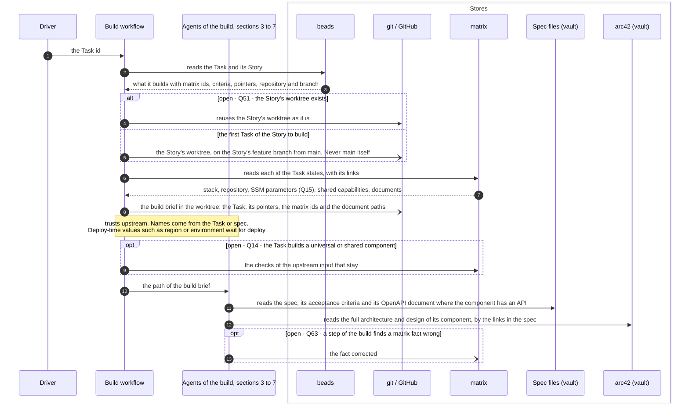
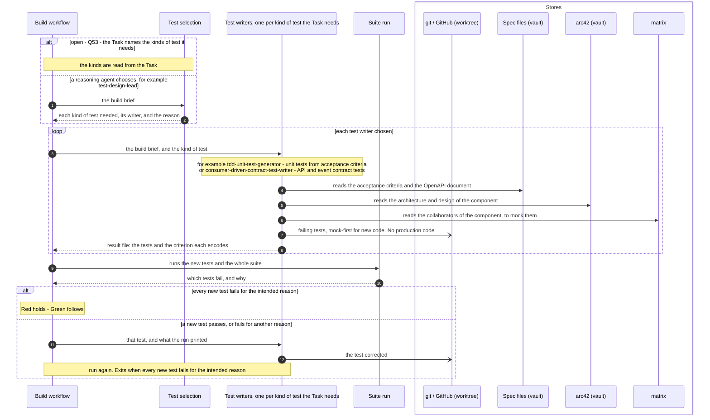
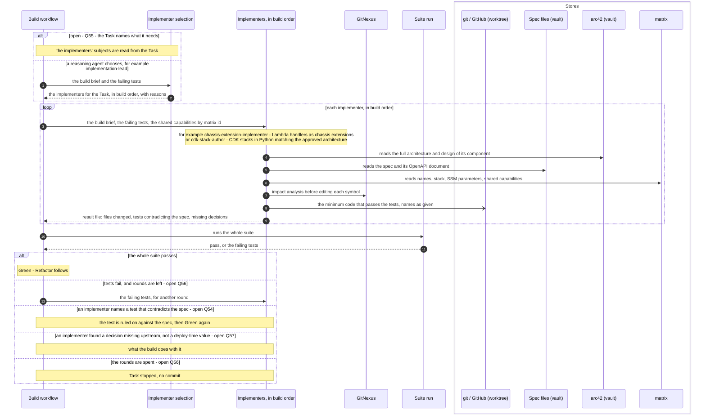
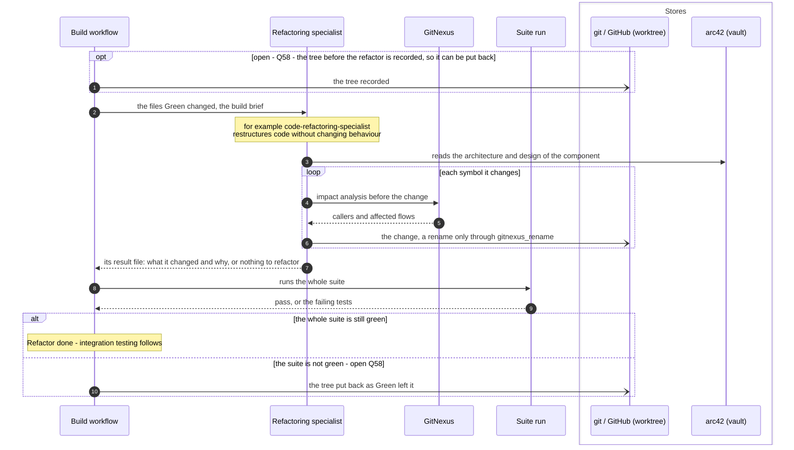
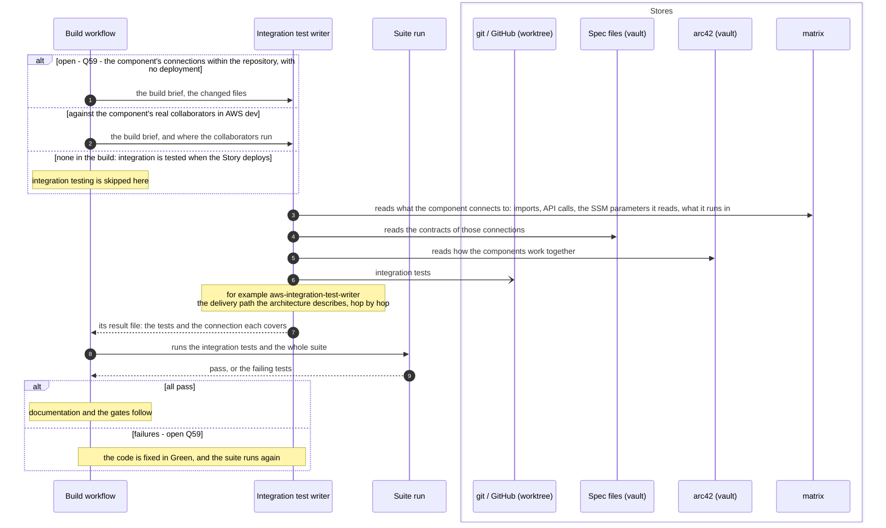
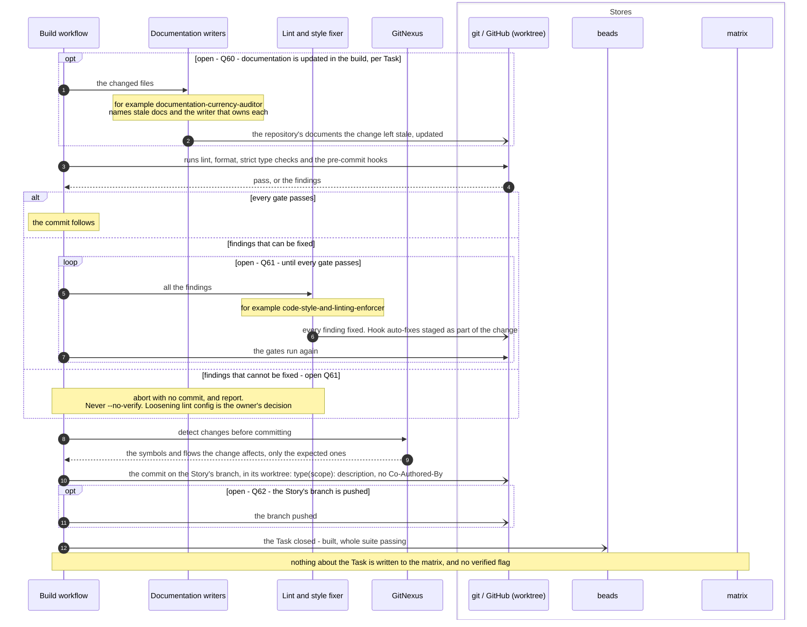
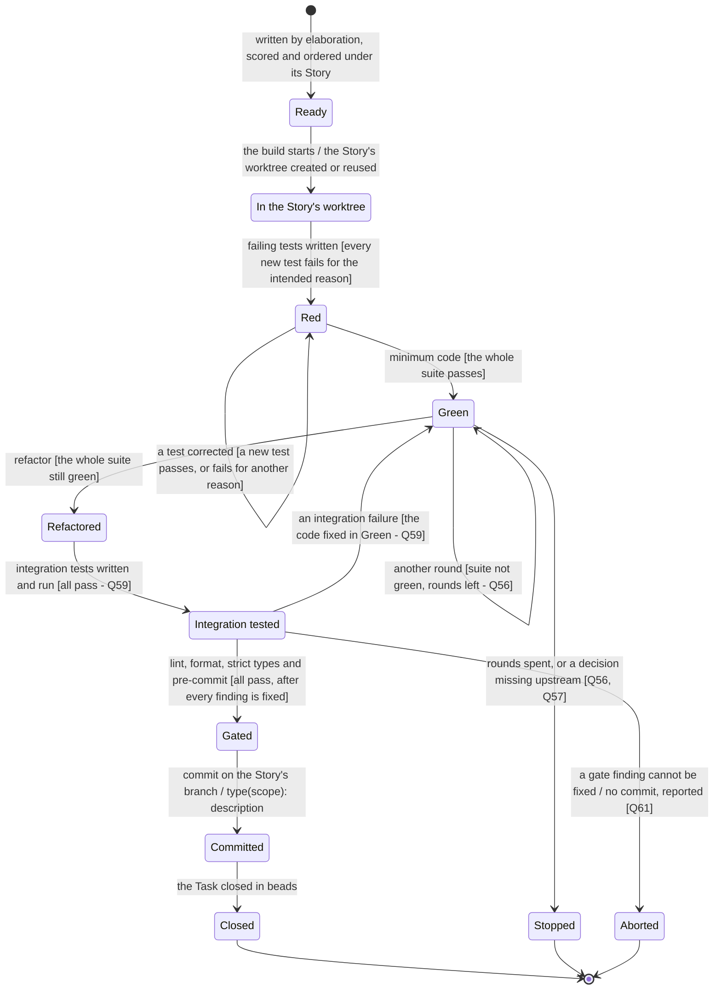

# The pipelines: build

Parent: [The pipelines: overview](pipelines.md)

The build runs once per Task. It takes a Task from beads, under its Story, and produces the
Task's code and tests committed on its Story's branch, in the Story's worktree, with the
repository's whole test suite passing ([requirements/pipelines.md](../requirements/pipelines.md),
"What the pipelines are", Build row). This document draws the build **as the owner wants it**.
The sources are the owner's messages of 2026-10-19 (Part 1 of the elaboration plan, items 1.10,
1.11 and 1.13, with the owner's qualifiers), the SkillSpoke repository's root `AGENTS.md` ("Code
quality", tier 1) and `.claude/rules/git-conventions.md`, the vault's `docs/sdlc/sdlc.md`, and
[requirements/pipelines.md](../requirements/pipelines.md) and
[requirements/matrix.md](../requirements/matrix.md) where they agree with the owner's words. The
Tasks come from elaboration, section 6 of [The pipelines: elaboration](pipelines-elaboration.md);
the Story's deploy, and the Epic's verified flag, come after, in
[The pipelines: deploy](pipelines-deploy.md). Where the owner has not said what is wanted, the
step is drawn as an open question, listed at the end with a recommendation.

The owner, on what the build is given: "Since Day 1, my requirement has been that as much as
possible should be written into the specs and tasks, so that the build has little to no decisions
to make. Everything that can be passed on to the build and determined in advance, should be." and
"the task should be detailed so that the build doesn't need to guess or interpret or decide on how
to do anything that was already concluded upstream in the elaboration (and architecture) pipeline.
And when I say task, I also mean spec."

## Legend

| Notation | Meaning |
|---|---|
| `A ->> B` (sequence) | A calls or starts B: B does work for A |
| `B -->> A` (sequence) | B returns its result to A |
| `A -) Store` (sequence) | A writes to a store; nothing is returned |
| `alt` / `opt` or a node labelled "open - Qn" | The owner has not decided this; every branch shown is an option, not a decision. Each is listed under "Open questions" at the end |
| `([...])` (activity) | Start or end |
| `{...?}` (activity) | A decision; every outgoing edge is labelled with its guard |
| "merge" node (activity) | Alternative paths coming back together; no waiting |
| `[*]` and `S1 --> S2 : event [guard]` (state machine) | Initial state, and what moves a Task from one state to another |
| arc42 (vault) | The arc42 architecture and design documents in the `skillspoke-docs` vault |
| Spec files (vault) | The Spec documents in the vault (`sdlc/mvp-1/specs/`, vault `docs/sdlc/sdlc.md`) |
| matrix | The one record of how Epics, PRDs, documents, services, components, resources, stacks and repositories relate. It records no Story and no Task |
| beads | The issue tracker that holds Epics, Stories and Tasks |
| git / GitHub | The Story's repository, its worktree and its feature branch |
| "for example `agent`" | A roster agent whose own file gives it a reason to be used for that role; which agent is used is reasoning, never code |

The roles in the diagrams are named in plain words. A roster agent is named only "for example",
with the subject in its own file that gives it a reason to be used. The owner: "Ever agent needs to
have a reason to be used.", "What I do not want is python code deciding which specialists to use"
and "I also do not want a pipeline that blindly sends everything to ever agent". Every agent the
build starts writes or changes code or tests, so every one runs on Opus or better. The owner: "If
it's touching code, it needs to be done with Opus or better. Perid." Each agent runs as its own
headless session and ends when its work is done. The owner: "I do prefer to spin up agents in
headless claude sessions to do work, and then get out." and "There can be nested subagents."

## 1. One Task through the build

**Subject:** the build of one Task.
**Scope:** from a Task ready in beads, under its Story, to its code and tests committed on its
Story's branch with the whole suite passing.
**Purpose:** the order of the steps, the guard on each decision, and where each step is drawn in
detail.
**Boundary:** elaboration, which writes the Task, comes before; the Story's deploy, its pull
request and the Epic's verified flag come after, in [deploy](pipelines-deploy.md).
**Sources:** Scope: [requirements/pipelines.md](../requirements/pipelines.md), Build row. The
worktree: `.claude/rules/git-conventions.md` ("`main` branch only — all branch work happens in
worktrees. Never branch in the main working tree." and "For tier 1, all implementation happens in a
worktree agent."). TDD: root `AGENTS.md` ("TDD London School (mock-first) for new code" and
"Spec-first OpenAPI: the spec exists before handler code"). Gates: `git-conventions.md` ("When a
pre-commit hook fails: fix **all** findings, restage, retry." and "If findings can't be fixed,
**abort with no commit** and report."). Closing: root `AGENTS.md` ("A Task closes when it
completes, including passing all tests."). Trust: the owner, "Your default is fault-intolerant. I
need more fault-tolerance for the pipeline, and need more trust.", with the exception "like if B is
going to be a universal or shared component" (Q14).

```mermaid
flowchart TD
    start(["Task ready in beads, under its Story"]) --> wt["The Story's worktree, on the Story's feature branch, created or reused. Never main - section 2"]
    wt --> read["The Task, its spec, the linked architecture and design, and the matrix ids it states are read - section 2"]
    read --> shared{"Does the Task build a universal or shared component?"}
    shared -->|"no: trust what upstream decided"| m0(("merge"))
    shared -->|"yes"| chk["open - Q14 - which checks of the upstream input stay"]
    chk --> m0
    m0 --> base{"open - Q52 - does the whole suite pass before any change?"}
    base -->|"yes"| red
    base -->|"no"| pre["open - Q52 - what is done with a suite that already fails"]
    pre --> red
    red["Red: failing tests first, mock-first for new code - section 3"] --> redok{"Does every new test fail for the intended reason?"}
    redok -->|"no: a test passes, or fails for another reason"| red
    redok -->|"yes: Red holds"| green["Green: the minimum code that makes the tests pass - section 4"]
    green --> gok{"Does the whole suite pass?"}
    gok -->|"no, and rounds are left - open Q56"| green
    gok -->|"no, and the rounds are spent - open Q56"| stopped(["Task stopped, no commit - open Q56"])
    gok -->|"yes: green"| refac["Refactor: behaviour unchanged - section 5"]
    refac --> rok{"Is the whole suite still green?"}
    rok -->|"yes"| m1(("merge"))
    rok -->|"no"| undo["open - Q58 - the refactor is undone"]
    undo --> m1
    m1 --> integ["Integration testing - open Q59 - section 6"]
    integ --> iok{"Do the integration tests pass?"}
    iok -->|"no - open Q59"| green
    iok -->|"yes"| docs["Documentation - open Q60"]
    docs --> gates["Quality gates: lint, format, strict types, pre-commit - section 7"]
    gates --> gk{"Do all gates pass?"}
    gk -->|"no, the findings can be fixed"| fix["Fix all findings, restage, retry"]
    fix --> gates
    gk -->|"no, the findings cannot be fixed - open Q61"| abort(["Abort with no commit, and report"])
    gk -->|"yes"| commit["Commit on the Story's branch in its worktree - open Q62"]
    commit --> closed(["Task closed in beads: built, whole suite passing. The Story's deploy follows when all its Tasks are built"])
```

Notes on the diagram:

- The loop back to Red exits when every new test fails for the intended reason. The loop back to
  Green exits when the whole suite passes, or when the rounds are spent (open
  Q56). The gate loop exits when every gate passes, or when a finding cannot be
  fixed.
- Which steps are scripts and which are agents (the worktree, the suite runs, the commit) is open
  (Q51). Every agent has a reason to be used; a step that needs no reasoning
  gives no agent a reason.
- The build writes no verified flag. Verified is set for the Epic once all the Tasks of all its
  Stories are built and tested, including CI (CDK), which means deployment must also work. The
  owner: "Once all of the tasks for all of the stories for and Epic have been built and tested
  (including CI (CDK), which means deployemen must also work), then all of the architecture and
  rellationships for the Epic can be set to verified." That is drawn in
  [deploy](pipelines-deploy.md) and in
  [architecture and matrix states](pipelines-architecture-states.md).

## 2. The worktree, and what the build reads

**Subject:** the start of the build of one Task.
**Scope:** from the Task id reaching the build to every agent of the build having what it needs.
**Purpose:** which store is read for what, where the worktree comes from, and what the build does
not re-decide.
**Boundary:** what each agent does with what it reads is drawn in sections 3 to 7.
**Sources:** The owner: "all details do not need to be copied into the tasks and specs (file
paths, URLs, etc. can be used to point to the more detailed information)", "even if it has only
the specific steps in a task that it needs to perform, it should still have access to the full
architecture for the component that it is working on. This is why the specs needs to have links
the that architecture (and design) documents.", "I don't want to encourage an agent to start
naming things, when the names should have already been provided in the task (or spec).", "there
may be some information that just simply isn't known until deploy time, such as the region or
environment where we are deploying. We don't want to stop because of that. We need to make sure
some of that is accommodated and handled at run time (deploy time).", "I don't want every
subsequent step in a process constantly checking that upstream steps were done right." On the
matrix: "Your question should be, "How can stack-B know what ssm stack-A is saving (or will saved
once deployed)?" The answer for that is, it should look in the matrix.", "The matrix does not
include stories and tasks (it isn't a build tracker), and it doesn't care about what has actually
been deployed.", and "The architecture process is designed to clean up the matrix is it works, and
the same with the build." [requirements/matrix.md](../requirements/matrix.md) R41: "A Task states
in full what it builds, using the matrix's ids for the stack, the components and the shared
capabilities." R26: "The pipeline uses everything in the matrix, verified or not." Worktree:
`.claude/rules/git-conventions.md` (tier 1 work in a worktree on a feature branch, never on
`main`). One Story per repository: vault `docs/sdlc/sdlc.md`.

Notes on the diagram:

- The workflow copies no document into the brief; each agent reads what it needs by the pointers.
  The owner: "file paths, URLs, etc. can be used to point to the more detailed information".
- The matrix is read, not re-derived. The build looks up a name, a stack, an SSM parameter or a
  document there instead of scanning ([requirements/matrix.md](../requirements/matrix.md) R30:
  "A pipeline step looks up what exists."). How an SSM parameter is recorded in the matrix is plan
  question 15.
- The matrix records no Task. The build records nothing about the Task in the matrix.
- Whether the build corrects a matrix fact it finds wrong is open (Q63): the
  owner says the build cleans up the matrix as it works, and
  [requirements/matrix.md](../requirements/matrix.md) R29 says a build run "reports what it finds
  wrong and changes nothing but the verified mark". The owner's words win where they differ, so
  the option is drawn and the question is listed.

## 3. Red: failing tests first

**Subject:** the Red step of one Task.
**Scope:** from the build brief to failing tests that encode the Task's acceptance criteria.
**Purpose:** who writes the tests, what each reads and writes, and how Red is confirmed.
**Boundary:** production code is Green's (section 4).
**Sources:** Root `AGENTS.md`: "TDD London School (mock-first) for new code." and "Spec-first
OpenAPI: the spec exists before handler code." The owner: "Ever agent needs to have a reason to be
used." and "I also do not want a pipeline that blindly sends everything to ever agent, whether it
applies or not". On contracts: "i'm a huge fan of the contracs being deterministic in files and
code, and for agents, a skill can contain both schemas and een the code to read and write and
verify the schemas." How the test writers are chosen is not stated by the owner
(Q53).

Notes on the diagram:

- A test writer is used for a kind of test the Task needs and for no other. For example, a Task
  that adds a handler behind an API Gateway REST API needs unit tests and contract tests; a Task
  that changes the wording on a web page needs neither contract tests nor end-to-end API tests.
- Each result file follows a contract held in a skill with its schema and the code that reads,
  writes and checks it (the owner, above).

## 4. Green: the minimum code

**Subject:** the Green step of one Task.
**Scope:** from failing tests to the whole suite passing.
**Purpose:** who writes the production code, what each implementer has, and the tier 1
obligations of the implementing step.
**Boundary:** restructuring is Refactor's (section 5); the gates are section 7.
**Sources:** The owner: "I don't care what kind of software engineering agent is writing the
code, even if it has only the specific steps in a task that it needs to perform, it should still
have access to the full architecture for the component that it is working on.", "I'm not sure why
the cdk-stack-author and api-gateway-cdk-implementer needs the skill or to name anything. The
tasks that build pipeline read, should already have all names in it, right?", "Maybe leaving the
skill in place can ba a backuo, but I don't want to encourage an agent to start naming things, when
the names should have already been provided in the task (or spec).", "I wouldn't expect a missing
name.", "What I do not want is python code deciding which specialists to use, because pythin
doesn't have the reasoning to make that determination." Root `AGENTS.md`, "Code quality", tier 1
(the obligations in the table below), "Operating rules and architecture defaults" 3, 4, 5, 9 and
10, and GitNexus ("MUST run impact analysis before editing any symbol."). How implementers are
chosen (Q55), how many rounds before giving up (Q56), a test
that contradicts the spec (Q54) and a decision missing upstream
(Q57) are not stated by the owner.

### The obligations of the implementing step

Every implementer meets these in the code it writes. They are tier 1 obligations from the
SkillSpoke repository's root `AGENTS.md`; the build does not decide them again.

| Obligation | Source (root `AGENTS.md`) |
|---|---|
| Concurrency guards, timeouts, backoff, idempotency, incremental processing, explicit error handling, resource cleanup | "Code quality", tier 1 |
| Latest stable versions, no deprecated patterns, no clever solutions unless asked | "Code quality", tier 1 |
| Files under 500 lines; typed interfaces for public APIs; validation at system boundaries | "Code quality", tier 1 |
| Spec-first OpenAPI: the spec exists before handler code | "Code quality", tier 1 |
| TDD London School (mock-first) for new code: no production code without a failing test | "Code quality", tier 1 |
| Lambdas on `aws-lambda-powertools` only (FastAPI, Flask and Django banned) | "Operating rules", 3 |
| API Gateway REST API v1 only (HTTP API v2 banned) | "Operating rules", 4 |
| No cross-service source imports (`skill_spoke.common`, `skill_spoke.services.<other>`) | "Operating rules", 5 |
| Each service owns its tables, unless an owner instruction overrides it for a stated scope | "Operating rules", 9 |
| Cross-stack values through an SSM parameter the producing stack writes and the consuming stack reads, never CDK exports or imports; the parameter's name is read from the matrix | "Operating rules", 10, and the owner ("it should look in the matrix") |
| Data-driven and configurable; paths through the project's environment variables; no person's name in code | "No hardcoding" |
| Impact analysis before editing any symbol | "GitNexus", "Always Do" |
| Names written as the Task or spec gives them; values known only at deploy time resolved at deploy time | The owner, quoted above |

Notes on the diagram:

- The `resource-naming` skill stays as a backup. The owner: "No. We aren't deleting the
  `resource-naming` skill." Nothing in an implementer's brief or file encourages it to name what
  the Task or spec already names.
- An implementer may start further agents for its work. The owner: "There can be nested
  subagents."

## 5. Refactor: behaviour unchanged

**Subject:** the Refactor step of one Task.
**Scope:** from Green to the same behaviour in clearer code, with the whole suite green.
**Purpose:** who refactors, what it may change, and what keeps behaviour unchanged.
**Boundary:** only the code the Task changed is in scope.
**Sources:** Root `AGENTS.md`: "TDD London School (mock-first) for new code." (red, green,
refactor), and GitNexus: "MUST run impact analysis before editing any symbol." and "NEVER rename
symbols with find-and-replace — use `gitnexus_rename` which understands the call graph." The
owner: "Ever agent needs to have a reason to be used." When the refactor runs, and what happens
when it breaks the suite, is not stated by the owner (Q58).

## 6. Integration testing

**Subject:** the integration testing of one Task.
**Scope:** from the refactored code to integration tests passing.
**Purpose:** where integration testing sits in the build, and the options for what it covers.
**Boundary:** the deploy of the Story to AWS dev and its smoke tests are in
[deploy](pipelines-deploy.md).
**Sources:** The build ends with "the repository's whole test suite passing"
([requirements/pipelines.md](../requirements/pipelines.md), Build row). The owner: "Not onnly are most
connections or dependencies netween things not through events, the most are probably because of
imports or API calls." and "Ever agent needs to have a reason to be used." What integration testing
covers in the build is not stated by the owner (Q59).

## 7. Quality gates, documentation and the commit

**Subject:** the end of the build of one Task.
**Scope:** from integration tests passing to the Task's commit on its Story's branch and the Task
closed in beads.
**Purpose:** the gates, how a failed gate is handled, and what is written where.
**Boundary:** the push of the Story's branch for its pull request, the deploy and the verified flag
are in [deploy](pipelines-deploy.md), except where Q62 says otherwise.
**Sources:** `.claude/rules/git-conventions.md`: "`git commit --no-verify` / `git push --no-verify`
/ `git commit -n` are **forbidden**, always", "When a pre-commit hook fails: fix **all** findings,
restage, retry. Hook auto-fixes left in the working tree are part of the change — stage them", "If
findings can't be fixed, **abort with no commit** and report. A missing commit is recoverable; a
bypassed gate lands unlinted code on main.", "Loosening lint config (`per-file-ignores`, `noqa`)
is an owner decision, not a recovery tactic.", "Commit format: `type(scope): description`", "No
`Co-Authored-By` headers in commits", "Commit early, commit often." and "tier 1 commits on its
feature branch in its worktree". Root `AGENTS.md`: "MUST run `gitnexus_detect_changes()` before
committing" and "A Task closes when it completes, including passing all tests." The owner: "The
matrix does not include stories and tasks (it isn't a build tracker)". When documentation is
updated (Q60), how many gate fixes before aborting and to whom an abort is
reported (Q61), and commits and the push (Q62) are not
stated by the owner.

## 8. A Task through the build

**Subject:** one Task bead.
**Scope:** from ready to closed, stopped or aborted.
**Purpose:** the states a Task passes through in the build, and what moves it.
**Boundary:** the Task's life before the build (written in elaboration) and the Story's deploy are
not drawn.
**Sources:** Root `AGENTS.md`: "A Task closes when it completes, including passing all tests." and
"TDD London School (mock-first) for new code." `.claude/rules/git-conventions.md` (worktree, gates,
abort with no commit). [requirements/pipelines.md](../requirements/pipelines.md): the Tasks under
each Story are "scored and ordered", and the build produces "The Task's code and tests committed to
the Story's branch, with the repository's whole test suite passing". The states of a Task that
stops or aborts are not stated by the owner (Q56, Q61).

## Stores read and written by the build

| Store | Read | Written |
|---|---|---|
| beads | The Task and its Story: what the Task builds, the matrix ids, acceptance criteria, pointers, the Story's repository and branch | The Task closed when built with the whole suite passing |
| matrix | Every id the Task states, with its links: stack, repository, SSM parameters written and read, shared capabilities, collaborators, related documents | Nothing about the Task and no verified flag. A matrix fact found wrong is open (Q63) |
| Spec files (vault) | The spec, its acceptance criteria, its OpenAPI document | Nothing |
| arc42 (vault) | The full architecture and design of the component, by the spec's links | Nothing |
| git / GitHub | The Story's worktree and branch | Tests, code, the repository's documents (Q60), the commit on the Story's branch (Q62) |

## Open questions

- **Q14. Which checks of upstream steps stay in the build and deploy?** (plan, item 1.11)
  Appears in sections 1 and 2. Recommendation (the plan's): keep a check only where the step that
  consumes the output is a universal or shared component, and remove the rest. Reason: that is the
  exception the owner named ("like if B is going to be a universal or shared component"), and the
  owner otherwise wants trust ("I need more fault-tolerance for the pipeline, and need more
  trust.").
- **Q15. How is an SSM parameter recorded in the matrix?** (plan, item 1.13) Appears in sections 2
  and 4, where the build reads the parameters a stack writes and reads. Recommendation (the
  plan's): as its own entry, named, linked from the stack that writes it and to each stack that
  reads it. Reason: an implementer then finds another stack's parameter by following links, which
  is the owner's answer to "How can stack-B know what ssm stack-A is saving".
- **Q51. Which build steps are scripts and which are agents: creating or reusing
  the Story's worktree, the suite runs, the build brief and the commit?** Appears in sections 1, 2
  and 7. Recommendation: scripts in the build workflow, with agents only for writing tests,
  writing code, refactoring, fixing gate findings and documentation. Reason: these steps need no
  reasoning, so no agent has a reason to be used for them ("Ever agent needs to have a reason to be
  used."), and the owner prefers contracts "deterministic in files and code"; a script is also
  faster, which the owner's time concern ("dosn't take 2 hours to run through a single Epic")
  favours.
- **Q52. Is the whole suite run before any change, and what is done when it
  already fails?** Appears in section 1. Recommendation: run it once at the start; a failure in the
  Task's repository is fixed in that run, within the Task's worktree, before Red. Reason: the build
  must end with "the repository's whole test suite passing", which a failure that was there before
  would block, and [requirements/pipelines.md](../requirements/pipelines.md) states "A build that
  finds a defect fixes it in that run."
- **Q53. How are the test writers chosen for a Task?** Appears in section 3.
  Recommendation: the Task names the kinds of test it needs, decided in elaboration, and the build
  starts the test writer whose own file covers each kind; a reasoning agent chooses only where the
  Task names none. Reason: the owner wants the build to have "little to no decisions to make", no
  Python choosing agents, and no agent without a reason to be used; the kinds of test follow from
  the design, which elaboration settles.
- **Q54. What happens when an implementer finds that a test contradicts the
  spec?** Appears in section 4. Recommendation: the implementer changes no test; it names the test
  and the spec passage in its result, the test writer that wrote it rules against the spec
  (update, delete or keep the test), and Green runs again. Reason: the spec is what upstream
  decided, so it is the authority, and keeping test writing and code writing in separate agents
  keeps each to its focused scope, the reason the owner gives for specialists.
- **Q55. How are the implementers chosen for a Task?** Appears in section 4.
  Recommendation: as Q53: the Task names the subjects it builds (for example a
  Lambda handler, a CDK stack, a DynamoDB access layer), and the build starts the implementer whose
  own file covers each, in build order; a reasoning agent, for example `implementation-lead`
  (whose file gives it the job of selecting the implementers whose specialties cover a Task),
  chooses only where the Task names none. Reason: the owner's "What I do not want is python code
  deciding which specialists to use" and "Ever agent needs to have a reason to be used.", and
  elaboration has already decided what the Task builds.
- **Q56. How many Green rounds before the build gives up, and what happens to
  the Task then?** Appears in sections 1, 4 and 8. Recommendation: three rounds, each given the
  failing tests and what the run printed; then the Task stops with no commit, its bead marked
  blocked with the failing tests and the cause, and the other Tasks of other Stories go on.
  Reason: a bound keeps one Task from running for hours (the owner: "dosn't take 2 hours"), a
  blocked bead with its cause is the record a person or a later run acts on, and nothing is
  committed that fails the suite.
- **Q57. What does the build do when it needs a decision that upstream did not
  record, and that is not a deploy-time value?** Appears in sections 4 and 8. Recommendation: the
  agent first follows the Task's pointers (the spec, arc42, the matrix); if none holds the
  decision, it does not invent it, and the Task stops with the missing decision recorded on its
  bead for elaboration to settle. Reason: the owner does not expect a missing name ("I wouldn't
  expect a missing name.") and does not want agents naming or re-deciding what upstream settles;
  stopping only on a real gap, and never on a deploy-time value, keeps the trust the owner asks
  for.
- **Q58. When does the refactor run, and what happens when it breaks the
  suite?** Appears in sections 1 and 5. Recommendation: it runs for every Task on the code Green
  changed, and returns "nothing to refactor" when nothing needs it; the tree is recorded before it
  and put back as Green left it when the suite is not green afterwards. Reason: refactor is part of
  the TDD cycle root `AGENTS.md` requires, a recorded tree makes "behaviour unchanged" certain
  without a reviewer, and no extra review agent is added for caution.
- **Q59. What does integration testing cover in the build, and how is an
  integration failure handled?** Appears in sections 1, 6 and 8. Recommendation: in the build, the
  component's connections that need no deployment (imports, calls to other modules, the contracts
  of the APIs it calls, mocked at the network edge); tests against real collaborators run when the
  Story deploys to AWS dev. A failure goes back to Green, within the same round limit as
  Q56. Reason: the deploy to AWS dev is per Story
  ([requirements/pipelines.md](../requirements/pipelines.md), Deploy row), so a Task cannot rely
  on its Story's stacks being deployed; the owner notes most connections are "imports or API
  calls", which in-repository tests cover.
- **Q60. When is documentation updated?** Appears in sections 1 and 7.
  Recommendation: in the build, per Task, for the documents inside the repository the change
  leaves stale (for example its README and API documents), committed with the code; arc42 is not
  written by the build. Reason: one commit then carries the code and the documents that describe
  it, and the build is not where architecture changes, since "The architecture and design comes
  before the build."
- **Q61. How many times are gate findings fixed before the build aborts, and
  to whom is an abort reported?** Appears in sections 1, 7 and 8. Recommendation: two fix
  attempts; then abort with no commit, and record the findings that could not be fixed on the
  Task's bead, which is marked blocked. Reason: `git-conventions.md` requires fixing all findings
  and aborting with no commit when they cannot be fixed, and the bead is where a person or a later
  run finds the cause; the bound keeps the time short.
- **Q62. Is a Task's work committed once or at checkpoints, and is the Story's
  branch pushed at the end of the build?** Appears in sections 1, 7 and the stores table.
  Recommendation: checkpoint commits after each step that leaves the tree working (Green,
  Refactor, integration), each passing the gates, and the branch pushed after the Task's last
  commit; the Story's one pull request is opened at its deploy. Reason: `git-conventions.md` says
  "Commit early, commit often", "every agent commits after each change that works" and "There is
  no profile in which finished work stops at a local commit; a push is the end state", while
  [requirements/pipelines.md](../requirements/pipelines.md) gives the Story one pull request at
  deploy.
- **Q63. Does the build correct a matrix fact it finds wrong, or only report
  it?** Appears in section 2 and the stores table. Recommendation: the build corrects the fact in
  the same run, leaving it not approved so the next elaboration that reaches it reviews it, and
  records nothing about the Task. Reason: the owner says "The architecture process is designed to
  clean up the matrix is it works, and the same with the build.", and
  [requirements/matrix.md](../requirements/matrix.md) R39 says a fact recorded "only later, or
  elsewhere, is found again by scanning"; R29, which says the build only reports, differs from the
  owner's words, so the owner decides.
