# The pipelines: build

Parent: [The pipelines: overview](pipelines.md)

The build pipeline runs once per Task. It takes in a Task with its build contract, on its
Story's branch, and produces the Task's code and tests committed to the Story's branch with the
repository's whole test suite passing (`blueprint/requirements/pipelines.md`, "What the pipelines
are"). The driver in `ops/sdlc-automation` routes the Task (`routing.py` `route_build`, the
executable twin of `workflows/route-build.js`), claims it, opens its step journal and dispatches
the composite `task-to-deploy` (`workflows/task-to-deploy.js`). That workflow runs the steps of
the journal (`skills/pipeline-contracts/schemas/pipeline-steps.json`, pipeline `build`) and, for
them, the workflows `workspace.js`, `infra-intent.js`, `suite-run.js`, `tdd-red.js`,
`tdd-green.js`, `tdd-refactor.js`, `documentation.js` and `settle.js`. The requirements live in
`blueprint/requirements/pipelines.md`, `blueprint/requirements/matrix.md` (R24 to R26, R39 to R42,
R46) and the Build table of section 4 of `blueprint/design/matrix.md`, which
`requirements/pipelines.md` makes the specification of the build lane's use of the matrix; the
owner's statements of 2026-10-19 that apply are quoted where they are used.

## Legend

| Notation | Meaning |
|---|---|
| `([...])` | Start or end of an activity diagram |
| `{...?}` | Decision; every outgoing edge carries its guard |
| `fork` / `join` | Concurrent work starts / ends |
| `merge` | Paths rejoin |
| `->>` | A call or a dispatch: the caller starts the work |
| `-->>` | The return of that call |
| `-)` | An asynchronous message, or a write to a store with no reply |
| `loop`, `alt`, `opt` | Repetition with its exit condition, alternatives, an optional part |
| `box` | A store: arc42 (vault), the matrix, beads, the vault, git / GitHub |
| "differs from required" | A note where the code does something other than what is required |
| "assumption" | An element neither source specifies |
| State `event [guard] / effect` | A state machine transition |

Store names used everywhere: **arc42 (vault)** (the architecture documents in the
`skillspoke-docs` vault), **vault** (the other vault documents, for example the Spec), **matrix**
(`atw-matrix`), **beads** (`bd`), **git / GitHub**. Two working files also appear: the **step
journal** (one file per bead, written by the driver) and the **relay directory** (the files every
deterministic command writes for this Task).

## 1. The build as required

**Subject:** what the build receives, what it reads, what it writes, and what it produces.
**Scope:** one Task, from ready to committed.
**Purpose:** the requirement every as-built diagram below is compared with.
**Boundary:** elaboration (which writes the Task) and the Story's deploy (which publishes, deploys,
corrects arc42 from what was built and sets the verified mark) are outside.
**Basis:** required. `requirements/pipelines.md` "What the pipelines are" and "Bugs" (a build that
finds a defect fixes it in that run) and "The matrix in the build and deploy lanes";
`requirements/matrix.md` R24, R25, R26, R39, R40, R41, R42, R46; `design/matrix.md` section 4,
Build table rows B1 to B7 and section 1.4; the owner's statements of 2026-10-19 in the conventions
(quoted in the notes). The order of B2 to B6 is as the Build table lists them (assumption: the
table names the steps, not their order, beyond B1 first and B7 last).

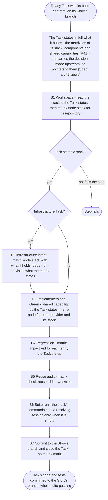

Notes on the required build:

- The matrix is read in every step that needs what it holds, and the build records nothing in it
  (R39, R46, `design/matrix.md` section 4 "the build and deploy steps read the matrix and record
  nothing in it except the verified mark at D8"). The verified mark is set by the driver when the
  Story's pull request merges (D8, `design/matrix.md` 1.4), outside the build of one Task.
- A build step that finds the code different from what the matrix states reports it in its
  result and the step journal, and changes nothing in the matrix (R29, section 4).
- The build trusts upstream: "the task should be detailed so that the build doesn't need to guess
  or interpret or decide on how to do anything that was already concluded upstream", with
  pointers (file paths, URLs) in place of copies; names come from the task or spec, and the
  `resource-naming` skill stays only "as a backuo" (owner, 2026-10-19).
- Values known only at deploy time do not stop the build: "there may be some information that
  just simply isn't known until deploy time, such as the region or environment ... We don't want
  to stop because of that", and "I don't want every subsequent step in a process constantly
  checking that upstream steps were done right" (owner, 2026-10-19).
- Every implementer has the full architecture of the component it works on, through the Spec's
  links to the architecture and design documents (owner, 2026-10-19).
- "Ever agent needs to have a reason to be used", and specialists are chosen by reasoning, not by
  code: "What I do not want is python code deciding which specialists to use" and "I also do not
  want a pipeline that blindly sends everything to ever agent" (owner, 2026-10-19).

## 2. The driver's build lane

**Subject:** how the driver turns a ready Task into a `task-to-deploy` dispatch and settles its
outcome in beads.
**Scope:** one dispatch of one Task.
**Purpose:** show where beads is read and written around the workflow.
**Boundary:** the workflow's own steps are in sections 3 to 5; the deploy lane is outside.
**Basis:** as built. `ops/sdlc-automation/routing.py` `route_build` (lines 340 to 441) and
`workflows/route-build.js` `decide()`; `ops/sdlc-automation/lane.py` `_claim_build` (1113),
`_with_step_journal` (1230), `_unlanded` (1130), `_settle_build` (1155);
`ops/sdlc-automation/buildinput.py` `contract()` (the build contract through the
`beads-contract` CLI, `skills/beads-contract/SKILL.md` "contract"); `journallines.py` (the
`STEP-JOURNAL` lines the workflow logs are applied to the journal file).

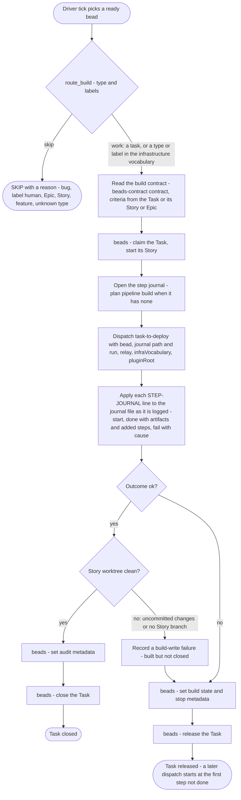

Notes:

- The router decides from type and labels alone; a Task missing its Story or Epic is still routed,
  and `task-to-deploy` refuses one with no Story at its workspace step (section 3).
- `workflows/ROUTING.md` "Type / label to composite" rule 5 lists type `task` as SKIP, while
  `route-build.js` and `routing.py` route a Task to `task-to-deploy`. The two as-built sources
  disagree; the code routes.

## 3. The step journal of a build: workspace to Red

**Subject:** the control flow of `task-to-deploy` from the dispatch to a Red that holds.
**Scope:** the steps `build:workspace`, `build:design-source`, `build:infra-intent`,
`build:regression-assess`, `build:regression-review`, `build:regression-validate`,
`build:baseline`, `build:red-write`, `build:red-check`.
**Purpose:** show every step, what adds the conditional steps, and each loop's exits. Part two is
section 4, part three section 5.
**Boundary:** what each step dispatches is in the sequence diagrams of sections 7 to 11.
**Basis:** as built. `skills/pipeline-contracts/schemas/pipeline-steps.json` `pipelines.build`
(`plan` and each kind's `adds` and `limit`); `workflows/task-to-deploy.js` `stepWorkspace` (1666),
`stepDesignSource` (1697), `stepInfraIntent` (1726), `regressionAssess` (1738),
`regressionReview` (1752), `stepRegressionValidate` (1765), `stepBaseline` (1786),
`stepRedWrite` (1807), `stepRedCheck` (1821), `MAX_RED_CHECKS` (1051).

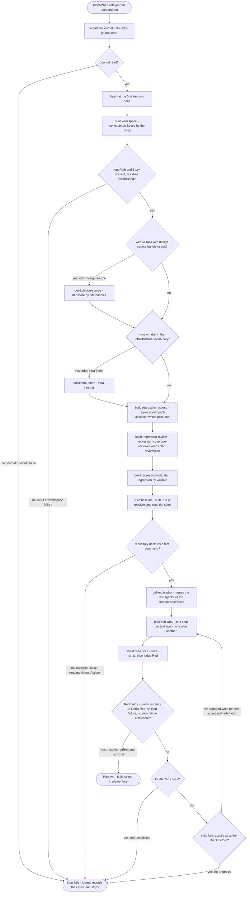

Differences from the requirements:

- B1: the workspace takes the repository from the Task's `repoPath`, not from the matrix
  (`node stack:<id>` for `repository`), and fails a Task with no `repoPath` or no Story with
  "re-elaborate the Task's Story", not a Task that states no stack
  (`task-to-deploy.js` 1668 to 1679).
- B4: no step reads `atw-matrix impact --id`. The regression-impact-assessor is told to "Discover
  affected requirements from actual sources" including prior PRDs (`regressionBrief`, 1350): the
  rediscovery by reading that R30 and R38 name as the failure the matrix removes.
- The regression scope is reviewed and validated before any test is written (regression-review,
  regression-validate), which re-checks requirement sources elaboration already bound to the
  Task; the owner does not want "every subsequent step ... constantly checking that upstream steps
  were done right".
- The test agents are named by a lookup table in code from the contract's surfaces
  (`tdd-red.js` `SURFACE_WRITERS`, 243), with `tdd-unit-test-generator` always included: code, not
  reasoning, decides which specialists run.

## 4. The step journal of a build: Green and the reuse audit

**Subject:** the control flow from the implementer selection to a green suite that passed the
reuse audit.
**Scope:** `build:select-implementers`, `build:implement`, `build:green-check`,
`build:test-ruling`, `build:reuse-audit`, and the rounds the audits add.
**Purpose:** show the Green loop, its exits, and how an audit sends work back once.
**Boundary:** the cds audit's own decision is in section 5; it sends work back into this same
loop.
**Basis:** as built. `pipeline-steps.json` kinds `build:select-implementers`, `build:implement`,
`build:green-check` (its `limit`), `build:test-ruling`, `build:reuse-audit` (its `limit`);
`task-to-deploy.js` `stepSelectImplementers` (1889), `stepImplement` (1912), `stepGreenCheck`
(1926), `stepTestRuling` (1983), `stepReuseAudit` (2149), `judgeReuse` (2124), `greenBoundary`
(1621), `MAX_GREEN_CHECKS` (1052).

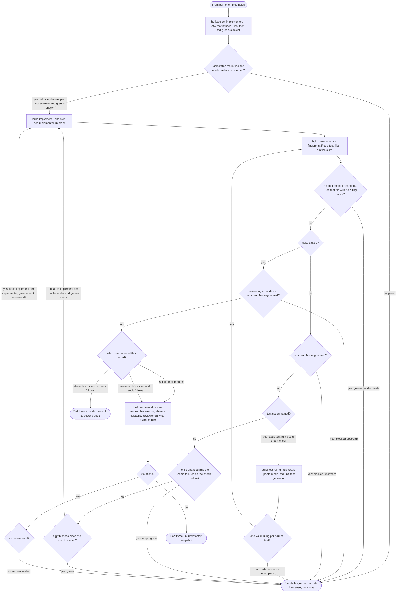

Differences from the requirements:

- B3: an infrastructure Task's implementer is fixed in code as `cdk-stack-author` unless the caller
  names one (`task-to-deploy.js` 1901): code decides the specialist.
- B3: the implementers the build can run are told to name resources. `cdk-stack-author.md` lines
  50 and 65 and `api-gateway-cdk-implementer.md` lines 51 and 71 put naming in "Allowed
  Decisions" and say "Name every resource with the resource-naming skill"; the same instruction is
  in `appsync-cdk-implementer.md` 60, `chassis-extension-implementer.md` 64,
  `cognito-lambda-trigger-implementer.md` 59, `dynamodb-access-layer-implementer.md` 67,
  `event-driven-consumer-implementer.md` 65, `event-api-client-implementer.md` 59,
  `kinesis-stream-implementer.md` 57, `mcp-server-implementer.md` 62,
  `power-tools-configuration-implementer.md` 58, `postgresql-access-layer-implementer.md` 70 and
  `s3-data-lake-implementer.md` 57. The owner: names "should have already been provided in the
  task (or spec)" and the skill stays only as a backup.
- B3 reads `atw-matrix uses --ids` with the Task's ids and hands the providers' names, kinds and
  repositories on; it runs no separate `node` per provider (Q6). The `uses` result carries the
  provider's stack repository, so the facts the row names reach the implementers.
- A Task that states no matrix id fails `build:select-implementers` and `build:reuse-audit`. The
  requirement fails a Task that states no stack at B1; as built the check sits at B3 and B5.
- B5 matches: `check-reuse --ids <ids> --worktree <path>`, and the reviewer's rulings stay in the
  step's result (`reuseAudit`).

## 5. The step journal of a build: refactor to commit

**Subject:** the control flow from the refactor to the commit on the Story's branch.
**Scope:** `build:refactor-snapshot`, `build:refactor`, `build:refactor-check`,
`build:refactor-restore`, `build:cds-audit`, `build:docs-audit`, `build:docs-write`,
`build:final-suite`, `build:regression-map`, `build:regression-map-review`,
`build:regression-verify`, `build:commit`.
**Purpose:** show the undo path of the refactor, the cds audit's single send-back, and the gates
before the commit.
**Boundary:** the Task's close is the driver's (section 2).
**Basis:** as built. `pipeline-steps.json` kinds listed in the scope; `task-to-deploy.js`
`stepRefactorSnapshot` (2000), `stepRefactor` (2008), `stepRefactorCheck` (2022),
`stepRefactorRestore` (2042), `stepCdsAudit` (2053), `stepDocsAudit` (2179), `stepDocsWrite`
(2190), `stepFinalSuite` (2201), `stepRegressionVerify` (1774), `stepCommit` (2210); the step
journal's `together` (the `build:docs-write` steps run concurrently).

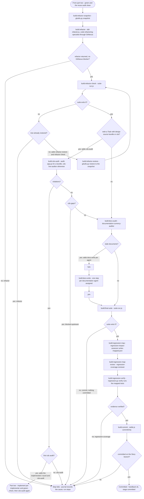

## 6. How a deterministic command runs

**Subject:** the checked relay every script step uses: `gitutils.py`, `atw-matrix`,
`regression.py`, `depscore.py`, `atw-step-journal` and the suite command.
**Scope:** one command.
**Purpose:** the sequence diagrams below draw each such call as one arrow; this is what the arrow
is.
**Boundary:** what each command does.
**Basis:** as built. `task-to-deploy.js` `relayKit` (159 to 673: `registeredCommand`, `exec`,
`run`), `gitutils` (1195), `matrixCommand` (1206, role `build-workflow`); `agents/workflow-command-runner.md`.

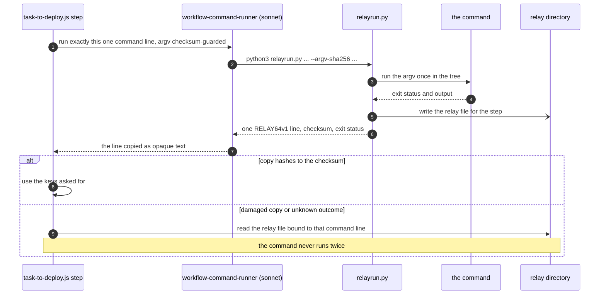

## 7. Workspace, design source and provisioning intent

**Subject:** the first steps: the Story's worktree, the design source of a web-ui Task, the
provisioning intent of an infrastructure Task.
**Scope:** `build:workspace`, `build:design-source`, `build:infra-intent`.
**Purpose:** what each agent receives and produces, and where git and the matrix are touched.
**Boundary:** the routing and claim before it (section 2).
**Basis:** as built. `task-to-deploy.js` `stepWorkspace`, `selectDesign` (1533),
`stepDesignSource`, `stepInfraIntent`; `workflows/workspace.js` (provision 805, independent
verification 817); `workflows/infra-intent.js` (prompt and schema, 172 to 232).

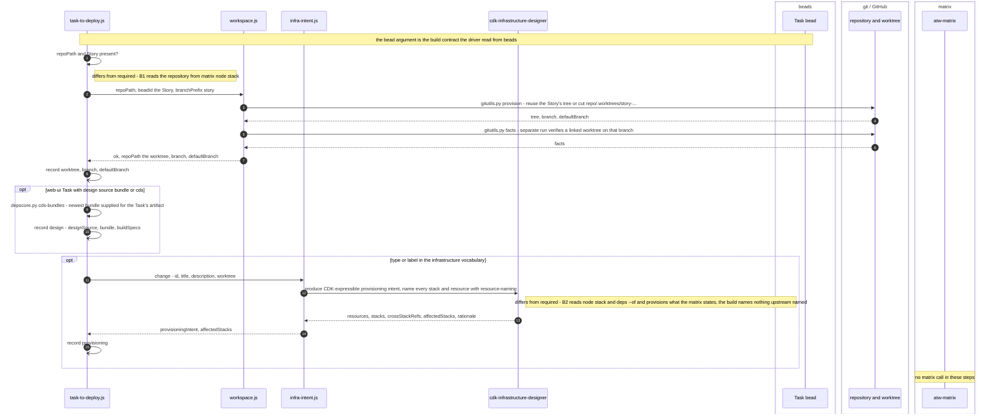

## 8. Regression scope, mapping and verification

**Subject:** the cumulative regression artifacts written before Red and finished before the
commit.
**Scope:** `build:regression-assess`, `-review`, `-validate`, and later `build:regression-map`,
`-map-review`, `-verify`.
**Purpose:** what the assessor and the reviewer receive and write, and what the script checks.
**Boundary:** the tests themselves are written in Red.
**Basis:** as built. `task-to-deploy.js` `REGRESSION_FILES` (1321), `regressionInvoke` (1329),
`author` (1340), `regressionBrief` (1348), `regressionReviewBrief` (1352), `regressionAssess`,
`regressionReview`, `stepRegressionValidate`, `stepRegressionVerify`; `scripts/portfolio/regression.py`
modes `prepare`, `validate`, `verify`.

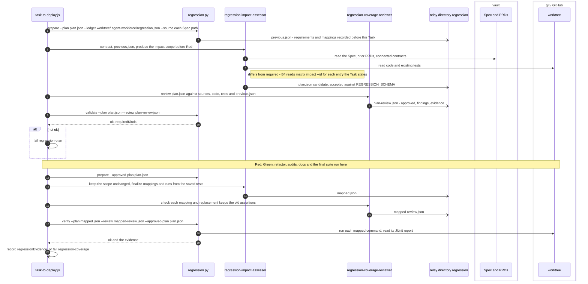

## 9. Baseline and Red

**Subject:** resolving the suite command, the baseline run, and the Red loop.
**Scope:** `build:baseline`, `build:red-write`, `build:red-check`, and the ruling on named tests
(`build:test-ruling`), which uses the same workflow.
**Purpose:** how test writers are chosen, what they receive, and how Red is judged by the run,
not by the agents' reports.
**Boundary:** Green (section 10).
**Basis:** as built. `task-to-deploy.js` `suite` (1309), `stepBaseline`, `stepRedWrite`,
`stepRedCheck`, `stepTestRuling`, `contractAt` (1247); `workflows/suite-run.js` (`resolvePrompt`
821, `test-command-resolver` 851, the run 880, `test-failure-parser` 906); `workflows/tdd-red.js`
(`SURFACE_WRITERS` 243, `plan` 263, `authorPrompt`, `updatePrompt`, writers in sequence 351).

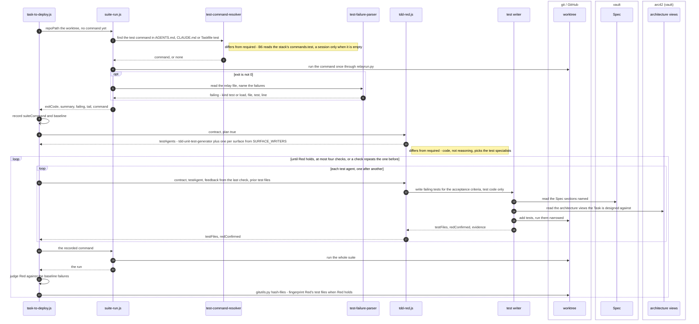

## 10. Green: implementer selection, implementation and the test ruling

**Subject:** how implementers are chosen and run, how the suite judges them, and how a test an
implementer disputes is ruled on.
**Scope:** `build:select-implementers`, `build:implement`, `build:green-check`,
`build:test-ruling`.
**Purpose:** what each implementer receives (contract, shared capabilities, Spec and arc42
pointers, feedback) and produces, and where the matrix is read.
**Boundary:** the audits (section 11).
**Basis:** as built. `task-to-deploy.js` `stepSelectImplementers`, `capabilityBrief` (1868),
`greenFeedbackAt` (1632), `baselineNoteAt` (1625), `stepImplement`, `stepGreenCheck`,
`stepTestRuling`, `checkTestDecisions` (1131); `workflows/tdd-green.js` (`IMPLEMENTER_ROSTER`,
the `implementation-lead` selection, `reuseBlock`, `GREEN_SCHEMA`); `agents/implementation-lead.md`.

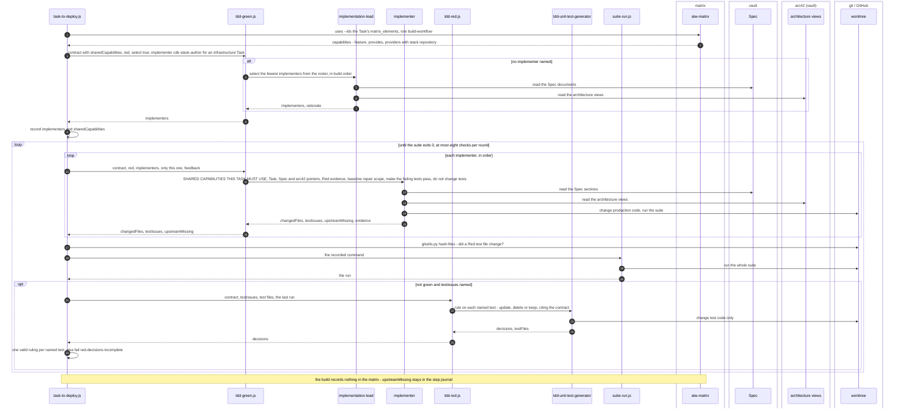

## 11. Audits: reuse, refactor and cds

**Subject:** the checks that follow Green and may send work back once.
**Scope:** `build:reuse-audit`, `build:refactor-snapshot`, `build:refactor`,
`build:refactor-check`, `build:refactor-restore`, `build:cds-audit`.
**Purpose:** the matrix read of B5, the GitNexus-only refactor and its undo, and the cds audit
for a web-ui Task.
**Boundary:** the rounds they add re-enter section 10.
**Basis:** as built. `task-to-deploy.js` `stepReuseAudit`, `judgeReuse`, `REUSE_JUDGMENT_SCHEMA`,
`stepRefactorSnapshot`, `stepRefactor`, `stepRefactorCheck`, `stepRefactorRestore`,
`stepCdsAudit`, `auditCds` (1453, `RUN_CDS_AUDIT_PY`), `auditCdsLive` (1590);
`workflows/tdd-refactor.js` (snapshot 834, the specialist's prompt 849 to 900, blocker and revert
handling, `gitutils.py changed` 957).

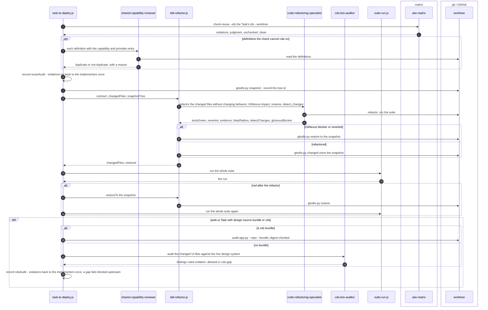

## 12. Documentation, the final suite and the commit

**Subject:** the documentation audit and updates, the final suite run, and the commit on the
Story's branch; then the driver's close.
**Scope:** `build:docs-audit`, `build:docs-write`, `build:final-suite`, `build:commit`, and the
driver's `_settle_build`.
**Purpose:** who is chosen to write documents and how, and where git and beads are written.
**Boundary:** the regression mapping between the final suite and the commit (section 8).
**Basis:** as built. `task-to-deploy.js` `stepDocsAudit`, `stepDocsWrite`, `allChangedAt` (2177),
`stepFinalSuite`, `stepCommit`, `handback` (2270); `workflows/documentation.js` (`WRITERS`,
the auditor's prompt, `writerForPath`, `assignment` mode); `workflows/settle.js` `commitRun`
(commit agent `github-actions-pipeline-implementer`); `ops/sdlc-automation/lane.py`
`_settle_build`.

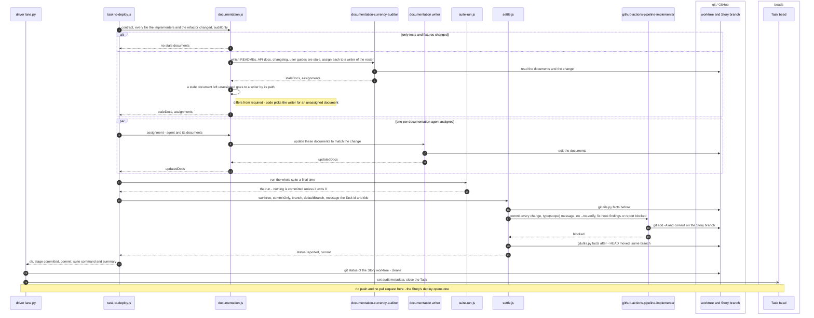

## 13. A step of the step journal

**Subject:** the states one journal step passes through, in the workflow's copy and in the file.
**Scope:** any step of pipeline `build`.
**Purpose:** show restart: a run begins at the first step that is not done, and a step that ran
before starts again from its beginning.
**Boundary:** the order of the steps (sections 3 to 5).
**Basis:** as built. `skills/pipeline-contracts/schemas/step-journal.schema.json`
`definitions/stepStatus` (planned, running, done, failed); the `step-journal` shared block in
`task-to-deploy.js` (674 to 948: `next`, `start`, `done`, `fail`, `run`, `together`);
`ops/sdlc-automation/journalstart.py` `start_at` (`invalidate_from`).

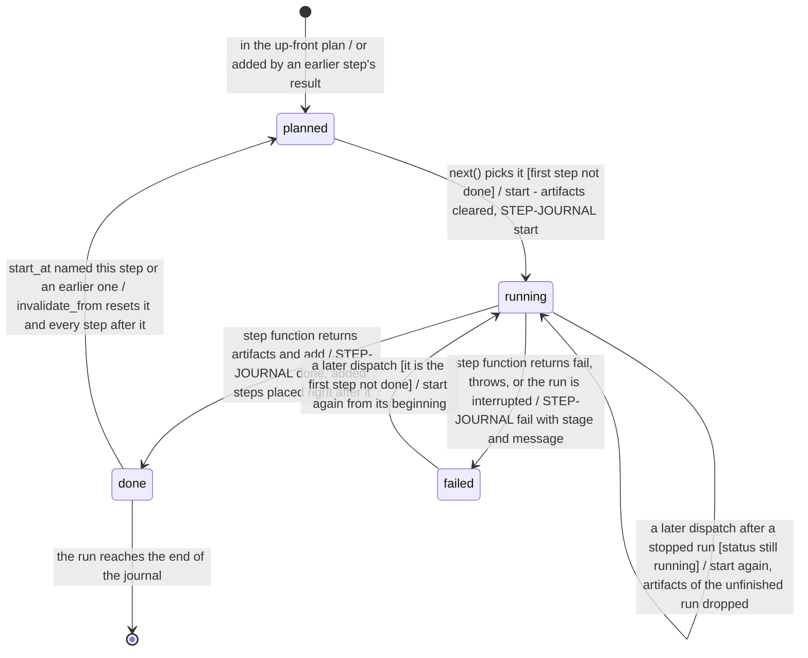

## Agents the build dispatches, and how each is chosen

Basis: as built (the files cited in sections 6 to 12).

| Agent | Step | Chosen by |
|---|---|---|
| `workflow-command-runner` | every script step | always, for each command (section 6) |
| `cdk-infrastructure-designer` | `build:infra-intent` | code: an infrastructure type or label |
| `regression-impact-assessor`, `regression-coverage-reviewer` | the six regression steps | always |
| `test-command-resolver`, `test-failure-parser` | every suite run | the resolver when no command is recorded, the parser when the suite exits non-zero |
| `tdd-unit-test-generator` and the surface test writers | `build:red-write`, `build:test-ruling` | code: `SURFACE_WRITERS` from the contract's surfaces, the unit writer always |
| `implementation-lead` | `build:select-implementers` | always, unless the caller or code names the implementer |
| the implementers of `IMPLEMENTER_ROSTER` | `build:implement` | `implementation-lead`, or `cdk-stack-author` fixed for an infrastructure Task |
| `shared-capability-reviewer` | `build:reuse-audit` | definitions `atw-matrix check-reuse` cannot rule on |
| `code-refactoring-specialist` | `build:refactor` | always |
| `cds-live-auditor` | `build:cds-audit` | a web-ui Task with design source cds and no bundle |
| `documentation-currency-auditor` | `build:docs-audit` | unless only tests and fixtures changed |
| `api-documentation-writer`, `readme-writer`, `changelog-writer`, `user-guide-writer` | `build:docs-write` | the auditor, or `writerForPath` for a document it left unassigned |
| `github-actions-pipeline-implementer` | `build:commit` | always, when the tree has changes |

Not dispatched by the build as built: `workflows/adversarial.js` (its testers and
`adversarial-critique-adjudicator`) and `workflows/gate-enforce.js` (`phase-gate-enforcer`); no
workflow in the build lane names either. `agents/test-coverage-gap-reviewer.md` says the
`tdd-red` workflow dispatches it, and `workflows/tdd-red.js` does not.

## Stores read and written by the build

Basis: as built, compared with required (`design/matrix.md` section 4, Build table).

| Store | Read | Written |
|---|---|---|
| beads | the build contract (driver, `beads-contract contract`) | the driver claims the Task, starts the Story, closes or releases the Task and sets build metadata |
| matrix | `uses --ids` (B3) and `check-reuse` (B5), role `build-workflow` | nothing, as required |
| arc42 (vault) | the architecture views the Task's `decisionIds` name, by the test writers, `implementation-lead` and the implementers | nothing |
| vault | the Spec documents and sections, and prior PRDs by the regression agents | nothing |
| git / GitHub | the worktree, through `gitutils.py` and the agents | the Story's worktree and branch (created or reused), the code, tests and documents, one commit per Task; no push |

## Differences from the requirements, in one list

1. B1: repository from `repoPath`, not `atw-matrix node stack:<id>`; the refusal names a missing
   `repoPath` or Story, not a missing stack (sections 3 and 7).
2. B2: `infra-intent.js` reads no matrix and has `cdk-infrastructure-designer` design resources and
   stacks again and name them with the `resource-naming` skill, re-deciding what upstream decided
   (section 7).
3. B3: thirteen implementer definitions tell the implementer to name resources, two of them with
   naming among their "Allowed Decisions" (section 4).
4. B4: the regression scope is rediscovered from sources, not read with `impact --id` (sections 3
   and 8).
5. B6: the suite command is resolved from `AGENTS.md`, `CLAUDE.md` or the Taskfile by a session,
   not read from the stack's `commands.test` (section 9).
6. Specialists chosen by code: the test writers (`SURFACE_WRITERS`), the implementer of an
   infrastructure Task (`cdk-stack-author`), and the writer of an unassigned document
   (`writerForPath`) (sections 3, 4 and 12).
7. Re-checks of upstream: the regression scope review and validation re-check the requirement
   sources elaboration bound to the Task, and the missing-id refusals sit at B3 and B5 rather than
   at B1 (sections 3 and 4).

## Assumptions

- Section 1: the order of B2 to B6 is the order the Build table lists them.
