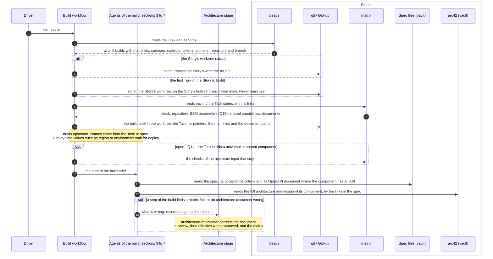
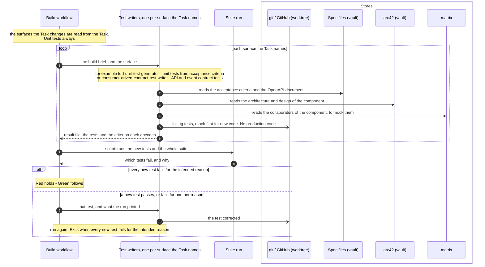
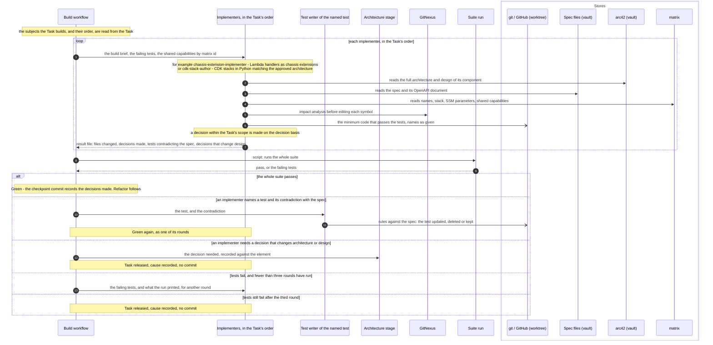
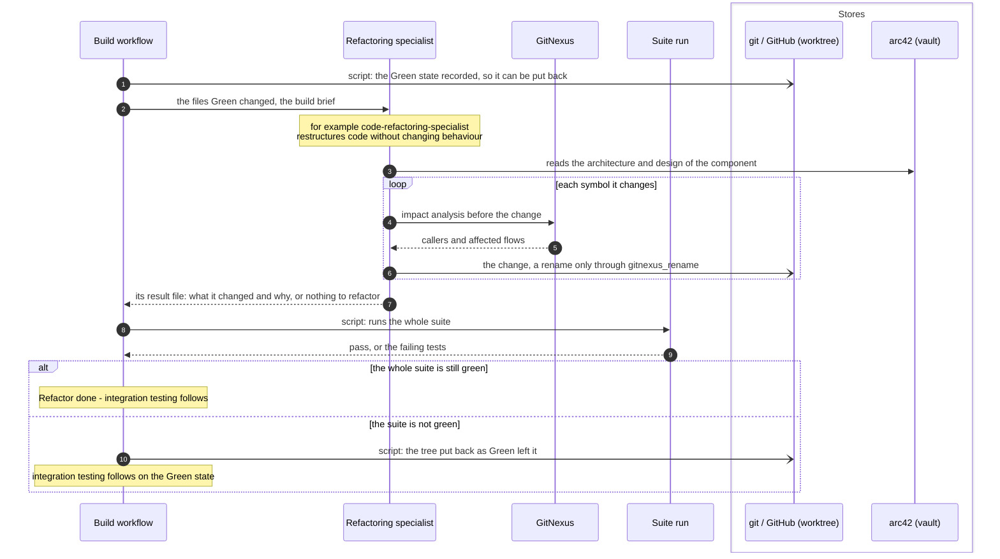
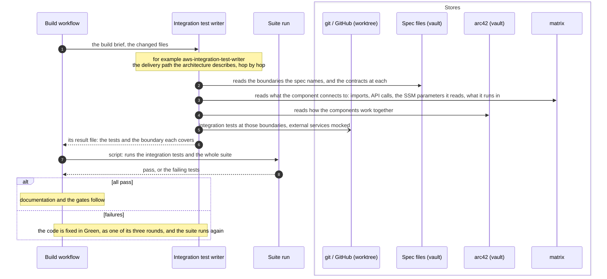
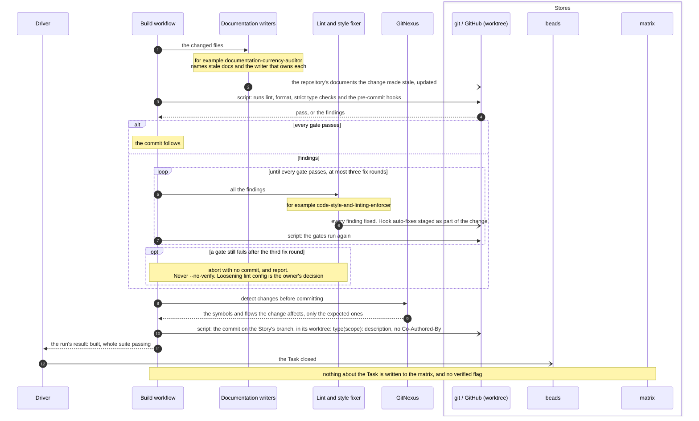
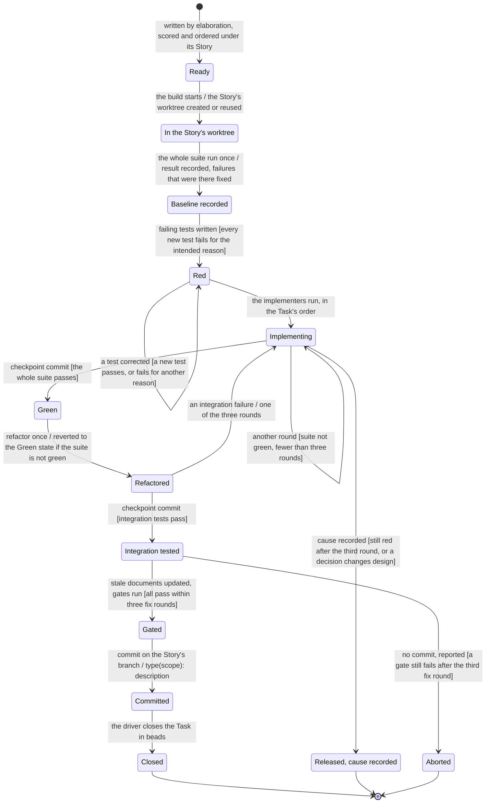

# The pipelines: build

Parent: [The pipelines: overview](pipelines.md)

The build runs once per Task. It takes a Task from beads, under its Story, and produces the
Task's code and tests committed on its Story's branch, in the Story's worktree, with the
repository's whole test suite passing ([requirements/pipelines.md](../requirements/pipelines.md),
"What the pipelines are", Build row). This document draws the build **as the owner wants it**.
The sources are the owner's messages of 2026-10-19 (Part 1 of the elaboration plan, items 1.10,
1.11 and 1.13, with the owner's qualifiers), the SkillSpoke repository's root `AGENTS.md` ("Code
quality", tier 1) and `.claude/rules/git-conventions.md`, the vault's `docs/sdlc/sdlc.md`, and
[requirements/pipelines.md](../requirements/pipelines.md) and
[requirements/matrix.md](../requirements/matrix.md) where they agree with the owner's words. The
Tasks come from elaboration, section 6 of [The pipelines: elaboration](pipelines-elaboration.md);
the Story's deploy, and the Epic's verified flag, come after, in
[The pipelines: deploy](pipelines-deploy.md). Where the sources leave a step's detail unstated, it
is decided on the project's decision basis (engineering best practice, security best practice, the
AWS Well-Architected Framework and the owner's stated principles) and its reason is given where the
step is described. The plan questions the owner still holds are drawn as open questions, listed at
the end with a recommendation.

The owner, on what the build is given: "Since Day 1, my requirement has been that as much as
possible should be written into the specs and tasks, so that the build has little to no decisions
to make. Everything that can be passed on to the build and determined in advance, should be." and
"the task should be detailed so that the build doesn't need to guess or interpret or decide on how
to do anything that was already concluded upstream in the elaboration (and architecture) pipeline.
And when I say task, I also mean spec."

## Legend

| Notation | Meaning |
|---|---|
| `A ->> B` (sequence) | A calls or starts B: B does work for A |
| `B -->> A` (sequence) | B returns its result to A |
| `A -) Store` (sequence) | A writes to a store; nothing is returned |
| `alt` / `opt` (sequence) | Branches taken on the condition each is labelled with |
| A node or block labelled "open - Qn" | The owner has not decided this. Each is listed under "Open questions" at the end |
| "Script" (activity) | A step the build workflow runs as code, with no agent |
| `([...])` (activity) | Start or end |
| `{...?}` (activity) | A decision; every outgoing edge is labelled with its guard |
| "merge" node (activity) | Alternative paths coming back together; no waiting |
| `[*]` and `S1 --> S2 : event [guard]` (state machine) | Initial state, and what moves a Task from one state to another |
| arc42 (vault) | The arc42 architecture and design documents in the `skillspoke-docs` vault |
| Spec files (vault) | The Spec documents in the vault (`sdlc/mvp-1/specs/`, vault `docs/sdlc/sdlc.md`) |
| matrix | The one record of how Epics, PRDs, documents, services, components, resources, stacks and repositories relate. It records no Story and no Task |
| beads | The issue tracker that holds Epics, Stories and Tasks |
| git / GitHub | The Story's repository, its worktree and its feature branch |
| Architecture stage | Where `architecture-maintainer` corrects an arc42 document and the matrix, as drawn in [architecture and matrix states](pipelines-architecture-states.md) |
| "for example `agent`" | A roster agent whose own file gives it a reason to be used for that role; which agent is used is reasoning, never code |

The roles in the diagrams are named in plain words. A roster agent is named only "for example",
with the subject in its own file that gives it a reason to be used. The owner: "Ever agent needs to
have a reason to be used.", "What I do not want is python code deciding which specialists to use"
and "I also do not want a pipeline that blindly sends everything to ever agent". Every agent the
build starts writes or changes code or tests, so every one runs on Opus or better. The owner: "If
it's touching code, it needs to be done with Opus or better. Perid." Each agent runs as its own
headless session and ends when its work is done. The owner: "I do prefer to spin up agents in
headless claude sessions to do work, and then get out." and "There can be nested subagents."

## 1. One Task through the build

**Subject:** the build of one Task.
**Scope:** from a Task ready in beads, under its Story, to its code and tests committed on its
Story's branch with the whole suite passing.
**Purpose:** the order of the steps, the guard on each decision, and where each step is drawn in
detail.
**Boundary:** elaboration, which writes the Task, comes before; the Story's deploy, its pull
request and the Epic's verified flag come after, in [deploy](pipelines-deploy.md).
**Sources:** Scope: [requirements/pipelines.md](../requirements/pipelines.md), Build row. The
worktree: `.claude/rules/git-conventions.md` ("`main` branch only — all branch work happens in
worktrees. Never branch in the main working tree." and "For tier 1, all implementation happens in a
worktree agent."). TDD: root `AGENTS.md` ("TDD London School (mock-first) for new code" and
"Spec-first OpenAPI: the spec exists before handler code"). Gates: `git-conventions.md` ("When a
pre-commit hook fails: fix **all** findings, restage, retry." and "If findings can't be fixed,
**abort with no commit** and report."). Commits: `git-conventions.md` ("Commit early, commit
often."). Defects: [requirements/pipelines.md](../requirements/pipelines.md) ("A build that finds
a defect fixes it in that run."). Closing: root `AGENTS.md` ("A Task closes when it completes,
including passing all tests."). Trust: the owner, "Your default is fault-intolerant. I need more
fault-tolerance for the pipeline, and need more trust.", with the exception "like if B is going to
be a universal or shared component" (Q14).

```mermaid
flowchart TD
    start(["Task ready in beads, under its Story"]) --> wt["Script: the Story's worktree, on the Story's feature branch, created or reused. Never main - section 2"]
    wt --> read["The Task, its spec, the linked architecture and design, and the matrix ids it states are read - section 2"]
    read --> shared{"Does the Task build a universal or shared component?"}
    shared -->|"no: trust what upstream decided"| m0(("merge"))
    shared -->|"yes"| chk["open - Q14 - which checks of the upstream input stay"]
    chk --> m0
    m0 --> base["Script: the whole suite run once before any change, its result recorded"]
    base --> bok{"Does the whole suite pass before any change?"}
    bok -->|"yes"| m2(("merge"))
    bok -->|"no"| pre["The failures recorded, and fixed in this run as defects the build found"]
    pre --> m2
    m2 --> red["Red: the test writer for each surface the Task names, unit tests always, mock-first - section 3"]
    red --> redok{"Does every new test fail for the intended reason?"}
    redok -->|"no: a test passes, or fails for another reason"| red
    redok -->|"yes: Red holds"| green["Green: the implementers for the subjects the Task names, in the Task's order - section 4"]
    green --> design{"Does the work need a decision that changes architecture or design?"}
    design -->|"yes"| relA(["Reported to the architecture stage. Task released, cause recorded, no commit"])
    design -->|"no"| gok{"Does the whole suite pass?"}
    gok -->|"no, fewer than three rounds run"| green
    gok -->|"no, after the third round"| relB(["Task released, cause recorded, no commit"])
    gok -->|"yes: green"| cp1["Script: checkpoint commit on the Story's branch - section 7"]
    cp1 --> refac["Refactor, once: behaviour unchanged - section 5"]
    refac --> rok{"Is the whole suite still green?"}
    rok -->|"yes"| m1(("merge"))
    rok -->|"no"| undo["Script: the refactor reverted to the Green state"]
    undo --> m1
    m1 --> integ["Integration tests at the boundaries the spec names, external services mocked - section 6"]
    integ --> iok{"Do the integration tests pass?"}
    iok -->|"no: the code is fixed in Green, as one of its rounds"| green
    iok -->|"yes"| docs["Documentation the change made stale, updated - section 7"]
    docs --> gates["Script: quality gates - lint, format, strict types, pre-commit - section 7"]
    gates --> gk{"Do all gates pass?"}
    gk -->|"no, fewer than three fix rounds run"| fix["Fix all findings, restage"]
    fix --> gates
    gk -->|"no, after the third fix round"| abort(["Abort with no commit, and report"])
    gk -->|"yes"| commit["Script: commit on the Story's branch in its worktree"]
    commit --> closed(["Task closed in beads: built, whole suite passing. The Story's deploy follows when all its Tasks are built"])
```

Notes on the diagram:

- The worktree, the suite runs, the gates and the commits are scripts; writing tests, writing code,
  refactoring, fixing gate findings and updating documentation are agents. No agent goes where no
  reasoning is needed.
- The whole suite runs once before any change and its result is recorded, so Red and Green are
  judged against a known baseline. A failure that was there before is recorded and fixed in the
  same run, because a build that finds a defect fixes it in that run.
- Green has at most three rounds; a Task still red after the third is released with its cause
  recorded, so bounded work cannot loop for hours. An integration failure goes back to Green as one
  of those rounds.
- A decision within the Task's scope that upstream did not record is made on the decision basis and
  recorded in the commit message. A decision that changes architecture or design is reported to the
  architecture stage and the Task is released, because later steps trust earlier ones and design
  belongs upstream.
- The loop back to Red exits when every new test fails for the intended reason. The gate loop
  exits when every gate passes, or after the third fix round, when the build aborts with no commit,
  because a gate is never bypassed.
- The build writes no verified flag. Verified is set for the Epic once all the Tasks of all its
  Stories are built and tested, including CI (CDK), which means deployment must also work. The
  owner: "Once all of the tasks for all of the stories for and Epic have been built and tested
  (including CI (CDK), which means deployemen must also work), then all of the architecture and
  rellationships for the Epic can be set to verified." A deterministic step sets it when the last
  Story of the Epic closes, as drawn in [deploy](pipelines-deploy.md) and in
  [architecture and matrix states](pipelines-architecture-states.md).

## 2. The worktree, and what the build reads

**Subject:** the start of the build of one Task.
**Scope:** from the Task id reaching the build to every agent of the build having what it needs.
**Purpose:** which store is read for what, where the worktree comes from, and what the build does
not re-decide.
**Boundary:** what each agent does with what it reads is drawn in sections 3 to 7.
**Sources:** The owner: "all details do not need to be copied into the tasks and specs (file
paths, URLs, etc. can be used to point to the more detailed information)", "even if it has only
the specific steps in a task that it needs to perform, it should still have access to the full
architecture for the component that it is working on. This is why the specs needs to have links
the that architecture (and design) documents.", "I don't want to encourage an agent to start
naming things, when the names should have already been provided in the task (or spec).", "there
may be some information that just simply isn't known until deploy time, such as the region or
environment where we are deploying. We don't want to stop because of that. We need to make sure
some of that is accommodated and handled at run time (deploy time).", "I don't want every
subsequent step in a process constantly checking that upstream steps were done right." On the
matrix: "Your question should be, "How can stack-B know what ssm stack-A is saving (or will saved
once deployed)?" The answer for that is, it should look in the matrix.", "The matrix does not
include stories and tasks (it isn't a build tracker), and it doesn't care about what has actually
been deployed.", and "The architecture process is designed to clean up the matrix is it works, and
the same with the build." [requirements/matrix.md](../requirements/matrix.md) R41: "A Task states
in full what it builds, using the matrix's ids for the stack, the components and the shared
capabilities." R26: "The pipeline uses everything in the matrix, verified or not." R29: a build
run "reports what it finds wrong and changes nothing but the verified mark". Worktree:
`.claude/rules/git-conventions.md` (tier 1 work in a worktree on a feature branch, never on
`main`). One Story per repository: vault `docs/sdlc/sdlc.md`.

Notes on the diagram:

- The worktree is created or reused by a script, because creating or reusing it needs no
  reasoning.
- The workflow copies no document into the brief; each agent reads what it needs by the pointers.
  The owner: "file paths, URLs, etc. can be used to point to the more detailed information".
- The matrix is read, not re-derived. The build looks up a name, a stack, an SSM parameter or a
  document there instead of scanning ([requirements/matrix.md](../requirements/matrix.md) R30:
  "A pipeline step looks up what exists."). How an SSM parameter is recorded in the matrix is plan
  question 15.
- The matrix records no Task. The build records nothing about the Task in the matrix.
- A matrix fact the build finds wrong is recorded against the element and sent to the architecture
  stage, where `architecture-maintainer` corrects the document and the matrix; the build itself
  changes nothing in the matrix, because the architecture stage is the one corrector and approver
  of architecture. The verified mark is set by the step that runs when the Epic's last Story
  closes.

## 3. Red: failing tests first

**Subject:** the Red step of one Task.
**Scope:** from the build brief to failing tests that encode the Task's acceptance criteria.
**Purpose:** who writes the tests, what each reads and writes, and how Red is confirmed.
**Boundary:** production code is Green's (section 4).
**Sources:** Root `AGENTS.md`: "TDD London School (mock-first) for new code." and "Spec-first
OpenAPI: the spec exists before handler code." The owner: "Ever agent needs to have a reason to be
used.", "I also do not want a pipeline that blindly sends everything to ever agent, whether it
applies or not" and "as much as possible should be written into the specs and tasks, so that the
build has little to no decisions to make". On contracts: "i'm a huge fan of the contracs being
deterministic in files and code, and for agents, a skill can contain both schemas and een the code
to read and write and verify the schemas."

Notes on the diagram:

- The Task, written in elaboration, names the surfaces it changes; the workflow sends the Task to
  the test writer for each named surface, and to the unit test writer always. The reasoning
  happened upstream, so no code guesses, and each writer is a specialist with a reason to run.
- A test writer is used for a surface the Task names and for no other. For example, a Task that
  adds a handler behind an API Gateway REST API names the handler and its API, so it gets unit
  tests and contract tests; a Task that changes the wording on a web page gets neither contract
  tests nor end-to-end API tests.
- Each result file follows a contract held in a skill with its schema and the code that reads,
  writes and checks it (the owner, above).

## 4. Green: the minimum code

**Subject:** the Green step of one Task.
**Scope:** from failing tests to the whole suite passing.
**Purpose:** who writes the production code, what each implementer has, and the tier 1
obligations of the implementing step.
**Boundary:** restructuring is Refactor's (section 5); the gates are section 7.
**Sources:** The owner: "I don't care what kind of software engineering agent is writing the
code, even if it has only the specific steps in a task that it needs to perform, it should still
have access to the full architecture for the component that it is working on.", "I'm not sure why
the cdk-stack-author and api-gateway-cdk-implementer needs the skill or to name anything. The
tasks that build pipeline read, should already have all names in it, right?", "Maybe leaving the
skill in place can ba a backuo, but I don't want to encourage an agent to start naming things, when
the names should have already been provided in the task (or spec).", "I wouldn't expect a missing
name.", "What I do not want is python code deciding which specialists to use, because pythin
doesn't have the reasoning to make that determination." Root `AGENTS.md`, "Code quality", tier 1
(the obligations in the table below), "Operating rules and architecture defaults" 3, 4, 5, 9 and
10, and GitNexus ("MUST run impact analysis before editing any symbol.").

Notes on the diagram:

- The implementers are those for the subjects the Task names, in the order the Task gives, for
  the same reason as the test writers: elaboration has already decided what the Task builds.
- An implementer changes no test. It names a test that contradicts the spec and the contradiction,
  and the test writer rules on it against the spec (update, delete or keep), because the spec
  decides.
- Green has at most three rounds, so bounded work cannot loop for hours.
- A decision within the Task's scope is recorded in the commit; a decision that changes
  architecture or design goes to the architecture stage and the Task is released, because design
  belongs upstream.
- The `resource-naming` skill stays as a backup. The owner: "No. We aren't deleting the
  `resource-naming` skill." Nothing in an implementer's brief or file encourages it to name what
  the Task or spec already names.
- An implementer may start further agents for its work. The owner: "There can be nested
  subagents."

### The obligations of the implementing step

Every implementer meets these in the code it writes. They are tier 1 obligations from the
SkillSpoke repository's root `AGENTS.md`; the build does not decide them again.

| Obligation | Source (root `AGENTS.md`) |
|---|---|
| Concurrency guards, timeouts, backoff, idempotency, incremental processing, explicit error handling, resource cleanup | "Code quality", tier 1 |
| Latest stable versions, no deprecated patterns, no clever solutions unless asked | "Code quality", tier 1 |
| Files under 500 lines; typed interfaces for public APIs; validation at system boundaries | "Code quality", tier 1 |
| Spec-first OpenAPI: the spec exists before handler code | "Code quality", tier 1 |
| TDD London School (mock-first) for new code: no production code without a failing test | "Code quality", tier 1 |
| Lambdas on `aws-lambda-powertools` only (FastAPI, Flask and Django banned) | "Operating rules", 3 |
| API Gateway REST API v1 only (HTTP API v2 banned) | "Operating rules", 4 |
| No cross-service source imports (`skill_spoke.common`, `skill_spoke.services.<other>`) | "Operating rules", 5 |
| Each service owns its tables, unless an owner instruction overrides it for a stated scope | "Operating rules", 9 |
| Cross-stack values through an SSM parameter the producing stack writes and the consuming stack reads, never CDK exports or imports; the parameter's name is read from the matrix | "Operating rules", 10, and the owner ("it should look in the matrix") |
| Data-driven and configurable; paths through the project's environment variables; no person's name in code | "No hardcoding" |
| Impact analysis before editing any symbol | "GitNexus", "Always Do" |
| Names written as the Task or spec gives them; values known only at deploy time resolved at deploy time | The owner, quoted above |

## 5. Refactor: behaviour unchanged

**Subject:** the Refactor step of one Task.
**Scope:** from Green to the same behaviour in clearer code, with the whole suite green.
**Purpose:** who refactors, what it may change, and what keeps behaviour unchanged.
**Boundary:** only the code the Task changed is in scope.
**Sources:** Root `AGENTS.md`: "TDD London School (mock-first) for new code." (red, green,
refactor), and GitNexus: "MUST run impact analysis before editing any symbol." and "NEVER rename
symbols with find-and-replace — use `gitnexus_rename` which understands the call graph." The
owner: "Ever agent needs to have a reason to be used."

Notes on the diagram:

- The refactor runs once, after Green, on the code Green changed. A refactor that breaks the suite
  is reverted to the recorded Green state, because refactoring never changes behaviour.

## 6. Integration testing

**Subject:** the integration testing of one Task.
**Scope:** from the refactored code to integration tests passing.
**Purpose:** where integration testing sits in the build, and what it covers.
**Boundary:** the deploy of the Story to AWS dev, its smoke tests and every test against deployed
AWS resources are in [deploy](pipelines-deploy.md).
**Sources:** The build ends with "the repository's whole test suite passing"
([requirements/pipelines.md](../requirements/pipelines.md), Build row). Root `AGENTS.md`: "TDD
London School (mock-first) for new code." The owner: "Not onnly are most connections or
dependencies netween things not through events, the most are probably because of imports or API
calls." and "Ever agent needs to have a reason to be used."

Notes on the diagram:

- The build runs integration tests at the boundaries the Task's spec names, with external
  services mocked (London School); tests against deployed AWS run in deploy, because AWS dev is
  deployed per Story, not per Task.
- An integration failure goes back to Green and counts as one of its three rounds, so the bound
  on Green holds.

## 7. Quality gates, documentation and the commit

**Subject:** the end of the build of one Task.
**Scope:** from integration tests passing to the Task's commit on its Story's branch and the Task
closed in beads.
**Purpose:** the gates, how a failed gate is handled, and what is written where.
**Boundary:** the push of the Story's branch for its pull request, the deploy and the verified flag
are in [deploy](pipelines-deploy.md).
**Sources:** `.claude/rules/git-conventions.md`: "`git commit --no-verify` / `git push --no-verify`
/ `git commit -n` are **forbidden**, always", "When a pre-commit hook fails: fix **all** findings,
restage, retry. Hook auto-fixes left in the working tree are part of the change — stage them", "If
findings can't be fixed, **abort with no commit** and report. A missing commit is recoverable; a
bypassed gate lands unlinted code on main.", "Loosening lint config (`per-file-ignores`, `noqa`)
is an owner decision, not a recovery tactic.", "Commit format: `type(scope): description`", "No
`Co-Authored-By` headers in commits", "Commit early, commit often.", "Each checkpoint commit passes
the quality gates below" and "tier 1 commits on its feature branch in its worktree". Root
`AGENTS.md`: "MUST run `gitnexus_detect_changes()` before committing" and "A Task closes when it
completes, including passing all tests." The owner: "The matrix does not include stories and tasks
(it isn't a build tracker)".

Notes on the diagram:

- Documentation the Task's change makes stale is updated in the same Task, because docs ship with
  the code. The arc42 documents are corrected only through the architecture stage (section 2).
- Gate findings are fixed and the gates rerun at most three times; then the build aborts with no
  commit and reports, because a gate is never bypassed.
- The build commits at each checkpoint that leaves the suite green (after Green, after Refactor
  and integration testing, and the last commit above), each through the same gates, so every
  change can be undone.
- The driver writes the Task's state from the run's result (closed, or released with its cause),
  so code sets a state the same way every time.

## 8. A Task through the build

**Subject:** one Task bead.
**Scope:** from ready to closed, released or aborted.
**Purpose:** the states a Task passes through in the build, and what moves it.
**Boundary:** the Task's life before the build (written in elaboration) and the Story's deploy are
not drawn.
**Sources:** Root `AGENTS.md`: "A Task closes when it completes, including passing all tests." and
"TDD London School (mock-first) for new code." `.claude/rules/git-conventions.md` (worktree, gates,
abort with no commit, checkpoint commits). [requirements/pipelines.md](../requirements/pipelines.md):
the Tasks under each Story are "scored and ordered", and the build produces "The Task's code and
tests committed to the Story's branch, with the repository's whole test suite passing".

## Stores read and written by the build

| Store | Read | Written |
|---|---|---|
| beads | The Task and its Story: what the Task builds, the matrix ids, the surfaces and subjects it names, acceptance criteria, pointers, the Story's repository and branch | By the driver, from the run's result: the Task closed when built with the whole suite passing, or released with its cause |
| matrix | Every id the Task states, with its links: stack, repository, SSM parameters written and read, shared capabilities, collaborators, related documents | Nothing. A matrix fact found wrong is recorded against the element and sent to the architecture stage |
| Spec files (vault) | The spec, its acceptance criteria, its OpenAPI document, the boundaries it names | Nothing |
| arc42 (vault) | The full architecture and design of the component, by the spec's links | Nothing; corrections go through the architecture stage |
| git / GitHub | The Story's worktree and branch | Tests, code, the repository's documents the change made stale, checkpoint commits and the Task's commit on the Story's branch |

## Open questions

- **Q14. Which checks of upstream steps stay in the build and deploy?** (plan, item 1.11)
  Appears in sections 1 and 2. Recommendation (the plan's): keep a check only where the step that
  consumes the output is a universal or shared component, and remove the rest. Reason: that is the
  exception the owner named ("like if B is going to be a universal or shared component"), and the
  owner otherwise wants trust ("I need more fault-tolerance for the pipeline, and need more
  trust.").
- **Q15. How is an SSM parameter recorded in the matrix?** (plan, item 1.13) Appears in sections 2
  and 4, where the build reads the parameters a stack writes and reads. Recommendation (the
  plan's): as its own entry, named, linked from the stack that writes it and to each stack that
  reads it. Reason: an implementer then finds another stack's parameter by following links, which
  is the owner's answer to "How can stack-B know what ssm stack-A is saving".
