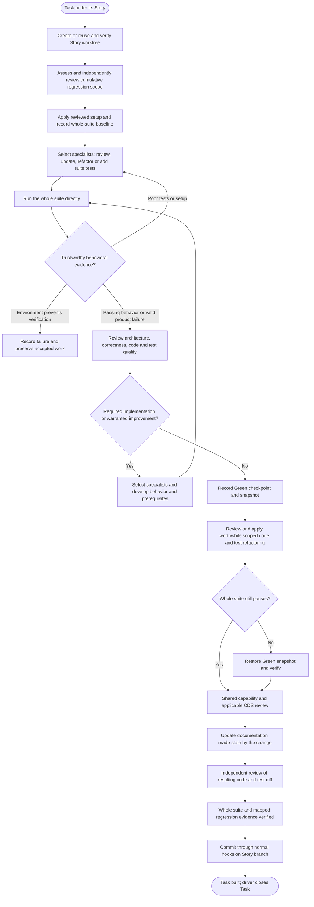

# The pipelines: build

Parent: [The pipelines: overview](pipelines.md)

The build takes a Task under a Story and produces code and tests committed in the Story's
worktree, with its complete repository suite passing. The Python orchestrator owns ordering,
subprocesses, artifacts, correction bounds and journal transitions. Headless agent sessions do
reasoning, code, test and documentation work. No model session relays a command or parses its
exit status.

Documentation selection records `documentationSelection`. Its parameterless dispatcher plans
one following `build:docs-specialist` step per selected agent, passing its `agent` parameter.
An empty selection completes without writers. Each writer records `documentationWork` before
the final independent review of the resulting diff.

## Execution and resumption

`orchestrator/flows/task_to_deploy.py` is the `task-to-deploy` composite. The driver dispatches it
through `orchestrator/run.py`. `pipeline-steps.json` defines the up-front build plan and its
script keys. The shared journal reader/writer and `JournalRunner` preserve each step's UUID,
accepted artifacts and failure. Existing `build:*` keys remain valid across the Python cutover.
An interrupted build begins at its first unfinished step; accepted work is not discarded.

The driver validates transport arguments for the selected flow, then the shared
`task-build-args.schema.json` validates the build leaf. Its Task brief keeps the Story under
`bead.story` and the design choice under `bead.cdsDesignSource`, matching the actual producer.
Story deploy leaves use their own exact argument definitions. Host execution identity is
separate from leaf fields; obsolete relay and PR-command settings are not sent to Python builds.
The producer-contract checker includes the real dispatch builder/parser and checks the projected
Task fields against the canonical bead metadata.

Regression preparation includes the Task's supplied Spec and PRD paths as well as journal
source artifacts. Final verification names the source seal beside the accepted
`regressionScope` artifact with `--bindings`, so another step or resumed dispatch reads the
same approval evidence. Each verification keeps its own execution-output directory.

`build_workspace.py` calls the existing git utilities directly to create or reuse the Story's
worktree and independently confirm its repository and branch. Every command pins its working
directory. A Task cannot commit on the default branch or detached HEAD.

`build_sessions.py` plans actual reasoning agents as journal children. Their shared schemas,
facts file and current journal are passed by path. The journal runner owns session IDs,
resumption, output validation and acceptance. A missing dynamically selected specialist is an
item failure; a missing fixed contract is a pipeline defect. New specialist selections name
bare roster roles without a plugin prefix. Before roster lookup and journal planning, the
shared reasoning boundary canonicalizes saved names with the journal's existing name helper.
The journal, registry, definition lookup and session launcher use the bare name. User and
project sources load so Claude Code applies its definition precedence. This applies to documentation writers, test writers and implementers, including
names retained in accepted artifacts.

A same-agent `Finish` continues the original agent step's semantic contract: its description,
parameters, input artifacts and saved evidence. The continuation retains its own journal ID,
session and completion status. Explicit nested Finish steps resolve to the same semantic origin;
ordinary helper steps keep their own contracts.

## One Task

Correction work is bounded within a dispatch. Implementation and suite-quality correction have
three rounds, and regression scope/mapping review permits two correction rounds. A later
dispatch does not inherit the earlier dispatch's consumed allowance. An unresolved correction
records its evidence and stops; no quality gate is bypassed. An empty implementation selection
for unresolved work stops with the accepted selector's rationale, preserving the named blocker
and required authority in the failure evidence. Passing tests alone do not override an
unapproved review or unresolved improvements.

## Tests and existing behavior

The PRD and TRD state requirements. Stories, specs, architecture and Task activities provide
implementation detail. Tests reflect that full contract in the existing suite; a Task is not
itself a replacement requirements document.

Test specialists consider happy paths, negative cases, edge cases and boundaries. They may
review, update and refactor existing tests as well as add new tests. Tests are code, and newly
written tests can be poor. A failing suite therefore receives a quality judgment before its
failure is treated as missing product behavior. The accepted route distinguishes test repair,
product implementation and environment failure.

An environment judgment appends one targeted `task-dependency-mapper` diagnosis using current
tracker, repository and readiness evidence. The result names real producer Tasks, their actual
parent Stories and whether their output must be built or deployed. The build validates those
identities and adds only missing consumer blockers through the normal cycle-checked writer;
normal elaboration protections for already started Tasks remain intact. A missing producer or
missing real authoring context is a finite pipeline work-authoring gap, never an owner SSM task
or permission to create shared resources as test fixtures.

`build:prerequisites-ready` remains planned while producer stages are pending. Its dispatch
returns the typed `waitingForPrerequisites` handback without a failure and releases its slot.
Delivered readiness requires a complete producer Story journal with closure and nonempty
successful stack verification evidence, or a publish-only mechanism with its actual published
commit recorded; Story status alone is insufficient. After progression,
a read-only `test-environment-provisioner` observation precedes the exact original suite and a
fresh independent assessment in the original phase. A readiness miss stops with its actual
evidence rather than redispatching the same observation. Distinct failure/tree fingerprints
and the existing build correction allowance bound diagnosis; accepted history is retained.

An empty implementer selection is reassessed only after its recorded test/tree fingerprint
changes. One appended whole-suite run and independent code review then use the normal selector.
The same tree digest is not reassessed twice, and the build correction allowance bounds changed
trees. This refreshes a decision made before a repository repair without resetting completed
journal steps.

Structured `buildPrerequisites.producers` from decomposition is stored as the canonical
`build_prerequisites` metadata object and gates selection before the first consumer suite.
Older Tasks without that field are not retroactively assigned guessed dependencies; the bounded
current-Task diagnosis repairs their actual prerequisites when discovered. Effective Task,
producer Story completion and actual host repository-holder dependencies are checked together
for cycles; unschedulable waits are explicit workflow gaps rather than indefinite holds.

When missing producer work has an actual open Story and completed saved authoring context,
the normal task decomposer appends only work that scope/spec already authorizes. Existing Task
and score objects remain exact, normal append-only durable-key writes make uncertain retries
idempotent, and only new Task ids receive normal Task scoring. No architecture or Epic assessment
runs. The changed tracker facts receive a bounded new diagnosis before consumer edges are added.
Absent that real authoring context, the pipeline records the precise finite work-authoring gap.

Build artifact readers expose recorded facts from completed steps and running structural
ancestors only. An ancestor's own deterministic completion already accepted those artifacts,
even while its children keep it running. Running siblings, future steps and raw unvalidated
session outputs remain excluded; invalidation clears the source artifacts through the normal
journal operations.

Passing required behavior is valid evidence. The build manufactures no Red, performs no
sabotage and requires no test-the-test demonstration. Passing tests still leave architecture
conformance, correctness, quality and best practices to review. Refactoring receives an
opportunity every time; a justified no-change result is valid when no improvement is warranted.
Changes stay within the assigned behavior and its prerequisites.

`build_suite.py` uses an already recorded suite command or the repository's explicit Taskfile
`test` task. A genuinely unstructured or conflicting declaration receives one configuration
judgment, whose result is recorded and reused. No test framework command is guessed. Commands
execute through `Tools.command`; full stdout, stderr and exit status remain in evidence files.
A zero exit alone does not establish behavioral coverage. The approved regression mapping and
fresh execution evidence remain required.

## Prerequisites and shared capabilities

The build develops missing prerequisite services, libraries and infrastructure in their owning
repositories and normal worktrees. It does not merely stop because a prerequisite has not yet
been built, and it does not duplicate a shared capability locally. Required external authority
and unpublished SkillSpoke library changes remain explicit blocking facts under their existing
rules; a consumer pin or lockfile is never changed ahead of publication.

Shared-capability review considers the capabilities named by the Task's matrix IDs. UI work is
reviewed against the Task's stated supplied bundle or live CDS source. Blocking and warranted
improvement findings receive bounded implementation and re-review.

## Commit and completion

The build checkpoints a verified Green state before refactoring. A regressing refactor restores
that snapshot and verifies the suite again. Before final commit, an independent reviewer inspects
the resulting code and test diff, the complete suite passes, and the cumulative regression tools
verify the mapped evidence. Repository hooks run normally at commit. A rejected hook or dirty
post-hook tree is a recorded work failure, never a reason to bypass hooks.

The Task's build sets no matrix approval or verified gate. The Story's deployment follows only
when its Tasks are built, as described in [deploy](pipelines-deploy.md).
