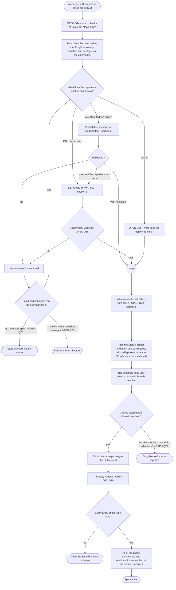
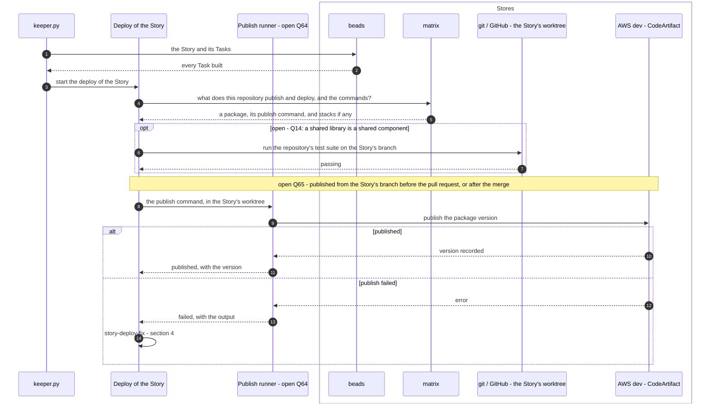
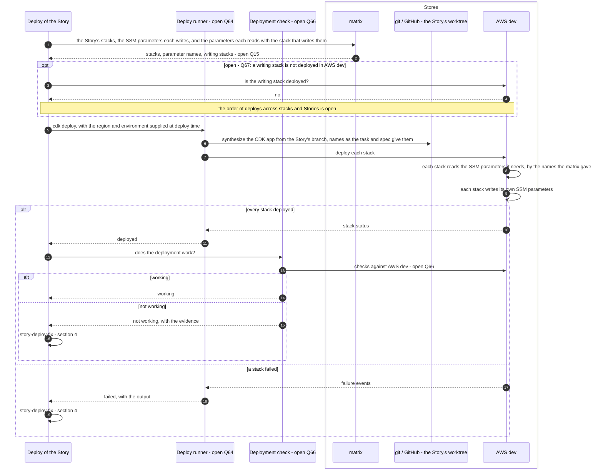
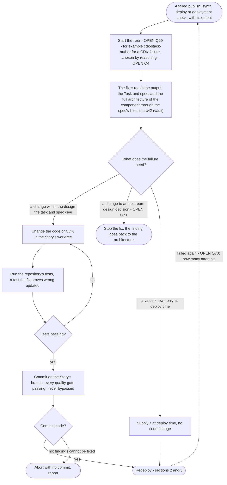
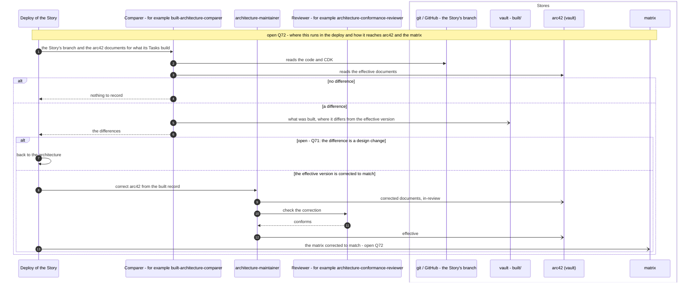
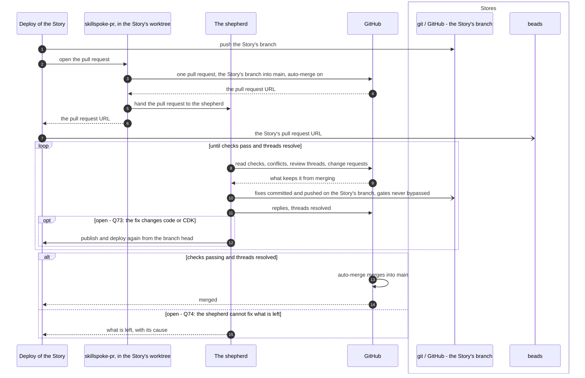
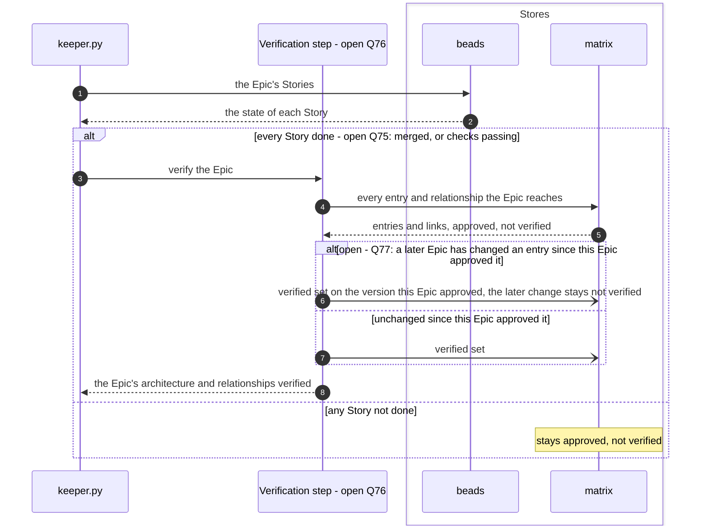
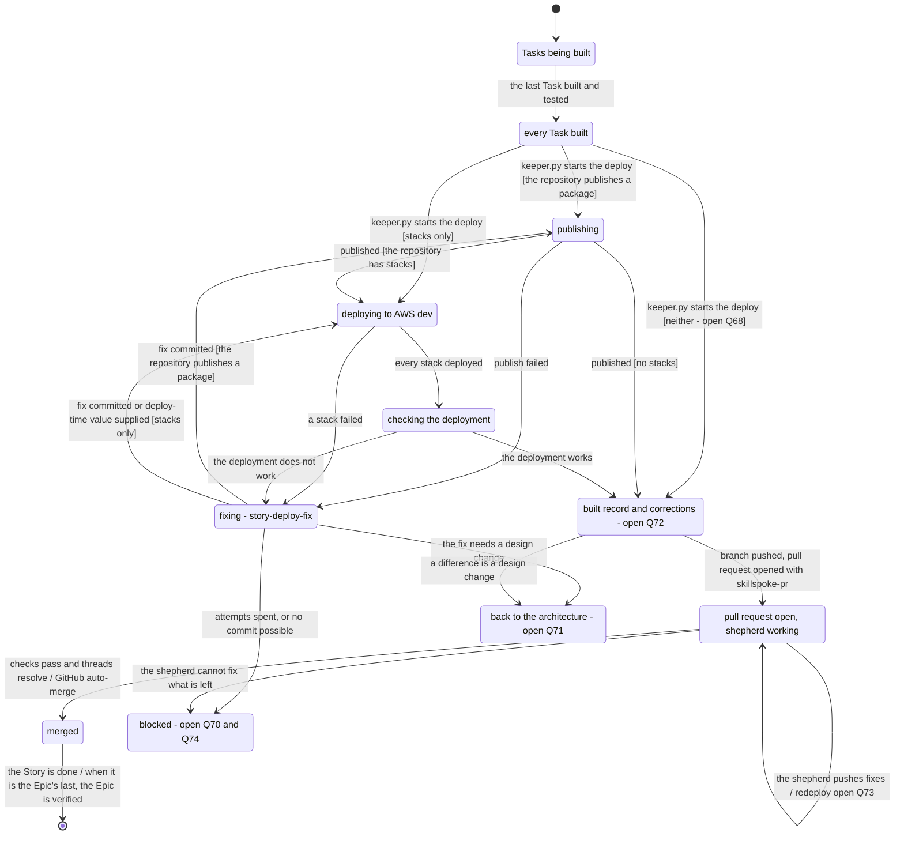
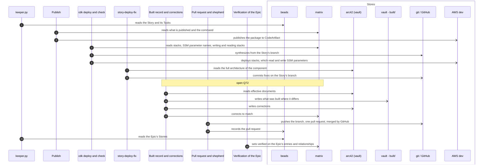

# The pipelines: deploy

Parent: [The pipelines: overview](pipelines.md)

The deploy pipeline runs once per Story. It takes a Story whose Tasks are all built, with their
code and tests on the Story's branch in the Story's worktree, and produces the Story's repository
published (each custom Python library to CodeArtifact) and deployed to AWS dev with CDK, the
deployment working, and one pull request that GitHub merges once the shepherd has its checks
passing and its threads resolved. When every Story of an Epic is done, all of the Epic's
architecture and relationships are set verified in the matrix. This document draws the deploy
**as the owner wants it**. The sources are the owner's messages of 2026-10-19 (Part 1 of the
elaboration plan, items 1.8, 1.11 and 1.13, and its questions), the vault's `docs/sdlc/sdlc.md`,
the SkillSpoke repository's root `AGENTS.md` and `.claude/rules/git-conventions.md`, and
[requirements/pipelines.md](../requirements/pipelines.md) and
[requirements/matrix.md](../requirements/matrix.md) where they agree with the owner's words. Where
the owner has not said what is wanted, the step is drawn as an open question, listed at the end
with a recommendation. The approved and verified states this pipeline ends in are drawn in
[The pipelines: architecture and matrix states](pipelines-architecture-states.md), sections 2 to
4; the build that comes before is [The pipelines: build](pipelines-build.md).

The owner, on what the deploy proves: "Once all of the tasks for all of the stories for and Epic
have been built and tested (including CI (CDK), which means deployemen must also work), then all
of the architecture and rellationships for the Epic can be set to verified." and "Verification is
the only way to prove tht the architecture is likely to work."

## Legend

| Notation | Meaning |
|---|---|
| `A ->> B` (sequence) | A calls or starts B: B does work for A |
| `B -->> A` (sequence) | B returns its result to A |
| `A -) Store` (sequence) | A writes to a store; nothing is returned |
| `alt` / `opt` labelled "open - Qn", or a node "OPEN Qn" | The owner has not decided this. Every branch shown is one the owner named or one listed as a question, and none is a decision. Qn is listed under "Open questions" at the end |
| `([...])` (activity) | Start or end |
| `{...?}` (activity) | A decision; every outgoing edge is labelled with its guard |
| "fork" / "join" nodes (activity) | Work that runs concurrently, and the point where all of it has finished |
| "merge" node (activity) | Alternative paths coming back together; no waiting |
| `[*]` and labelled transitions (state machine) | Initial state; event [guard] / effect |
| `keeper.py` | The driver in `ops/sdlc-automation` that starts the deploy of a Story. Only the owner runs it |
| beads | The issue tracker that holds the Epic, its Stories and their Tasks |
| matrix | The one record of how Epics, documents, resources, stacks, SSM parameters and repositories relate ([requirements/matrix.md](../requirements/matrix.md)). It holds no Story and no Task |
| arc42 (vault) | The arc42 architecture and design documents in the `skillspoke-docs` vault |
| vault | The `skillspoke-docs` vault outside arc42, for example the record of what was built (`tech/architecture/built/`) |
| git / GitHub | The Story's repository: its worktree, the Story's branch, the pull request and `main` |
| AWS dev | The one development AWS account: CodeArtifact and the CloudFormation stacks CDK deploys |
| "(no agent yet)" | A role the owner's design has that no agent file implements today |

Agents are named by their role. Where a roster agent fits a role, it is named "for example", with
the subject in its own file that gives it a reason to be used. Which agent is started is reasoning,
not code (the owner: "What I do not want is python code deciding which specialists to use");
how it is chosen is plan question 4.

## 1. One Story, through deploy

**Subject:** the deploy of one Story.
**Scope:** from a Story whose Tasks are all built to its pull request merged, and, for the last
Story of an Epic, the Epic's verification.
**Purpose:** the order of the steps, what each needs before it starts, and where each loop ends.
**Boundary:** the build of each Task is in [build](pipelines-build.md); each step here is drawn in
detail in the sections that follow.
**Sources:** the owner: "keeper is what knows to deploy a story."; the requirements row for Deploy:
"A Story whose Tasks are all built" producing "The Story's repository published and deployed to
the development environment and verified, the record of what was built, and one merged pull
request" ([requirements/pipelines.md](../requirements/pipelines.md)); custom Python libraries,
[requirements/matrix.md](../requirements/matrix.md) R34: "every custom Python library as a package
published to CodeArtifact"; not every repository has a stack, the owner: "I want to remind you
that not all repos have stacks."; verification, the owner, quoted above; the pull request,
`git-conventions.md`: "The agent that writes a change commits it, pushes the branch, and opens the
PR with `skillspoke-pr` before it reports." and "PRs merge automatically. Never ask the owner to
merge, and never merge yourself."

Notes on the diagram:

- The fix loop returns to the publish and deploy decision and exits when the deployment works, or
  when the fix stops for one of the two open reasons.
- A value known only at deploy time, such as the region or the environment, is supplied at
  deploy time and stops nothing (section 3).
- The deploy adds no Story and no Task to the matrix. The owner: "The matrix does not include
  stories and tasks (it isn't a build tracker), and it doesn't care about what has actually been
  deployed."

## 2. Publish a custom Python library

**Subject:** the publish of the package a Story's repository holds.
**Scope:** from the Story's built branch to the package version in CodeArtifact.
**Purpose:** what the publish reads, who runs it and what it writes.
**Boundary:** the CDK deploy is section 3; a failed publish goes to section 4.
**Sources:** the owner, on the naming library: "a python library, which should have been
published to CodeArtifacts."; [requirements/matrix.md](../requirements/matrix.md) R34 ("The matrix
records every custom Python library as a package published to CodeArtifact") and question Q21
("What does this stack publish and deploy, and which commands test, publish and deploy it?"),
which agree with the owner's matrix as the index that saves every step a scan ("so that agents do
not need the scan a perform complicated searches over and over just to figure out answer to
simple questions"); checks of upstream steps, the owner: "I don't want every subsequent step in a
process constantly checking that upstream steps were done right" with the exception "like if B is
going to be a universal or shared component".

Notes on the diagram:

- The matrix answers what the repository publishes and the command; the deploy does not scan the
  repository to find out ([requirements/matrix.md](../requirements/matrix.md) R38, the owner on
  the matrix's purpose).
- A package version can be deleted and published again, so a version published from a Story's
  branch can be replaced.

## 3. Deploy to AWS dev with CDK

**Subject:** the `cdk deploy` of the stacks a Story's repository holds.
**Scope:** from the published package (when there is one) to every stack deployed in AWS dev and
the deployment working.
**Purpose:** where a stack finds another stack's SSM parameter, how values known only at deploy
time are handled, and what decides that the deployment works.
**Boundary:** a failed deploy goes to section 4. What the deploy records in the matrix is only
the verified flag, at the end of the Epic (section 7).
**Sources:** `AGENTS.md`: "Anything deployed to AWS dev can be torn down and redeployed" and
"Cross-stack references: do not use CDK/CloudFormation exports or imports to share values between
stacks. The producing stack stores the value in an SSM Parameter Store parameter; the consuming
stack reads that parameter's value."; the owner: "Your question should be, "How can stack-B know
what ssm stack-A is saving (or will saved once deployed)?" The answer for that is, it should look
in the matrix." and "for each stack, I should be able to see what SSM parameters it would write";
deploy-time values, the owner: "there may be some information that just simply isn't known until
deploy time, such as the region or environment where we are deploying. We don't want to stop
because of that. We need to make sure some of that is accommodated and handled at run time
(deploy time)."; names, the owner: "I don't want to encourage an agent to start naming things,
when the names should have already been provided in the task (or spec)."

Notes on the diagram:

- The names of stacks, resources and parameters come from the task and the spec, and the
  parameter names another stack writes come from the matrix. The deploy creates no name.
- The region and the environment are supplied when the deploy runs and are not a reason to stop
  or to report a gap.

## 4. The fix of a failed deploy (story-deploy-fix)

**Subject:** the fix of a Story's failed publish, synth, deploy or deployment check.
**Scope:** from the failure's output to a fix committed on the Story's branch, or to the fix
stopping.
**Purpose:** what the fix is given, what it may change, where it commits, and where the loop
ends.
**Boundary:** the redeploy after the fix is sections 2 and 3. Who fixes, how many attempts, and
whether a design change goes back to elaboration are not stated by the owner and are drawn open.
**Sources:** the owner, on the build: "The architecture process is designed to clean up the matrix
is it works, and the same with the build."; on what an implementer sees: "even if it has only the
specific steps in a task that it needs to perform, it should still have access to the full
architecture for the component that it is working on"; on trust: "I need more fault-tolerance for
the pipeline, and need more trust."; on upstream decisions: "the task should be detailed so that
the build doesn't need to guess or interpret or decide on how to do anything that was already
concluded upstream in the elaboration (and architecture) pipeline."; `AGENTS.md` tier 1: "TDD
London School (mock-first) for new code."; `git-conventions.md`: "When a pre-commit hook fails:
fix **all** findings, restage, retry.", "If findings can't be fixed, **abort with no commit** and
report." and "`git commit --no-verify` / `git push --no-verify` / `git commit -n` are
**forbidden**".

Notes on the diagram:

- The inner loop from "Tests passing?" back to the change ends when the tests pass, or when the
  fixer gives up and the fix ends with no commit.
- The outer loop from "Redeploy" back to the start ends when the deployment works, or when the
  number of attempts (open) is spent.
- A fix commits on the Story's branch in the Story's worktree. It opens no pull request; the one
  pull request of the Story is section 6.

## 5. What the deploy finds wrong in the architecture

**Subject:** a difference between what a Story built and deployed, and arc42 and the matrix.
**Scope:** from the difference found to arc42 and the matrix corrected.
**Purpose:** that what the build finds wrong is cleaned up, and which parts of the how are open.
**Boundary:** how arc42 document states change is in
[architecture and matrix states](pipelines-architecture-states.md), section 1.
**Sources:** the owner: "The architecture process is designed to clean up the matrix is it works,
and the same with the build." and "It will not be 100% complete, and it may not be 100% accurate
in it's current state, but that's ok."; the owner: "Any updates or corrections to arc42 must also
be made."; `docs/sdlc/sdlc.md`: "**Built** (`built/<subject>/`) - what the build delivered where
it differs from the effective version, which is then corrected to match."

Notes on the diagram:

- The comparer's subject in its own file is "Compare the code one Story built with the approved
  architecture for its elements and record each difference", which gives it a reason to be used
  here.
- Whether the correction is approved by the architecture agent responsible for approving the
  architecture, as an `effective` document must be, is part of Q72.

## 6. The pull request, the shepherd and auto-merge

**Subject:** the one pull request of a Story.
**Scope:** from the Story's branch, deployed and working, to the pull request merged by GitHub.
**Purpose:** who opens the pull request, from where, what the shepherd does, and who merges.
**Boundary:** CI here is the pull request's checks; the CI the owner names in verification is
these checks passing.
**Sources:** `git-conventions.md`: "PRs: always `skillspoke-pr` (never `gh pr create`)", "Run
`skillspoke-pr` inside the branch's worktree.", "It opens the PR with GitHub auto-merge switched
on and hands it to the shepherd, which fixes until checks pass and threads resolve; GitHub then
merges the PR.", "PRs merge automatically. Never ask the owner to merge, and never merge
yourself.", "It never commits on `main` in a primary working tree, never pushes to `main`" and
"A commit that is not pushed, or a branch with no PR, is unfinished work, not a handoff."; the
requirements row: "one merged pull request".

Notes on the diagram:

- The loop exits when the checks pass and the threads are resolved, and GitHub merges; or when
  the shepherd cannot fix what is left (open).
- No agent merges and the owner is never asked to merge.

## 7. Verification: the matrix's verified marks

**Subject:** the verified marks of one Epic.
**Scope:** from the last Story of the Epic done to all of the Epic's architecture and
relationships set verified.
**Purpose:** when verified is set, on what, and what it does not touch.
**Boundary:** the states of an entry over time, and what a later spec reads from the last
verified version, are in [architecture and matrix states](pipelines-architecture-states.md),
sections 2 and 4.
**Sources:** the owner: "Once all of the tasks for all of the stories for and Epic have been built
and tested (including CI (CDK), which means deployemen must also work), then all of the
architecture and rellationships for the Epic can be set to verified.", "The verified flag remain
false or unverified. This means we have an approved, but unverified architecture for that Epic as
documented in the matrix, but none of has been verofied by building and testing.", "The linkage
could have a verified flag. The node could have a verified flag. Neither wold be required for
every situation." and "For an Epic, I should be able to instantly know what AWS resources are
invalidated and what stacks and repos those AWS resources are in."; `AGENTS.md`: "A Story or Epic
is never closed because its Tasks are closed, and an open Epic is never a condition for other
work."

Notes on the diagram:

- Verification writes only the matrix. It changes no arc42 document; `effective` is the
  architecture agent's approval, not a build result.
- What the Epic reaches is followed through the matrix's links (plan item 1.13): its AWS
  resources, their stacks and repositories, the SSM parameters the stacks write and read, and the
  documents related to them.
- The name of the verified flag is plan question 12.

## 8. The states of a Story through deploy

**Subject:** one Story bead.
**Scope:** from its last Task built to its pull request merged, and the Epic's verification.
**Purpose:** every state the deploy moves a Story through, and what moves it.
**Boundary:** the states of the matrix entries are in
[architecture and matrix states](pipelines-architecture-states.md), section 2.
**Sources:** those quoted in sections 1 to 7.

## 9. Where the stores are read and written

**Subject:** every read and write the deploy makes.
**Scope:** one Story's deploy, and the Epic's verification.
**Purpose:** which step touches beads, the matrix, arc42 (vault), the vault, git / GitHub and AWS
dev, and how.
**Boundary:** the order of the reads and writes is in sections 2 to 7.
**Sources:** the owner: "arc42 is both input and out. The matrix is both input and output.", "The
matrix does not include stories and tasks (it isn't a build tracker), and it doesn't care about
what has actually been deployed." and "The architecture process is designed to clean up the
matrix is it works, and the same with the build."; `git-conventions.md` and `AGENTS.md`, quoted
in sections 3 and 6.

Notes on the diagram:

- The matrix gets no Story, no Task and no record of what is deployed. Its only writes from this
  pipeline are the corrections the build finds (open Q72) and the verified
  marks.
- AWS dev can be torn down and redeployed; what is deployed there is never a source of matrix
  facts.

## 10. The agents and roles the deploy starts

**Subject:** every role that does work in the deploy.
**Scope:** one Story's deploy and the Epic's verification.
**Purpose:** each role, whether an agent or a script fills it, and the subject that gives a named
agent a reason to be used.
**Boundary:** how a specialist is chosen is plan question 4.
**Sources:** the owner: "Ever agent needs to have a reason to be used.", "I also do not want a
pipeline that blindly sends everything to ever agent", "I do prefer to spin up agents in headless
claude sessions to do work, and then get out." and "i'm a huge fan of the contracs being
deterministic in files and code"; `git-conventions.md` on the shepherd; the owner: "keeper is what
knows to deploy a story."

| Role | Who fills it | Reason it is used |
|---|---|---|
| Starts the deploy of a Story, and the Epic's verification | `keeper.py` (the owner: "keeper is what knows to deploy a story"); verification is open Q76 | Knows the Story's Tasks are all built |
| Runs the publish command and `cdk deploy` | Open Q64: a script or an agent | The commands come from the matrix |
| Decides that the deployment works | Open Q66; for example `smoke-test-author` where tests against the deployed endpoints are wanted | Its subject: "post-deployment smoke tests verifying the feature's critical paths against live endpoints" |
| Fixes a failed deploy | Open Q69; for example `cdk-stack-author` for a CDK failure | Its subject: "AWS CDK stacks in Python matching the approved architecture", with synth validation |
| Records what was built where it differs | Open Q72; for example `built-architecture-comparer` | Its subject: "Compare the code one Story built with the approved architecture for its elements and record each difference" |
| Corrects arc42 from the built record | `architecture-maintainer` | The arc42 writer |
| Checks that correction | For example `architecture-conformance-reviewer` | Its subject: "Check a correction of the effective architecture documents from what a Story built" |
| Takes back a design change the deploy finds | `aws-solutions-architect`, open Q71 | The owner: "The solutions architect is responsible for all architecture" |
| Opens the pull request | `skillspoke-pr`, run by the deploy in the Story's worktree | `git-conventions.md` |
| Gets the pull request to merge | The shepherd | `git-conventions.md`: "fixes until checks pass and threads resolve" |
| Merges | GitHub auto-merge | `git-conventions.md`: "Never ask the owner to merge, and never merge yourself." |

## Open questions

Q1 to Q16 are the owner's questions from the elaboration plan; Q17 and above are new.

- **Q4. How are specialists chosen?** Appears in the legend and section 4 (the fixer).
  Recommendation, as the plan gives it: the step that has the reasoning names the subjects that
  need a specialist, with the reason for each, and the workflow sends the work to the specialist
  for each named subject, from a list of subjects and specialists the owner approves. Here, the
  failure's output and the deploy step that failed name the subject. Reason: the owner: "What I do
  not want is python code deciding which specialists to use" and "Ever agent needs to have a
  reason to be used."
- **Q12. Is `architectureApproved` the approved flag?** Appears in section 7 (the flag names).
  Recommendation, as the plan gives it: yes, one approved flag and one verified flag. Reason: the
  owner named two flags.
- **Q14. Which checks of upstream steps stay in the build and deploy?** Appears in sections 1
  and 2. Recommendation: the deploy checks nothing the build already did, except that the test
  suite of a shared library runs once more before its package is published. Reason: the owner's
  rule and its exception, "like if B is going to be a universal or shared component"; a published
  library is used by every repository that depends on it.
- **Q15. How is an SSM parameter recorded in the matrix?** Appears in section 3. Recommendation,
  as the plan gives it: as its own entry, linked from the stack that writes it and to each stack
  that reads it. Reason: the deploy then reads the parameter name and the writing stack by
  following links.
- **Q64. Does a script or an agent run the publish command and `cdk
  deploy`?** Appears in sections 2, 3 and 10. Recommendation: a script runs the commands the
  matrix names and reports exit status and output; an agent is started only for the fix. Reason:
  running a named command needs no reasoning, the owner prefers deterministic contracts "in files
  and code", and every agent needs a reason to be used.
- **Q65. Is a package published from the Story's branch before the pull
  request, or from `main` after the merge?** Appears in section 2. Recommendation: from the
  Story's branch, before the pull request, and again from the branch head if the shepherd changes
  the library. Reason: the owner's verification needs the deployment working, which for a stack
  that uses the library needs the version published; a package version can be deleted and
  published again.
- **Q66. What proves "the deployment working"?** Appears in sections 1, 3
  and 10. Recommendation: every stack reaches `CREATE_COMPLETE` or `UPDATE_COMPLETE`, and the
  post-deployment tests the spec names for the Story's critical paths pass against AWS dev.
  Reason: the owner: "deployemen must also work"; a completed stack proves the resources exist,
  and the Well-Architected Operational Excellence pillar calls for testing a deployment, not only
  applying it.
- **Q67. In what order are stacks and Stories deployed when stack-B reads a
  parameter stack-A writes, and what happens when stack-A is not deployed in AWS dev?** Appears
  in section 3. Recommendation: `keeper.py` orders Story deploys by the matrix's links between a
  writing stack and its reading stacks, and deploys a writing stack that is not in AWS dev from its
  repository's `main` before the reading stack. Reason: the owner places the parameter's name in
  the matrix, and AWS dev "can be torn down and redeployed", so a missing stack is normal there
  and not a fault of the Story.
- **Q68. What does the deploy do for a Story whose repository neither
  publishes a package nor deploys a stack?** Appears in sections 1 and 8. Recommendation: go
  straight to the built record and the pull request, with the pull request's checks as the CI.
  Reason: the owner: "not all repos have stacks"; there is nothing to publish or deploy, and the
  Story still needs its one merged pull request.
- **Q69. Who fixes a failed deploy?** Appears in sections 4 and 10.
  Recommendation: the specialist for the failing subject, chosen as Q4 decides (for example
  `cdk-stack-author` for a synth or CDK deploy failure), given the failure's output, the Task and
  spec, and the links to the full architecture of the component. Reason: the owner wants
  specialists with "Specific instructions and skills and expertise and tools, small context", and
  every implementer to have "access to the full architecture for the component that it is working
  on".
- **Q70. How many fix attempts are made before the fix stops, and what
  happens then?** Appears in sections 1, 4 and 8. Recommendation: three attempts per Story deploy;
  then the Story is marked blocked in beads with the cause and the last output, and `keeper.py`
  reports it to the owner. Reason: the owner: a pipeline that "dosn't take 2 hours to run through
  a single Epic"; a bound keeps one failing Story from consuming the run, and a blocked Story with
  its cause is the record the owner acts on.
- **Q71. Does a fix, or a built difference, that changes the design go back
  to elaboration?** Appears in sections 1, 4, 5, 8 and 10. Recommendation: yes; the fix stops, and
  the finding goes to `aws-solutions-architect` for the Epic, whose approved change then reaches
  the Story's Tasks as elaboration does. Reason: the owner: "The solutions architect is
  responsible for all architecture", and the build must not "decide on how to do anything that
  was already concluded upstream".
- **Q72. How does what the build or deploy finds wrong in the architecture
  reach arc42 and the matrix, and where in the deploy does it run?** Appears in sections 1, 5, 8,
  9 and 10. Recommendation: after the deployment works and before the pull request, a comparer
  writes each difference to `built/<subject>/` in the vault, `architecture-maintainer` corrects the
  effective documents, the architecture agent responsible for approving the architecture approves
  the correction (so `effective` keeps its meaning), and the matching matrix entries are corrected
  in the same step. Reason: `docs/sdlc/sdlc.md` gives the built record "which is then corrected to
  match"; the owner: "The architecture process is designed to clean up the matrix is it works, and
  the same with the build." and "Any updates or corrections to arc42 must also be made."
- **Q73. Does a shepherd's change re-run the publish and the deploy?**
  Appears in sections 6 and 8. Recommendation: yes, when the change touches code, a package or
  CDK; not for a change to tests, comments or documentation only. Reason: verified must mean that
  what merged is what was deployed and worked.
- **Q74. What happens when the shepherd cannot get the pull request to
  merge?** Appears in sections 1, 6 and 8. Recommendation: the pull request stays open, the Story
  is marked blocked in beads with what is left and its cause, and `keeper.py` reports it to the
  owner. Reason: `git-conventions.md` forbids merging by hand and bypassing gates, so the only
  honest end is a reported block.
- **Q75. Is a Story done for the Epic's verification when its pull request's
  checks pass, or when it merges?** Appears in sections 1 and 7. Recommendation: when it merges.
  Reason: GitHub merges only once checks pass and threads resolve, and `main` is what later Stories
  and Epics build on, so a merged Story is the one whose CI and CDK are proved.
- **Q76. What notices that every Story of the Epic is done, and what sets
  verified?** Appears in sections 7 and 10. Recommendation: `keeper.py` notices it from beads
  after a Story merges, and a script sets verified on every entry and relationship the Epic
  reaches, with no agent judgment. Reason: `keeper.py` already knows each Story's state; the
  condition is the owner's and needs no reasoning; drawn this way it matches
  [architecture and matrix states](pipelines-architecture-states.md), section 3.
- **Q77. What is set verified when a later Epic has changed an entry since
  this Epic approved it?** Appears in section 7. Recommendation: verified is set on the version
  this Epic approved, and the later change stays not verified. Reason: the build proved the
  version it built; the owner's versions example
  ([architecture and matrix states](pipelines-architecture-states.md), section 4) needs the last
  verified version to be known.
- **Q78. Who closes the Story bead, and when?** Appears in section 1.
  Recommendation: the deploy closes the Story when its pull request merges; the Epic is not closed
  by verification. Reason: `AGENTS.md`: "A Story or Epic is never closed because its Tasks are
  closed"; a Story closes on its own work, the merged deploy, and Epic closure is not stated by
  the owner.
