# The pipelines: deploy

Parent: [The pipelines: overview](pipelines.md)

The deploy pipeline runs once per Story. It takes in a Story whose Tasks are all built on the
Story's branch, and produces the Story's repository published and deployed to AWS dev and
verified, the record of what was built (the effective arc42 documents corrected to match the
code), and one merged pull request; when the pull request merges, the driver sets the matrix's
verified mark on what the Story built and closes the Story. The driver
(`ops/sdlc-automation/storydeploy.py`, composite `story-deploy`, runner `driver` in
`skills/pipeline-contracts/schemas/composites.json`) runs the steps of the Story's step journal
itself and dispatches three workflow scripts for the steps that need an agent:
`workflows/deploy-mechanism.js`, `workflows/story-deploy-fix.js` and
`workflows/built-version.js`; `workflows/settle.js` commits a fix, and the `shepherd-pr` skill
works the pull request until it qualifies for merging. The steps are defined in
`skills/pipeline-contracts/schemas/pipeline-steps.json` (pipeline `deploy`). The requirements are
`blueprint/requirements/pipelines.md` (the Deploy row, and "The matrix in the build and deploy
lanes", which makes the Deploy table D1 to D10 of section 4 of `blueprint/design/matrix.md` the
specification), requirements R24 to R26, R29, R39, R42 and R46 of
`blueprint/requirements/matrix.md`, and the owner's statements of 2026-10-19 quoted below.

## Legend

| Notation | Meaning |
|---|---|
| `->>` (sequence) | a call or a dispatch: the caller starts the work |
| `-->>` (sequence) | the return of that call |
| `-)` (sequence) | an asynchronous message, or a write to a store with no reply |
| `([...])` (activity) | start or end |
| `{...?}` (activity) | a decision; each outgoing edge is labelled with its guard |
| `fork` / `join` nodes (activity) | concurrent work starts / ends |
| `[*]` (state machine) | initial or terminal state; transitions read "event [guard] / effect" |
| "arc42 (vault)", "matrix", "beads", "vault", "git / GitHub" | the stores, named the same everywhere |
| note "differs from required" | the as-built behaviour differs from the requirement named |
| "assumption" | an element neither the requirements nor the code specifies |

The owner's statements of 2026-10-19 this document draws as required:

- "Once all of the tasks for all of the stories for and Epic have been built and tested (including CI (CDK), which means deployemen must also work), then all of the architecture and rellationships for the Epic can be set to verified."
- "The matrix does not include stories and tasks (it isn't a build tracker), and it doesn't care about what has actually been deployed."
- "I do prefer to spin up agents in headless claude sessions to do work, and then get out."
- "arc42 is both input and out. The matrix is both input and output."

## 1. The Story deploy, step by step

**Subject.** The steps of one Story's deploy journal, in the order they run, with the steps each
step's result adds.
**Scope.** One Story, from the dispatch that finds every Task closed to the Story's close.
**Purpose.** Show the control flow: which steps are planned up front, which a result adds, where
the fix loop and the waits are, and where the pipeline stops.
**Boundary.** Outside: how the driver selects the Story (see
[The pipelines: driver and routing](pipelines-driver.md)), and the inside of the three workflow
steps (sections 3, 4 and 5).
**Basis.** As built: `pipeline-steps.json` pipeline `deploy` (`plan`, `inner`, `kinds.*.adds`,
`limit`, `waits`); `storydeploy.py` `STEPS` and the step functions `_mechanism_step` (line 1164)
to `_close_step` (line 1508), `_failed_attempt` (line 1125, `MAX_FIX_ATTEMPTS = 3`, line 178),
`_run_journal` (line 1594). Required, by the parts that cite it: the Deploy row of
`requirements/pipelines.md`.

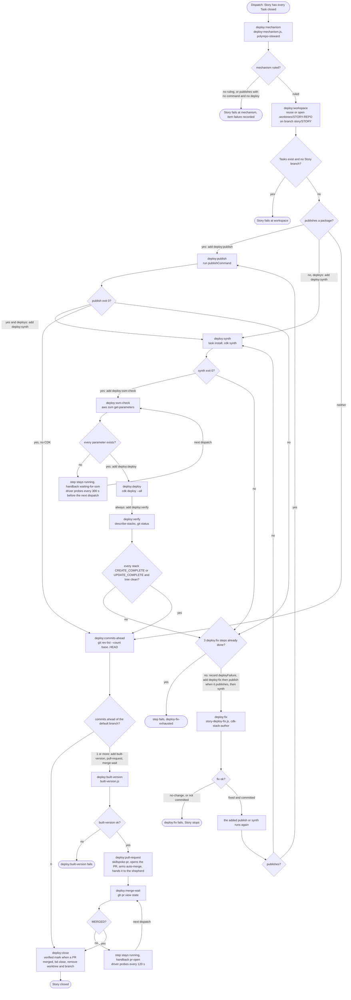

Differences from the requirements:

- The Deploy row of `requirements/pipelines.md` takes in "A Story whose Tasks are all built" and
  produces "one merged pull request". As built, a Story whose branch holds no commit
  (`commits-ahead` 0) closes with no pull request and no built-version step, and a Story with no
  Task at all is deployed once its Epic's elaboration is done (`storyorder.startable_without_tasks`,
  line 116). Neither case is covered by a requirement; both are as built only.
- A repository that neither publishes nor deploys is not stopped: `mechanism_of` returns a
  mechanism with both false (`_nothing_to_ship`, line 949), and the Story goes on to
  commits-ahead, the built-version step, a pull request and the close. Only a repository that
  publishes with no publish command and does not deploy stops (`_no_mechanism`, line 943). As
  built only.

## 2. Where the deploy reads and writes the stores

**Subject.** The stores each deploy step reads and writes.
**Scope.** Every step of section 1, and the shepherd of the pull request.
**Purpose.** Show where arc42 (vault), the matrix, beads, the vault, git / GitHub, AWS dev and the
step journal are touched, and set the required matrix reads beside the as-built ones.
**Boundary.** Outside: the build pipeline's writes to the same Story branch.
**Basis.** Required: the Deploy table D1 to D10 of `blueprint/design/matrix.md` section 4, made
required by `requirements/pipelines.md` ("The matrix in the build and deploy lanes"); R29, R39,
R46. As built: `storydeploy.py`, `deploy-mechanism.js`, `story-deploy-fix.js`, `built-version.js`,
`scripts/portfolio/depscore.py` `_sync_documents` (line 243) and `_dispatch_arch_built_remove`
(line 1854), `ops/sdlc-automation/matrixmarks.py` `verified` (line 342).

| Step | git / GitHub | AWS dev | beads | step journal |
|---|---|---|---|---|
| deploy:mechanism | the repository's declarations, read by `polyrepo-steward` | none | none | done with `mechanism` |
| deploy:workspace | `git worktree add`, `rev-parse` | none | none | `worktree`, `branch` |
| deploy:publish | none | CodeArtifact through `publishCommand` | none | `publishedHead` or `deployFailure` |
| deploy:synth, deploy:ssm-check | none | SSM `get-parameters` | none | `assembly`, `ssmParameters` |
| deploy:deploy, deploy:verify | `git status` | `cdk deploy --all`, CloudFormation `describe-stacks` | none | `deployOutput`, `stacks` or `deployFailure` |
| deploy:fix | a commit on the Story branch | `describe-stack-events`, read only | none | `fix` and the child steps |
| deploy:built-version | the worktree at HEAD, read | none | none | `built` and the child steps |
| deploy:pull-request, deploy:merge-wait | push, pull request, `gh pr view` | none | none | `pullRequest`, `pullRequestState` |
| deploy:close | `gh pr view` merge commit, `worktree remove`, `branch -D`, push of `matrix.json` | none | `bd close` of the Story | `closed` |

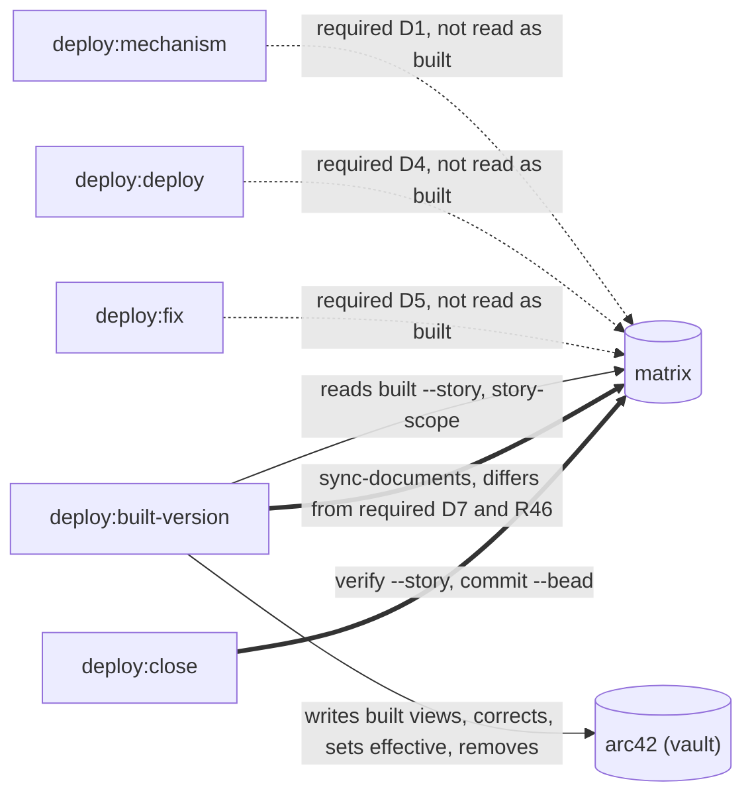

In the diagram a dotted edge is a matrix read the requirements call for and the code does not make,
and a thick edge is a write.

Differences from the requirements:

- D1 (Mechanism) requires the stack's `executionUse`, `distributedAs`, `commands.publish` and
  `commands.deploy` to be read from the matrix, with the steward session run only when one is
  absent. As built the `polyrepo-steward` session runs on every Story and the matrix is not read
  (`deploy-mechanism.js` holds no `atw-matrix` call; `storydeploy.mechanism_of`, line 955).
- D2 (Publish) requires `distributedAs`; as built the publish runs the steward's `publishCommand`.
- D4 (Deploy) requires the stack's `commands.deploy`; as built the driver runs
  `cdk deploy --all --require-approval never` (`storydeploy.deploy`, line 551).
- D5 (Deploy fix) requires `node stack:<id>` and `deps --of` for the failed stacks; as built the
  fixer's brief carries the failed step, its output and the stack statuses, and no matrix read.
- D7 (Built correction) and R46 require that the deploy records nothing in the matrix except the
  verified mark ("A deploy adds no new facts to the matrix"; R29 "changes nothing but the verified
  mark"). As built `depscore.py arch-approve` and `arch-built-remove`, which the built-version
  step runs, also bring the matrix's `document` entries of the files they touch up to date
  (`_sync_documents`, which writes the matrix through `update_matrix`).
- R30 and R38 require a step to look up what the matrix holds rather than rediscover it; the
  mechanism ruling rediscovers from the repository's own files what the matrix's stack records
  would answer.

## 3. deploy:mechanism (`workflows/deploy-mechanism.js`)

**Subject.** The ruling of what the Story's repository publishes and deploys.
**Scope.** The `deploy:mechanism` step.
**Purpose.** Show the agent the step starts, what it receives and what it returns.
**Boundary.** Outside: the publish and deploy commands themselves (section 4).
**Basis.** As built: `storydeploy.py` `_mechanism_step` (line 1164), `mechanism_of` (line 955),
`_usable` (line 1001), `_excluded_repositories` (line 924); `deploy-mechanism.js` (the
`polyrepo-steward` call, line 290; arguments `DeployMechanismArgs` in the `story-deploy-args`
shared block). Required: D1 of the Deploy table (see section 2).

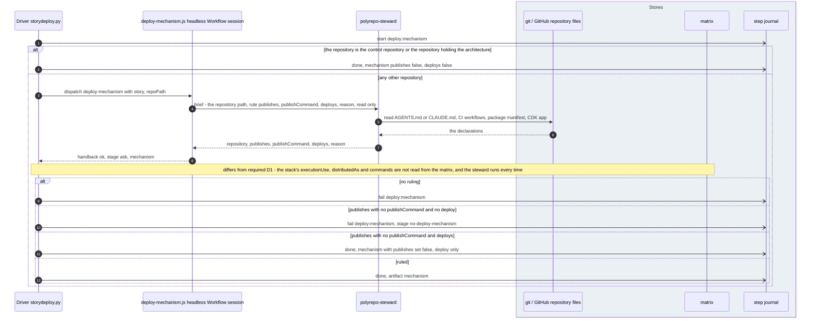

## 4. Workspace, publish, synth, SSM check, deploy and verify

**Subject.** The steps the driver runs itself, with no agent.
**Scope.** `deploy:workspace`, `deploy:publish`, `deploy:synth`, `deploy:ssm-check`,
`deploy:deploy`, `deploy:verify`, and the failure that adds a fix.
**Purpose.** Show the commands, what each records in the journal, and the two kinds of stop: a
wait and a fix.
**Boundary.** Outside: the fix itself (section 5).
**Basis.** As built: `storydeploy.py` `_workspace_step` (line 1177), `open_worktree` (line 717),
`_publish_step` (line 1204), `publish` (line 423), `_synth_step` (line 1223), `synth` (line 440,
`task install` when the Taskfile declares it, then `cdk synth --quiet --output cdk.out`),
`_ssm_check_step` (line 1256), `ssm_reads` (line 488, parameters of type
`AWS::SSM::Parameter::Value<...>`), `missing_parameters` (line 513), `_deploy_step` (line 1275),
`_verify_step` (line 1290), `verify` (line 592), `_failed_attempt` (line 1125), `wait_of`
(line 1798). Required: the Deploy row of `requirements/pipelines.md` ("published and deployed to
the development environment and verified").

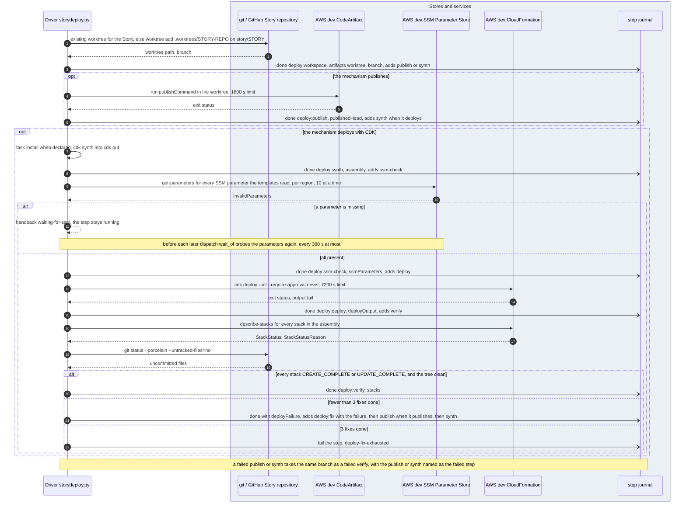

Assumptions: none.

Differences from the requirements: none beyond D2 and D4 in section 2. No requirement says how
"verified" is judged for a deploy; as built it is CloudFormation stack status plus a clean
worktree. The workflow `workflows/deploy.js` (a `smoke-test-author` suite run against the deployed
endpoints, then a `cdk-stack-author` deploy) is not declared in `composites.json` and nothing
dispatches it, so no smoke test runs in the deploy pipeline.

## 5. deploy:fix (`workflows/story-deploy-fix.js`)

**Subject.** The fix of a failed publish, synth, deploy or verification.
**Scope.** The `deploy:fix` step and its three child steps.
**Purpose.** Show the agent, what it receives, what is measured rather than taken from its report,
and how the commit lands on the Story branch.
**Boundary.** Outside: the redeploy after the fix (section 4 runs again).
**Basis.** As built: `storydeploy.py` `_fix_step` (line 1338); `story-deploy-fix.js` `stepAuthor`
(the `cdk-stack-author` call, line 1134), `stepVerify` (the `TREE_PY` git status read and the
synth test run through `relayrun.py`), `stepCommit` (`settle` with `commitOnly`); `settle.js`
`commitRun` (the `github-actions-pipeline-implementer` commit session); `pipeline-steps.json`
`inner["deploy:fix"]`.

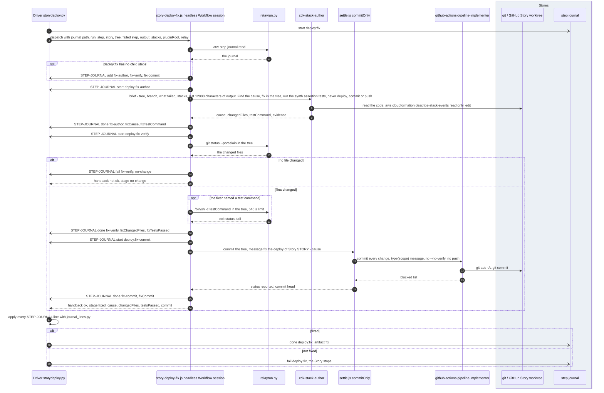

Differences from the requirements: D5 (section 2). The fix is committed whether the synth
assertion tests passed or not: `testsPassed` false, or no test command named, does not stop the
fix (`stepVerify`); the redeploy and verification decide. No requirement covers this; as built
only.

## 6. deploy:built-version (`workflows/built-version.js`)

The built-version step is drawn twice: the control flow of its child steps (6.1) and the agents,
stores and commands of each child step (6.2).

### 6.1 The child steps

**Subject.** The child steps of `deploy:built-version` and the correction and review loop.
**Scope.** One Story's built-version step.
**Purpose.** Show when a comparison writes nothing, when a correction runs, and how the review
loop ends.
**Boundary.** Outside: the agents' prompts (6.2).
**Basis.** As built: `pipeline-steps.json` `inner["deploy:built-version"]` and the
`deploy:built-*` kinds; `built-version.js` `stepSnapshot`, `stepCompare`, `stepCorrect`,
`stepReview` (`MAX_CORRECTIONS = 2`), `stepApprove`, `stepRemove`; `storydeploy.py`
`_built_version_step` (line 1403), `built_args` (line 795). Required: D6 and D7 of the Deploy
table.

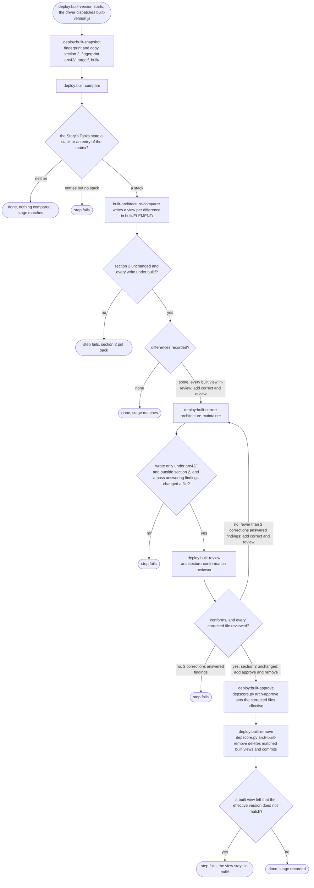

### 6.2 The agents and stores of the built-version step

**Subject.** What each built-version child step sends to its agent or command and what comes back.
**Scope.** The child steps of 6.1.
**Purpose.** Show where the matrix is read, where arc42 (vault) is written, and what is measured.
**Boundary.** Outside: the step journal changes, which follow the pattern of section 5.
**Basis.** As built: `built-version.js` (`matrixCommand`, `depscore`, `treeSnapshot`,
`constraintsGuard`, and the step functions of 6.1); `depscore.py` `arch-constraints`,
`arch-snapshot`, `arch-state`, `arch-approve`, `arch-built-remove`, `_sync_documents` (line 243).
Required: D6 (`built --story`, then `story-scope`), D7, R29, R46.

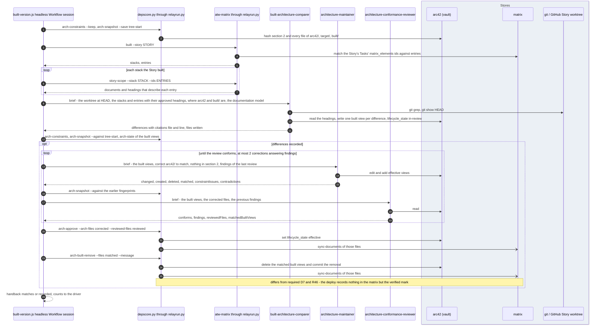

Differences from the requirements: the matrix write of D7 and R46 (section 2). The built-version
step corrects arc42 and writes no other matrix fact, which matches R29 ("A build or deploy run
reports what it finds wrong and changes nothing but the verified mark") except for that
document sync.

## 7. Pull request, shepherd and merge

**Subject.** The Story's one pull request from open to merged.
**Scope.** `deploy:pull-request` and `deploy:merge-wait`, and the shepherd that runs beside them.
**Purpose.** Show who opens the pull request, who works it until it qualifies, who merges it, and
how the driver learns it merged.
**Boundary.** Outside: the inside of one `fix-pr` pass (`commands/fix-pr.md`).
**Basis.** As built: `storydeploy.py` `_pull_request_step` (line 1429), `open_pr` (line 643, the
command `atw.pr_command()`, which is `skillspoke-pr`; exit 3 means the pull request is open and
auto-merge is not armed), `_merge_wait_step` (line 1460), `wait_of` (line 1798);
`/Users/msat1971/.local/bin/skillspoke-pr` (CodeRabbit review comment, auto-merge, the shepherd
hand-off); `ops/shepherd-prs.sh` (lock, `gitutils.py provision`, the headless session,
`gitutils.py cleanup-merged-pr`); `skills/shepherd-pr/SKILL.md` and `scripts/shepherd-pr.sh`;
`commands/fix-pr.md`. Required: the Deploy row of `requirements/pipelines.md` ("one merged pull
request").

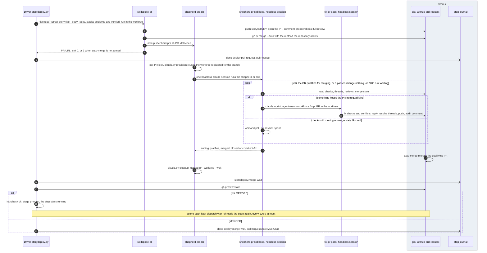

Assumptions: none. The shepherd never merges (`Bash(gh pr merge:*)` is denied in every pass);
GitHub auto-merge merges.

## 8. deploy:close and the verified mark

### 8.1 What the close does

**Subject.** The close of a Story and the one matrix write of the deploy.
**Scope.** `deploy:close`.
**Purpose.** Show where the verified mark is set, on what, and what else the close does.
**Boundary.** Outside: the Epic, which the deploy never closes.
**Basis.** As built: `storydeploy.py` `_close_step` (line 1508), `_mark_verified` (line 898),
`merge_commit` (line 875), `_remove_workspace` (line 1476); `matrixmarks.py` `verified`
(line 342, role `build-driver` in `ATW_MATRIX_ROLE`); `blueprint/design/matrix.md` 1.4 and 1.5
(`atw-matrix verify`, `built --story`). Required: R24, R25, R39, R42, R46; the owner statement of
2026-10-19 on verified, and item 1.8 of the approved naming follow-ups
(`claude-inbox/naming-followups-2026-10-17.md`, lines 172 to 193).

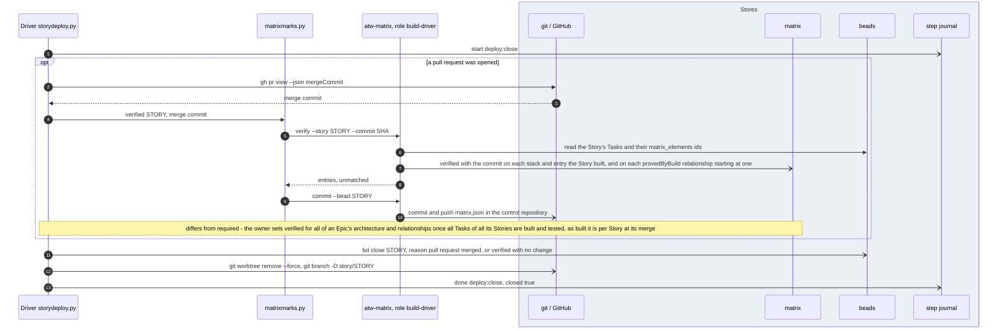

### 8.2 The verified mark, required and as built

**Subject.** When the matrix's verified mark is set.
**Scope.** The architecture an Epic's elaboration reaches, and the entries one Story's Tasks name.
**Purpose.** Set the owner's per-Epic rule beside the per-Story mark the code sets.
**Boundary.** Outside: the approved mark (`architectureApproved`), which the elaboration
pipeline's promotion sets.
**Basis.** The first machine is required: the owner statement of 2026-10-19 ("Once all of the
tasks for all of the stories for and Epic have been built and tested (including CI (CDK), which
means deployemen must also work), then all of the architecture and rellationships for the Epic can
be set to verified."), item 1.8 of the naming follow-ups, R24 and R25. The second is as built:
`storydeploy._close_step`, `matrixmarks.verified`, `design/matrix.md` 1.4.

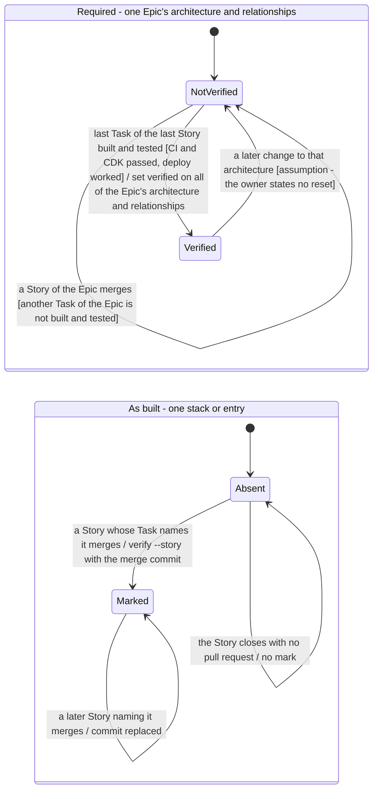

Differences from the requirements:

- Granularity: the owner requires the mark for all of an Epic's architecture and relationships at
  once, when all Tasks of all its Stories are built and tested; as built the mark is set per
  Story, at its merge, on the stacks and entries its own Tasks name (`built --story`) and on the
  `provedByBuild` relationships that start at them. A Story of an Epic merges and marks its
  entries while other Stories of the same Epic are unbuilt.
- Scope: "all of the architecture and rellationships for the Epic" is wider than the Task-named
  entries; architecture the Epic's elaboration reached that no Task names is never marked, and a
  relationship without `provedByBuild` is never marked.
- R25 says "The build pipeline sets the verified mark"; as built the deploy pipeline's
  `deploy:close` sets it (the role is still named `build-driver`).
- The owner's second statement ("it doesn't care about what has actually been deployed") holds
  as built: the mark records the merge commit and no deployed state, and the matrix holds no
  Story or Task (R40, R42: the Task script reads the beads).

Assumptions: the transition from Verified back to NotVerified in the required machine. The owner's
statements do not say what happens to the mark when a later Epic changes the architecture;
`design/matrix.md` 1.4 keeps the mark until the changing Story is verified.

## 9. A deploy step's states in the Story's journal

**Subject.** The status of one step of a Story's deploy journal.
**Scope.** Every step kind of pipeline `deploy`.
**Purpose.** Show how a dispatch begins where the last one stopped, how a wait keeps a step
running, and how a failure is retried.
**Boundary.** Outside: the journal's container steps, whose status follows their children (see
[The pipelines: driver and routing](pipelines-driver.md), section 8).
**Basis.** As built: `skills/pipeline-contracts/schemas/step-journal.schema.json`
(`stepStatus`: planned, running, done, failed); `orchestrator/core/step_journal.py`
(`start_step` refuses a done step, `fail_step`, `next_step` returns the first step that is not
done, `unclosed_steps`); `ops/sdlc-automation/deployjournal.py` `upcoming` (line 367);
`storydeploy.py` `_run_journal`, `_ssm_check_step`, `_merge_wait_step`, `_failed_attempt`,
`_stopped`, `_run_step`; `elabmark.py --start-at` (the owner's reset).

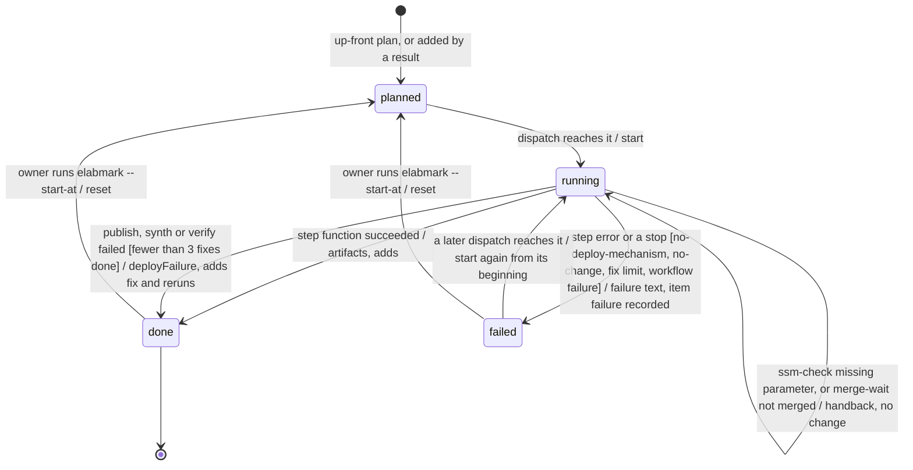

Differences from the requirements: none; no requirement covers the journal states. As built
only.
