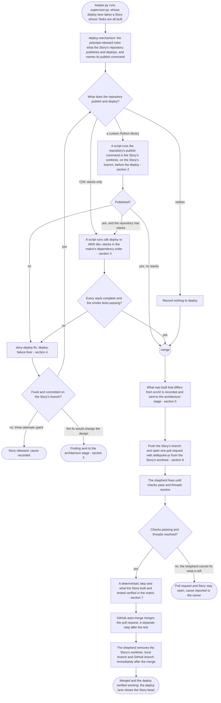
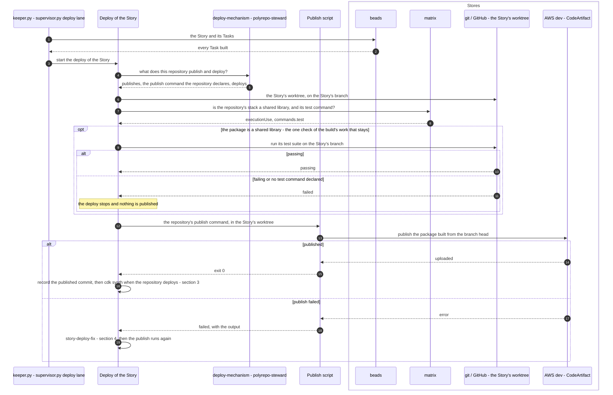
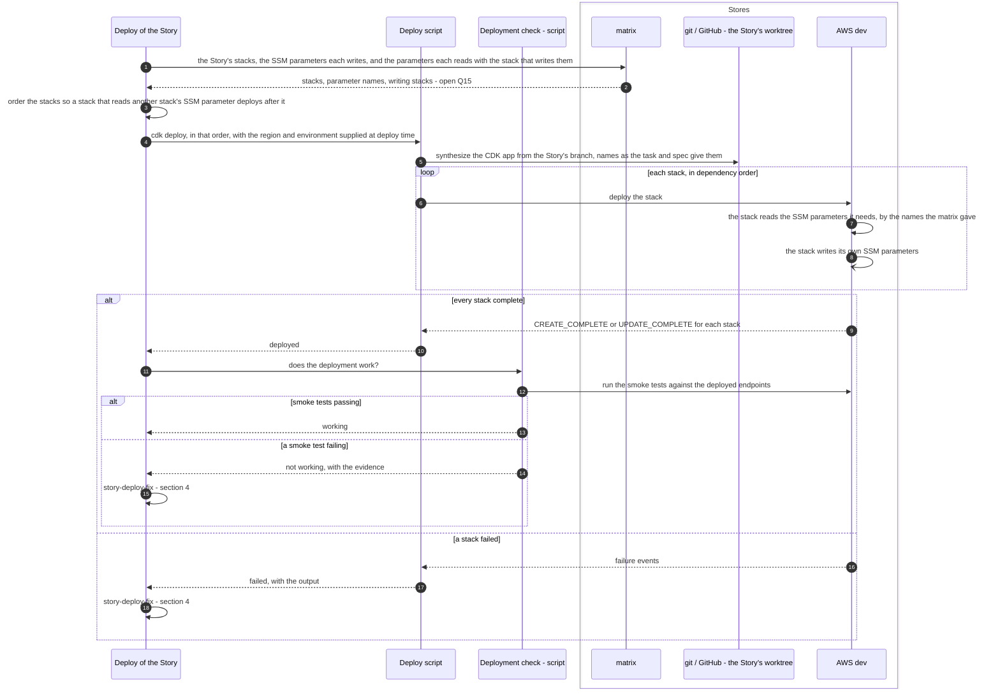
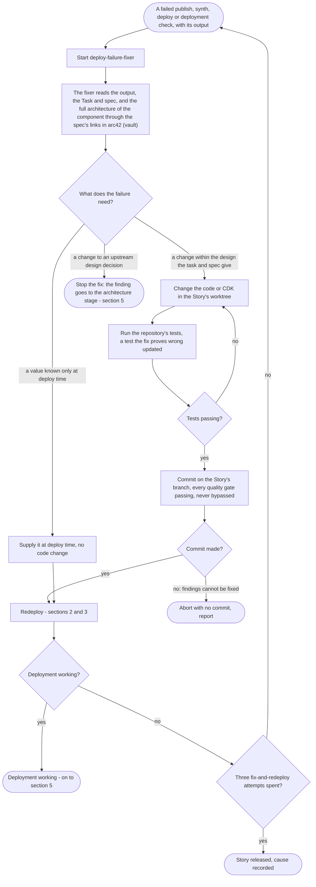
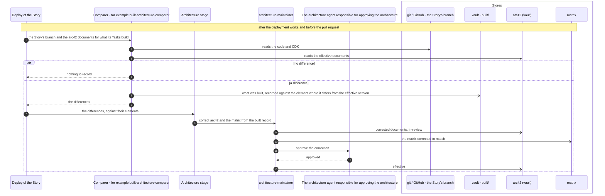
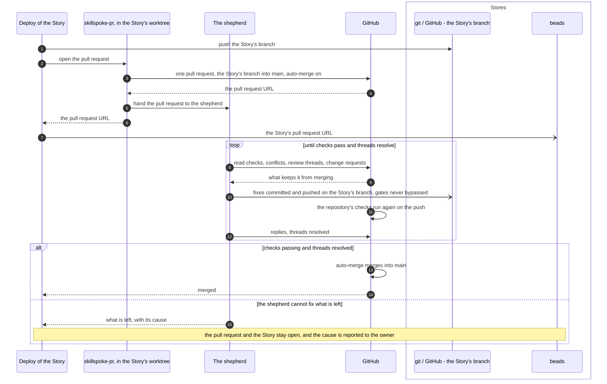
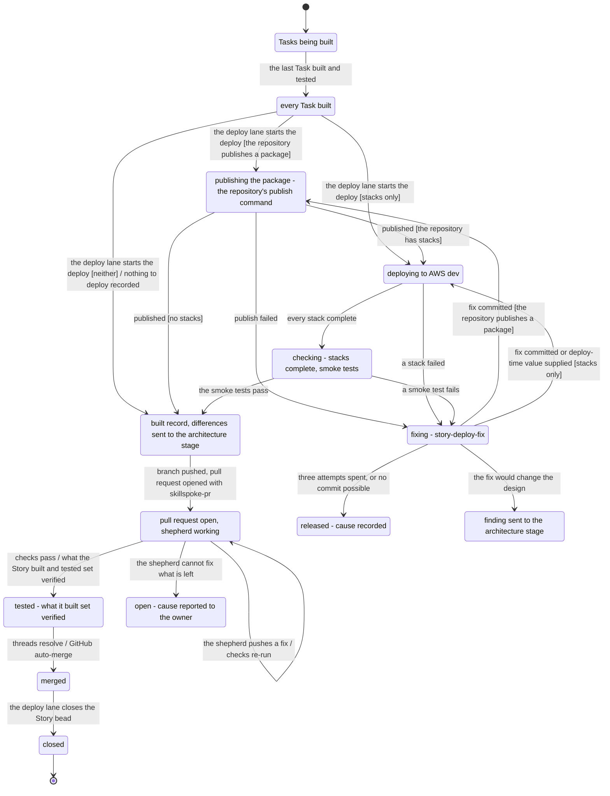
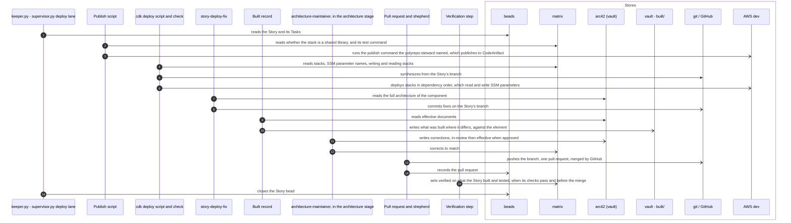

# The pipelines: deploy

Parent: [The pipelines: overview](pipelines.md)

The deploy pipeline runs once per Story. It takes a Story whose Tasks are all built, with their
code and tests on the Story's branch in the Story's worktree, and produces the Story's repository
published (each custom Python library to CodeArtifact) and deployed to AWS dev with CDK, the
deployment working, and one pull request that GitHub merges once the shepherd has its checks
passing and its threads resolved. When the Story's test passes (its CI checks and the test that its
CDK deployment works), what the Story built and tested is set verified in the matrix, before and
apart from the merge. This document draws the deploy
**as the owner wants it**. The sources are the owner's messages of 2026-10-19 (Part 1 of the
elaboration plan, items 1.8, 1.11 and 1.13, and its questions), the vault's `docs/sdlc/sdlc.md`,
the SkillSpoke repository's root `AGENTS.md` and `.claude/rules/git-conventions.md`, and
[requirements/pipelines.md](../requirements/pipelines.md) and
[requirements/matrix.md](../requirements/matrix.md) where they agree with the owner's words. Where
the owner has not said what is wanted, the step is drawn as an open question, listed at the end
with a recommendation. The approved and verified states this pipeline ends in are drawn in
[The pipelines: architecture and matrix states](pipelines-architecture-states.md), sections 2 to
4; the build that comes before is [The pipelines: build](pipelines-build.md).

The owner, on what the deploy proves: "Once all of the tasks for all of the stories for and Epic
have been built and tested (including CI (CDK), which means deployemen must also work), then all
of the architecture and rellationships for the Epic can be set to verified." and "Verification is
the only way to prove tht the architecture is likely to work."

## Legend

| Notation | Meaning |
|---|---|
| `A ->> B` (sequence) | A calls or starts B: B does work for A |
| `B -->> A` (sequence) | B returns its result to A |
| `A -) Store` (sequence) | A writes to a store; nothing is returned |
| `alt` / `opt` labelled "open - Qn", or a node "OPEN Qn" | The owner has not decided this. Every branch shown is one the owner named or one listed as a question, and none is a decision. Qn is listed under "Open questions" at the end |
| `([...])` (activity) | Start or end |
| `{...?}` (activity) | A decision; every outgoing edge is labelled with its guard |
| "fork" / "join" nodes (activity) | Work that runs concurrently, and the point where all of it has finished |
| "merge" node (activity) | Alternative paths coming back together; no waiting |
| `[*]` and labelled transitions (state machine) | Initial state; event [guard] / effect |
| `keeper.py`, `supervisor.py` | The driver in `ops/sdlc-automation`. The owner runs only `keeper.py`, which runs `supervisor.py`; the supervisor's deploy lane starts the deploy of a Story and closes the Story bead |
| beads | The issue tracker that holds the Epic, its Stories and their Tasks |
| matrix | The one record of how Epics, documents, resources, stacks, SSM parameters and repositories relate ([requirements/matrix.md](../requirements/matrix.md)). It holds no Story and no Task |
| arc42 (vault) | The arc42 architecture and design documents in the `skillspoke-docs` vault |
| vault | The `skillspoke-docs` vault outside arc42, for example the record of what was built (`tech/architecture/built/`) |
| git / GitHub | The Story's repository: its worktree, the Story's branch, the pull request and `main` |
| AWS dev | The one development AWS account: CodeArtifact and the CloudFormation stacks CDK deploys |
| "(no agent yet)" | A role the owner's design has that no agent file implements today |

Agents are named by their role. Where a roster agent fits a role, it is named "for example", with
the subject in its own file that gives it a reason to be used. Which agent is started is reasoning,
not code (the owner: "What I do not want is python code deciding which specialists to use");
how it is chosen is plan question 4.

## 1. One Story, through deploy

**Subject:** the deploy of one Story.
**Scope:** from a Story whose Tasks are all built to what it built set verified, its pull request
merged and the Story closed.
**Purpose:** the order of the steps, what each needs before it starts, and where each loop ends.
**Boundary:** the build of each Task is in [build](pipelines-build.md); each step here is drawn in
detail in the sections that follow.
**Sources:** the owner: "keeper is what knows to deploy a story."; the code, which is the source for
`keeper.py` and `supervisor.py`: `keeper.py` runs `supervisor.py`, whose deploy lane
(`selection.select_deploy`, `storyorder.gate`) takes each Story whose Tasks are all closed, one
Story at a time per repository, and runs its deploy through `storydeploy.run`, whose
`deploy:close` step closes the Story bead (`ops/sdlc-automation/keeper.py`, `supervisor.py`, `selection.py`, `storyorder.py` and `storydeploy.py`); the requirements row for Deploy:
"A Story whose Tasks are all built" producing "The Story's repository published and deployed to
the development environment and verified, the record of what was built, and one merged pull
request" ([requirements/pipelines.md](../requirements/pipelines.md)); custom Python libraries,
[requirements/matrix.md](../requirements/matrix.md) R34: "every custom Python library as a package
published to CodeArtifact"; not every repository has a stack, the owner: "I want to remind you
that not all repos have stacks."; verification, the owner, quoted above; the pull request,
`git-conventions.md`: "The agent that writes a change commits it, pushes the branch, and opens the
PR with `skillspoke-pr` before it reports." and "PRs merge automatically. Never ask the owner to
merge, and never merge yourself."



Notes on the diagram:

- The fix loop returns to the publish and deploy decision and exits when the deployment works,
  when three fix-and-redeploy attempts are spent, or when the fix would change the design.
- Scripts run the publish command and `cdk deploy`, and an agent works only on a failure, because
  running a named command needs no reasoning.
- A repository that neither publishes a package nor deploys a stack records "nothing to deploy"
  and goes on to its pull request, because not every repository has a stack and the Story still
  needs its one merged pull request.
- After three fix-and-redeploy attempts the Story is released with its cause recorded, so one
  failing Story's work is bounded and does not hold up the rest.
- When the shepherd cannot finish, the pull request and the Story stay open and the cause is
  reported to the owner, because merge is automatic and never forced.
- The shepherd, which waits for the merge, removes the Story's worktree, local branch and GitHub
  branch right after it, as the last step of landing, so no leftover branch outlives its work.
- A Story is done when its pull request has merged and its deploy was verified working, because
  both are proof; the driver then closes the Story bead, in the close step of `storydeploy.py`
  that the deploy lane of `supervisor.py` runs, because the driver is the one setter of bead
  states.
- A value known only at deploy time, such as the region or the environment, is supplied at
  deploy time and stops nothing (section 3).
- The deploy checks nothing the build already did. The one check that stays is the test suite of
  a shared library, run once more before its package is published (section 2), because a
  published library is used by every repository that depends on it: the owner's exception, "like
  if B is going to be a universal or shared component". Every other check of an upstream step is
  removed, because the owner wants trust: "I need more fault-tolerance for the pipeline, and need
  more trust."
- The deploy adds no Story and no Task to the matrix. The owner: "The matrix does not include
  stories and tasks (it isn't a build tracker), and it doesn't care about what has actually been
  deployed."

## 2. Publish a custom Python library

**Subject:** the publish of the package a Story's repository holds.
**Scope:** from the Story's built branch, in the Story's worktree, to the package the repository's
publish command uploads to CodeArtifact.
**Purpose:** what the publish reads, who runs it, when it runs and what it writes.
**Boundary:** the CDK deploy is section 3; a failed publish goes to section 4. The version the
package gets is the repository's publish command's own; the pipeline sets and changes no version
(for SkillSpoke, the "Library versions" section of each repository's `AGENTS.md`). Nothing is
published after the pull request opens or because anything merged to `main`.
**Sources:** the owner, on the naming library: "a python library, which should have been
published to CodeArtifacts."; [requirements/matrix.md](../requirements/matrix.md) R34 ("The matrix
records every custom Python library as a package published to CodeArtifact") and its lookup Q21
("What does this stack publish and deploy, and which commands test, publish and deploy it?"),
which agree with the owner's matrix as the index that saves every step a scan ("so that agents do
not need the scan a perform complicated searches over and over just to figure out answer to
simple questions"); checks of upstream steps, the owner: "I don't want every subsequent step in a
process constantly checking that upstream steps were done right" with the exception "like if B is
going to be a universal or shared component". For who starts the deploy and what the publish does, the code: `ops/sdlc-automation/keeper.py`,
`supervisor.py`, `selection.py` and `storydeploy.py` (`mechanism_of`, `_workspace_step`,
`_library_tests_fail`, `_publish_step`, `_run_again`), and the `deploy-mechanism` workflow.



Notes on the diagram:

- The `deploy-mechanism` workflow asks the `polyrepo-steward` whether the repository publishes a
  package and deploys with CDK, and the publish command as the repository declares it. A script
  runs that command and reports its exit status and output; running a command needs no reasoning.
- The publish runs from the Story's worktree on the Story's branch, after the workspace step and
  before `cdk synth`, the deploy, the verification, the built record and the pull request. It runs
  again only after a fix of a failed publish, synth, deploy or verification (section 4), because the
  fix changed the branch. Nothing is published after the pull request opens, and nothing is
  published because a merge to `main` happened.
- The pipeline passes the publish command no version and sets, computes or bumps none: the
  version is whatever the repository's own publish command publishes.
- A repository the steward rules publishes a package but names no publish command for is deployed
  without a publish when it deploys with CDK, and stops otherwise.

## 3. Deploy to AWS dev with CDK

**Subject:** the `cdk deploy` of the stacks a Story's repository holds.
**Scope:** from the published package (when there is one) to every stack deployed in AWS dev and
the deployment working.
**Purpose:** where a stack finds another stack's SSM parameter, in what order stacks deploy, how
values known only at deploy time are handled, and what decides that the deployment works.
**Boundary:** a failed deploy goes to section 4. What the deploy records in the matrix is only
the verified flag, when the Story's test passes (section 7).
**Sources:** `AGENTS.md`: "Anything deployed to AWS dev can be torn down and redeployed" and
"Cross-stack references: do not use CDK/CloudFormation exports or imports to share values between
stacks. The producing stack stores the value in an SSM Parameter Store parameter; the consuming
stack reads that parameter's value."; the owner: "Your question should be, "How can stack-B know
what ssm stack-A is saving (or will saved once deployed)?" The answer for that is, it should look
in the matrix." and "for each stack, I should be able to see what SSM parameters it would write";
deploy-time values, the owner: "there may be some information that just simply isn't known until
deploy time, such as the region or environment where we are deploying. We don't want to stop
because of that. We need to make sure some of that is accommodated and handled at run time
(deploy time)."; names, the owner: "I don't want to encourage an agent to start naming things,
when the names should have already been provided in the task (or spec)."



Notes on the diagram:

- A script runs `cdk deploy` and reports its exit status and output; running a command needs no
  reasoning.
- Stacks deploy in dependency order taken from the matrix: a stack that reads another stack's SSM
  parameter deploys after it, because the matrix holds those links.
- The deployment works when every stack reaches a complete state and the smoke tests against the
  deployed endpoints pass, because a successful deploy alone does not show the code runs. The
  smoke tests cover the Story's critical paths; writing them is the subject of, for example,
  `smoke-test-author`.
- The names of stacks, resources and parameters come from the task and the spec, and the
  parameter names another stack writes come from the matrix. The deploy creates no name.
- The region and the environment are supplied when the deploy runs and are not a reason to stop
  or to report a gap.

## 4. The fix of a failed deploy (story-deploy-fix)

**Subject:** the fix of a Story's failed publish, synth, deploy or deployment check.
**Scope:** from the failure's output to a fix committed on the Story's branch, or to the fix
stopping.
**Purpose:** what the fix is given, who makes it, what it may change, where it commits, and where
the loop ends.
**Boundary:** the redeploy after the fix is sections 2 and 3. A finding that would change the
design goes to the architecture stage (section 5).
**Sources:** the owner, on the build: "The architecture process is designed to clean up the matrix
is it works, and the same with the build."; on what an implementer sees: "even if it has only the
specific steps in a task that it needs to perform, it should still have access to the full
architecture for the component that it is working on"; on trust: "I need more fault-tolerance for
the pipeline, and need more trust."; on upstream decisions: "the task should be detailed so that
the build doesn't need to guess or interpret or decide on how to do anything that was already
concluded upstream in the elaboration (and architecture) pipeline."; `AGENTS.md` tier 1: "TDD
London School (mock-first) for new code."; `git-conventions.md`: "When a pre-commit hook fails:
fix **all** findings, restage, retry.", "If findings can't be fixed, **abort with no commit** and
report." and "`git commit --no-verify` / `git push --no-verify` / `git commit -n` are
**forbidden**".



Notes on the diagram:

- The fixer is `deploy-failure-fixer`, which diagnoses and fixes in the Story's worktree with the
  CDK and CloudFormation skills, because deploy failures are CDK and infrastructure work.
- A fix that would change the design is not made in the deploy; the finding goes to the
  architecture stage, because architecture owns design.
- The inner loop from "Tests passing?" back to the change ends when the tests pass, or when the
  fixer gives up and the fix ends with no commit.
- The outer loop from the redeploy back to the start ends when the deployment works, or after
  three fix-and-redeploy attempts, when the Story is released with its cause recorded, so the work
  is bounded.
- A fix commits on the Story's branch in the Story's worktree. It opens no pull request; the one
  pull request of the Story is section 6.

## 5. What the deploy finds wrong in the architecture

**Subject:** a difference between what a Story built and deployed, and arc42 and the matrix.
**Scope:** from the difference found to arc42 and the matrix corrected.
**Purpose:** that what the build and deploy find wrong is cleaned up, where it runs, and who
corrects it.
**Boundary:** how arc42 document states change is in
[architecture and matrix states](pipelines-architecture-states.md), section 1.
**Sources:** the owner: "The architecture process is designed to clean up the matrix is it works,
and the same with the build." and "It will not be 100% complete, and it may not be 100% accurate
in it's current state, but that's ok."; the owner: "Any updates or corrections to arc42 must also
be made."; `docs/sdlc/sdlc.md`: "**Built** (`built/<subject>/`) - what the build delivered where
it differs from the effective version, which is then corrected to match."



Notes on the diagram:

- What the build or deploy finds wrong in the architecture is recorded against the element and
  sent to the architecture stage, where `architecture-maintainer` corrects the document (it goes
  `in-review`, then `effective` when approved) and the matrix, because architecture has one
  approver. A fix that would change the design (section 4) takes the same path.
- The comparison runs after the deployment works and before the pull request, so the record
  describes what was deployed and works.
- The comparer's subject in its own file is "Compare the code one Story built with the approved
  architecture for its elements and record each difference", which gives it a reason to be used
  here.
- The comparison covers everything the approved documents state for the Story's elements, in
  arc42 and in the detailed architecture under `detailed/`: responsibilities, data ownership,
  interactions, placement, and the detailed design (routes, fields, keys, types, schemas, names).
  A name, field or value no approved document states is outside it. The "arc42 (vault)" store in
  the diagram stands for both.

## 6. The pull request, the shepherd and auto-merge

**Subject:** the one pull request of a Story.
**Scope:** from the Story's branch, deployed and working, to the pull request merged by GitHub.
**Purpose:** who opens the pull request, from where, what the shepherd does, who merges, and what
follows the merge.
**Boundary:** CI here is the pull request's checks; the CI the owner names in verification is
these checks passing.
**Sources:** `git-conventions.md`: "PRs: always `skillspoke-pr` (never `gh pr create`)", "Run
`skillspoke-pr` inside the branch's worktree.", "It opens the PR with GitHub auto-merge switched
on and hands it to the shepherd, which fixes until checks pass and threads resolve; GitHub then
merges the PR.", "PRs merge automatically. Never ask the owner to merge, and never merge
yourself.", "It never commits on `main` in a primary working tree, never pushes to `main`" and
"A commit that is not pushed, or a branch with no PR, is unfinished work, not a handoff."; the
requirements row: "one merged pull request".



Notes on the diagram:

- A change the shepherd pushes re-runs the repository's checks. It does not re-run the publish or
  the deploy: the deploy published and deployed before the pull request opened, and waits only for
  GitHub to report the pull request merged.
- The loop exits when the checks pass and the threads are resolved, and GitHub merges; or when
  the shepherd cannot fix what is left, when the pull request and the Story stay open and the cause
  is reported to the owner, because merge is automatic and never forced.
- Nothing is published after the merge.
- No agent merges and the owner is never asked to merge.

## 7. Verification: the matrix's verified marks

**Subject:** the verified marks of what one Story built and tested.
**Scope:** from the Story's test passing (its deploy verified working and its CI checks passing) to
what it built and tested set verified.
**Purpose:** when verified is set, by what, on what, and what it does not touch.
**Boundary:** the states of an entry over time, and what a later spec reads from the last
verified version, are in [architecture and matrix states](pipelines-architecture-states.md),
sections 2 and 4. The requirement is [requirements/matrix.md](../requirements/matrix.md),
section 3.5 and R25.
**Sources:** the owner: "Once all of the tasks for all of the stories for and Epic have been built
and tested (including CI (CDK), which means deployemen must also work), then all of the
architecture and rellationships for the Epic can be set to verified.", "The verified flag remain
false or unverified. This means we have an approved, but unverified architecture for that Epic as
documented in the matrix, but none of has been verofied by building and testing.", "The linkage
could have a verified flag. The node could have a verified flag. Neither wold be required for
every situation." and "For an Epic, I should be able to instantly know what AWS resources are
invalidated and what stacks and repos those AWS resources are in."; the owner's later statement of
the requirement, recorded in [requirements/matrix.md](../requirements/matrix.md) section 3.5: the
test passing is the trigger, not a merge, and verified belongs to each stack and component, valid
for every Epic that relates to it; `AGENTS.md`: "A Story or Epic is never closed because its Tasks
are closed, and an open Epic is never a condition for other work."

```mermaid
sequenceDiagram
    autonumber
    participant K as keeper.py - supervisor.py deploy lane
    participant VS as Verification step - deterministic
    participant GH as GitHub
    box Stores
        participant MX as matrix
    end

    K->>GH: the Story's checks
    GH-->>K: passing, on the tested commit; the deploy test passed before the pull request opened
    K->>VS: verify what the Story built, at the tested commit
    VS->>MX: the stacks and entries the Story's Tasks state they built, and the relationships starting there
    MX-->>VS: entries and links, with their flags
    alt an entry carries an approved change this build did not build
        VS-)MX: verified set on what this Story built and tested, that change stays not verified
    else otherwise
        VS-)MX: verified set
    end
    VS-->>K: what the Story built is verified
    Note over K,GH: the merge follows as a separate step and decides nothing about verified
```

Notes on the diagram:

- A deterministic step sets the flag when the Story's test passes, because the condition is
  factual and needs no judgment. It runs before and apart from the merge, and names no branch
  ([the matrix design](matrix.md), section 1.4.2).
- The flag is set per Story on what that Story built and tested, and waits for no other Story of
  any Epic, because an Epic owns no stack or component.
- Verified is set only on what was built and tested; an entry carrying another approved change
  stays not verified for that change, because verified says built, nothing more.
- Verification writes only the matrix. It changes no arc42 document; `effective` is the
  architecture agent's approval, not a build result.
- The flags are `approved` and `verified` on every entry and relationship
  ([the matrix design](matrix.md), section 1.4).

## 8. The states of a Story through deploy

**Subject:** one Story bead.
**Scope:** from its last Task built to the Story closed, and what it built set verified.
**Purpose:** every state the deploy moves a Story through, and what moves it.
**Boundary:** the states of the matrix entries are in
[architecture and matrix states](pipelines-architecture-states.md), section 2.
**Sources:** those quoted in sections 1 to 7.



## 9. Where the stores are read and written

**Subject:** every read and write the deploy makes.
**Scope:** one Story's deploy, and the verified flag on what it built.
**Purpose:** which step touches beads, the matrix, arc42 (vault), the vault, git / GitHub and AWS
dev, and how.
**Boundary:** the order of the reads and writes is in sections 2 to 7.
**Sources:** the owner: "arc42 is both input and out. The matrix is both input and output.", "The
matrix does not include stories and tasks (it isn't a build tracker), and it doesn't care about
what has actually been deployed." and "The architecture process is designed to clean up the
matrix is it works, and the same with the build."; `git-conventions.md` and `AGENTS.md`, quoted
in sections 3 and 6. For the deploy lane, the code: `ops/sdlc-automation/keeper.py`,
`supervisor.py`, `selection.py` and `storydeploy.py`.



Notes on the diagram:

- The matrix gets no Story, no Task and no record of what is deployed. Its only writes from this
  pipeline are the corrections the architecture stage makes from the built record and the verified
  marks.
- AWS dev can be torn down and redeployed; what is deployed there is never a source of matrix
  facts.

## 10. The agents and roles the deploy starts

**Subject:** every role that does work in the deploy.
**Scope:** one Story's deploy and the verified flag on what it built.
**Purpose:** each role, whether an agent or a script fills it, and the subject that gives a named
agent a reason to be used.
**Boundary:** how a specialist is chosen is plan question 4.
**Sources:** the owner: "Ever agent needs to have a reason to be used.", "I also do not want a
pipeline that blindly sends everything to ever agent", "I do prefer to spin up agents in headless
claude sessions to do work, and then get out." and "i'm a huge fan of the contracs being
deterministic in files and code"; `git-conventions.md` on the shepherd; the owner: "keeper is what
knows to deploy a story."; `ops/sdlc-automation/keeper.py`, `supervisor.py`, `selection.py`, `storyorder.py` and `storydeploy.py`, for who starts the deploy and closes the Story.

| Role | Who fills it | Reason it is used |
|---|---|---|
| Starts the deploy of a Story, starts the verification of what it built, and closes the Story bead | The deploy lane of `supervisor.py`, which `keeper.py` runs (the owner: "keeper is what knows to deploy a story"; `selection.select_deploy`, `storydeploy.py`) | Knows the Story's Tasks are all built, and is the one setter of bead states |
| Rules what the repository publishes and deploys, and names its publish command | `polyrepo-steward`, through the `deploy-mechanism` workflow | Its subject: the project's repositories and what each declares |
| Runs the publish command and `cdk deploy` | A script | Running a named command needs no reasoning |
| Writes the smoke tests | `smoke-test-author`, before the deploy | Its subject: smoke tests of a change's critical paths, parameterized by environment variables so they run against the deployment |
| Decides that the deployment works | A script: every stack complete and the smoke tests passing | Deploy success alone does not show the code runs |
| Fixes a failed deploy | `deploy-failure-fixer` | Its subject: diagnosing a failed publish, synth, deploy or verification and fixing it in the worktree, with the synth assertion tests |
| Records what was built where it differs | For example `built-architecture-comparer` | Its subject: "Compare the code one Story built with the approved architecture for its elements and record each difference" |
| Corrects arc42 and the matrix from the built record, and takes a design-changing finding | `architecture-maintainer`, in the architecture stage | The arc42 writer; architecture has one approver |
| Approves that correction | The architecture agent responsible for approving the architecture | An `effective` document is an approved one |
| Opens the pull request | `skillspoke-pr`, run by the deploy in the Story's worktree | `git-conventions.md` |
| Gets the pull request to merge | The shepherd | `git-conventions.md`: "fixes until checks pass and threads resolve" |
| Merges | GitHub auto-merge | `git-conventions.md`: "Never ask the owner to merge, and never merge yourself." |
| Sets what the Story built and tested verified | A deterministic step, run when the Story's test passes, before the merge | The condition is factual |

## Open questions

Q1 to Q16 are the owner's questions from the elaboration plan.

- **Q4. How are specialists chosen?** Appears in the legend. Section 4's fixer is one fixed
  specialist, `deploy-failure-fixer`, whose subject is every deploy failure.
  Recommendation, as the plan gives it: the step that has the reasoning names the subjects that
  need a specialist, with the reason for each, and the workflow sends the work to the specialist
  for each named subject, from a list of subjects and specialists the owner approves. Reason: the owner: "What I do
  not want is python code deciding which specialists to use" and "Ever agent needs to have a
  reason to be used."
- **Q15. How is an SSM parameter recorded in the matrix?** Appears in section 3. Recommendation,
  as the plan gives it: as its own entry, linked from the stack that writes it and to each stack
  that reads it. Reason: the deploy then reads the parameter name and the writing stack by
  following links.
