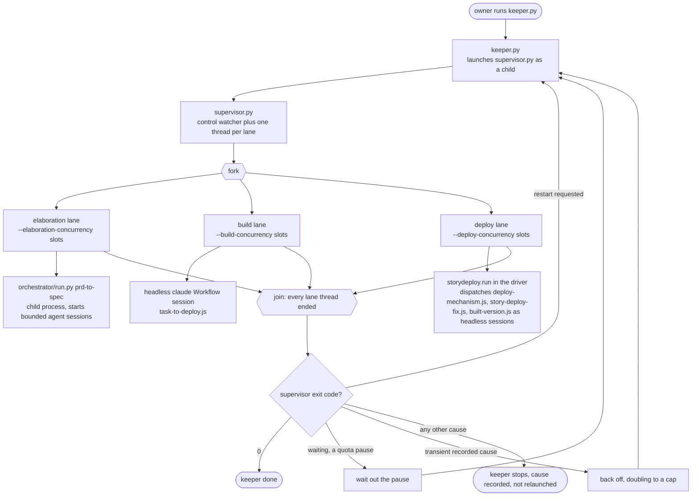
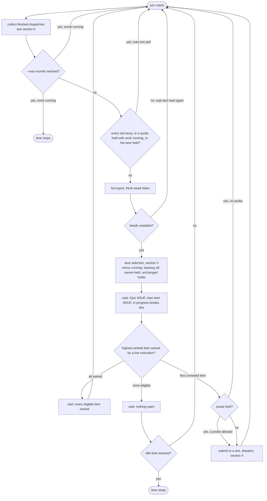
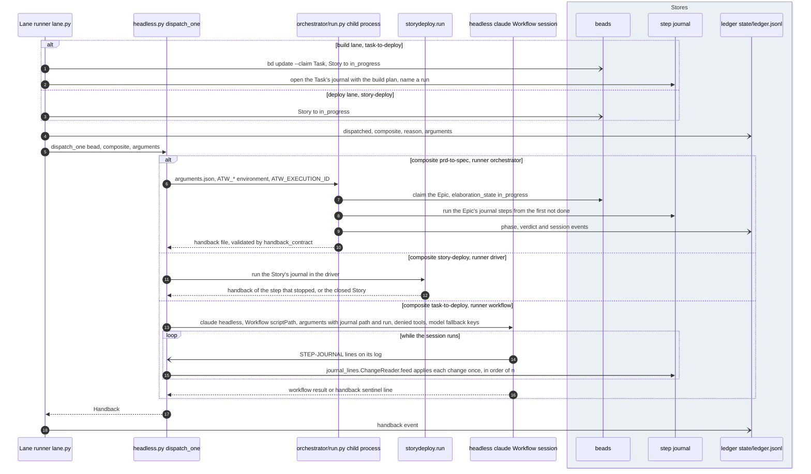
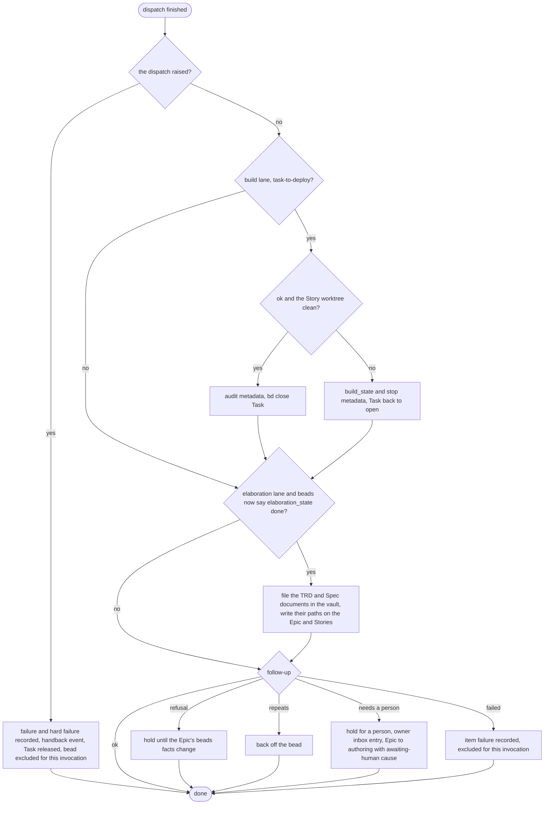
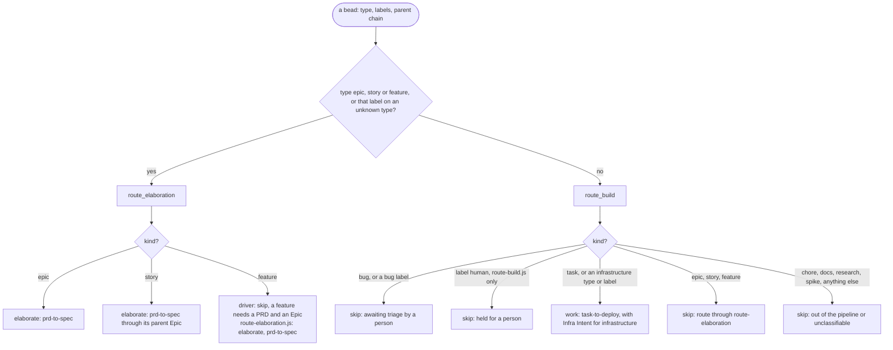
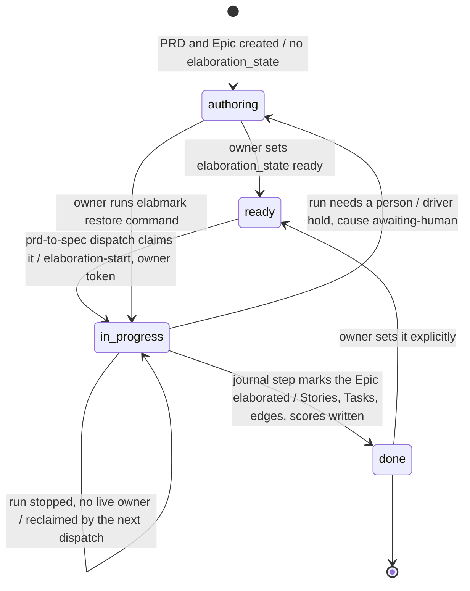
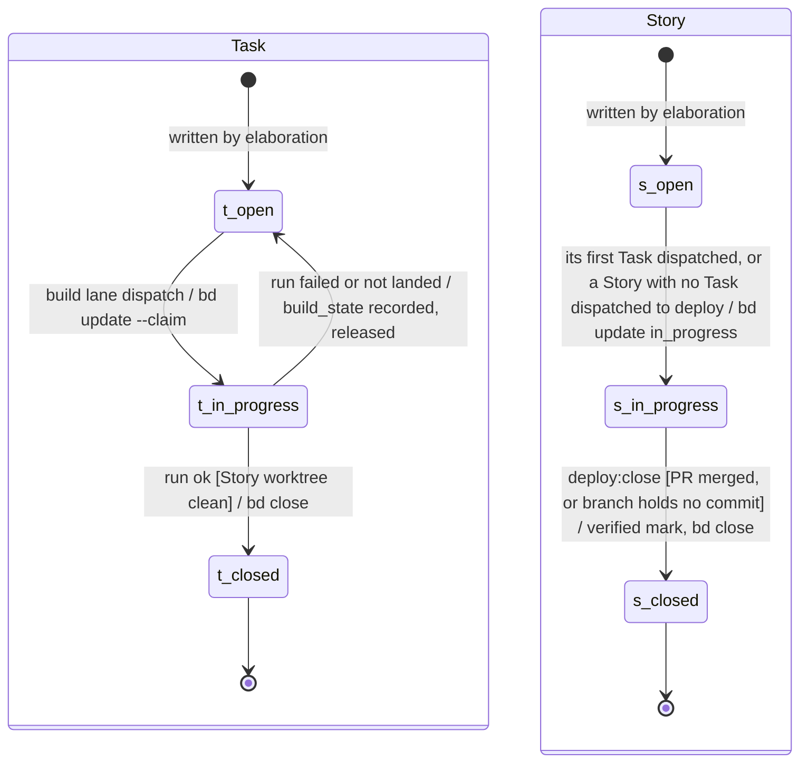
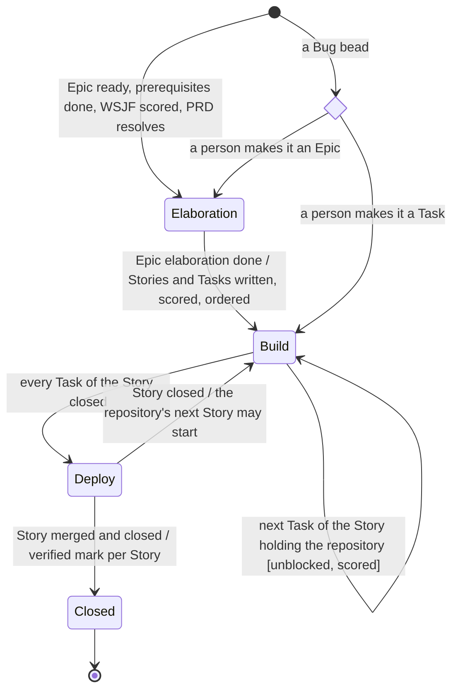
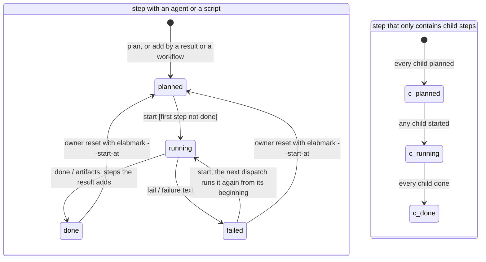

# The pipelines: driver and routing

Parent: [The pipelines: overview](pipelines.md)

The driver is the process that runs every pipeline. It lives in the control repository at
`ops/sdlc-automation`: `keeper.py` keeps `supervisor.py` running, and the supervisor runs three
lanes, elaboration, build and deploy, each with its own pool of slots. Each lane reads beads,
selects the eligible work, ranks it, and dispatches one bead per free slot: an Epic to the Python
orchestrator (`orchestrator/run.py`, composite `prd-to-spec`), a Task to a headless Workflow
session running `workflows/task-to-deploy.js`, and a Story to its own Story deploy
(`storydeploy.py`, see [The pipelines: deploy](pipelines-deploy.md)). Every build and deploy
begins at the first step of the bead's step journal that is not done. Routing decides which
composite owns a bead: the driver routes with `routing.py`; a session routes one bead with
`commands/work-bead.md`, which calls `workflows/route-build.js` or
`workflows/route-elaboration.js` and dispatches nothing. Only the owner runs the driver. The
requirements are `blueprint/requirements/pipelines.md` (the three pipelines, Bugs, composites),
the vault's `docs/sdlc/sdlc.md` (the chain of documents and beads) and the owner's statements of
2026-10-19 quoted below; `orchestrator/specs/epic/driver-contract.md` describes the elaboration
boundary as built.

## Legend

| Notation | Meaning |
|---|---|
| `->>` (sequence) | a call or a dispatch: the caller starts the work |
| `-->>` (sequence) | the return of that call |
| `-)` (sequence) | an asynchronous message, or a write to a store with no reply |
| `([...])` (activity) | start or end |
| `{...?}` (activity) | a decision; each outgoing edge is labelled with its guard |
| `fork` / `join` nodes (activity) | concurrent work starts / ends |
| `[*]` (state machine) | initial or terminal state; transitions read "event [guard] / effect" |
| "arc42 (vault)", "matrix", "beads", "vault", "git / GitHub" | the stores, named the same everywhere |
| note "differs from required" | the as-built behaviour differs from the requirement named |
| "assumption" | an element neither the requirements nor the code specifies |

The owner's statements of 2026-10-19 this document draws as required:

- "I do prefer to spin up agents in headless claude sessions to do work, and then get out." and "I know a subagent can start a workflow with subagents, etc. There can be nested subagents."
- "i'm a huge fan of the contracs being deterministic in files and code, and for agents, a skill can contain both schemas and een the code to read and write and verify the schemas."
- "What I do not want is python code deciding which specialists to use, because pythin doesn't have the reasoning to make that determination." and "I also do not want a pipeline that blindly sends everything to ever agent, whether it applies or not".

## 1. The driver's processes

**Subject.** The processes and threads of the driver.
**Scope.** One owner-started run of `keeper.py`.
**Purpose.** Show who restarts whom, and where each lane hands off its work.
**Boundary.** Outside: the dashboard (`dashboard.py`), and the inside of each dispatch (section 4).
**Basis.** As built: `keeper.py` `Keeper._run_supervisors` (line 296), `_retry_decision`
(line 335), `_after_exit` (line 352); `supervisor.py` `SdlcSupervisor.run` (line 468), `_run_lane`
(line 506); `lane.py` `LaneRunner.loop` (line 358); `headless.py` `dispatch_one` (line 653).
Required: the three pipelines of `requirements/pipelines.md`; the owner's preference for
headless sessions.

## 2. One turn of a lane

**Subject.** The loop each lane thread runs.
**Scope.** One lane, one turn.
**Purpose.** Show when a lane waits, selects, dispatches, and collects a finished dispatch.
**Boundary.** Outside: which beads are eligible (section 3) and what a dispatch runs (section 4).
**Basis.** As built: `lane.py` `_turn` (line 386), `_next_work` (line 490), `_launch_selected`
(line 466), `_await_after` (line 450), `_recover` (line 419), `_collect_outcome` (line 1277),
`_follow_up` (line 1347); `nextwork.py` `next_item` (line 257); `ordering.py` `rank` (line 122).

A lane loop that raises a beads timeout restarts after a backoff, keeping in-flight work running;
any other error, or more crashes than the window allows, ends the lane, and the supervisor stops.

## 3. Selection in each lane

**Subject.** Which beads each lane may dispatch.
**Scope.** The elaboration, build and deploy lanes.
**Purpose.** Show the eligibility rules that move a bead from one pipeline to the next.
**Boundary.** Outside: ranking (section 2) and routing (section 6).
**Basis.** As built: `selection.py` `_epic_candidate` (line 264), `build_candidates` (line 321),
`select_build` (line 408), `select_deploy` (line 433), `hold_for_person` (line 233);
`elabstate.py` `candidacy`, `unmet_blockers`; `storyorder.py` `gate` (line 184), `_take_holder`,
`_group_tasks`, `startable_without_tasks` (line 116), `_deploy` (line 149); `storydeploy.wait_of`
(line 1798); `workitems.py` `find_prd` (line 326, `atw-matrix epic`). Required: the Deploy row
("A Story whose Tasks are all built"), the Build row ("A Task with its build contract, on its
Story's branch") and the Elaboration row ("A ready Epic and its PRD") of
`requirements/pipelines.md`.

```mermaid
flowchart TD
  subgraph ELAB["Elaboration lane"]
    E1["every bead of type epic, open, not excluded"] --> E2{"every tracks or blocks prerequisite is an Epic with elaboration done?"}
    E2 -->|"no"| EX1["not selected"]
    E2 -->|"yes"| E3{"elaboration_state?"}
    E3 -->|"ready"| E4
    E3 -->|"in_progress, no live owner: reclaimed"| E4["workable"]
    E3 -->|"done, in_progress owned, authoring, held"| EX2["not selected"]
    E4 --> E5{"WSJF scored and a PRD resolves through atw-matrix epic?"}
    E5 -->|"yes"| E6["one Epic per PRD, composite prd-to-spec"]
    E5 -->|"no"| EX3["not selected"]
  end
  subgraph BUILD["Build lane"]
    B1["type task or an infrastructure type, WSJF scored, unblocked in beads, not closed, no human-action label"] --> B2{"repository, Story and elaboration key recorded?"}
    B2 -->|"no"| BX1["problem reported"]
    B2 -->|"yes"| B3{"its Epic's elaboration done?"}
    B3 -->|"no"| BX2["not selected"]
    B3 -->|"yes"| B4["group by Story, one Story per repository holds the repository:<br/>the started Story, else the highest ranked"]
    B4 --> B5["the holder's unfinished Tasks first, else its open Tasks, composite task-to-deploy"]
  end
  subgraph DEPLOY["Deploy lane"]
    D1{"open Story in_progress with every Task closed, or with no Task and its Epic done?"} -->|"yes"| D2{"its journal waits: SSM parameter missing or PR not merged?"}
    D1 -->|"no"| DX1["not selected"]
    D2 -->|"yes"| DX2["not selected until the probe clears"]
    D2 -->|"no"| D3["composite story-deploy"]
  end
```

Differences from the requirements:

- The Elaboration row takes in "A ready Epic"; as built an Epic in progress with no live owner is
  also selected (reclaimed). This continues a stopped run rather than starting one, so no
  requirement is broken; it is as built only.
- The build lane builds no Task of an Epic whose elaboration is not done, and only one Story per
  repository is worked at a time. No requirement covers either rule; as built only.

## 4. Dispatch

**Subject.** What one dispatch does, by composite.
**Scope.** `LaneRunner._work_in_scope` to the returned handback.
**Purpose.** Show the three dispatch paths, what each sends, and how the step journal is written.
**Boundary.** Outside: the steps of `prd-to-spec` and `task-to-deploy` (their own documents), and
the Story deploy's steps ([The pipelines: deploy](pipelines-deploy.md)).
**Basis.** As built: `lane.py` `_work_in_scope` (line 1192), `_claim_build` (line 1113),
`_with_step_journal` (line 1230); `workitems.py` `journal_args` (line 607), `composite_args`
(line 663); `headless.py` `dispatch_one` (line 653), `_dispatch_with_recovery`,
`_dispatch_session`, `_step_journal_reader`; `orchestrated.py`; `orchestrator/run.py` `main`;
`orchestrator/specs/epic/driver-contract.md` sections 3 and 4;
`orchestrator/core/journal_lines.py` `ChangeReader.feed`;
`skills/pipeline-contracts/SKILL.md` ("Journal changes a workflow script reports", driver
surface). Required: the owner's preference for headless sessions; deterministic contracts in
files and code.

Differences from the requirements: none found. The composites declared in
`skills/pipeline-contracts/schemas/composites.json` each have a runner (`prd-to-spec`
orchestrator; `task-to-deploy`, `story-deploy-fix`, `deploy-mechanism`, `built-version`
workflow; `story-deploy` driver), as "Composites" in `requirements/pipelines.md` requires. The
workflow `workflows/deploy.js` is declared as no composite and nothing dispatches it.

## 5. Collecting an outcome

**Subject.** What the lane does with a finished dispatch.
**Scope.** `LaneRunner._collect_outcome` and `_collect_error`.
**Purpose.** Show how a bead's beads state changes after a run, and when it is held, backed off
or excluded.
**Boundary.** Outside: the outcome classification inside `attempts.py`.
**Basis.** As built: `lane.py` `_collect_outcome` (line 1277), `_settle_build` (line 1155),
`_unlanded` (line 1130), `_elaboration_done` (line 799), `_file_artifacts` (line 994),
`_follow_up` (line 1347), `_collect_error` (line 1295);
`orchestrator/specs/epic/driver-contract.md` section 4.

## 6. Routing

**Subject.** Which composite owns a bead.
**Scope.** The driver's router and the plugin's two routers.
**Purpose.** Show the rules, and where the two as-built routers disagree with each other and with
the policy document.
**Boundary.** Outside: selection, which comes after routing in the driver (section 3).
**Basis.** As built: `ops/sdlc-automation/routing.py` `route` (line 431), `route_build`
(line 340), `route_elaboration` (line 400); `workflows/route-build.js`;
`workflows/route-elaboration.js`; `commands/work-bead.md`; `workflows/ROUTING.md`. Required:
"Bugs" and "What the pipelines are" in `requirements/pipelines.md` ("Every unit of work the
pipelines do is an Epic, a Story or a Task"; "both routers skip a Bug and say why").

The `work-bead` command routes one bead the same way through the plugin routers, then prints the
next step of the bead's journal with `atw-step-journal next`; it dispatches nothing. The driver
does not call the plugin routers: each holds its own copy of the rules.

Differences from the requirements, and between the as-built routers:

- A feature: `requirements/pipelines.md` names Epics, Stories and Tasks as the only units of
  work. The driver's `route_elaboration` skips a feature; `route-elaboration.js` routes it to
  `prd-to-spec`. `route-elaboration.js` differs from the requirement and from the driver.
- The `human` label: `route-build.js` skips a bead labelled `human`; the driver's `route_build`
  does not, and the build and deploy lanes drop such beads at selection instead
  (`selection.hold_for_person`). The outcome matches; the rule lives in two places.
- `ROUTING.md` describes rules the routers do not implement: a `spec-ready` / `implementation`
  label rule (its rule 3), `task` among the skipped types (its rule 5), and an
  `ambiguity-detector` classification (its rule 6). Neither router has them. Both routers skip a
  Bug and say why, as required.

## 7. Bead states and how a bead moves between pipelines

### 7.1 An Epic

**Subject.** An Epic's `elaboration_state` and its beads status.
**Scope.** One Epic bead.
**Purpose.** Show who moves an Epic between states and which state makes it elaboration work.
**Boundary.** Outside: the Epic's WSJF score and edges (assessment workflows).
**Basis.** As built: `elabstate.py` (`AUTHORING`, `READY`, `IN_PROGRESS`, `DONE`, `candidacy`,
`hold_for_person`, `restore_command`); `orchestrator/specs/epic/driver-contract.md` section 2;
`depscore.py` `elaboration-start`, `elaboration-finish`; `elabmark.py`. Required: the
Elaboration row of `requirements/pipelines.md`; `sdlc.md` "The Chain" (a PRD and its Epic are
created together).

Nothing in the pipelines closes an Epic bead.

### 7.2 A Task and a Story

**Subject.** The beads status of a Task and of a Story.
**Scope.** One Task bead, one Story bead.
**Purpose.** Show which lane moves each status.
**Boundary.** Outside: the Task's build steps (its step journal, section 8).
**Basis.** As built: `lane.py` `_claim_build` (line 1113), `_settle_build` (line 1155);
`beadsio.py` `claim`, `start`, `release`, `close`; `storydeploy.py` `_close_step` (line 1508);
`supervisor.py` `_continue_unfinished` (line 743, stranded claims released at start).
Required: the Build and Deploy rows of `requirements/pipelines.md`.

### 7.3 How a bead moves between pipelines

**Subject.** The hand-offs from elaboration to build to deploy.
**Scope.** One Epic and the Stories and Tasks under it.
**Purpose.** Show the condition at each hand-off.
**Boundary.** Outside: Bugs, which no pipeline takes ("Bugs", `requirements/pipelines.md`).
**Basis.** Required: "What the pipelines are" and "Bugs" in `requirements/pipelines.md`; `sdlc.md`
"The Chain". As built: `selection.py`, `storyorder.py`, `lane.py`, `storydeploy.py`; the
verified mark per [The pipelines: deploy](pipelines-deploy.md) section 8.

Differences from the requirements: the verified mark at `Closed` is per Story; the owner requires
it per Epic once all Tasks of all its Stories are built and tested (see
[The pipelines: deploy](pipelines-deploy.md), section 8.2).

## 8. A step of a step journal

**Subject.** The status of one step of a bead's step journal, for every pipeline.
**Scope.** Any step of an Epic's, Task's or Story's journal.
**Purpose.** Show the only thing that decides where a run begins.
**Boundary.** Outside: the deploy-specific waits and fix limit
([The pipelines: deploy](pipelines-deploy.md), section 9).
**Basis.** As built: `skills/pipeline-contracts/schemas/step-journal.schema.json`
(`stepStatus`, `changeOp` add, start, done, fail); `orchestrator/core/step_journal.py`
(`start_step`, `finish_step`, `fail_step`, `next_step`, `unclosed_steps`, `_settle_container`,
`_reset`); `orchestrator/core/journal_lines.py`; `skills/pipeline-contracts/SKILL.md` ("A run of
any pipeline begins at the first step of the bead's journal that is not done").

A performed step whose child steps are all done waits for its own `done` (the driver's step for a
workflow it dispatched); `unclosed_steps` returns it first.

Differences from the requirements: none; no requirement states the journal's states. As built
only.
