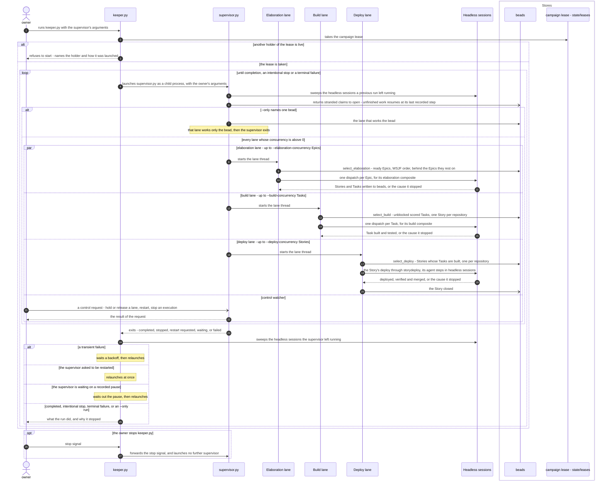
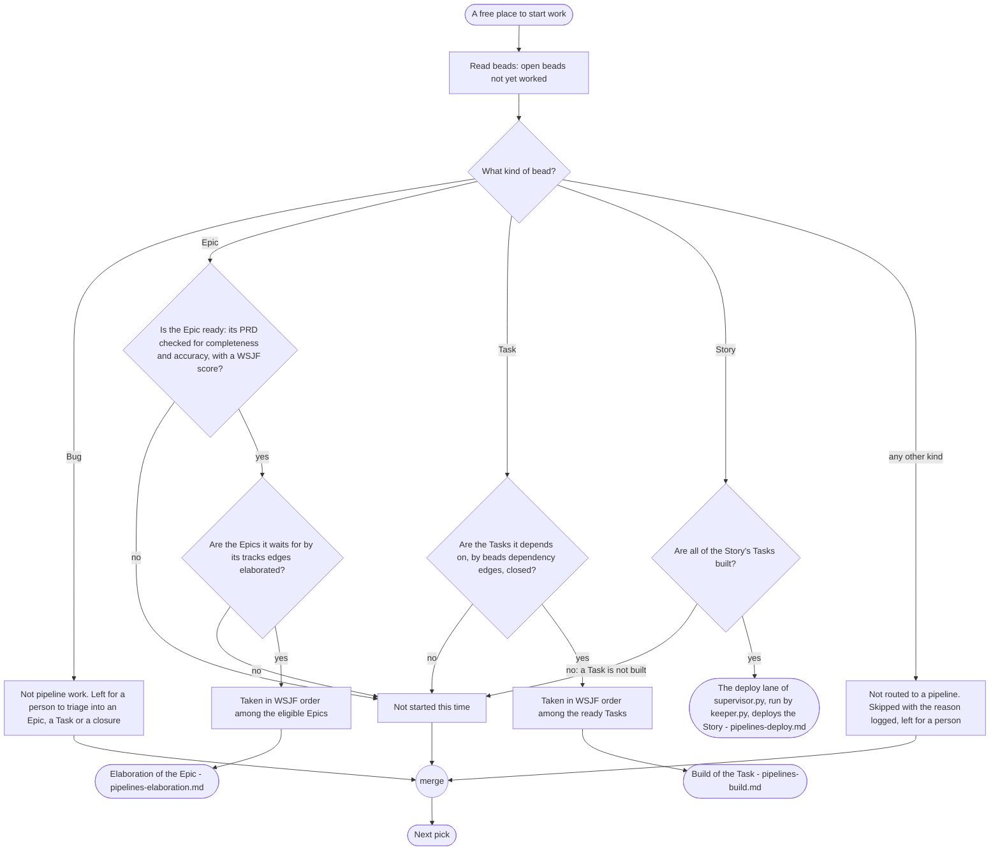
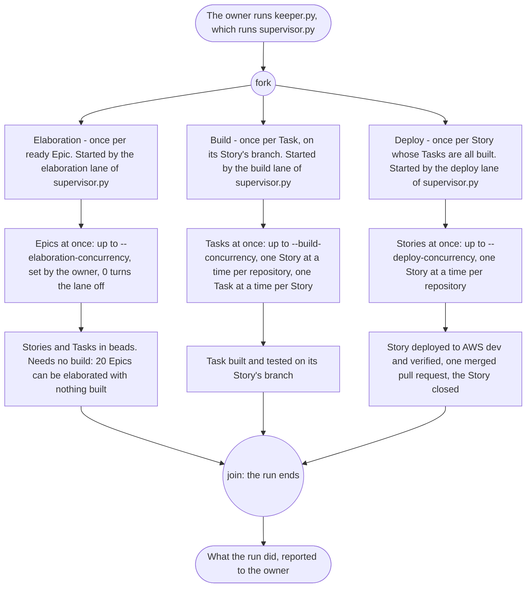
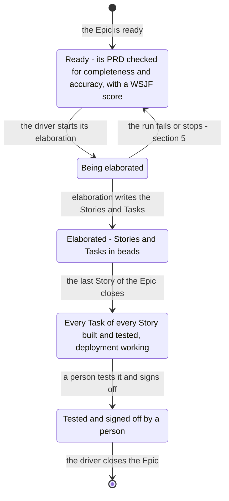
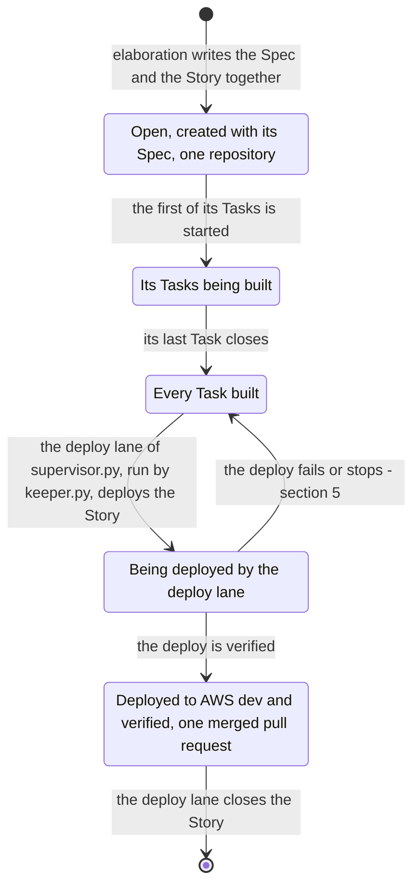
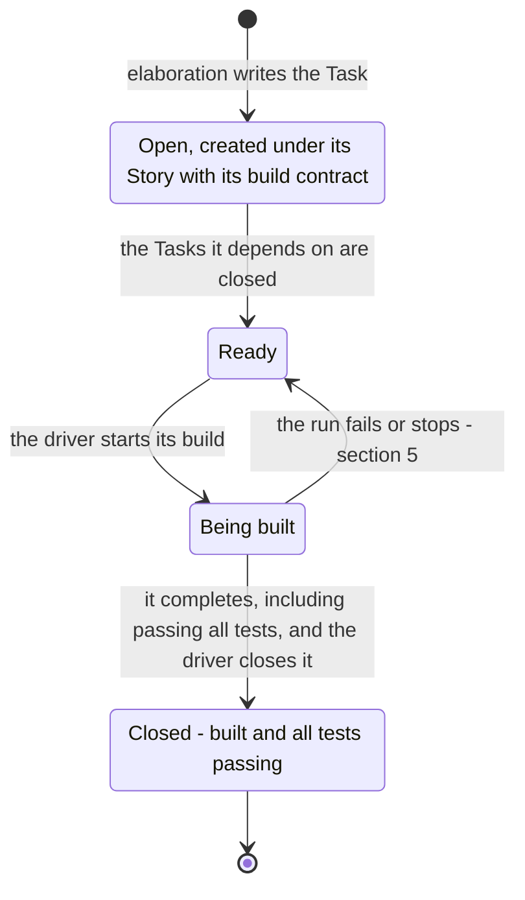
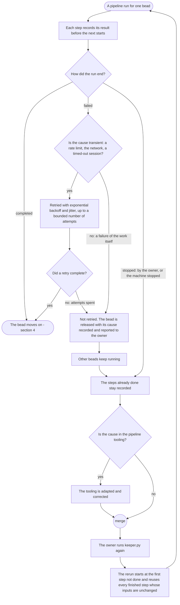
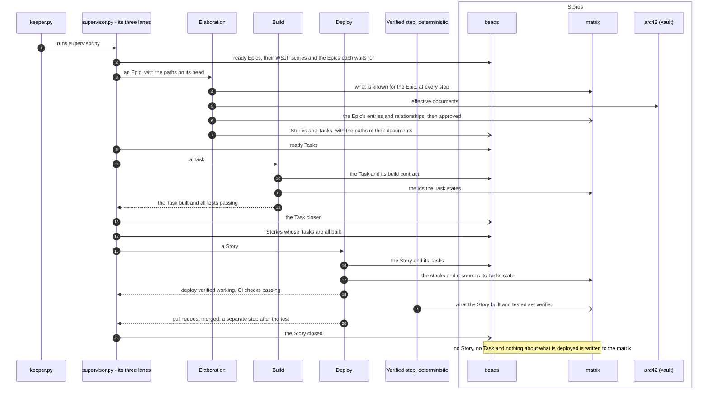

# The pipelines: driver

Parent: [The pipelines: overview](pipelines.md)

The driver is what runs every pipeline. The owner starts it, and only the owner: the owner runs
`keeper.py` in the control repository's `ops/sdlc-automation`, and `keeper.py` runs
`supervisor.py`. The owner never runs `supervisor.py` directly. The driver takes in the beads that
are ready for work and starts, for each, the pipeline that works it: elaboration once per ready
Epic, build once per Task, deploy once per Story. Its work begins at an Epic that is ready: its PRD
has been checked for completeness and accuracy and it has a WSJF score; nothing before that is
drawn here. It produces no artifact of its own; what it produces is pipeline runs that make real
project progress, each done by agents in headless Claude sessions that do the work and get out.
This document draws the driver **as the owner wants it**. For `keeper.py` and `supervisor.py` the
code is the source: `ops/sdlc-automation/keeper.py`, `supervisor.py`, `lane.py`, `selection.py`,
`storyorder.py`, `storydeploy.py`, `dispatch.py`, `control.py` and `campaign.py`. The other
sources are the owner's messages of 2026-10-19 (quoted with their qualifiers in Part 1 of the
elaboration plan), the owner's statements "keeper is what knows to deploy a story.", "I never run
supervisor directly. I only ever run `keeper.py`." and "Your scope does not require you to think
about anything prior to an Epic (PRD) becoming ready. Once it is ready, it will have already
performed checks of the PRD for completeness and accuracy, it will also have a WSJF score.", the
SkillSpoke repository's root `AGENTS.md` ("Pipeline runs belong to the owner", "Standing facts",
"Code quality"), the vault's `docs/sdlc/sdlc.md`, and
[requirements/pipelines.md](../requirements/pipelines.md) where it agrees with the owner's words.
What each pipeline does inside is drawn in [elaboration](pipelines-elaboration.md),
[build](pipelines-build.md) and [deploy](pipelines-deploy.md); the arc42 and matrix states in
[architecture and matrix states](pipelines-architecture-states.md).

## Legend

| Notation | Meaning |
|---|---|
| `A ->> B` (sequence) | A calls or starts B: B does work for A |
| `B -->> A` (sequence) | B returns its result to A |
| `A -) Store` (sequence) | A writes to a store; nothing is returned |
| `opt` (sequence) | Steps that run only when the labelled condition holds |
| `alt` (sequence) | Exactly one of the labelled branches runs |
| `par` (sequence) | The labelled branches run at the same time |
| `([...])` (activity) | Start or end |
| `{...?}` (activity) | A decision; every outgoing edge is labelled with its guard |
| "fork" / "join" nodes (activity) | Work that runs concurrently, and the point where all of it has finished |
| "merge" node (activity) | Alternative paths coming back together; no waiting |
| `[*]` and labelled transitions (state machine) | Initial or final state; the event or condition that moves the bead |
| lane | One of the three threads of `supervisor.py` - elaboration, build, deploy - each with its own concurrency setting; 0 turns the lane off |
| headless session | A headless Claude session that does one piece of work and gets out |
| arc42 (vault), matrix, beads, vault, git / GitHub, AWS dev | The stores, named the same in every document |

## 1. The owner runs keeper, and keeper runs supervisor

**Subject:** the two programs of the driver, what each is for, and what each starts.
**Scope:** from the owner running `keeper.py` to the pipelines its `supervisor.py` starts and the
end of the run.
**Purpose:** who starts the driver, what `keeper.py` does to keep `supervisor.py` running, and
which pipeline each lane of `supervisor.py` starts.
**Boundary:** how a bead is chosen is section 2; the inside of each pipeline is in its own
document.
**Sources:** the code: `ops/sdlc-automation/keeper.py` (`main` takes the campaign lease and
refuses to start while another holder is live; `Keeper.run` launches `supervisor.py` as a child
process with the owner's arguments, relaunches it after a backoff on a transient failure, at once
when it asks to be restarted, and after a recorded pause when it is waiting; stops on completion,
an intentional stop or a terminal failure; `handle_signal` forwards the owner's stop signal;
`_sweep` sweeps the headless sessions a dead supervisor left running), `supervisor.py` (startup
sweeps leaked sessions and returns stranded claims to open; `run` starts the control watcher and
one thread per lane; `--only` works one bead), `selection.py` (`select_elaboration`,
`select_build`, `select_deploy`), `lane.py`, `dispatch.py` and `storydeploy.py` (a Story's deploy),
`control.py` (the owner's requests to hold or release a lane, restart the supervisor or stop an
execution) and `campaign.py` (the lease). The owner: "I never run supervisor directly. I only ever
run `keeper.py`.", "keeper is what knows to deploy a story.", "I do prefer to spin up agents in
headless claude sessions to do work, and then get out." and "There can be nested subagents."
`AGENTS.md`, "Pipeline runs belong to the owner": "A pipeline run is long and expensive, so a
successful run must make real project progress."

Notes on the diagram:

- The owner runs only `keeper.py`. `keeper.py` runs `supervisor.py`; nothing else starts it.
- `keeper.py` is what deploys a Story: it runs `supervisor.py`, whose deploy lane deploys each
  Story whose Tasks are built and closes the Story bead.
- Each lane has its own concurrency setting, and 0 turns that lane off, so the owner can run one
  lane, two or all three.
- The campaign lease keeps two drivers from dispatching the same beads and sweeping each other's
  sessions.
- A relaunched supervisor resumes unfinished work at its last recorded step, so a relaunch redoes
  no finished work.
- No session and no agent runs either program, and none rehearses a run (`AGENTS.md`). A run is
  the test of the pipeline, so each run is drawn as doing real work.

## 2. Choosing a bead and routing it to its pipeline

**Subject:** how the driver picks the next bead and decides which pipeline works it.
**Scope:** one pick of one bead.
**Purpose:** which kinds of bead are pipeline work, what each needs before it is started, and the
order among the ready ones.
**Boundary:** an Epic arrives ready: its PRD has already been checked for completeness and
accuracy, and it has a WSJF score. Nothing before an Epic is ready is drawn in these documents.
**Sources:** the owner: "Your scope does not require you to think about anything prior to an Epic
(PRD) becoming ready. Once it is ready, it will have already performed checks of the PRD for
completeness and accuracy, it will also have a WSJF score."
[requirements/pipelines.md](../requirements/pipelines.md): "A Task with its build contract, on its
Story's branch", "A Story whose Tasks are all built", and "Bugs": "A Bug bead is a report that
something is wrong. It is not pipeline work" and "A person triages a Bug into an Epic, a Task, or
a closure." The owner: "keeper is what knows to deploy a story." and "Ever agent needs to have a
reason to be used." `docs/sdlc/sdlc.md`: "User stories in the SkillSpoke SDLC are recorded ONLY as
Beads issues". For the lanes that take each kind, the code: `ops/sdlc-automation/selection.py`
and `storyorder.py`.

Notes on the diagram:

- A Bug is never started by the driver. The Epic or Task a person triages it into is then
  pipeline work like any other ([requirements/pipelines.md](../requirements/pipelines.md)).
- A Story is never elaborated or built by itself: it is created with its Spec in elaboration and
  deployed once its Tasks are built (`docs/sdlc/sdlc.md`,
  [requirements/pipelines.md](../requirements/pipelines.md)).
- An Epic's readiness and its WSJF score are given, not decided here: a ready Epic's PRD has
  already been checked for completeness and accuracy, and it has its WSJF score (the owner).
- The Epic-to-Epic `tracks` edges `epicorder.py` sets decide which ready Epics may be elaborated:
  an Epic waits for the Epic that goes first, by the judgment the matrix records, on each shared
  item they both need whose architecture is not approved, so that an Epic waits for the Epic that
  builds and owns what it uses and no two Epics work at once on the same unapproved shared item. Ready Epics are taken in their WSJF order behind those
  dependencies, because it puts the most value per effort first.
- A Task is ready when the Tasks it depends on (beads dependency edges) are closed, and ready Tasks
  are taken in WSJF order, because the edges carry build order and WSJF orders what is free to run.
- A bead of any kind not routed to a pipeline is skipped with the reason logged and left for a
  person, as a Bug is, and the routing table is data that accepts new kinds, because no closed list
  of today's kinds is kept and no pipeline runs work it was not designed for.
- No pipeline is started for a bead it does not apply to. The owner: "I also do not want a
  pipeline that blindly sends everything to ever agent, whether it applies or not".

## 3. The pipelines the driver runs, and how many at once

**Subject:** the three pipelines as places the driver starts work, and the concurrency of each.
**Scope:** one run of the driver.
**Purpose:** what each pipeline runs once per, which lane starts it, and how many run at once.
**Boundary:** the inside of each pipeline is in its own document.
**Sources:** [requirements/pipelines.md](../requirements/pipelines.md), "What the pipelines are".
The owner: "keeper is what knows to deploy a story.", "we can process 20 Epics through elaboration
with out building anything." and "I need a working pipeline ... and dosn't take 2 hours to run
through a single Epic". `docs/sdlc/sdlc.md`: one Spec and one Story per repository, all beneath
the single Epic. The code: `ops/sdlc-automation/supervisor.py` (one lane per pipeline, each with
`--elaboration-concurrency`, `--build-concurrency` or `--deploy-concurrency`, 0 turning it off),
`lane.py` and `storyorder.py` (one active Story per repository, one active Task per Story).

Notes on the diagram:

- Elaboration does not wait for the build. The owner: "we can process 20 Epics through
  elaboration with out building anything."
- The owner's time goal covers one Epic: a working pipeline that "dosn't take 2 hours to run
  through a single Epic".
- Runs on different repositories go in parallel, runs on the same repository (and the same Story
  branch) run one at a time, and the number in flight is a setting the owner can change, not a
  constant, because parallel work on different files is safe and fast and one writer per branch
  avoids conflicts.

## 4. An Epic, a Story and a Task, across the pipelines

**Subject:** the states of each kind of bead as the pipelines work it.
**Scope:** for an Epic, from its being ready to its closure; for a Story and a Task, from the
bead's creation to its closure.
**Purpose:** which pipeline moves each bead, and which states the sources name.
**Boundary:** the matrix's approved and verified flags and the arc42 `effective` and `in-review`
states are drawn in [architecture and matrix states](pipelines-architecture-states.md); they are
states of matrix content and documents, not of beads.
**Sources:** the owner: "Once it is ready, it will have already performed checks of the PRD for
completeness and accuracy, it will also have a WSJF score." `docs/sdlc/sdlc.md`: "A Spec and its
Story are created together - one Story bead per Spec, scoped to exactly one repository", and user
stories are recorded only as Beads issues. `AGENTS.md`, "Standing facts": "A Task closes when it
completes, including passing all tests. A Story or Epic is never closed because its Tasks are
closed, and an open Epic is never a condition for other work." and "History is never changed:
closed or completed issues". [requirements/pipelines.md](../requirements/pipelines.md): "A Story
whose Tasks are all built". The owner: "keeper is what knows to deploy a story." and "Once all of
the tasks for all of the stories for and Epic have been built and tested (including CI (CDK),
which means deployemen must also work), then all of the architecture and rellationships for the
Epic can be set to verified." The matrix holds no Story and no Task (the owner: "The matrix does
not include stories and tasks (it isn't a build tracker)"). For the Story's deploy and closure,
the code: `ops/sdlc-automation/selection.py` and `storydeploy.py`.

### 4.1 An Epic

The matrix's verified flag is not an Epic state: a deterministic step sets it on what each Story
built and tested when that Story's test passes, before its merge, because verified belongs to each
stack and component and holds for every Epic that relates to it
([requirements/matrix.md](../requirements/matrix.md), section 3.5). The Epic closes only after
a person has tested it and signed off, never because its Stories closed, because closure records
proof, not counting. An open Epic is never a condition for other work: its Stories and Tasks are
worked while it is open (`AGENTS.md`).

### 4.2 A Story

A Story closes when its pull request has merged and its deploy is verified working, and never
because its Tasks are closed (`AGENTS.md`), because closure records proof, not counting.

### 4.3 A Task

The driver writes every bead state change, deterministically from each run's result; agents write
content, not states, because a state is a fact the run's contract reports, so code sets it the same
way every time. A closed bead is never reopened or changed: history is never changed
(`AGENTS.md`).

## 5. When a pipeline run fails or stops

**Subject:** what happens to a bead's work when its run fails or is stopped.
**Scope:** one run of one pipeline for one bead.
**Purpose:** that work already done is kept and reused, that a failed run is visible to the owner,
and that the next real run makes progress.
**Boundary:** how a failed deploy is fixed inside the deploy pipeline is in
[deploy](pipelines-deploy.md); a defect a build finds is fixed in that run
([requirements/pipelines.md](../requirements/pipelines.md): "A build that finds a defect fixes it
in that run."); how `keeper.py` relaunches `supervisor.py` is section 1.
**Sources:** `docs/sdlc/sdlc.md`, "Documents Are Written to Disk as They're Produced": documents
are "written to disk by the agent that produces them", and "A rerun of an Epic reuses every phase
whose recorded inputs are unchanged instead of restarting from step 1." `AGENTS.md`: "A pipeline
run is long and expensive, so a successful run must make real project progress.", and of the
tooling: "The owner verifies it by running the pipeline: it works or it does not, and when it does
not, adapt and correct." The owner: "I only ever run `keeper.py`.", "Your default is
fault-intolerant. I need more fault-tolerance for the pipeline, and need more trust." and "I can't
afford to constantly refact the pipelines evey 2 weeks." Values known only at deploy time: "We
don't want to stop because of that. We need to make sure some of that is accommodated and handled
at run time (deploy time)."

Notes on the diagram:

- Transient failures (rate limits, network, a timed-out session) retry with exponential backoff
  and jitter up to a bounded number of attempts; a failure of the work itself is not retried
  blindly, the bead is released with its cause recorded, and other beads keep running, because the
  AWS Well-Architected reliability guidance calls for bounded retries and one failing bead must not
  stop the rest.
- Every step of every pipeline (elaboration, build and deploy) records its result before the next
  starts, and a rerun starts at the first step not done and reuses every finished step whose inputs
  are unchanged, because a halt never forces finished work to be redone (`docs/sdlc/sdlc.md`).
- Only the owner starts the next run, by running `keeper.py`. `keeper.py` relaunches
  `supervisor.py` within a run (section 1); no session or agent starts either program
  (`AGENTS.md`).
- A value known only at deploy time, such as the region or environment, is not a failure: it is
  handled at deploy time (the owner).

## 6. Where beads and the matrix are read

**Subject:** which store the driver and the pipelines it starts read and write.
**Scope:** one run of the driver.
**Purpose:** that the driver works from beads, that the pipelines read the matrix at their steps,
and that no Story or Task is written to the matrix.
**Boundary:** each pipeline's reads and writes are drawn in its own document.
**Sources:** `docs/sdlc/sdlc.md`: Stories and Tasks live only in beads, and "Documents are handed
between agents as paths recorded on the owning Beads issue (Epic or Story), never as content."
The owner: "The matrix does not include stories and tasks (it isn't a build tracker), and it
doesn't care about what has actually been deployed.", "Regarding the matrix: It's entire purpose is
to mintain a mapping (a matrix) between things to every step of every pipeline doesn't need to
research and scan or rediscover what pertains the task that step is performing.", "arc42 is both
input and out. The matrix is both input and output." and "Once all of the tasks for all of the
stories for and Epic have been built and tested ... then all of the architecture and
rellationships for the Epic can be set to verified." For the reads and writes of `keeper.py` and
`supervisor.py`, the code: `ops/sdlc-automation/keeper.py`, `supervisor.py`, `selection.py` (ready
Epics, their WSJF scores and the Epics each waits for, read from beads) and `storydeploy.py` (the
Story closed).

Notes on the diagram:

- The driver chooses work from beads. The matrix is read by the pipelines' steps, because its
  purpose is that each step does not "research and scan or rediscover what pertains the task that
  step is performing" (the owner).
- The elaboration lane reads, from beads, the ready Epics, their WSJF scores and the Epics each
  waits for by its `tracks` edges (section 2).
- `keeper.py` reads and writes no bead itself: it runs `supervisor.py`, whose lanes do.
- The driver writes each bead state from the run's result, and the pipelines write content, because
  code sets a state the same way every time (section 4).
- A deterministic step that runs when a Story's test passes sets verified on what the Story built
  and tested, because the condition is factual; the merge that follows decides nothing.
