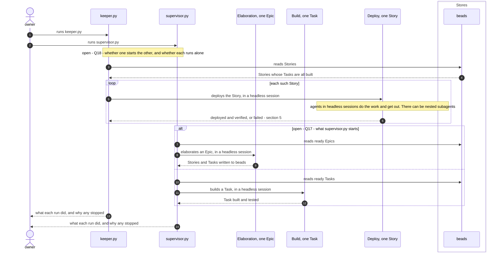
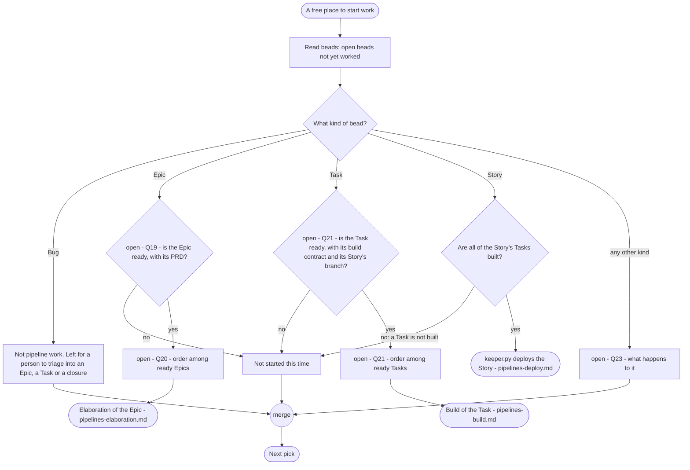
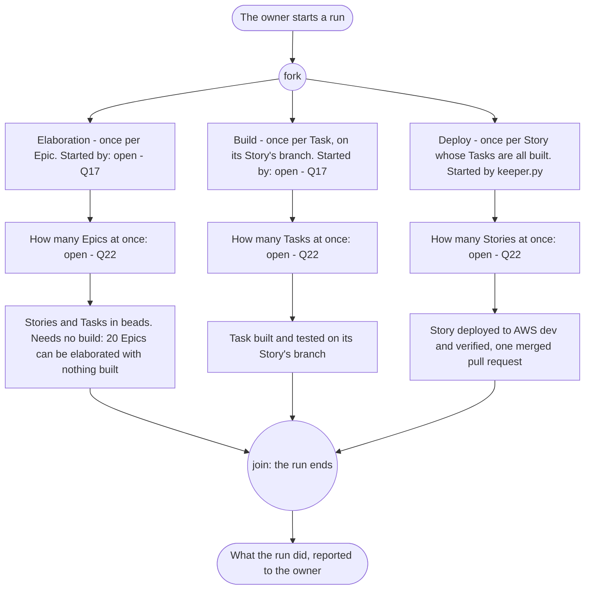
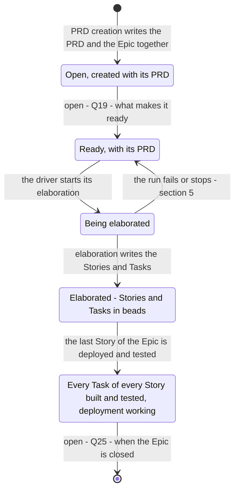
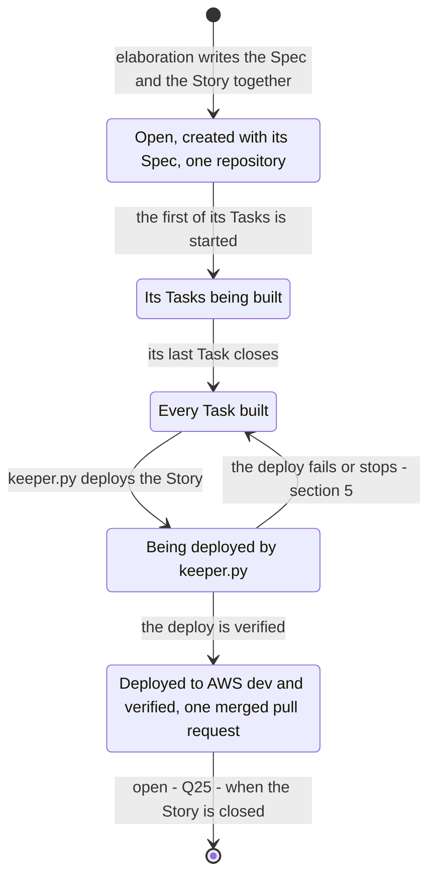
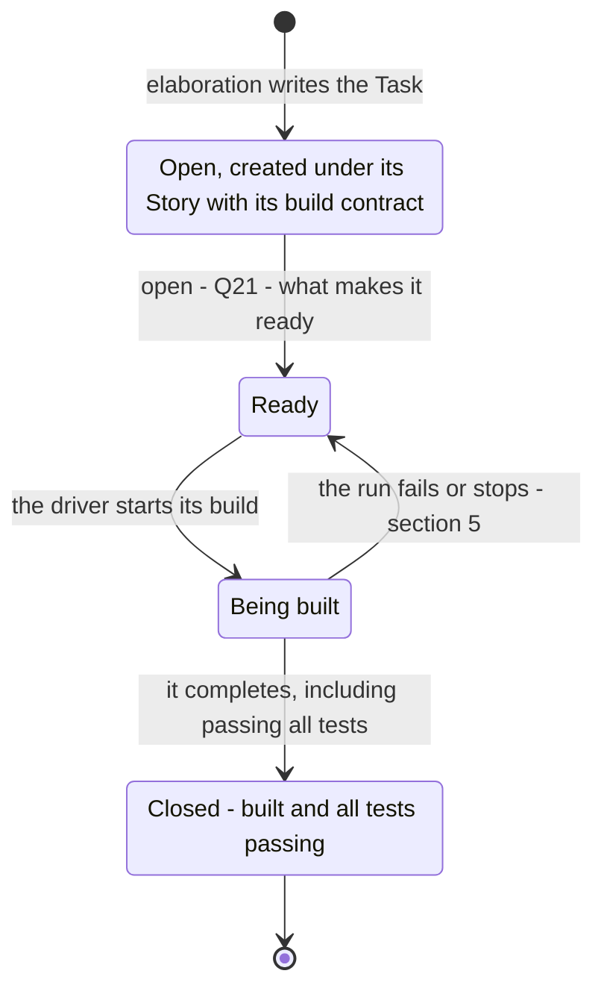
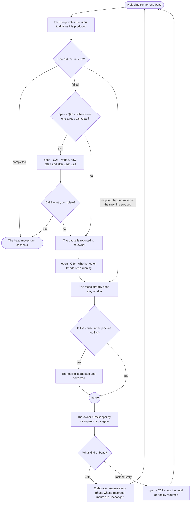
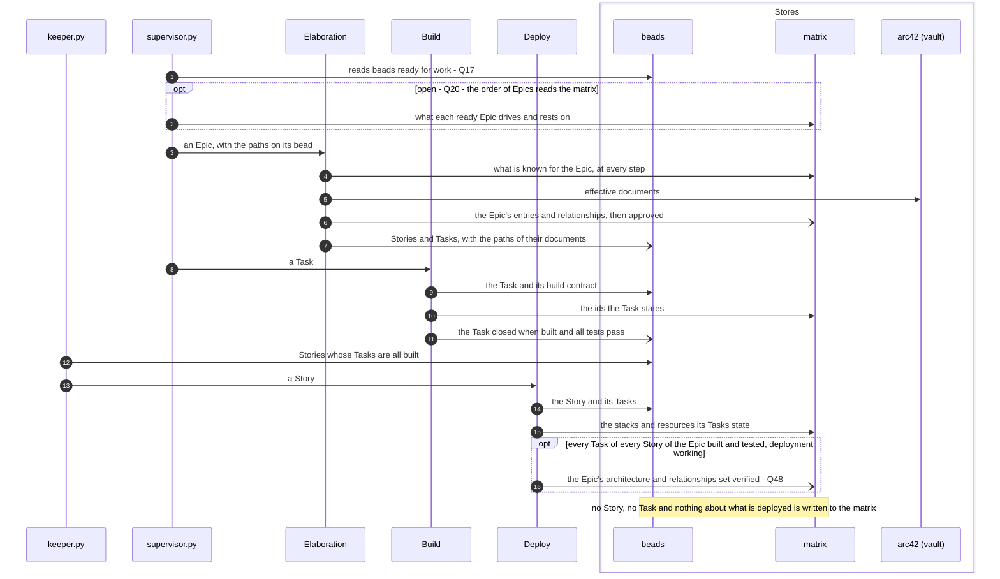

# The pipelines: driver

Parent: [The pipelines: overview](pipelines.md)

The driver is what runs every pipeline. The owner starts it, and only the owner: it begins where
the owner runs `keeper.py` and `supervisor.py` in the control repository's `ops/sdlc-automation`.
It takes in the beads that are ready for work and starts, for each, the pipeline that works it:
elaboration once per Epic, build once per Task, deploy once per Story. It produces no artifact of
its own; what it produces is pipeline runs that make real project progress, each done by agents in
headless Claude sessions that do the work and get out. This document draws the driver **as the
owner wants it**. The sources are the owner's messages of 2026-10-19 (quoted with their
qualifiers in Part 1 of the elaboration plan), the owner's statement "keeper is what knows to
deploy a story.", the SkillSpoke repository's root `AGENTS.md` ("Pipeline runs belong to the
owner", "Standing facts", "Code quality"), the vault's `docs/sdlc/sdlc.md`, and
[requirements/pipelines.md](../requirements/pipelines.md) where it agrees with the owner's words.
Where the owner has not said what is wanted, the step is drawn as an open question, listed at the
end with a recommendation. What each pipeline does inside is drawn in
[elaboration](pipelines-elaboration.md), [build](pipelines-build.md) and
[deploy](pipelines-deploy.md); the arc42 and matrix states in
[architecture and matrix states](pipelines-architecture-states.md).

## Legend

| Notation | Meaning |
|---|---|
| `A ->> B` (sequence) | A calls or starts B: B does work for A |
| `B -->> A` (sequence) | B returns its result to A |
| `A -) Store` (sequence) | A writes to a store; nothing is returned |
| `alt` / `opt` or a node labelled "open - ..." | The owner has not decided this; every branch shown is an option, not a decision. The id names the entry under "Open questions" at the end |
| Q17 and above | A question new to these diagram documents; Q1 to Q16 are the owner's questions from the elaboration plan |
| `([...])` (activity) | Start or end |
| `{...?}` (activity) | A decision; every outgoing edge is labelled with its guard |
| "fork" / "join" nodes (activity) | Work that runs concurrently, and the point where all of it has finished |
| "merge" node (activity) | Alternative paths coming back together; no waiting |
| `[*]` and labelled transitions (state machine) | Initial or final state; the event or condition that moves the bead |
| headless session | A headless Claude session that does one piece of work and gets out |
| arc42 (vault), matrix, beads, vault, git / GitHub, AWS dev | The stores, named the same in every document |

## 1. The owner starts keeper and supervisor

**Subject:** the two programs the owner runs, and what each starts.
**Scope:** from the owner starting a run to the pipelines it starts.
**Purpose:** who starts the driver, what each program is for, and which pipeline each starts.
**Boundary:** how a bead is chosen is section 2; the inside of each pipeline is in its own
document.
**Sources:** `AGENTS.md`, "Pipeline runs belong to the owner": "Only the owner runs `keeper.py`
and `supervisor.py`; their real runs are the test of the pipeline." and "A pipeline run is long
and expensive, so a successful run must make real project progress." The owner: "keeper is what
knows to deploy a story." and "I do prefer to spin up agents in headless claude sessions to do
work, and then get out." and "There can be nested subagents."
[requirements/pipelines.md](../requirements/pipelines.md), "What the pipelines are": elaboration
runs once per Epic, build once per Task, deploy once per Story.

Notes on the diagram:

- Only the deploy of a Story is drawn as started by `keeper.py`, because the owner said so. No
  other program starts a deploy.
- What `supervisor.py` starts is an open question (Q17). Both branches are
  options; the owner's words name `supervisor.py` as a program the owner runs and nothing more.
- No session and no agent runs either program, and none rehearses a run (`AGENTS.md`). A run is
  the test of the pipeline, so each run is drawn as doing real work.

## 2. Choosing a bead and routing it to its pipeline

**Subject:** how the driver picks the next bead and decides which pipeline works it.
**Scope:** one pick of one bead.
**Purpose:** which kinds of bead are pipeline work, what each needs before it is started, and the
order among the ready ones.
**Boundary:** the readiness of an Epic's PRD is decided by PRD validation
([PRD creation and PRD validation](pipelines-prd.md)).
**Sources:** [requirements/pipelines.md](../requirements/pipelines.md): "A ready Epic and its PRD",
"A Task with its build contract, on its Story's branch", "A Story whose Tasks are all built", and
"Bugs": "A Bug bead is a report that something is wrong. It is not pipeline work" and "A person
triages a Bug into an Epic, a Task, or a closure." The owner: "keeper is what knows to deploy a
story." and "Ever agent needs to have a reason to be used." `docs/sdlc/sdlc.md`: "User stories in
the SkillSpoke SDLC are recorded ONLY as Beads issues". The order of Epics is not stated by the
owner's sources: `docs/sdlc/sdlc.md` and [requirements/pipelines.md](../requirements/pipelines.md)
say nothing of architecture dependencies or WSJF as the order (Q20).

Notes on the diagram:

- A Bug is never started by the driver. The Epic or Task a person triages it into is then
  pipeline work like any other ([requirements/pipelines.md](../requirements/pipelines.md)).
- A Story is never elaborated or built by itself: it is created with its Spec in elaboration and
  deployed once its Tasks are built (`docs/sdlc/sdlc.md`,
  [requirements/pipelines.md](../requirements/pipelines.md)).
- No pipeline is started for a bead it does not apply to. The owner: "I also do not want a
  pipeline that blindly sends everything to ever agent, whether it applies or not".

## 3. The pipelines the driver runs, and how many at once

**Subject:** the three pipelines as places the driver starts work, and the concurrency of each.
**Scope:** one run of the driver.
**Purpose:** what each pipeline runs once per, who starts it, and what the sources say of running
several at once.
**Boundary:** the inside of each pipeline is in its own document.
**Sources:** [requirements/pipelines.md](../requirements/pipelines.md), "What the pipelines are".
The owner: "keeper is what knows to deploy a story.", "we can process 20 Epics through elaboration
with out building anything." and "I need a working pipeline ... and dosn't take 2 hours to run
through a single Epic". `docs/sdlc/sdlc.md`: one Spec and one Story per repository, all beneath
the single Epic. No source states how many Epics, Tasks or Stories run at once
(Q22).

Notes on the diagram:

- Elaboration does not wait for the build. The owner: "we can process 20 Epics through
  elaboration with out building anything."
- The owner's time goal covers one Epic: a working pipeline that "dosn't take 2 hours to run
  through a single Epic".

## 4. An Epic, a Story and a Task, across the pipelines

**Subject:** the states of each kind of bead as the pipelines work it.
**Scope:** from the bead's creation to its closure.
**Purpose:** which pipeline moves each bead, and which states the sources name.
**Boundary:** the matrix's approved and verified flags and the arc42 `effective` and `in-review`
states are drawn in [architecture and matrix states](pipelines-architecture-states.md); they are
states of matrix content and documents, not of beads.
**Sources:** `docs/sdlc/sdlc.md`: "A PRD and its Epic are created together", "A Spec and its Story
are created together - one Story bead per Spec, scoped to exactly one repository", and user
stories are recorded only as Beads issues. `AGENTS.md`, "Standing facts": "A Task closes when it
completes, including passing all tests. A Story or Epic is never closed because its Tasks are
closed, and an open Epic is never a condition for other work." and "History is never changed:
closed or completed issues". [requirements/pipelines.md](../requirements/pipelines.md): "A ready
Epic and its PRD", "A Story whose Tasks are all built". The owner: "keeper is what knows to deploy
a story." and "Once all of the tasks for all of the stories for and Epic have been built and
tested (including CI (CDK), which means deployemen must also work), then all of the architecture
and rellationships for the Epic can be set to verified." The matrix holds no Story and no Task
(the owner: "The matrix does not include stories and tasks (it isn't a build tracker)").

### 4.1 An Epic

At "Every Task of every Story built and tested, deployment working", the Epic's architecture and
relationships in the matrix can be set verified (the owner). Which step sets them is
Q48. An open Epic is never a condition for other work: its
Stories and Tasks are worked while it is open (`AGENTS.md`).

### 4.2 A Story

A Story is never closed because its Tasks are closed (`AGENTS.md`).

### 4.3 A Task

Who moves a bead from one state to the next in beads (the driver or the pipeline it started) is
Q24. A closed bead is never reopened or changed: history is never changed
(`AGENTS.md`).

## 5. When a pipeline run fails or stops

**Subject:** what happens to a bead's work when its run fails or is stopped.
**Scope:** one run of one pipeline for one bead.
**Purpose:** that work already done is kept and reused, that a failed run is visible to the owner,
and that the next real run makes progress.
**Boundary:** how a failed deploy is fixed inside the deploy pipeline is in
[deploy](pipelines-deploy.md); a defect a build finds is fixed in that run
([requirements/pipelines.md](../requirements/pipelines.md): "A build that finds a defect fixes it
in that run.").
**Sources:** `docs/sdlc/sdlc.md`, "Documents Are Written to Disk as They're Produced": documents
are "written to disk by the agent that produces them", and "A rerun of an Epic reuses every phase
whose recorded inputs are unchanged instead of restarting from step 1." `AGENTS.md`: "A pipeline
run is long and expensive, so a successful run must make real project progress.", "Only the owner
runs `keeper.py` and `supervisor.py`", and of the tooling: "The owner verifies it by running the
pipeline: it works or it does not, and when it does not, adapt and correct." The owner: "Your
default is fault-intolerant. I need more fault-tolerance for the pipeline, and need more trust."
and "I can't afford to constantly refact the pipelines evey 2 weeks." Values known only at deploy
time: "We don't want to stop because of that. We need to make sure some of that is accommodated
and handled at run time (deploy time)."

Notes on the diagram:

- Only the owner starts the next run. No session or agent restarts `keeper.py` or `supervisor.py`
  (`AGENTS.md`).
- A value known only at deploy time, such as the region or environment, is not a failure: it is
  handled at deploy time (the owner).

## 6. Where beads and the matrix are read

**Subject:** which store the driver and the pipelines it starts read and write.
**Scope:** one run of the driver.
**Purpose:** that the driver works from beads, that the pipelines read the matrix at their steps,
and that no Story or Task is written to the matrix.
**Boundary:** each pipeline's reads and writes are drawn in its own document.
**Sources:** `docs/sdlc/sdlc.md`: Stories and Tasks live only in beads, and "Documents are handed
between agents as paths recorded on the owning Beads issue (Epic or Story), never as content."
The owner: "The matrix does not include stories and tasks (it isn't a build tracker), and it
doesn't care about what has actually been deployed.", "Regarding the matrix: It's entire purpose is
to mintain a mapping (a matrix) between things to every step of every pipeline doesn't need to
research and scan or rediscover what pertains the task that step is performing.", "arc42 is both
input and out. The matrix is both input and output." and "Once all of the tasks for all of the
stories for and Epic have been built and tested ... then all of the architecture and
rellationships for the Epic can be set to verified."

Notes on the diagram:

- The driver chooses work from beads. The matrix is read by the pipelines' steps, because its
  purpose is that each step does not "research and scan or rediscover what pertains the task that
  step is performing" (the owner).
- Who writes each bead state is Q24; the diagram shows the build closing a
  Task only where `AGENTS.md` states when a Task closes.

## Open questions

- **Q17. What does `supervisor.py` start: the elaboration of Epics, the build
  of Tasks, or both?** Appears in sections 1, 3 and 6. Recommendation: `supervisor.py` starts the
  elaboration of Epics and the build of Tasks, and `keeper.py` starts the deploy of Stories. Reason:
  the owner placed deploy with `keeper.py` ("keeper is what knows to deploy a story."), every
  pipeline needs a program that starts it, and one program per kind of start keeps each with one
  responsibility.
- **Q18. Does one of `keeper.py` and `supervisor.py` start the other, or does
  the owner start each on its own, and may each run without the other?** Appears in section 1.
  Recommendation: the owner starts each, neither starts the other, and each runs without the other.
  Reason: the owner's sources say the owner runs both; elaboration needs no build or deploy
  ("we can process 20 Epics through elaboration with out building anything"), so neither should
  depend on the other being up.
- **Q19. What makes an Epic ready for elaboration?** Appears in sections 2
  and 4.1. Recommendation: its PRD file resolves and PRD validation passed it with no blocker
  finding. Reason: [requirements/pipelines.md](../requirements/pipelines.md) says elaboration takes
  "A ready Epic and its PRD", and PRD validation exists to judge the PRD before elaboration.
- **Q20. In what order are ready Epics elaborated?** Appears in sections 2
  and 6. Recommendation: an Epic whose architecture other Epics rest on is elaborated before them,
  and WSJF orders the Epics that rest on nothing unelaborated; the driver reads those dependencies
  from the matrix. Reason: each later Epic starts from what earlier Epics approved (the owner:
  "each learnine piece of information is to help the next step in the pipelines"), and WSJF is a
  standard way to order work by value over size once dependencies allow it.
- **Q21. What makes a Task ready for build, and in what order are ready Tasks
  built?** Appears in sections 2 and 4.3. Recommendation: a Task is ready when every Task it depends
  on in beads is closed, and ready Tasks are built in dependency order, then by WSJF. Reason: a
  Task builds on its Story's branch from what earlier Tasks committed, and beads holds the build
  dependencies (the matrix holds no Task).
- **Q22. How many Epics, Tasks and Stories are worked at once?** Appears in
  section 3. Recommendation: a number per pipeline that the owner sets when starting the run, with
  the Tasks of one Story built one at a time. Reason: work on different things runs in parallel by
  default, work on the same files runs in sequence, and the Tasks of one Story share one branch;
  the owner's cost and time goals ("dosn't take 2 hours to run through a single Epic") are met by
  the owner choosing the number for the run.
- **Q23. What happens to a bead that is not an Epic, a Story, a Task or a Bug?**
  Appears in section 2. Recommendation: it is not started, and the run reports it to the owner with
  its kind. Reason: every agent needs a reason to be used, and no pipeline is defined for it; a
  report keeps it from being silently ignored.
- **Q24. Who changes a bead's state in beads: the driver that started the run,
  or the pipeline doing the work?** Appears in sections 4 and 6. Recommendation: the pipeline that
  completes the work writes the state its work reached, and the driver writes only that it started
  a run. Reason: the actor that does the work knows when it is done, and one writer per state
  keeps beads a single source of truth.
- **Q25. When are a Story and an Epic closed?** Appears in sections 4.1 and
  4.2. Recommendation: a Story is closed when its deploy is verified and its pull request merged;
  an Epic is closed when every Story beneath it is closed and its architecture and relationships are
  set verified. Reason: `AGENTS.md` rules out closing either because its Tasks are closed, and these
  are the points at which the owner's sources say the work of each is done.
- **Q26. When a run fails, which causes are retried, how often and after what
  wait, and do other beads keep running?** Appears in section 5. Recommendation: a cause outside the
  work (a rate limit, a network or service outage) is retried with increasing waits a small fixed
  number of times; any other cause stops that bead's run and is reported to the owner with the
  cause, and other beads keep running unless the cause would fail them too. Reason: the owner wants
  "more fault-tolerance for the pipeline", a run is "long and expensive", and the reliability pillar
  of the AWS Well-Architected Framework calls for bounded retries with backoff and for isolating a
  failure to what it affects.
- **Q27. How does the build of a Task or the deploy of a Story resume after a
  failed or stopped run?** Appears in section 5. Recommendation: the same as an Epic: each step's
  output is recorded as it is produced, and the next run begins at the first step not done, reusing
  every step whose recorded inputs are unchanged. Reason: `docs/sdlc/sdlc.md` states this for an
  Epic, and a run that makes "real project progress" must not redo finished work.
- **Q48. Which step sets the Epic's architecture and
  relationships verified, once the last Story of the Epic is deployed and tested?** Appears in
  sections 4.1 and 6 (raised in [architecture and matrix states](pipelines-architecture-states.md)).
  Recommendation: the deploy of the Story that completes the condition, started by `keeper.py`,
  checks that every Task of every Story of the Epic is built and tested with deployment working and
  sets them verified. Reason: the owner's condition includes "deployemen must also work", which is
  known first when that deploy is verified.
