# The pipelines: elaboration as built

Parent: [The pipelines: overview](pipelines.md)

Required counterpart: [The pipelines: elaboration](pipelines-elaboration.md)

This document draws the elaboration pipeline, the composite `prd-to-spec`, **as the code builds
it today**. Every diagram is "Basis: as built". One dispatch of `prd-to-spec`
(`orchestrator/flows/prd_to_spec.py`) takes one ready Epic and its PRD, claims the Epic in beads,
and runs the Epic's step journal from its first step that is not done: the Architecture container
(`architecture.py`, `architecture_check.py`, `architecture_review.py`, `architecture_promotion.py`,
`architecture_earlier.py`, `architecture_files.py`), the TRD confirm step (`trd_authoring.py`),
the repository span and one Specs and Stories container per repository (`repo_scoping.py`,
`repo_placement.py`, `spec_authoring.py`, `spec_authoring_ui.py`, `spec_review.py`), the Tasks
(`task_decomposition.py`), the Task edges (`task_edges.py`), and the finishing steps
(`elaboration_steps.py`, `elaboration_support.py`, `elaboration_result.py`). It produces the
architecture written in arc42 (vault) and recorded in the matrix, the TRD, one spec set and one
Story bead per repository, and scored Task beads with their edges. The step contracts are in
`orchestrator/specs/epic/` (`prd-to-spec.md`, `architecture.md`, `trd-authoring.md`,
`repo-scoping.md`, `spec-authoring.md`, `task-decomposition.md`). The workflows
`route-elaboration.js`, `dependency-assessment.js`, `task-dependency-assessment.js`,
`wsjf-scoring.js` and `gate-enforce.js` are not run by any step of the journal (section 1). The
owner's requirements for elaboration are in [requirements/pipelines.md](../requirements/pipelines.md),
[requirements/matrix.md](../requirements/matrix.md), and Part 1 of the elaboration plan (items 1.1
to 1.12, quoted in [The pipelines: elaboration](pipelines-elaboration.md)). Each diagram's
"Differences from the requirements" names the plan item an as-built step departs from.

## Legend

| Notation | Meaning |
|---|---|
| `A ->> B` (sequence) | A calls or starts B: B does work for A |
| `B -->> A` (sequence) | B returns its result to A |
| `A -) Store` (sequence) | A writes to a store; nothing is returned |
| `alt` / `opt` / `loop` / `par` (sequence) | Alternatives, an optional part, a repeated part labelled with its exit, concurrent parts |
| `note` "differs from required" | The as-built step departs from the owner's requirement named in the note |
| `([...])` (activity) | Start or end |
| `{...?}` (activity) | A decision; every outgoing edge is labelled with its guard |
| "fork" / "join" nodes (activity) | Work that runs concurrently, and the point where all of it has finished |
| "merge" node (activity) | Alternative paths coming back together; no waiting |
| `event [guard] / effect` (state) | What moves a durable state, under what condition, and what it writes |
| runner | The journal runner of one dispatch (`orchestrator/core/journal_run.py`), which runs a step's script handler or launches its agent's session |
| arc42 (vault) | The arc42 documents under the architecture root in the `skillspoke-docs` vault |
| vault | The `skillspoke-docs` vault as a git repository (commits and pushes) |
| matrix | The matrix file, read and written through `atw-matrix` and its Python modules (`matrixstore`, `matrixwrite`, `matrixsync`, `matrixquery`) |
| beads | The bead tracker (`bd`, `beadgraph`, `beadwrite`) |
| git / GitHub | Product repositories and their GitHub remotes (`polyrepo`) |
| journal | The Epic's step journal, `<control>/.claude/workflow-runs/step-journals/<epic>.step-journal.json` |

Two facts hold for every agent step below, so the diagrams do not repeat them:

- Every agent session's output is checked by its step's output check; an output that fails the
  check sends the session back once, with the errors, as its one corrective resume
  (`orchestrator/core/agents.py:462-517`). A second failure fails the step.
- A failed step ends the dispatch. The next dispatch starts at the first step with no child steps
  that is not done (`orchestrator/core/step_journal.py:729-746`), so the failed step runs again. An
  earlier start happens only when the owner asks for it (`atw-step-journal invalidate`, or the
  driver's `elabmark.py --start-at`), per `orchestrator/specs/epic/prd-to-spec.md`, "Where a run
  begins".

## 1. One dispatch, end to end

**Subject:** one dispatch of `prd-to-spec` for one Epic.
**Scope:** from the driver's selection of the Epic to the release of its claim, through the ten
outermost steps of the Epic's journal.
**Purpose:** the order of the steps, what decides where a dispatch begins, and how it ends.
**Boundary:** Epic dependency assessment and Epic WSJF scoring are outside (owner-run commands);
the build and deploy pipelines come after. Each outermost step is drawn in detail in the sections
that follow.
**Basis:** as built. `ops/sdlc-automation/selection.py:264-284` (`_epic_candidate`);
`orchestrator/flows/prd_to_spec.py:130-218` (`outermost_steps`), `:363-398` (claim and loop),
`:309-344` (release); `scripts/portfolio/elaboration.py` (`start`, `finish`, `release`);
`orchestrator/specs/epic/dependency-assessment.md` and `wsjf-scoring.md`, "Who calls it".

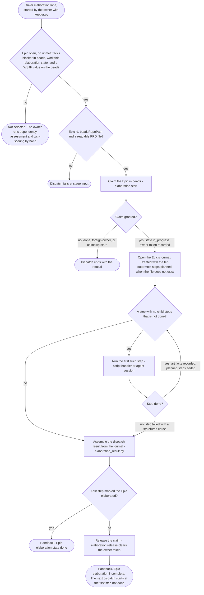

The ten outermost steps the loop runs, in order (`prd_to_spec.py:148-218`):

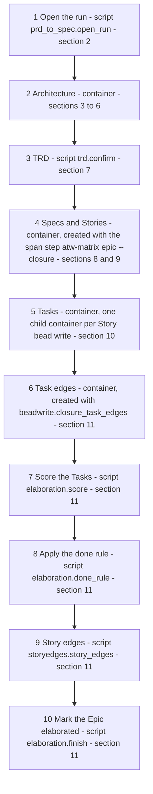

Workflows the Epic's journal does not run, as built:

| Workflow | Who runs it today | Source |
|---|---|---|
| `route-elaboration.js` | `/work-bead` only; the driver routes with its own `routing.route_elaboration` | `orchestrator/specs/epic/route-elaboration.md`, "Entry" |
| `dependency-assessment.js` (`epic-sequencer`) | the owner, through the plugin command; the driver only reads the `tracks` edges it writes | `orchestrator/specs/epic/dependency-assessment.md`, "Who calls it" |
| `wsjf-scoring.js` (`wsjf-scorer`) | the owner, and `dependency-assessment.js` after it applies edges; elaboration runs only the WSJF arithmetic (`scoring.score`) | `orchestrator/specs/epic/wsjf-scoring.md`, "Who calls it"; `scripts/portfolio/elaboration.py:240-326` |
| `task-dependency-assessment.js` | nothing but the Workflow tool by name; marked for deletion | `orchestrator/specs/epic/task-dependency-assessment.md` |
| `gate-enforce.js` | no Epic step | `orchestrator/specs/epic/gate-enforce.md` |

**Differences from the requirements:**

- Plan item 1.10: step 4's span fails the dispatch when the architecture adds or changes nothing
  ("the architecture adds or changes nothing to build", `repo_scoping.py:1001-1002`), so an Epic
  with no architecture change gets no spec; the owner requires "there still needs to be a spec
  with instructions for the wording change".
- Plan item 1.8: the dispatch sets the matrix approved state only as `architectureApproved` on the
  Epic's requirements and features (section 6); verified is never set by elaboration, which
  matches the owner's "The verified flag remain false or unverified" after elaboration.

**Assumptions:** none.

## 2. Open the run

**Subject:** the first outermost step, script `prd_to_spec.open_run`.
**Scope:** from the dispatch's arguments to the architect's step planned under the Architecture
container.
**Purpose:** what the matrix and the context file hold before the architect starts.
**Boundary:** the architect's work is section 3.
**Basis:** as built. `orchestrator/flows/prd_to_spec.py:221-275` (`_sync_matrix`, `open_run`);
`orchestrator/flows/architecture_files.py:110-131` (`new_context`), `:294-314`
(`agents_with_role`); `orchestrator/flows/architecture.py:177-208` (`first_steps`, `plan_under`);
`orchestrator/flows/architecture_earlier.py` (`carry`).

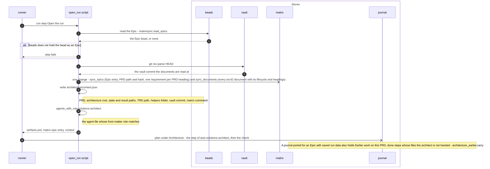

**Differences from the requirements:**

- Plan item 1.4: the matrix is filled from the PRD here as one requirement per PRD heading, and
  the architect is then told the matrix holds the Epic's requirements (section 3). The owner:
  "This statement is not true, and was never true".
- Plan item 1.6: the agent for the architect's step is found by Python from the front matter
  field `role` (`architecture_files.py:294-314`); the plan replaces role-based seat filling with
  the way question 4 settles.

**Assumptions:** none.

## 3. The architect's session and the agents it starts

**Subject:** the step "Decide what the architecture should be for this PRD", agent
`aws-solutions-architect`, and the agents it starts inside its session.
**Scope:** from the launch of the architect's session to the accepted architecture result.
**Purpose:** what the architect reads, whom it starts and how each is chosen, what each returns,
and what is written to arc42 (vault) and the matrix.
**Boundary:** what the runner does with helpers left running when the session ends is section 4;
the check and review are sections 5 and 6.
**Basis:** as built. `orchestrator/flows/architecture.py:212-232` (`_handed_files`), `:300-438`
(recording and the output check), `:440-494` (`architect`); `agents/aws-solutions-architect.md`
"The first step" (`:100-132`), "Delegating to specialists" (`:220-275`), "The TRD" (`:331-346`),
"Having the documents written" (`:348-353`), "Before you finish" (`:355-370`); the agent files
whose front matter role is `design-specialist`, `diagram-author`, `trd-author`,
`document-maintainer` or `repository-steward`; schemas `agent-brief`, `architecture-state`,
`specialist-request`, `specialist-answer`, `trd-request`, `trd-answer`, `write-request`,
`write-result`, `architecture-result` in `skills/artifact-handoff/schemas/`.

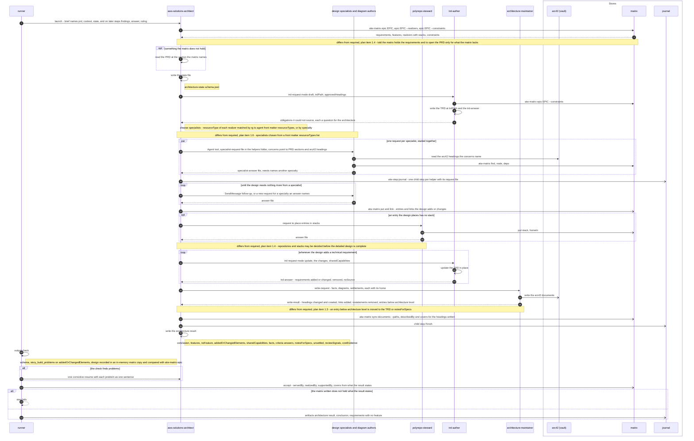

Who each agent is and how it is chosen, as built:

| Agent | How it is chosen | Receives | Produces | Writes |
|---|---|---|---|---|
| `aws-solutions-architect` | Python, the one agent whose front matter `role` is `solutions-architect` (`architecture_files.py:294-314`) | `prd`, `context`, `state`; later `findings`, `answer`, `ruling` | state file, architecture result | matrix (`put`, `link`, `sync-documents`), journal child steps |
| design specialists: `api-contract-designer`, `bounded-context-mapper`, `cdk-infrastructure-designer`, `domain-event-modeler`, `event-schema-designer`, `graphql-schema-designer`, `integration-pattern-architect`, `persistence-architecture-specialist`, `security-architecture-designer` | the architect, from the realizers' `resourceType` and each specialist's front matter `resourceTypes`, or by specialty (`aws-solutions-architect.md:232-250`) | a `specialist-request` file | a `specialist-answer` file | nothing outside its answer |
| diagram authors: `architecture-diagram-author`, `c4-diagram-author`, `uml-diagram-author` | the architect | a `specialist-request` with `kind` `task` | an answer file | nothing outside its answer |
| `polyrepo-steward` | the architect, "for placing entries in stacks" (`aws-solutions-architect.md:229`) | a request file | an answer file | matrix stacks and `homeIn` |
| `trd-author` | the architect, as soon as the state file is written | `trd-request` (`draft`, then `update`) | the TRD at `trdPath`, a `trd-answer` | the TRD file |
| `architecture-maintainer` | the architect | `write-request` | arc42 documents, `write-result` | arc42 (vault) |

**Differences from the requirements:**

- Plan item 1.4: "The first step" tells the architect "The matrix holds the Epic's requirements,
  features, realizers and constraints, broken down from the PRD ... Open the PRD only for something
  specific the matrix does not hold" (`aws-solutions-architect.md:105-107`). The owner: "How would
  you know if the matrix had everything that needed to exist, if you didn't open the PRD?"
- Plan item 1.4: the architect may start `polyrepo-steward` to place entries in stacks during its
  work (`architecture.py:527-552`), and the span creates repositories after the TRD step (section
  8); the owner requires that "the detailed-desgnn has to be completed" before the repositories
  are known. Who decides where an element lives is question 9.
- Plan item 1.6: specialists are chosen from the front matter `resourceTypes` lists
  (`aws-solutions-architect.md:232-241`), and "A part the Epic reaches is asked about even when its
  documents are effective" (`:248-250`). The owner: "Every agent needs to have a reason to be used"
  and "I also do not want a pipeline that blindly sends everything to ever agent".
- Plan item 1.3: the design specialists' files defer detail to spec writers, the maintainer
  returns entries "below architecture level" that the architect moves "to the TRD or to
  `notesForSpecs`" (`aws-solutions-architect.md:351`), and `notesForSpecs` is a free-text field of
  the result. The owner requires high, medium and detailed architecture and design done during
  architecture and recorded in documents and the matrix.
- Plan item 1.7: the result carries `costEvidence`; nothing records, for each AWS resource, which
  AWS tools, MCP servers and skills reviewed it, that best practices and security best practices
  were followed, how each decision was made, or the Well-Architected review.
- Plan item 1.9: the TRD is drafted once the state file is written and updated whenever the design
  adds a technical requirement (`aws-solutions-architect.md:331-346`). The owner: "The TRD drives
  architecture, some information in the architecture (like standards and contraints) aslo drives
  the TRD." When it is first written and updated is question 13; `trd-author.md` and the flow are
  named for change.

**Assumptions:** the loop "until the design needs nothing more from a specialist" is the
architect's judgment; no code bounds it. The order of the specialist, steward, TRD and maintainer
exchanges is the architect's; the diagram shows one order.

## 4. When the architect's session ends

**Subject:** what the runner does with the architect's step and its child steps after the
architect's session ends.
**Scope:** the architect's step, its helper child steps and its "Finish" child step.
**Purpose:** how an interrupted session or a helper left running is continued without asking a
helper again.
**Boundary:** the helpers' work itself is section 3.
**Basis:** as built. `orchestrator/flows/architecture.py:440-494` (`architect`, `resume_from`,
`is_finish`), `:497-563` (`_saved_request`, `specialist`), `:677-730` (`trd_author`),
`:733-819` (`_sync`, `maintainer`); `orchestrator/specs/epic/architecture.md`, "The architect and
the agents it starts"; `skills/pipeline-contracts/schemas/helper-steps.schema.json`, the protocol named in
`aws-solutions-architect.md:270-275`.

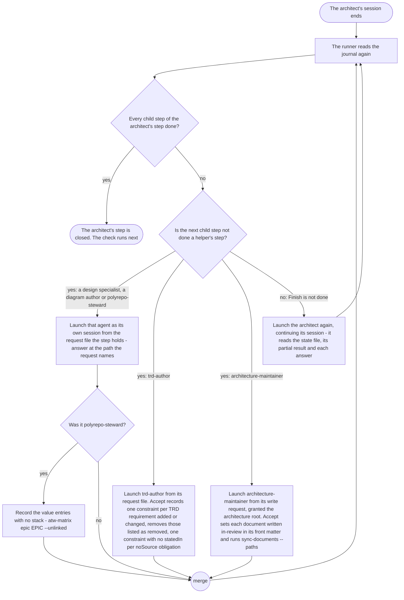

Writes made when a helper's step is accepted, as built:

| Helper | Matrix | arc42 (vault) | Journal artifacts |
|---|---|---|---|
| design specialist, diagram author | none | none | `request` or `question`, `answer` |
| `polyrepo-steward` | stacks and `homeIn`, by the steward itself | none | `request`, `answer`, `entries with no stack` |
| `trd-author` | `constraint` entries with a `trd` pointer, `statedIn`, `appliesTo` (`architecture.py:615-674`) | none | `request`, `TRD`, `answer`, `obligations with no source`, `constraints recorded` |
| `architecture-maintainer` | `sync-documents --paths` for each document written (`architecture.py:760-781`) | each written document set `lifecycle: in-review` (`matrixsync.set_lifecycle`) | `write request`, `what was written`, `documents synced` |

**Differences from the requirements:** none named in the plan for this continuation.

**Assumptions:** none.

## 5. The check after the architect

**Subject:** the script step `atw-matrix check; atw-matrix review-scope`.
**Scope:** from an accepted architecture result to the planned reviewers, a correction, or the
lead's step.
**Purpose:** the mechanical gate, its loop bound, and how reviewers are selected.
**Boundary:** the reviews and what follows them are section 6.
**Basis:** as built. `orchestrator/flows/architecture_check.py:157-198` (`check_step`,
`_mechanical`), `:395-458` (`_review_steps`), `:461-487` (`_correction`, `MAX_CORRECTIONS` 3 at
`:90`), `:505-557` (`check`); `skills/effective-architecture/review-criteria.json` (`appliesWhen`).

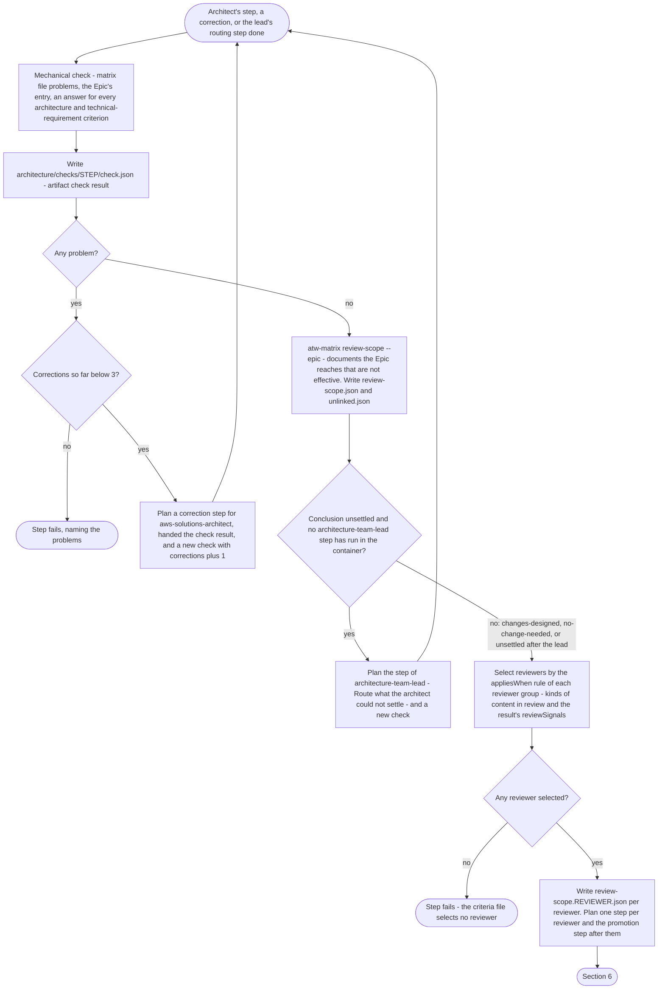

The reviewers the criteria file can select are the agents whose front matter role is
`architecture-reviewer`: `architecture-boundary-guardian`, `architecture-pattern-challenger`,
`architecture-tradeoff-skeptic`, `cost-architecture-reviewer`, `cost-impact-reviewer`,
`failure-mode-analyst`, `operational-readiness-reviewer` and `trd-validator`. A result whose
conclusion is `no-change-needed` is reviewed too: each reviewer's narrowed scope also names the
effective documents and headings the result's criteria answers cite (`architecture_check.py:263-323`).

**Differences from the requirements:**

- Plan item 1.6: which reviewers run is decided by a rule in a JSON file over content kinds and
  signals, applied by Python; the plan names role-based seat filling
  (`architecture_files.py:294-312`) as Python choosing the agent.
- Plan item 1.3: the criteria the result must answer include rule A12 ("Every document stays at
  architecture level", `skills/effective-architecture/review-standard.md:59-61`), which the plan
  removes.

**Assumptions:** none.

## 6. Review, routing, ruling and promotion

**Subject:** the reviewers' steps, the steps of `architecture-team-lead` and
`architecture-decider`, and the promotion script `atw-matrix sync-documents; atw-matrix commit`.
**Scope:** from the planned reviewers to the documents set effective and the matrix committed.
**Purpose:** who reviews what, how findings loop back, who rules, and where `lifecycle` and
`architectureApproved` are written.
**Boundary:** the architect's corrections reuse section 3.
**Basis:** as built. `orchestrator/flows/architecture_review.py:195-305` (`_lead_group`,
`_accept_review`, `reviewer`), `:318-364` (`lead`), `:367-453` (`_disagreements`, `decider`);
`orchestrator/flows/architecture_promotion.py:88-145` (`_promote`), `:180-195`
(`_require_resolved`), `:267-321` (`promote`); `scripts/portfolio/matrixwrite.py:639-679`
(`approve`); `skills/artifact-handoff/scripts/architecture_work_contract.py:52-56` (routings).

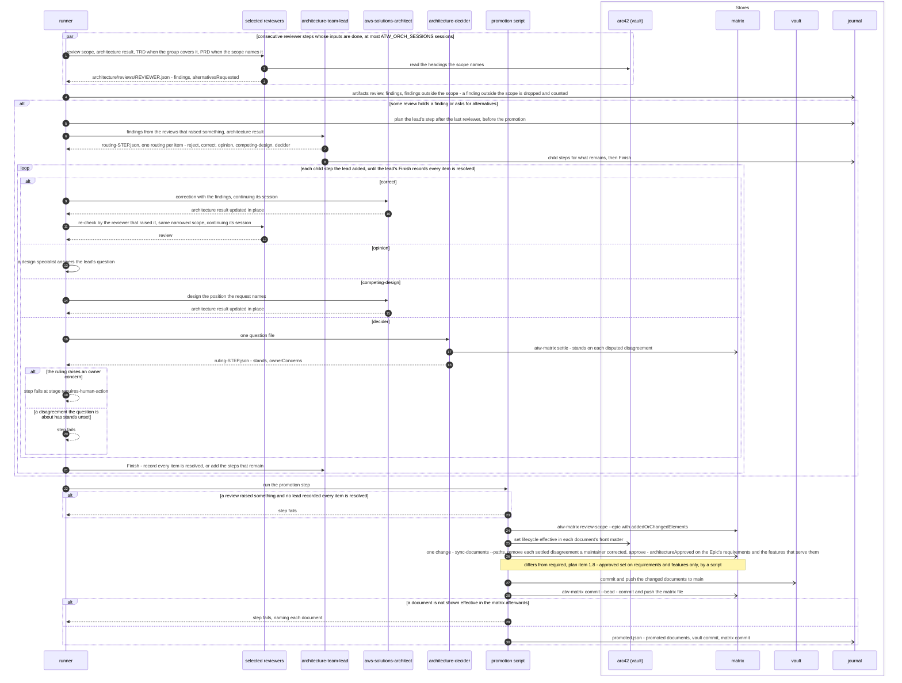

**Differences from the requirements:**

- Plan item 1.8: the arc42 `effective` lifecycle is set by the promotion script by rule
  (`architecture_promotion.py:116`; the architect's file: "A script marks content approved",
  `aws-solutions-architect.md:387`). The owner: `effective` "means ... the document has been
  approved by the architecture agent responsble for approving the architecture."
- Plan item 1.8: the approved state is the `architectureApproved` mark, set on the Epic's
  requirements and the features that serve them (`matrixwrite.py:667-679`); the owner requires an
  approved flag on the matrix content an Epic's elaboration reaches, set when the matrix and arc42
  are filled out or corrected. Whether `architectureApproved` is the approved flag is question 12.

**Assumptions:** the `opinion` branch is drawn as "a design specialist answers the lead's
question"; the lead's definition says it may ask the agents whose role is `design-specialist`
(`architecture_review.py:318-330`), and the step it adds runs through the `specialist` launch
builder (`architecture.py:527-563`).

## 7. The TRD confirm step

**Subject:** the outermost step "TRD", script `trd.confirm`.
**Scope:** from the TRD file `trd-author` wrote to the TRD recorded on the Epic bead.
**Purpose:** what is checked and recorded once the architecture is promoted.
**Boundary:** the writing of the TRD is sections 3 and 4.
**Basis:** as built. `orchestrator/flows/trd_authoring.py:164-302` (`document`,
`unresolved_requirements`, `_mark_trd`, `confirm`); `orchestrator/specs/epic/trd-authoring.md`.

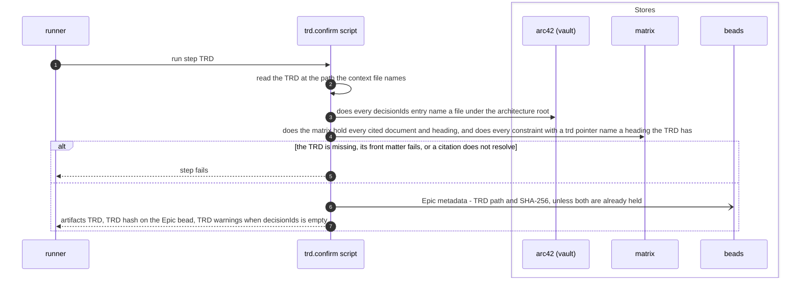

**Differences from the requirements:** none named in the plan for this step.

**Assumptions:** none.

## 8. The repository span

**Subject:** the first step of "Specs and Stories", script `atw-matrix epic --closure`
(`repo_scoping.span`).
**Scope:** from the architect's `addedOrChangedElements` to one Specs and Stories container per
repository.
**Purpose:** what each Story builds, where repositories come from, and when a repository is
created.
**Boundary:** the spec steps of one repository are section 9.
**Basis:** as built. `orchestrator/flows/repo_scoping.py:354-371` (`story_build_entries`),
`:440-462` (`story_build_problems`), `:489-529` (`repository_name`), `:603-640` (`story_builds`),
`:227-337` (`create_repositories`), `:927-960` (`_spec_steps`), `:988-1062` (`span`);
`orchestrator/flows/repo_placement.py` (`forbidden`); `orchestrator/specs/epic/repo-scoping.md`.

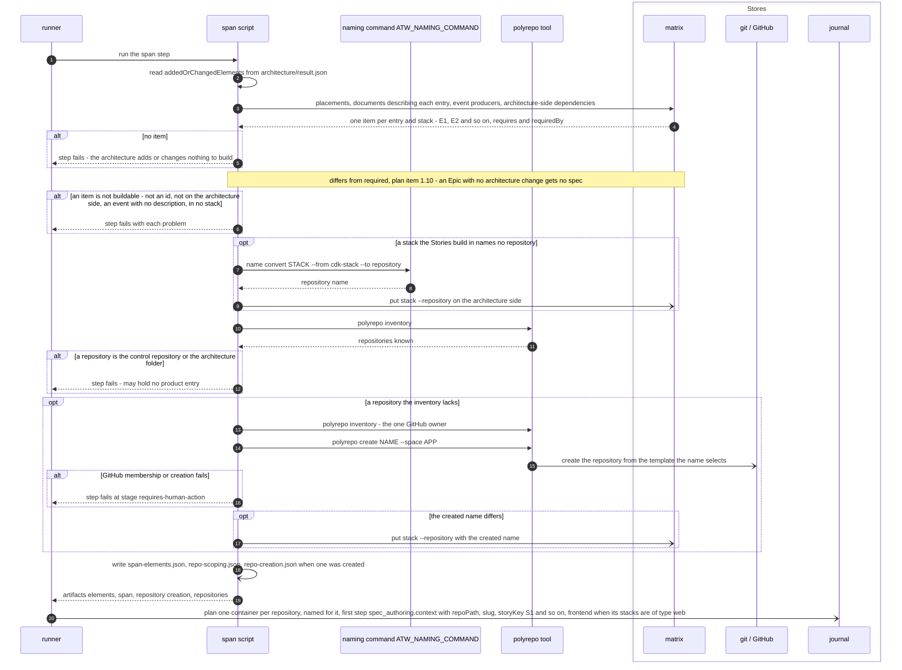

**Differences from the requirements:**

- Plan item 1.10: what each Story builds is the architect's `addedOrChangedElements` and nothing
  more (`repo_scoping.py:354-371`); the owner requires the spec's scope to come from the verified
  state of each element ("A spec's delta NEVER was supposed to come from an architecture delta").
- Plan item 1.10: the span fails when nothing is added or changed (`repo_scoping.py:1001-1002`);
  the owner requires a spec for an Epic with no architecture change.
- Plan item 1.4: repositories are determined from the stacks placed during the architect's
  session, before or alongside the detailed design (section 3); question 9.

**Assumptions:** none.

## 9. The specs and the Story of one repository

**Subject:** the steps of one repository's container under "Specs and Stories".
**Scope:** from `spec_authoring.context` to the Story bead and its journal.
**Purpose:** which agents write which documents from what, the review loop and its bound, and the
Story written to beads.
**Boundary:** the Tasks are section 10. Repositories run one after another.
**Basis:** as built. `orchestrator/flows/spec_authoring.py:254-351` (`_repository_steps`),
`:420-479` (`context`), `:550-576` (`spec_document`), `:620-725` (`story_document`,
`story_bead`); `orchestrator/flows/spec_review.py:204-458` (`following`, `reviewer`, `correction`,
`decider`, `author`); `orchestrator/flows/spec_authoring_ui.py`; `orchestrator/flows/elaboration_files.py:63-67`;
`orchestrator/specs/epic/spec-authoring.md`; schemas `spec-context`, `spec-ui`, `ui-bundles`,
`spec-review`, `spec-correction`, `spec-ruling`, `story-document`, `document-front-matter`
(`SpecDocument`).

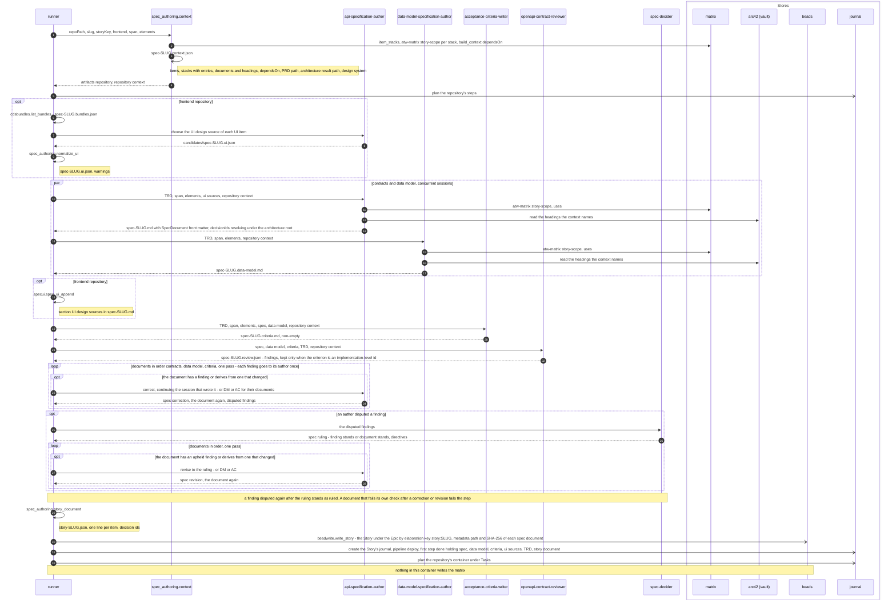

**Differences from the requirements:**

- Plan item 1.10: the spec's scope is the span's items, from the architecture delta; nothing
  reads the verified state of an element to choose between the work that brings the build up to
  the approved architecture and the delta alone.
- Plan item 1.3: the authors are handed the architect's result, whose `notesForSpecs` they start
  from (`architectureResult` in the context file, `spec_authoring.py:471`); the plan replaces
  that free-text channel with documents and the matrix.
- Plan item 1.10 and 1.12: the spec writers' files and names are to say they write specs and are
  not the detail-level designers.
- The Story bead is written by the script `beadwrite.write_story` from the Story document; the
  agent `user-story-writer` is not dispatched by any step (no flow or workflow names it). No plan
  item names this.

**Assumptions:** none.

## 10. The Tasks of one repository

**Subject:** the steps of one repository's container under "Tasks".
**Scope:** from `task_decomposition.context` to the Task beads written and recorded.
**Purpose:** what the decomposer receives, the gap check and its one correction, and what is
written to beads.
**Boundary:** edges between Tasks of different Stories are section 11.
**Basis:** as built. `orchestrator/flows/task_decomposition.py:240-260` (`task_grouping_check`),
`:265-317` (the decomposer's launch), `:319-345` (`_correction_steps`), `:380-420` (the plan
step); `scripts/portfolio/beadwrite.py` (`plan_story_tasks`, `write_task`,
`retire_superseded_tasks`); `orchestrator/specs/epic/task-decomposition.md`; schemas
`task-context`, `tasks`, `task-gaps`, `tasks-correction`.

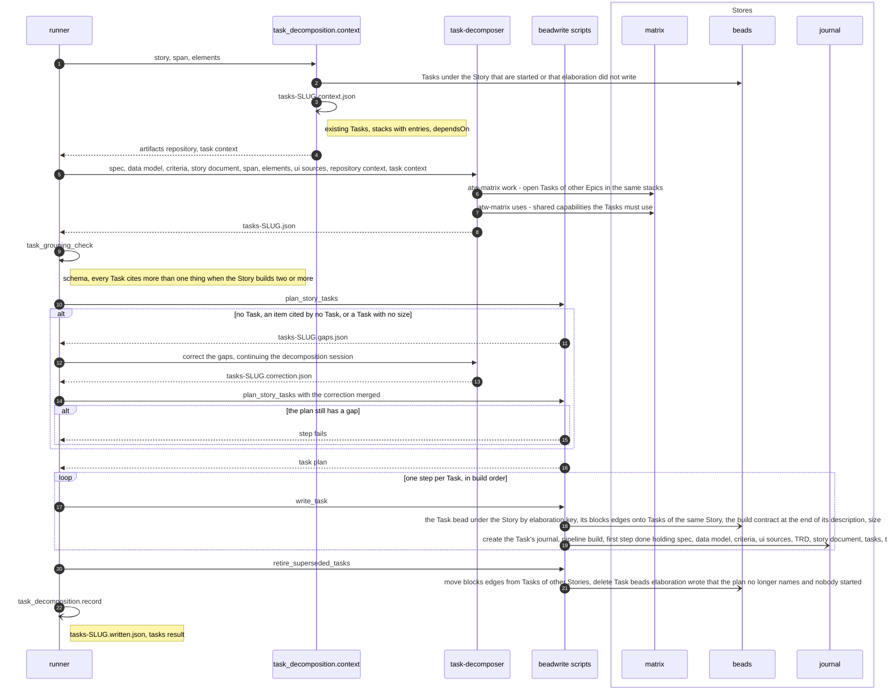

**Differences from the requirements:** none named in the plan for these steps. Plan item 1.11
concerns what the build receives from the Tasks and specs and is drawn with the build pipeline.

**Assumptions:** none.

## 11. Task edges and the finish

**Subject:** the outermost steps "Task edges", "Score the Tasks", "Apply the done rule", "Story
edges" and "Mark the Epic elaborated".
**Scope:** from the Tasks of every Story to the Epic marked elaborated.
**Purpose:** where cross-Story edges come from, when the mapper runs, and the gates before the
Epic is done.
**Boundary:** WSJF judgment of Epics is outside elaboration (section 1).
**Basis:** as built. `orchestrator/flows/task_edges.py:70-120` (planning, `SEVERAL`), `:184-215`
(the mapper's launch); `scripts/portfolio/beadwrite.py` (`closure_task_edges`,
`write_all_task_edges`); `orchestrator/flows/elaboration_steps.py` (`score`, `apply_done_rule`,
`story_edges`, `mark_done`); `scripts/portfolio/elaboration.py:240-326` (`finish`);
`orchestrator/specs/epic/prd-to-spec.md`, "Task edges" and "Finish".

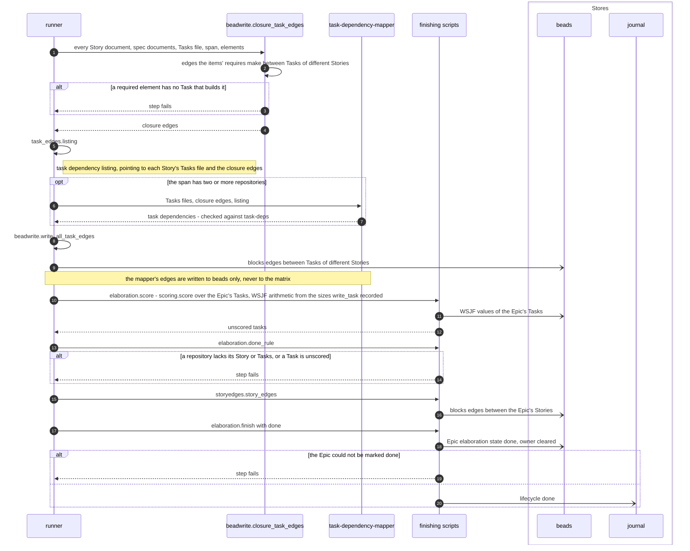

**Differences from the requirements:** none named in the plan for these steps.

**Assumptions:** none.

## 12. The Epic's elaboration state in beads

**Subject:** the bead metadata `KEY_ELABORATION_STATE` of one Epic and its owner token
(`KEY_ELABORATION_STATE_OWNER`).
**Scope:** every transition the driver selection and `prd-to-spec` make.
**Purpose:** when an Epic can be dispatched, claimed, resumed and finished.
**Boundary:** the Epic's `tracks` edges and WSJF value come from outside elaboration.
**Basis:** as built. `scripts/portfolio/elaboration.py:135-223` (`start`), `:240-326`
(`finish`), `:328-370` (`release`); `skills/beads-contract/scripts/bead_metadata.py:98-100`;
`ops/sdlc-automation/selection.py:264-284`.

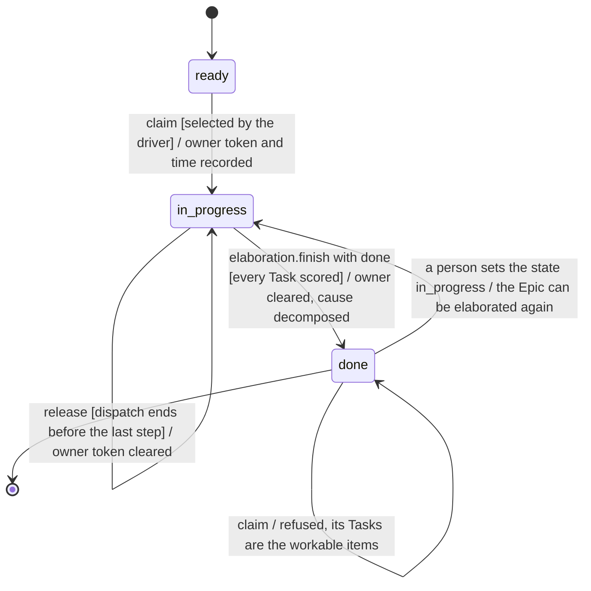

An absent elaboration state is taken as `ready`; an unknown one is taken as `ready` with a warning
(`elaboration.py:186-191`). A claim on an `in_progress` Epic held by another owner is refused
unless the dispatch asks to reclaim (`:192-200`).

**Differences from the requirements:** none named in the plan.

**Assumptions:** none.

## 13. A journal step

**Subject:** the status of one step of the Epic's journal.
**Scope:** every step, script or agent, at any depth.
**Purpose:** what a rerun reuses and what it runs again.
**Boundary:** the steps a step plans are added by its completion.
**Basis:** as built. `skills/pipeline-contracts/scripts/step_journal_contract.py:37-40`;
`orchestrator/core/step_journal.py:268-357` (container completion), `:569-692` (start, done,
fail), `:729-787` (`next_step`, journal done); `orchestrator/specs/epic/prd-to-spec.md`, "How a
step runs" and "Where a run begins".

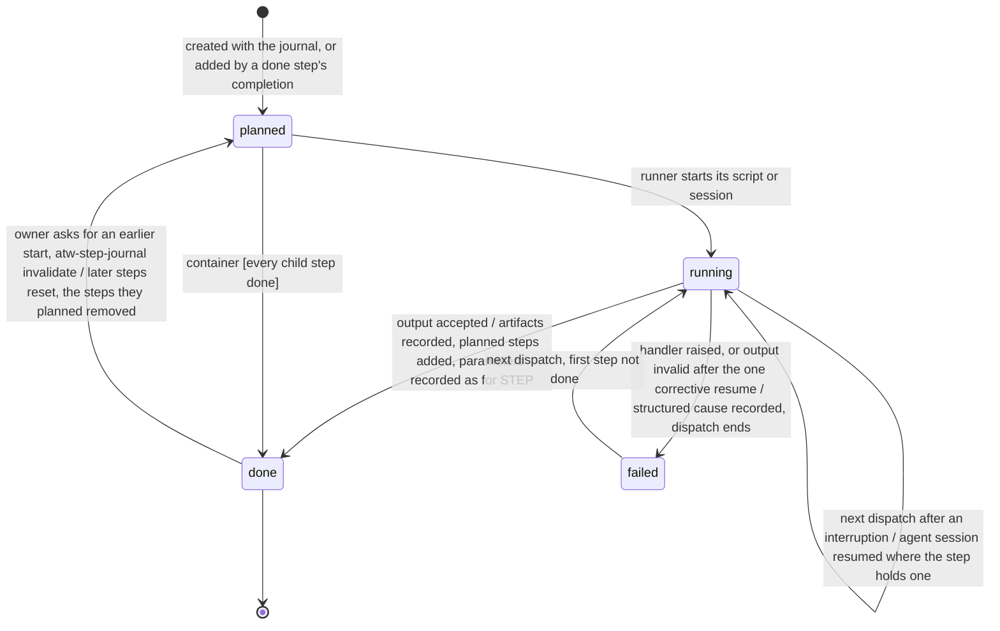

A container has no handler: it is done when every child step is done. Consecutive sibling steps
that each have an agent, have no child steps and whose inputs are done run as concurrent sessions,
at most `ATW_ORCH_SESSIONS` at a time (`orchestrator/core/journal_run.py:77`, `:427`).

**Differences from the requirements:** none named in the plan.

**Assumptions:** none.

## 14. arc42 lifecycle and the matrix marks, as elaboration writes them

**Subject:** the front matter `lifecycle` of an arc42 document and the matrix marks
`architectureApproved` and `verified`.
**Scope:** the writes elaboration makes, and the one write the driver makes after a Story merges.
**Purpose:** where the as-built states are set, for comparison with
[The pipelines: architecture and matrix states](pipelines-architecture-states.md).
**Boundary:** the seeding of the matrix and arc42 is outside.
**Basis:** as built. `orchestrator/flows/architecture.py:760-781` (`_sync`, in-review);
`orchestrator/flows/architecture_promotion.py:88-145` (effective, approve);
`scripts/portfolio/matrixwrite.py:639-679` (`approve`); `ops/sdlc-automation/matrixmarks.py:342`
(`verified`, `atw-matrix verify --story`).

An arc42 document:

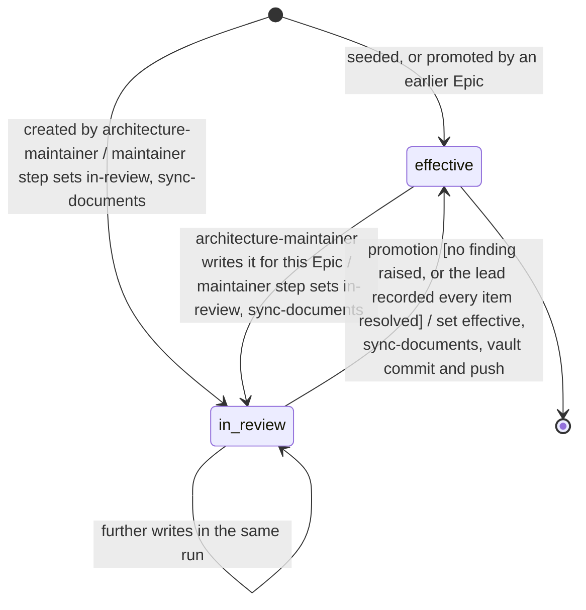

A matrix requirement or feature of the Epic, and a stack or component:

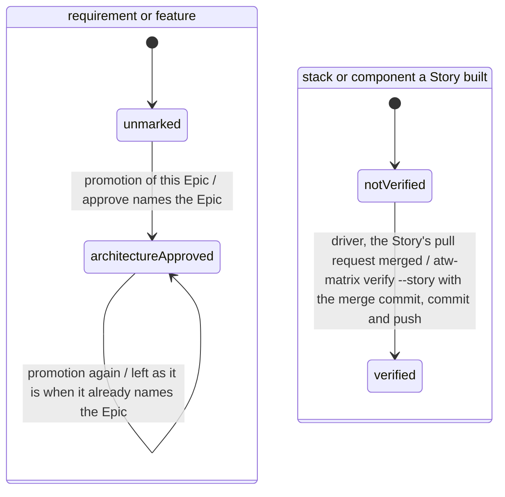

**Differences from the requirements:**

- Plan item 1.8: `effective` is set by the promotion script, not by "the architecture agent
  responsble for approving the architecture".
- Plan item 1.8: the approved mark reaches only the Epic's requirements and features; the owner's
  approved flag covers the matrix content an Epic's elaboration reaches (nodes and linkages, "The
  linkage could have a verified flag. The node could have a verified flag."). Question 12.
- Plan item 1.8: `verified` is set per Story when its pull request merges; the owner: "Once all of
  the tasks for all of the stories for and Epic have been built and tested (including CI (CDK),
  which means deployemen must also work), then all of the architecture and rellationships for the
  Epic can be set to verified."

**Assumptions:** none.
