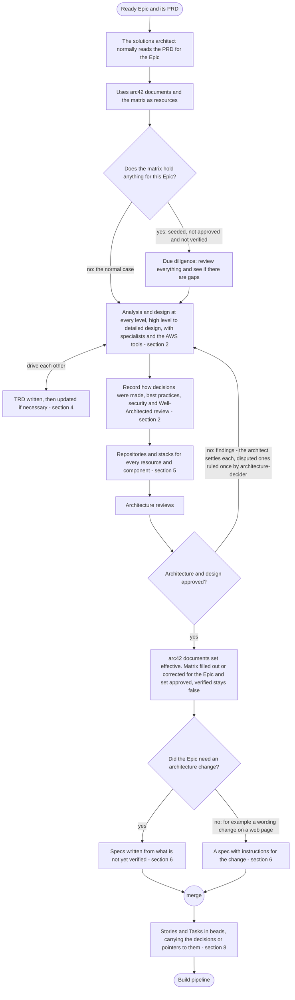
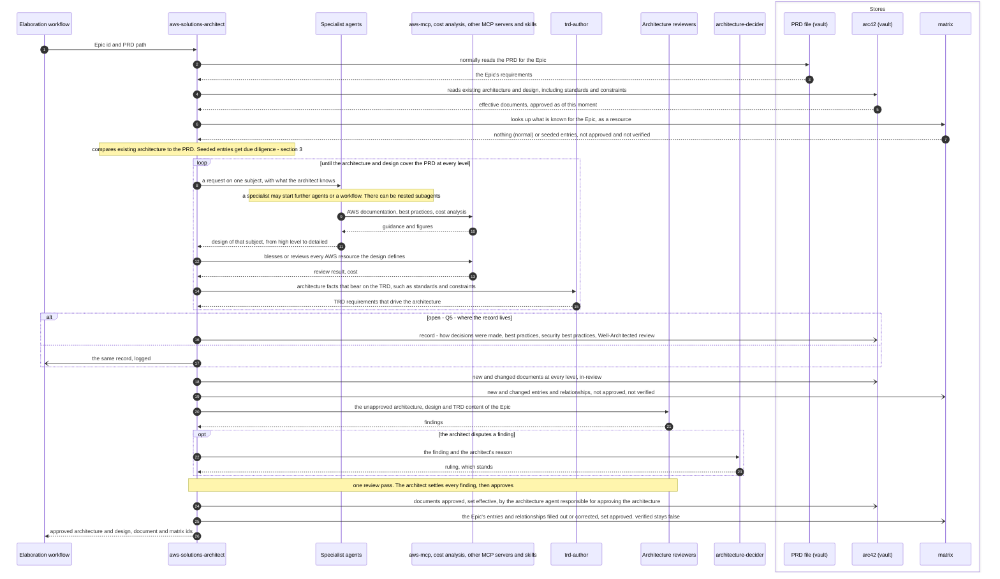
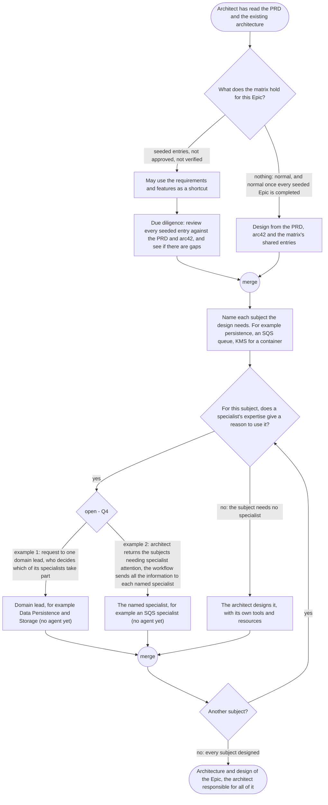
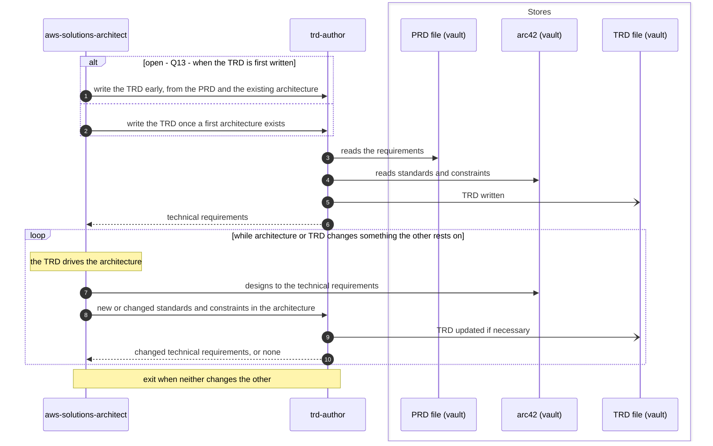
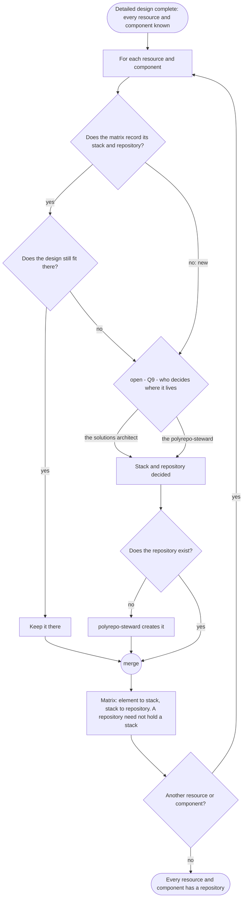
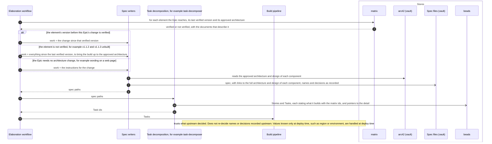
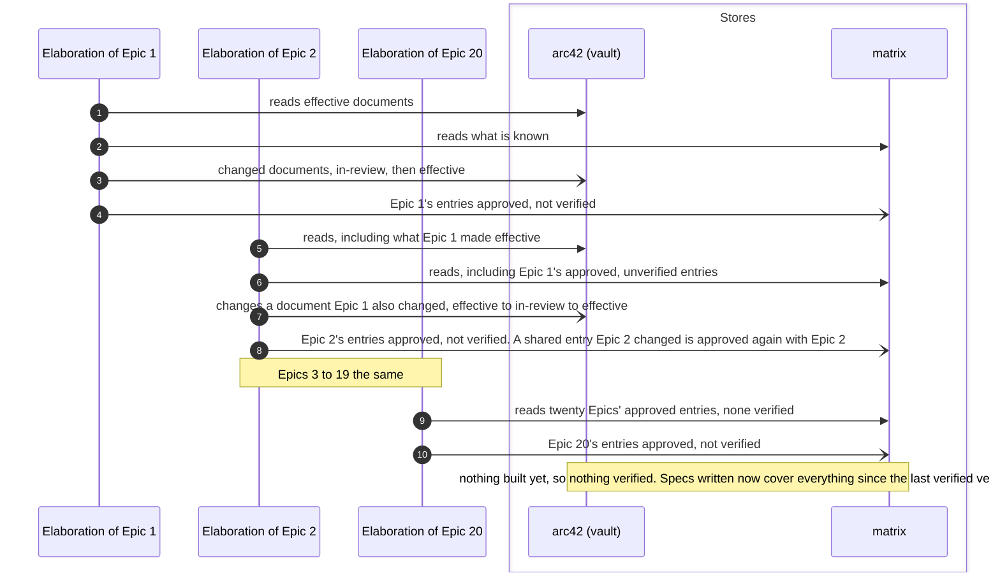
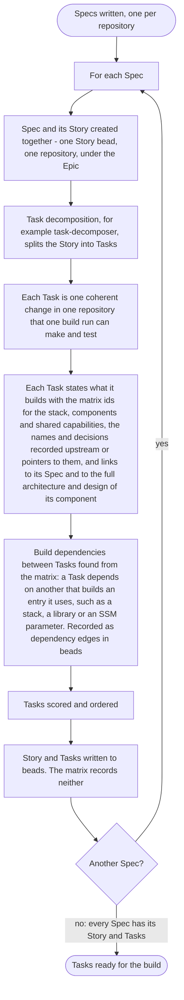

# The pipelines: elaboration

Parent: [The pipelines: overview](pipelines.md)

Elaboration runs once per Epic. It takes a ready Epic and its PRD and produces the architecture
and design the PRD needs (at every level, from high level to detailed design), the TRD, the
specs, and the Stories and Tasks the build works. This document draws elaboration **as the owner
wants it**. The sources are the owner's messages of 2026-10-19 (quoted with their qualifiers in
Part 1 of the elaboration plan, items 1.2 to 1.13), the vault's `docs/sdlc/sdlc.md`, and
[requirements/pipelines.md](../requirements/pipelines.md) and
[requirements/matrix.md](../requirements/matrix.md) where they agree with the owner's words. Where
the owner has not said what is wanted, the step is drawn as an open question, listed at the end
with a recommendation. When arc42 documents and matrix entries change state over time, across
Epics, is drawn in
[The pipelines: architecture and matrix states](pipelines-architecture-states.md).

The owner, on all of it: "None of this is a new requirement. The requirements have been
consistent, but, for some reason, Claude Code seems to want to streamline the process, and it's
just more complex that Claude Code wants it to be." and "Unfortunately, there is no
quick-and-easy way to do this."

## Legend

| Notation | Meaning |
|---|---|
| `A ->> B` (sequence) | A calls or starts B: B does work for A |
| `B -->> A` (sequence) | B returns its result to A |
| `A -) Store` (sequence) | A writes to a store; nothing is returned |
| `alt` / `opt` or a node labelled "open - Qn" | The owner has not decided this; every branch shown is one the owner named or one the plan lists as a question, and none is a decision. Qn is listed under "Open questions" at the end |
| `([...])` (activity) | Start or end |
| `{...?}` (activity) | A decision; every outgoing edge is labelled with its guard |
| "fork" / "join" nodes (activity) | Work that runs concurrently, and the point where all of it has finished |
| "merge" node (activity) | Alternative paths coming back together; no waiting |
| arc42 (vault) | The arc42 architecture and design documents in the `skillspoke-docs` vault |
| matrix | The one record of how Epics, PRDs, requirements, features, documents, services, components, resources, stacks and repositories relate ([requirements/matrix.md](../requirements/matrix.md)) |
| beads | The issue tracker that holds Epics, Stories and Tasks |
| "(no agent yet)" | A role the owner's design has that no agent file implements today |

The specialist agents are named by their names today and by their subjects, so the diagrams stay
readable when a specialist is renamed, split or added.

## 1. One Epic, end to end

**Subject:** the elaboration of one Epic.
**Scope:** from a ready Epic and its PRD to the Tasks the build works.
**Purpose:** the order of the stages and what each stage needs before it starts.
**Boundary:** PRD creation and validation come before (see
[The pipelines: PRD creation and PRD validation](pipelines-prd.md)); the build and deploy come
after (see [build](pipelines-build.md) and [deploy](pipelines-deploy.md)). Each stage is drawn in
detail in the sections that follow.
**Sources:** Order of operations, the owner: "1. Existing Architecture is read and
understood and compared to the PRD 2. Analysis occurs, and any gap in the existing architecture
is generated and approved to fullfil the needs of the PRD. 3. Aything new or changed is updated in
the matrix." Repositories after detailed design, the owner: "the detailed-desgnn has to be
completed and details added or updated in the matrix, and as part of that, all resources or
components or whatever will need a repository." The spec, the owner: "No architecture change is
requured, but there still needs to be a spec".

Notes on the diagram:

- "Normally" is the owner's word: "Normally, architecture needs to read the PRD for the Epic,
  then it would use both the arc42 documents, and the matrix as a resource to try to build out
  the architecture for the PRD." The diagram does not say the architect always reads the PRD
  first.
- The owner, on the TRD: it "probably has be written and then updated if necessary". When it is
  first written is an open question (Q13); section 4 shows it.
- The reviews run once. The architect settles each finding, and a finding the architect disputes
  goes once to `architecture-decider`, whose ruling stands; there are no further rounds, because
  the owner saw review loops make "A simple request or task ... take hours to complete".

## 2. The architecture stage

**Subject:** the architecture stage of one Epic.
**Scope:** from the solutions architect starting work on the Epic to approved architecture and
design, recorded in arc42 and in the matrix.
**Purpose:** who takes part, what each is given and returns, which tools are used, and where
arc42 and the matrix are read and written.
**Boundary:** how specialists are chosen is section 3; the TRD exchange is section 4;
repositories are section 5; document and flag states over time are in
[architecture and matrix states](pipelines-architecture-states.md).
**Sources:** The owner: "The solutions architect is responsible for all architecture for
the agent." and "that architecture agent must use all of its tools and resurces and produce and
approve the architecture." On levels: "When I've said architecture in this project, I've always
included everything from a high-level network diagram, to the design of the classes, object
models, APIs, database column, data types, etc." and "my first instinct of call all high, medium,
and detailed architecture and design needs to happen when during what we call "architecture"." On
tools: "I want to know that aws-mcp (which include cost analysis) and any other specialized mcp
servers, skills, and tools are used." and "If the architecture defines some architecure the
includes AWS resources, then I need to know it was blessed or reviewed with the AWS tools." On
the record: "I need to inow that all best practive, security best practices were followed, and I
would recommend how decisions were made, how we know best practices or whether it was reviewed
for AWS well-architected principles be documented in arc42 or at least logged." On nesting: "I
know a subagent can start a workflow with subagents, etc. There can be nested subagents."

Notes on the diagram:

- The review step comes from [requirements/matrix.md](../requirements/matrix.md) R57 (the
  architecture "has been through the solutions architect and the architecture reviews"). The
  architect names the review subjects its design raises (for example cost, security, failure
  modes), each with its reason, and the workflow sends the design to the reviewer for each named
  subject, because every agent needs a reason to be used, the same as the specialists in section 3.
- How the architect reaches a specialist (directly, through a domain lead, or through the
  workflow) is Q4, drawn in section 3.
- "Any updates or corrections to arc42 must also be made." (the owner): every correction written
  to the matrix at the end of the stage has its counterpart in the arc42 documents written in the
  same stage.
- The detailed design is recorded in documents and in the matrix, not left to spec writers. The
  owner: "All of these details that I thought were already in the Architecture documents and
  matrix, and now I'm understanding are postponed decision until spec authoring, still need be
  documented and stored in the matrix," Where in arc42 the detailed design documents are placed is
  an open question (Q3).
- Documents are chosen and grown by the owner's diagram-and-model-types guidance, not one bespoke
  document per Epic. The owner: "There are diagrams that need to be created and then enhanced or
  updated as each item is built.", "There are diagrams that only pertain to a single component.",
  "There are doagrams that should only pertain to a single feature." and "There are diagrams that
  show how components work together."

## 3. Using the matrix, and choosing specialists

**Subject:** what the solutions architect does with what the matrix holds, and how it decides
which specialists to use.
**Scope:** inside the architecture stage, before and during design.
**Purpose:** the seeded case against the normal case, and the reasoning that chooses a
specialist.
**Boundary:** what each specialist designs is its own file's job; this diagram shows only why one
is used.
**Sources:** The owner: "Normally no infomration will be in the matrix at all for an
Epic, and it gets populated as the pipelines run", "We, however, preloaded known information to
help speed things up for our initial Epic poplulation.", "In the pipeline, the architecture can
look at the requirements and features as a shortcut, but remember, that only exists because we
seeded the information.", "When existing data is populated in the matrix for an epic, that is not
approved and not verified, then the architecture agents still need to do some due diligents to
review ecerything and see if there are gaps.", "The matrix is to help speed up gathering what we
alrdeady know, but it can't show us what we not uet knnow." On specialists: "There has to be some
sort of reasoning or expertise or decision making to even know which specialist to use.", "What I
do not want is python code deciding which specialists to use", "I also do not want a pipeline
that blindly sends everything to ever agent, whether it applies or not", "Ever agent needs to have
a reason to be used.", "For architecture, that reasoning agent is supposed to be the solutions
architect". The two ways are the owner's two examples, and "Neither one of these scenarios are
perfect or fool proof." (Q4).

Notes on the diagram:

- No subject is left uncovered. The owner: "The solutions architect is responsible for all
  architecture for the agent." and "that architecture agent must use all of its tools and
  resurces and produce and approve the architecture." What the architect does with a subject no
  specialist covers is an open question (Q10); the "no" edge shows the
  architect doing it, which the owner's sentence requires in any case.
- The subjects are open. The owner: "What if the architecture calls for us to to build a container
  using KMS? I doubt that's even in hour hardcoded resourceType list." No list of today's resource
  types limits the subjects.
- In example 1 the owner noted the cost of autonomy: "So I'm not necessarily interested in an
  agent orchestating with autonomy like this."

### Why each specialist is used

The owner: "I need to remind you of why I wanted the specialest agents. Specific instructions and
skills and expertise and tools, small context, and focused scope and responsabilities.", "In my
experience, the general default training data for Anthropic models isn't good enough when it
comes to a lot of specific topics." and "Without spreading the work to specialist agents, a
generic agent ends of doing way too much of the work, filling up it's own context, and then making
horrible decisions and producing horrible results". The specialists the architect can use today,
each with the subject that is its reason to be used:

| Specialist today | Subject that gives the reason to use it |
|---|---|
| `bounded-context-mapper` | Bounded contexts, domain responsibilities, service ownership |
| `integration-pattern-architect` | Service boundaries, synchronous and event integration, delivery and failure behaviour |
| `api-contract-designer` | REST interfaces, which block exposes each, who may call it, compatibility |
| `graphql-schema-designer` | GraphQL interfaces |
| `domain-event-modeler` | Domain events as facts, their owners and triggers |
| `event-schema-designer` | EventBridge event types and routing rules (the owner: "That agent was originally written to be used for eventbridge event schemas.") |
| `persistence-architecture-specialist` | Which block owns each store, what it holds, consistency, data lifecycle |
| `security-architecture-designer` | Trust boundaries, identities, authorization, IAM, encryption, threat mitigation |
| `cdk-infrastructure-designer` | Repositories, CDK stacks, where each block runs, shared infrastructure |
| `architecture-diagram-author`, `c4-diagram-author`, `uml-diagram-author` | Drawing one diagram of a settled design |

A subject with no specialist today (the owner's examples: an SQS specialist, a lead for Data
Persistence and Storage) is a gap in the roster, not a gap in the architecture.

## 4. The TRD and the architecture drive each other

**Subject:** the exchange between the architecture and the TRD.
**Scope:** inside the architecture stage.
**Purpose:** that each feeds the other, and that the TRD is updated when the architecture bears on
it.
**Boundary:** TRD validation detail is not drawn.
**Sources:** The owner: "the TRD probably has be written and then updated if necessary.
The TRD drives architecture, some information in the architecture (like standards and contraints)
aslo drives the TRD." When the TRD is first written and when it is updated is an open question
(Q13).

## 5. Repositories and stacks, after the detailed design

**Subject:** deciding the repository and stack of every resource and component the design needs.
**Scope:** the end of the architecture stage.
**Purpose:** that repositories are decided from the resources and components, not before them.
**Boundary:** creating a repository is repository work, done by the `polyrepo-steward`.
**Sources:** The owner: "But the architect skips steps when it immediately looks at the
repositories. Those repositories are only based on the high-level architecure and none of the
detailed design.", "How would architecture know which repos are needed until it knows which
resources are needed? I want to remind you that not all repos have stacks.", "All of those
specialest agents that weren't happening until spec writing still have to be done before you
know what repos can be determined." and "all resources or components or whatever will need a
repository." Who decides where an element lives is an open question (Q9).

Sources for the two steps not quoted above: "Does the design still fit there?" follows the owner:
"The architecture process is designed to clean up the matrix is it works". "polyrepo-steward
creates it" follows the SkillSpoke rule `.claude/rules/keep-polyrepo-steward-current.md`: "The
`polyrepo-steward` owns repository work: creating, naming and cloning repositories".

## 6. The spec, the Stories and the Tasks

**Subject:** what the spec covers and carries, and what reaches the build.
**Scope:** from approved architecture to the Tasks in beads.
**Purpose:** a spec's work comes from what is not yet verified, an Epic with no architecture change
still gets a spec, the spec links to the full architecture and design, and the build trusts what
it is given.
**Boundary:** the build itself is in [build](pipelines-build.md).
**Sources:** The owner: "A spec's delta NEVER was supposed to come from an architecture
delta.", "The architecture and design comes before the build. Think of the everuything in terms
of version numbers.", the version example (drawn in
[architecture and matrix states](pipelines-architecture-states.md), section 4), "No every Epic
requires an architecure change. An epic could contain only changes to the wording of text on a
page in the web app. No architecture change is requured, but there still needs to be a spec with
instuctions for the wording change.", "it should still have access to the full architecture for
the component that it is working on. This is why the specs needs to have links the that
architecture (and design) documents.", "The spec writer wasn't supposed to be the lead
detail-level engineering designer. It was supposed to be a specialest that could write a spec
document." On the build: "as much as possible should be written into the specs and tasks, so that
the build has little to no decisions to make", "all details do not need to be copied into the
tasks and specs (file paths, URLs, etc. can be used to point to the more detailed information)",
"Your default is fault-intolerant. I need more fault-tolerance for the pipeline, and need more
trust."

Notes on the diagram:

- "Spec writers" are writers of a spec document, specialists in writing specs; the detailed
  design was done in the architecture stage. One spec writer works on each kind of spec content the
  Story needs (for example an API contract by `api-specification-author`, a data model by
  `data-model-specification-author`), named from the subjects the approved design records, and
  writes from the recorded design without designing, because the owner's spec writer "was supposed
  to be a specialest that could write a spec document".
- Task decomposition is drawn in section 8.
- One Spec and one Story per repository, and Tasks under each Story, are stated by
  [requirements/pipelines.md](../requirements/pipelines.md) and the vault's `docs/sdlc/sdlc.md`.
  The matrix records no Story and no Task (the owner: "The matrix does not include stories and
  tasks (it isn't a build tracker)"; [requirements/matrix.md](../requirements/matrix.md) R40).
- "Not perfect", the owner: "This is not an easy or perfect processess to keep track of, and even
  the verification flag concept isn't perfct, but it help us to know whether what is currently
  buit matches the architecture and design."

## 7. Many Epics elaborated before anything is built

**Subject:** several Epics passing through elaboration while nothing is built.
**Scope:** across Epics, over time.
**Purpose:** that approved does not mean built, and that each later Epic starts from what earlier
Epics approved.
**Boundary:** the build of any of them is not drawn.
**Sources:** The owner: "at any point in time, and Epic progress through the pipeline and
change the architecture. In fact we can process 20 Epics through elaboration with out building
anything. Verification is the only way to prove tht the architecture is likely to work." and
"each learnine piece of information is to help the next step in the pipelines."

Step 8 ("approved again with Epic 2") follows [requirements/matrix.md](../requirements/matrix.md)
R57: a later Epic's change clears the approved mark until that Epic's architecture is approved.

## 8. Task decomposition

**Subject:** turning each Spec into its Story and the Story into Tasks.
**Scope:** from written Specs to Stories and Tasks in beads, ready for the build.
**Purpose:** one Story per Spec and per repository, and Tasks detailed enough that the build
decides nothing that was decided upstream.
**Boundary:** the build of a Task is in [build](pipelines-build.md); the order the driver works
Tasks in is in [driver](pipelines-driver.md).
**Sources:** the vault's `docs/sdlc/sdlc.md`: "A Spec and its Story are created together - one
Story bead per Spec, scoped to exactly one repository. A PRD whose work spans several repositories
yields one Spec/Story pair per repository, all beneath the single Epic." and "User stories in the
SkillSpoke SDLC are recorded ONLY as Beads issues, produced at task decomposition".
[requirements/pipelines.md](../requirements/pipelines.md): "the Tasks under each Story, scored and
ordered". [requirements/matrix.md](../requirements/matrix.md) R41: "A Task states in full what it
builds, using the matrix's ids for the stack, the components and the shared capabilities". The
owner: "the task should be detailed so that the build doesn't need to guess or interpret or decide
on how to do anything that was already concluded upstream in the elaboration (and architecture)
pipeline. And when I say task, I also mean spec.", "all details do not need to be copied into the
tasks and specs (file paths, URLs, etc. can be used to point to the more detailed information)",
"I don't want to encourage an agent to start naming things, when the names should have already
been provided in the task (or spec)." and "The matrix does not include stories and tasks (it isn't
a build tracker)".

Decisions in this diagram, each for one reason:

- No separate review of a Spec: the spec writer writes from approved, reviewed architecture, and
  later steps trust earlier ones (the owner: "I need more fault-tolerance for the pipeline, and
  need more trust.").
- A Task is one coherent change in one repository that one build run can make and test, because a
  larger Task fills an implementer's context, which the owner names as the cause of poor results.
- Build dependencies come from the matrix's links, so no scan is needed (plan item 1.13), and are
  recorded as beads dependency edges, because beads carries build order and the matrix holds no
  Task.

## Open questions

Questions Q3 to Q13 are the plan's questions for the owner, with the plan's recommendations.

| Question | Where | Recommendation and reason |
|---|---|---|
| **Q3.** Where in arc42 are the detailed design documents placed? | Section 2 | By the owner's `architecture-documentation-model.md` and `diagram-and-model-types.md`: a view of one component under its building block in section 5, how components work together in section 6, a crosscutting design in section 8. One home keeps each design fact single-sourced, and the matrix links each document to the elements it describes. |
| **Q4.** How are specialists chosen? | Sections 2 and 3 | The owner's second example: the architect's result lists the topics needing specialist attention with a reason for each; the workflow sends the architect's result to the specialist for each topic, from a list of topics and specialists the owner approves; the architect may ask a specialist a follow-up directly. The architect's reasoning decides the topics, so no Python decides, and a workflow is observable and runs specialists in parallel. |
| **Q5.** Where does the record of tools, decisions and the Well-Architected review live? | Section 2 | A review record per Epic, written by the architecture stage, committed with the Epic's elaboration output and linked from the Epic's matrix entry. arc42 holds no decision records, so a log keeps the documents to design facts while every decision and review stays findable. |
| **Q9.** Who decides where an element lives, once the detailed design has determined the resources? | Section 5 | The architecture decides the repository and stack of each element, and the `polyrepo-steward` does the repository work that follows. Where an element lives follows from the design, and repository work is the steward's. |
| **Q10.** What does the solutions architect do with a subject no specialist covers? | Section 3 | It designs the subject with its own tools and resources and recommends to the owner a specialist to create or update. The owner: the architect "must use all of its tools and resurces and produce and approve the architecture", and "At the very least I would have likeed to been given the opportunity to update the agent or perhaps create some new agents." |
| **Q13.** When is the TRD written and updated? | Sections 1 and 4 | Written from the PRD before the architecture, updated after each architecture change that bears on it. The owner: "the TRD probably has be written and then updated if necessary" and "The TRD drives architecture". |
