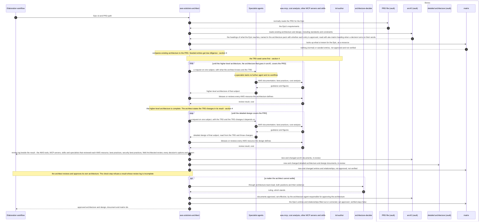
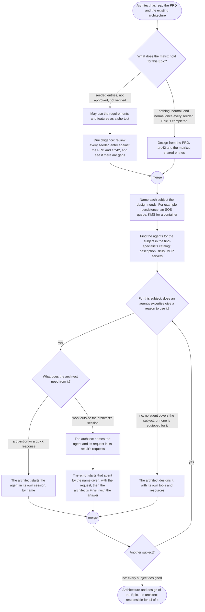
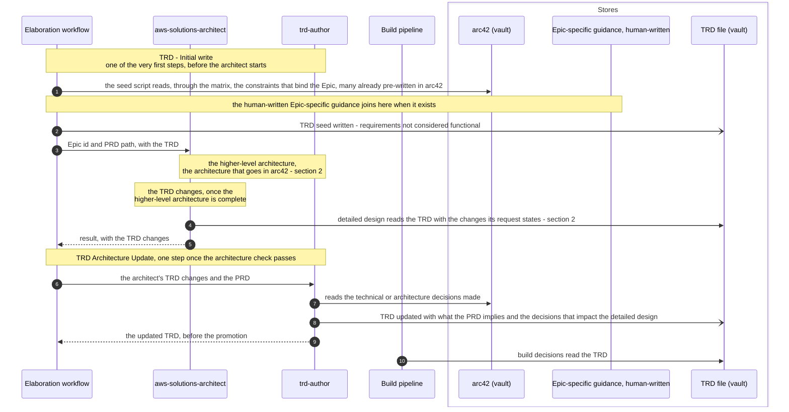
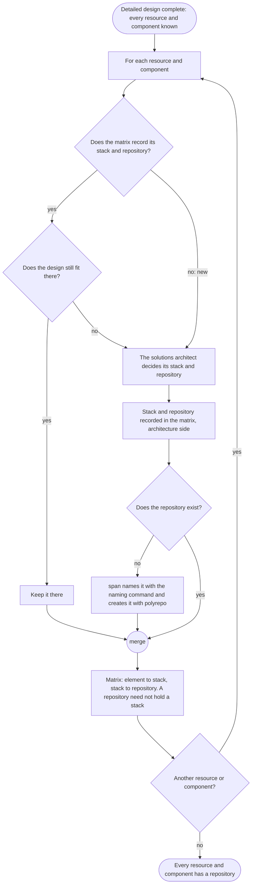
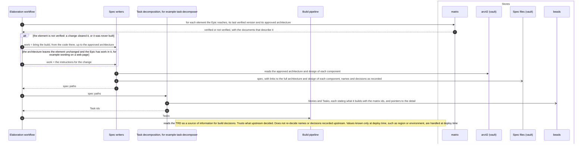
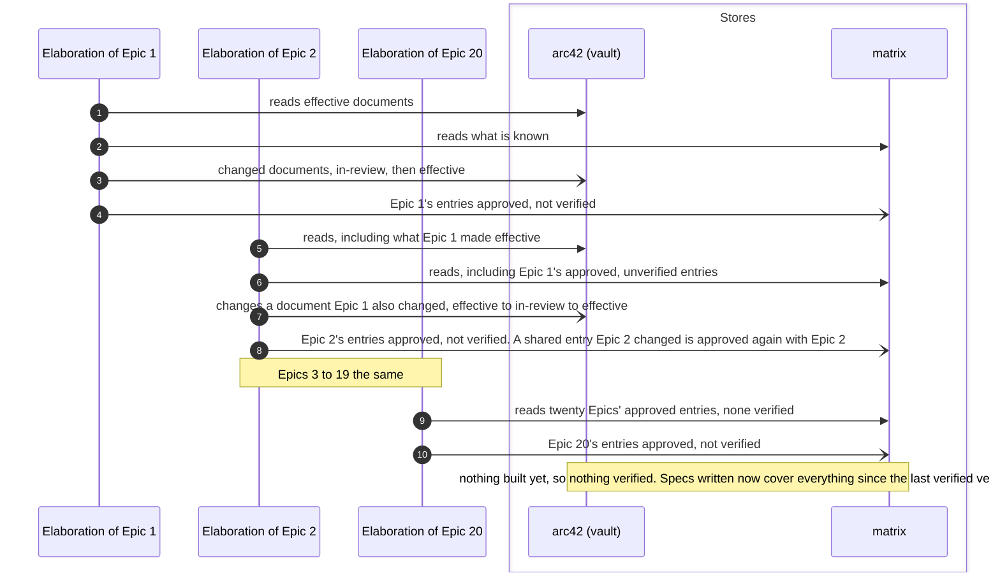

# The pipelines: elaboration

Parent: [The pipelines: overview](pipelines.md)

Elaboration runs once per Epic. It takes a ready Epic and its PRD and produces the architecture
and design the PRD needs (at every level, from high level to detailed design), the TRD, the
specs, and the Stories and Tasks the build works. This document draws elaboration **as the owner
wants it**. The sources are the owner's messages of 2026-10-19 (quoted with their qualifiers in
Part 1 of the elaboration plan, items 1.2 to 1.13), the vault's `docs/sdlc/sdlc.md`, and
[requirements/pipelines.md](../requirements/pipelines.md) and
[requirements/matrix.md](../requirements/matrix.md) where they agree with the owner's words. Where
the owner has not said what is wanted, the step is drawn as an open question, listed at the end
with a recommendation. When arc42 documents and matrix entries change state over time, across
Epics, is drawn in
[The pipelines: architecture and matrix states](pipelines-architecture-states.md).

The owner, on all of it: "None of this is a new requirement. The requirements have been
consistent, but, for some reason, Claude Code seems to want to streamline the process, and it's
just more complex that Claude Code wants it to be." and "Unfortunately, there is no
quick-and-easy way to do this."

## Legend

| Notation | Meaning |
|---|---|
| `A ->> B` (sequence) | A calls or starts B: B does work for A |
| `B -->> A` (sequence) | B returns its result to A |
| `A -) Store` (sequence) | A writes to a store; nothing is returned |
| `alt` / `opt` or a node labelled "open - Qn" | The owner has not decided this; every branch shown is one the owner named or one the plan lists as a question, and none is a decision. Qn is listed under "Open questions" at the end |
| `([...])` (activity) | Start or end |
| `{...?}` (activity) | A decision; every outgoing edge is labelled with its guard |
| "fork" / "join" nodes (activity) | Work that runs concurrently, and the point where all of it has finished |
| "merge" node (activity) | Alternative paths coming back together; no waiting |
| arc42 (vault) | The arc42 architecture and design documents in the `skillspoke-docs` vault |
| detailed architecture (vault) | Architecture and design too detailed for arc42, under the vault's `docs/tech/architecture/` outside `arc42/` |
| matrix | The one record of how Epics, PRDs, requirements, features, documents, services, components, resources, stacks and repositories relate ([requirements/matrix.md](../requirements/matrix.md)) |
| beads | The issue tracker that holds Epics, Stories and Tasks |
| "(no agent yet)" | A role the owner's design has that no agent file implements today |

The specialist agents are named by their names today and by their subjects, so the diagrams stay
readable when a specialist is renamed, split or added.

## 1. One Epic, end to end

**Subject:** the elaboration of one Epic.
**Scope:** from a ready Epic (its PRD checked for completeness and accuracy, with a WSJF score) to
the Tasks the build works.
**Purpose:** the order of the stages and what each stage needs before it starts.
**Boundary:** nothing before the Epic is ready (the owner: "Your scope does not require you to
think about anything prior to an Epic (PRD) becoming ready."); the build and deploy come after (see [build](pipelines-build.md) and [deploy](pipelines-deploy.md)). Each stage is drawn in
detail in the sections that follow.
**Sources:** Order of operations, the owner: "1. Existing Architecture is read and
understood and compared to the PRD 2. Analysis occurs, and any gap in the existing architecture
is generated and approved to fullfil the needs of the PRD. 3. Aything new or changed is updated in
the matrix." Repositories after detailed design, the owner: "the detailed-desgnn has to be
completed and details added or updated in the matrix, and as part of that, all resources or
components or whatever will need a repository." The spec, the owner: "No architecture change is
requured, but there still needs to be a spec".

```mermaid
flowchart TD
    start(["Ready Epic and its PRD"]) --> pack["Architecture pack, a script step and an index: the PRD's path, the Epic's reach by the rule of reach with whether each entry is approved, the Epics sharing it and the references of the headings that describe it, the constraints that bind it by id, and a file of every constraint that applies"]
    pack --> trdInit["TRD seed, a script step and one of the very first steps: every constraint with a rule that binds the Epic or its reach, and the section 2 constraints that bind every Epic - section 4"]
    trdInit --> readPRD["The solutions architect normally reads the PRD for the Epic"]
    readPRD --> resources["Uses arc42 documents and the matrix as resources"]
    resources --> lookup{"Does the matrix hold anything for this Epic?"}
    lookup -->|"no: the normal case"| design
    lookup -->|"yes: seeded, not approved and not verified"| diligence["Due diligence: review everything and see if there are gaps"]
    diligence --> design
    design["Higher-level architecture, the architecture that goes in arc42, with specialists and the AWS tools - section 2"]
    design --> detailed["Detailed design, reading the TRD and the TRD changes the architect decided, with specialists and the AWS tools - section 2"]
    detailed --> record["Review log: the AWS tools that reviewed each AWS resource, best practices, security, Well-Architected review, every decision's options and reason - section 2"]
    record --> repos["Repositories and stacks for every resource and component - section 5"]
    repos --> review["The solutions architect reviews and approves its own architecture against the criteria, with the TRD changes its decisions make"]
    review --> ok{"Does the check pass the result and the review log?"}
    ok -->|"no: each problem goes back to the architect as a correction"| detailed
    ok -->|"yes"| trdUpdate["TRD architecture update: one trd-author session adds what the PRD implies and applies the architect's TRD changes - section 4"]
    trdUpdate --> writes["The documents this Epic's maintainers wrote set effective. The architecture of the Epic's reach in the corrected matrix set approved, verified stays false"]
    writes --> archChange{"Did the Epic need an architecture change?"}
    archChange -->|"yes"| spec["Specs written from what is not yet verified - section 6"]
    archChange -->|"no: for example a wording change on a web page"| specNo["A spec with instructions for the change - section 6"]
    spec --> merge1(("merge"))
    specNo --> merge1
    merge1 --> stories["Stories and Tasks in beads, carrying the decisions or pointers to them - section 8"]
    stories --> done(["Build pipeline, which reads the TRD for its decisions"])
```

Notes on the diagram:

- "Normally" is the owner's word: "Normally, architecture needs to read the PRD for the Epic,
  then it would use both the arc42 documents, and the matrix as a resource to try to build out
  the architecture for the PRD." The diagram does not say the architect always reads the PRD
  first.
- The owner, on the TRD: "I think the TRD actually gets written and updated in a few phases." The
  initial write is "one of the very first steps"; the update comes "Once the architecture docs are
  completed (this would be the higher-level architecture that would be in `arc42` that isn't
  considered detail or design)". Section 4 shows both. The initial write is a script step, the
  seed, because what it writes is mechanical: the constraints of the matrix that bind the Epic,
  with their sources. The update is one `trd-author` session once the architecture check passes,
  from the TRD changes in the architect's result; the detailed design reads the TRD together with
  the changes its request states, so it works from the decisions before the TRD file holds them.
- The architecture pack (`orchestrator/flows/architecture_pack.py`) is written beside the context
  file as `pack.json`, an index, with `constraints.json`, every constraint that applies in full.
  The TRD seed, the TRD author, the architect and its specialists read it, not the whole matrix
  and not the vault. It holds no heading text: each reach row names the headings that describe it as
  `<path>#<heading>`, and a session reads a heading's words with `atw-matrix heading` only when a
  decision turns on them, so no session is handed the text of every heading the Epic reaches.
  The reach is `matrixtraverse.approval_scope`, the one set the pack lists, the check holds the
  architect's verdicts to and promotion approves.
- The architect writes its matrix changes to one change file, `matrix-changes.json` beside the
  context file. The output check applies it to a copy of the matrix and sends each failing
  operation back for the session's correction; the step that accepts the result applies it in one
  locked update, then records the result. The check step then recomputes the reach on the
  corrected matrix: each entry needs a `kept` or `corrected` verdict in the result's `reach`, a
  `pruned` one must no longer be reached, and each reached service, component, piece of
  infrastructure or layer with no stack is placed or listed under `excluded`.
- The project's graph index of the architecture documents is re-indexed by a script step
  (`orchestrator/flows/architecture_index.py`) once per pass, after every document is written and
  before the check, outside any agent session: no agent re-indexes, and no session waits on a
  rebuild. The driver names the command in `$ATW_DOCS_INDEX_COMMAND`; a pass that changed no file
  under the architecture root runs nothing, and a failed re-index is recorded without failing the
  run.
- Promotion sets effective exactly the documents this Epic's maintainers wrote, and commits those
  and the review log, and sets the approved mark on the architecture of the reach. Two Epics are
  never elaborated at the same time on the same unapproved architecture: the dependency edges
  `epicorder.py` sets in advance order them, and the driver's elaboration lane starts no Epic whose
  approval scope shares an entry with no approved mark with an Epic being elaborated
  (`atw-matrix approval --epic`), so promotion runs no check for that case. The held Epic starts
  once that Epic's promotion approves the entry, and then confirms the entry's link instead of
  reviewing it again.
- The solutions architect is the reviewer; no other agent reviews the architecture. The owner:
  "The solutions architect is the reviewer. I do not want to introduce new reviewers in for
  architecture. I already took out reviewers." What the owner requires instead is proof: "what I
  do want is some sort of proof that best practices and well-architected principles and security
  practces were consulted and followed. I want every decision between 2 options to have a
  reason. I don't want architecture going off instinct." The review log is that proof, and the
  check step refuses a result whose log lacks it. A matter the architect cannot settle goes to
  `architecture-team-lead`, and from there once to `architecture-decider`, whose ruling stands.

## 2. The architecture stage

**Subject:** the architecture stage of one Epic.
**Scope:** from the solutions architect starting work on the Epic to approved architecture and
design, recorded in arc42 and in the matrix.
**Purpose:** who takes part, what each is given and returns, which tools are used, and where
arc42 and the matrix are read and written.
**Boundary:** how specialists are chosen is section 3; the two TRD phases are section 4;
repositories are section 5; document and flag states over time are in
[architecture and matrix states](pipelines-architecture-states.md).
**Sources:** The owner: "The solutions architect is responsible for all architecture for
the agent." and "that architecture agent must use all of its tools and resurces and produce and
approve the architecture." On levels: "When I've said architecture in this project, I've always
included everything from a high-level network diagram, to the design of the classes, object
models, APIs, database column, data types, etc." and "my first instinct of call all high, medium,
and detailed architecture and design needs to happen when during what we call "architecture"." On
tools: "I want to know that aws-mcp (which include cost analysis) and any other specialized mcp
servers, skills, and tools are used." and "If the architecture defines some architecure the
includes AWS resources, then I need to know it was blessed or reviewed with the AWS tools." On
the record: "I need to inow that all best practive, security best practices were followed, and I
would recommend how decisions were made, how we know best practices or whether it was reviewed
for AWS well-architected principles be documented in arc42 or at least logged." On nesting: "I
know a subagent can start a workflow with subagents, etc. There can be nested subagents."

Notes on the diagram:

- The review is the solutions architect's own, against the criteria of
  `skills/effective-architecture/review-standard.md`; no reviewer agent is started. Its record is
  the Epic's review log (the `log-architecture-review` skill, `schemas/review-log.schema.json`),
  written at the architecture context's `reviewLogPath` beside the result. The check step runs the
  skill's check on it: a decision without two options, its choice or its reason, an AWS resource
  the design adds or changes with no review entry, or a design with an AWS resource and no
  Well-Architected review goes back to the architect as a correction. The promotion step files the
  log in the vault at `<architectureRoot>/review-logs/<epic id>.json`, commits it with the Epic's
  architecture, and links it from the Epic's matrix entry (attribute `reviewLog`). arc42 holds no
  decision records, so the log keeps the documents to design facts while every decision and
  review stays findable.
- How the architect reaches a specialist is drawn in section 3: in its own session for a
  question or quick work, or by naming the agent and its request in its result for work outside
  its session.
- "Any updates or corrections to arc42 must also be made." (the owner): every correction written
  to the matrix at the end of the stage has its counterpart in the arc42 documents written in the
  same stage.
- The detailed design is recorded in documents and in the matrix, not left to spec writers. The
  owner: "All of these details that I thought were already in the Architecture documents and
  matrix, and now I'm understanding are postponed decision until spec authoring, still need be
  documented and stored in the matrix," Detailed architecture and design that does not qualify
  for arc42 lives under the vault's `docs/tech/architecture/`, outside `arc42/`, filed through the
  `filing-clerk`. The owner: "There may be some things in arc42 that you or others may deem to be lower-level or too detailed for arc42. I want you to figure a home under `/docs/tech/architecture` somewhere. Use `filing-clerk`. I want you to help build out and organize (with the `filing-clerk`) the architecture under `/docs/tech/architecture`. This is really where all of our detailed architecture and for anything that doesn't qualify for `arc42`."
- How the tooling records the detailed design: the review standard
  (`skills/effective-architecture/review-criteria.json`) has no level below architecture. Its
  architecture and design level is homed in arc42 and the detailed architecture under
  `detailed/`, and holds the detailed design criteria (routes, store keys and data models, event
  values, names, idempotency keys and timeouts, a component's classes and object models) that
  the solutions architect answers, and reviews and approves its own design against. Specialists return each
  decision with where it belongs (an arc42 section or a `detailed/` folder), the architect's
  result names each fact's home document, and `architecture-maintainer` writes it there; `atw-matrix
  sync-documents` records the documents. There is no free-text channel of details for the spec
  authors: the specs-and-Tasks criteria carry the design "as the detailed design records them".
- Architecture documents are of two classes, defined in
  `skills/artifact-handoff/schemas/document-front-matter.schema.json`: a view
  (`ArchitectureView`: `view_type`, `scope`, `subject`, `shows`, a diagram and its prose) and a
  standard or policy (`ArchitectureStandard`: `document_class: standard` or `policy`, no diagram,
  no `view_type`, `scope` or `shows`, requirements only and no implementation), for example
  `arc42/08-crosscutting-concepts/s3-storage-standard.md` in the vault. The scopes are the
  documentation model's: system, domain, cross-component, service, component, feature, concept.
- Documents are chosen and grown by the owner's diagram-and-model-types guidance, not one bespoke
  document per Epic. The owner: "There are diagrams that need to be created and then enhanced or
  updated as each item is built.", "There are diagrams that only pertain to a single component.",
  "There are doagrams that should only pertain to a single feature." and "There are diagrams that
  show how components work together."

## 3. Using the matrix, and choosing specialists

**Subject:** what the solutions architect does with what the matrix holds, and how it decides
which specialists to use.
**Scope:** inside the architecture stage, before and during design.
**Purpose:** the seeded case against the normal case, and the reasoning that chooses a
specialist.
**Boundary:** what each specialist designs is its own file's job; this diagram shows only why one
is used.
**Sources:** The owner: "Normally no infomration will be in the matrix at all for an
Epic, and it gets populated as the pipelines run", "We, however, preloaded known information to
help speed things up for our initial Epic poplulation.", "In the pipeline, the architecture can
look at the requirements and features as a shortcut, but remember, that only exists because we
seeded the information.", "When existing data is populated in the matrix for an epic, that is not
approved and not verified, then the architecture agents still need to do some due diligents to
review ecerything and see if there are gaps.", "The matrix is to help speed up gathering what we
alrdeady know, but it can't show us what we not uet knnow." On specialists: "There has to be some
sort of reasoning or expertise or decision making to even know which specialist to use.", "What I
do not want is python code deciding which specialists to use", "I also do not want a pipeline
that blindly sends everything to ever agent, whether it applies or not", "Ever agent needs to have
a reason to be used.", "For architecture, that reasoning agent is supposed to be the solutions
architect". The owner decided: "I think the architecture agent can continue to use subagents for
basic questions and quick responses.", "We can add a skill that the architecture agent can use,
and the skill has all specialized agents in it (like a table or json file) with descriptions, and
the architecture can find agents that way.", "If the architecture agent needs needs actual work to
be done by a specialized agent outside of the architecture agent's headless claude code session,
then it can pass the agent and request in the results, and the code can route the request to the
agent by name (not by resourceType)." and "In other words, let the architect decide whih agents
are needed."

Notes on the diagram:

- No subject is left uncovered. The owner: "The solutions architect is responsible for all
  architecture for the agent." and "that architecture agent must use all of its tools and
  resurces and produce and approve the architecture." There is no specialist gap: a subject no
  specialist covers, or one a specialist covers without what it needs, takes the "no" edge, and
  the architect designs it with its own tools and resources.
- For such a subject the architect also recommends to the owner a specialist to create or
  update (the owner: "At the very least I would have likeed to been given the opportunity to
  update the agent or perhaps create some new agents."). It lists each one in its result under
  `specialistRecommendations` (`skills/artifact-handoff/schemas/architecture-result.schema.json`);
  the architect step records them in the Epic's step journal, and the elaboration report
  (`orchestrator/flows/elaboration_result.py`) puts the latest ones in the handback's
  `requiredHumanActions`, which the driver records in the owner's human-action log whether or
  not the run succeeded. A recommendation never stops the run.
- The subjects are open. The owner: "What if the architecture calls for us to to build a container
  using KMS? I doubt that's even in hour hardcoded resourceType list." No list of today's resource
  types limits the subjects, and no agent definition carries routing fields: the architect
  chooses from the catalog of the `find-specialists` skill (`skills/find-specialists/catalog.json`),
  generated from every agent's own definition by `scripts/specialist_catalog.py`, whose
  `generate --check` the pre-commit hook `specialist-catalog-fresh` runs whenever an agent
  changes.
- Python decides nothing about which agent runs. Each entry of the result's `requests`
  (`architecture-result.schema.json`) names an agent and states its request; the step that
  accepts the result (`orchestrator/flows/architecture.py`, `_requested`) plans one step for each
  named agent and the architect's `Finish` after them, and the launch builder registered for
  every catalog agent without one of its own (`journal_registry.any_agent_step`) starts it. A name
  the catalog does not list is sent back to the architect as a correction.
- The architecture lead chooses the specialist it asks for an opinion from the same catalog.
- In example 1 the owner noted the cost of autonomy: "So I'm not necessarily interested in an
  agent orchestating with autonomy like this."

### Why each specialist is used

The owner: "I need to remind you of why I wanted the specialest agents. Specific instructions and
skills and expertise and tools, small context, and focused scope and responsabilities.", "In my
experience, the general default training data for Anthropic models isn't good enough when it
comes to a lot of specific topics." and "Without spreading the work to specialist agents, a
generic agent ends of doing way too much of the work, filling up it's own context, and then making
horrible decisions and producing horrible results". Which agents exist, and what each is for and equipped with, is the catalog of the
`find-specialists` skill and nowhere else. A subject no agent covers is a gap in the roster, not a
gap in the architecture.

## 4. The TRD is written, then updated, during architecture

**Subject:** the two phases of the TRD in the architecture stage, and who reads it.
**Scope:** inside the architecture stage, and the TRD as read by detailed design and the build.
**Purpose:** that the TRD is written as one of the very first steps, updated from the
decisions of the higher-level architecture, and read by detailed design and by the build. The
initial write is the script step `trd.seed`, with no session: the constraints of the matrix that
bind the Epic and its reach, and the section 2 constraints that bind every Epic, each headed by
its constraint id with its sources. The update is one `trd-author` session once the architecture
check passes, from the TRD changes in the architect's result; it also adds the requirements the
PRD implies. The detailed design reads the TRD with the changes its request states.
**Boundary:** TRD validation detail is not drawn. The owner's future separate TRD input document
is not drawn as a store: the owner said "do not focus on this now"; its place is the initial
write, where "we would pull in that human-written Epic-epecific guidence". A TRD an earlier run
left for the Epic is started over by the seed, which also removes the matrix constraints that
point at its requirements; the update after the architect writes again what the PRD implies and
applies the architect's changes, which its result still holds. A state file
the solutions architect left is checked and corrected, not judged again from nothing: an
in-flight Epic picks up where it left off.
**Sources:** The owner: "I think the TRD actually gets written and updated in a few phases."
On the initial write: "While a Product Requirements Document (PRD) focuses on what the product
should do (functional requirements), a TRD focuses on reuirements not considered functional. NFRs
act as the quality constraints and operational boundaries that the technical architecture must
support. Since many of these are already pre-written in the arc42, they can be easily added to a
TRD as one of the very first steps. Note: This is also where we would pull in that human-written
Epic-epecific guidence." On the update: "Once the architecture docs are completed (this would be
the higher-level architecture that would be in `arc42` that isn't considered detail or design),
the TRD would be updated again to reflect technical or architecture decisions made that would
impact the detailed design." On its use: "I'm doing all of this assuming that we are using the
TRD as a source of information that impacts any detailed design and build decisions."

## 5. Repositories and stacks, after the detailed design

**Subject:** deciding the repository and stack of every resource and component the design needs.
**Scope:** the end of the architecture stage.
**Purpose:** that repositories are decided from the resources and components, not before them.
**Boundary:** creating a repository is the `span` step's, done with the `polyrepo-steward`'s `polyrepo` tool.
**Sources:** The owner: "But the architect skips steps when it immediately looks at the
repositories. Those repositories are only based on the high-level architecure and none of the
detailed design.", "How would architecture know which repos are needed until it knows which
resources are needed? I want to remind you that not all repos have stacks.", "All of those
specialest agents that weren't happening until spec writing still have to be done before you
know what repos can be determined." and "all resources or components or whatever will need a
repository." The solutions architect decides where each element lives (the architecture decides
the repository and stack of each element, and the `span` step creates each repository that
follows with the `polyrepo-steward`'s `polyrepo` tool, because where an element lives follows from
the design).

Sources for the two steps not quoted above: "Does the design still fit there?" follows the owner:
"The architecture process is designed to clean up the matrix is it works". "span names it
and creates it": the deterministic `span` step of `orchestrator/flows/repo_scoping.py` names
each missing repository with the naming command and creates it with the steward's `polyrepo`
tool; no agent session creates it.

## 6. The spec, the Stories and the Tasks

**Subject:** what the spec covers and carries, and what reaches the build.
**Scope:** from approved architecture to the Tasks in beads.
**Purpose:** a spec's work comes from what is not yet verified, work in an element the Epic's
architecture leaves unchanged still gets a spec, with or without an architecture change elsewhere, the spec links to the full architecture and design, and the build trusts what
it is given.
**Boundary:** the build itself is in [build](pipelines-build.md).
**Sources:** The owner: "A spec's delta NEVER was supposed to come from an architecture
delta.", "The architecture and design comes before the build. Think of the everuything in terms
of version numbers.", the version example (drawn in
[architecture and matrix states](pipelines-architecture-states.md), section 4), "No every Epic
requires an architecure change. An epic could contain only changes to the wording of text on a
page in the web app. No architecture change is requured, but there still needs to be a spec with
instuctions for the wording change.", "it should still have access to the full architecture for
the component that it is working on. This is why the specs needs to have links the that
architecture (and design) documents.", "The spec writer wasn't supposed to be the lead
detail-level engineering designer. It was supposed to be a specialest that could write a spec
document." On the build: "as much as possible should be written into the specs and tasks, so that
the build has little to no decisions to make", "all details do not need to be copied into the
tasks and specs (file paths, URLs, etc. can be used to point to the more detailed information)",
"Your default is fault-intolerant. I need more fault-tolerance for the pipeline, and need more
trust."

Notes on the diagram:

- "Spec writers" are writers of a spec document, specialists in writing specs; the detailed
  design was done in the architecture stage. One spec writer works on each kind of spec content the
  Story needs (for example an API contract by `api-specification-author`, a data model by
  `data-model-specification-author`), named from the subjects the approved design records, and
  writes from the recorded design without designing, because the owner's spec writer "was supposed
  to be a specialest that could write a spec document".
- The workflow's reads are `spec_authoring.entry_scope` (the spec context's `buildScope`:
  work for each entry that is not verified, none for a verified one), `spec_authoring.component_documents`
  (`atw-matrix documents`, whose links `spec_authoring.link_documents` puts at the end of every
  spec document), and the existing elements the solutions architect names in its result as where
  Epic work that leaves their architecture unchanged lands (`unchangedWorkElements`, which the
  span step in `repo_scoping` reads beside `addedOrChangedElements`). Which elements those
  are is the architect's design decision; no script picks them.
- The repository context step hands every spec session a spec pack (`spec-pack.schema.json`,
  written by `orchestrator/flows/spec_pack.py`): the entries the Story builds with whether each is
  approved, the constraints, shared capabilities and TRD requirements that bind them, and the contract
  files the repository holds. It holds no heading text: a spec session reads the text of a
  heading the repository context names with `atw-matrix heading`, from the vault's last commit,
  only when its work turns on it. No spec session explores the vault. A spec writer runs only for a
  kind of content the Story's entries include (`spec_authoring.story_surfaces`): contracts for an
  entry with an API, event, error or UI contract, a data model for a data store, UI design
  sources for a UI item of a frontend repository; a script writes the document of a kind the
  Story does not need. After the one review at most three rounds follow, each round's sessions
  running together: one correction, the decider on the disputed findings, one revision to the
  ruling.
- The repositories' containers under Specs and Stories run at the same time, and so do their
  containers under Tasks, at most `ATW_ORCH_SESSIONS` at once (`journal_run.concurrent_containers`),
  because no repository's specs or Tasks wait on another's and run time is a goal of the pipeline.
- Task decomposition is drawn in section 8.
- One Spec and one Story per repository, and Tasks under each Story, are stated by
  [requirements/pipelines.md](../requirements/pipelines.md) and the vault's `docs/sdlc/sdlc.md`.
  The matrix records no Story and no Task (the owner: "The matrix does not include stories and
  tasks (it isn't a build tracker)"; [requirements/matrix.md](../requirements/matrix.md) R40).
- "Not perfect", the owner: "This is not an easy or perfect processess to keep track of, and even
  the verification flag concept isn't perfct, but it help us to know whether what is currently
  buit matches the architecture and design."

## 7. Many Epics elaborated before anything is built

**Subject:** several Epics passing through elaboration while nothing is built.
**Scope:** across Epics, over time.
**Purpose:** that approved does not mean built, and that each later Epic starts from what earlier
Epics approved.
**Boundary:** the build of any of them is not drawn.
**Sources:** The owner: "at any point in time, and Epic progress through the pipeline and
change the architecture. In fact we can process 20 Epics through elaboration with out building
anything. Verification is the only way to prove tht the architecture is likely to work." and
"each learnine piece of information is to help the next step in the pipelines."

Step 8 ("approved again with Epic 2") follows [requirements/matrix.md](../requirements/matrix.md)
R57: a later Epic's change clears the approved mark until that Epic's architecture is approved.

## 8. Task decomposition

**Subject:** turning each Spec into its Story and the Story into Tasks.
**Scope:** from written Specs to Stories and Tasks in beads, ready for the build.
**Purpose:** one Story per Spec and per repository, and Tasks detailed enough that the build
decides nothing that was decided upstream.
**Boundary:** the build of a Task is in [build](pipelines-build.md); the order the driver works
Tasks in is in [driver](pipelines-driver.md).
**Sources:** the vault's `docs/sdlc/sdlc.md`: "A Spec and its Story are created together - one
Story bead per Spec, scoped to exactly one repository. A PRD whose work spans several repositories
yields one Spec/Story pair per repository, all beneath the single Epic." and "User stories in the
SkillSpoke SDLC are recorded ONLY as Beads issues, produced at task decomposition".
[requirements/pipelines.md](../requirements/pipelines.md): "the Tasks under each Story, scored and
ordered". [requirements/matrix.md](../requirements/matrix.md) R41: "A Task states in full what it
builds, using the matrix's ids for the stack, the components and the shared capabilities". The
owner: "the task should be detailed so that the build doesn't need to guess or interpret or decide
on how to do anything that was already concluded upstream in the elaboration (and architecture)
pipeline. And when I say task, I also mean spec.", "all details do not need to be copied into the
tasks and specs (file paths, URLs, etc. can be used to point to the more detailed information)",
"I don't want to encourage an agent to start naming things, when the names should have already
been provided in the task (or spec)." and "The matrix does not include stories and tasks (it isn't
a build tracker)".

Decisions in this diagram, each for one reason:

- No separate review of a Spec: the spec writer writes from approved, reviewed architecture, and
  later steps trust earlier ones (the owner: "I need more fault-tolerance for the pipeline, and
  need more trust.").
- A Task is one coherent change in one repository that one build run can make and test, because a
  larger Task fills an implementer's context, which the owner names as the cause of poor results.
- Build dependencies come from the matrix's links, so no scan is needed (plan item 1.13), and are
  recorded as beads dependency edges, because beads carries build order and the matrix holds no
  Task.
