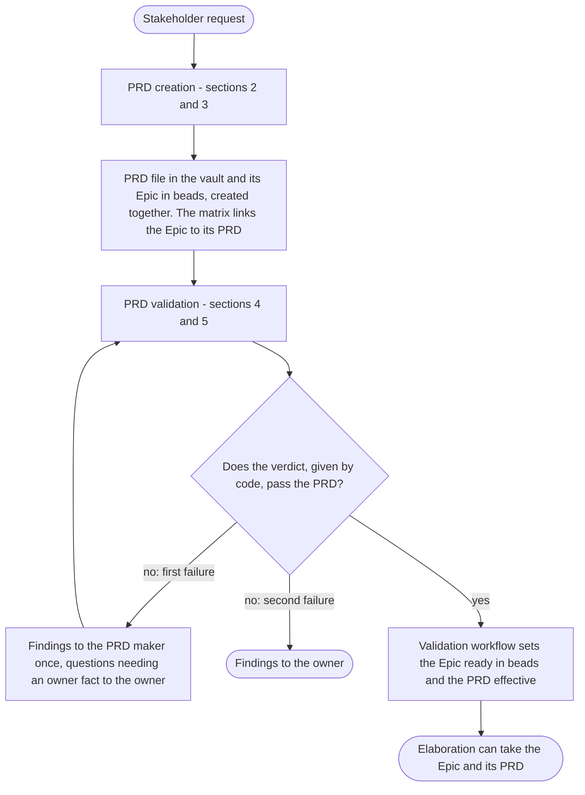
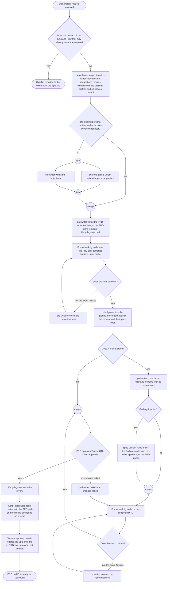
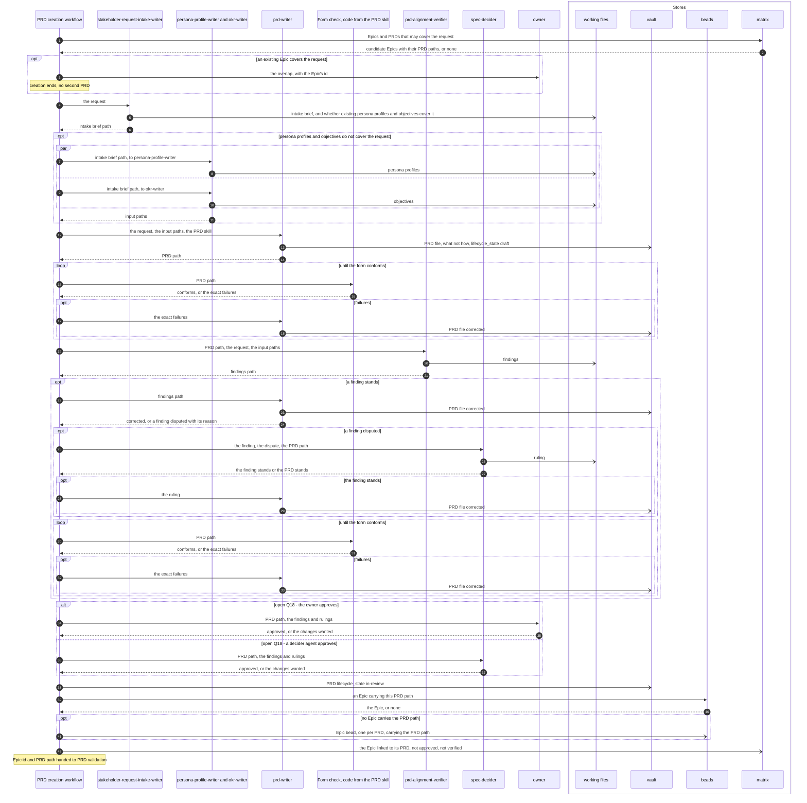
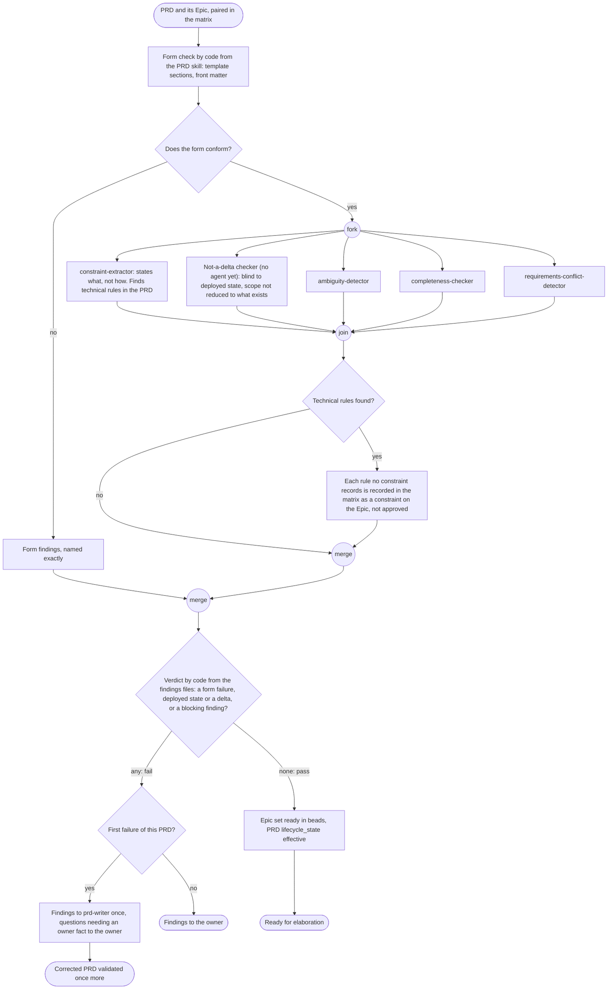
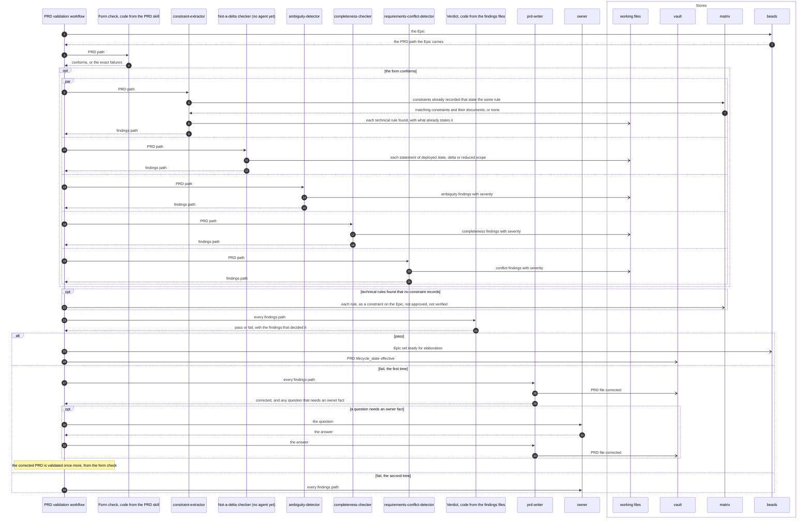
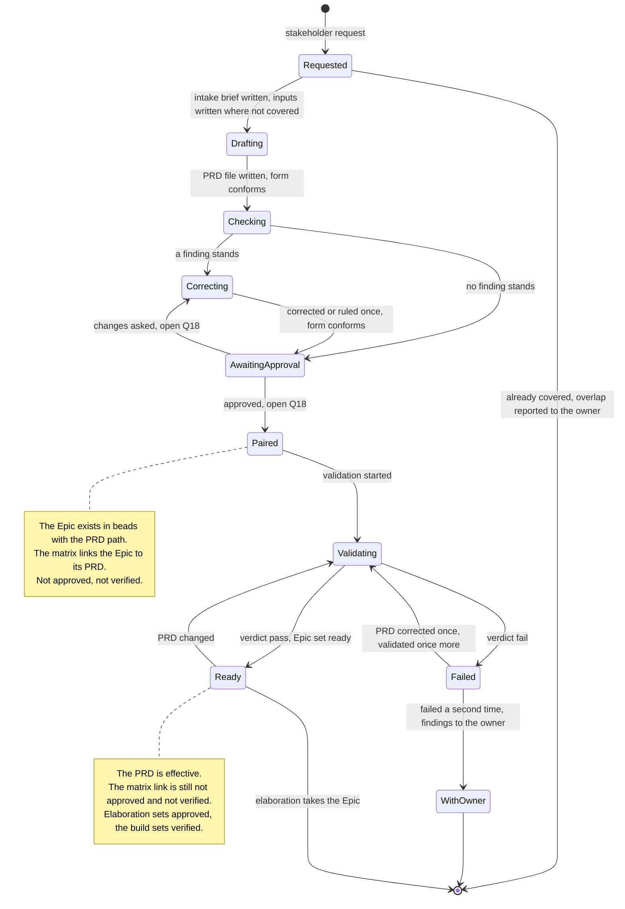

# The pipelines: PRD creation and PRD validation

Parent: [The pipelines: overview](pipelines.md)

PRD creation takes a stakeholder request and produces a PRD and its Epic, created together, with
the matrix linking the Epic to its PRD. PRD validation takes that PRD and its Epic and decides
whether elaboration can take the Epic. Together they run from a stakeholder request to an Epic
that is ready for elaboration ([The pipelines: elaboration](pipelines-elaboration.md) starts
from "A ready Epic and its PRD", [requirements/pipelines.md](../requirements/pipelines.md)). This
document draws both **as the owner wants them**. The sources are the vault's `docs/sdlc/sdlc.md`
("A PRD and its Epic are created together - one Epic bead per PRD", "A PRD states what"), the
owner's messages of 2026-10-19 (on the matrix, on agents, on contracts and on review loops), the
SkillSpoke repository's root `AGENTS.md` (maker, checker and approver kept separate; how a PRD may
change) and [requirements/matrix.md](../requirements/matrix.md) where it agrees with the owner's
words. Where the owner's words do not name a step, the step is designed on the owner's decision
basis (`making-decisions.md`: engineering best practice, security best practice, the AWS
Well-Architected Framework, the right thing to do) and the owner's stated principles, and its
reason is given where it is described. One point is the owner's and stays open: who approves a
PRD (Q18, under "Open questions").

## Legend

| Notation | Meaning |
|---|---|
| `A ->> B` (sequence) | A calls or starts B: B does work for A |
| `B -->> A` (sequence) | B returns its result to A |
| `A -) Store` (sequence) | A writes to a store; nothing is returned |
| `alt` / `opt` / `par` / `loop` (sequence) | Alternatives, an optional part, concurrent parts, a repeated part; each carries its condition, each loop its exit |
| `box` (sequence) | The stores |
| `([...])` (activity) | Start or end |
| `{...?}` (activity) | A decision; every outgoing edge is labelled with its guard |
| "fork" / "join" (activity) | Work that runs concurrently, and the point where all of it has finished |
| "merge" (activity) | Alternative paths coming back together; no waiting |
| "open Q18" | The owner has not said what is wanted here. The question, a recommendation and its reason are under "Open questions" |
| vault | The `skillspoke-docs` vault; PRDs live in `sdlc/mvp-1/prds/` (`docs/sdlc/sdlc.md`, "Where Each Lives") |
| arc42 (vault) | The arc42 architecture and design documents in the vault |
| beads | The issue tracker that holds the Epic |
| matrix | The record of how Epics, PRDs, architecture documents, resources, stacks, repositories and more relate ([requirements/matrix.md](../requirements/matrix.md)) |
| working files | The files each agent writes its output to, handed on by path |
| "(no agent yet)" | A role the design has that no agent file covers today |

Agents are named by role. Where a role has an agent in the plugin's `agents/` folder whose own
file gives it a reason to be used, the agent is named; which agent is used is decided by
reasoning, not by code (the owner: "What I do not want is python code deciding which specialists
to use").

## 1. From a request to a ready Epic

**Subject:** the path from one stakeholder request to an Epic elaboration can take.
**Scope:** PRD creation and PRD validation, and what passes between them.
**Purpose:** the order of the two pipelines and the hand-off from one to the other and to
elaboration.
**Boundary:** each pipeline is drawn in detail in sections 2 to 5. Selection of a ready Epic by
the driver, and elaboration, are outside ([The pipelines: elaboration](pipelines-elaboration.md)).
**Sources:** `docs/sdlc/sdlc.md` "The Chain": "A PRD and its Epic are created together - one Epic
bead per PRD, and a PRD's work may span several repositories." The owner: "The matrix stores
relations between Epic (PRDs), architecture (docuemnts), resources, stacks, repos, infra, and
more)". [requirements/pipelines.md](../requirements/pipelines.md): elaboration "Takes in: A ready
Epic and its PRD".

Notes on the diagram:

- A failed PRD is corrected and validated once more; a second failure goes to the owner. Reason:
  the loop is bounded, and the meaning of a requirement is the owner's.
- The PRD is never cut down to what exists: "A PRD states what: pure requirements, blind to
  deployed state, which never reduces its scope. There are no delta PRDs, and no document merges
  deployed state into requirements." (`docs/sdlc/sdlc.md`, "The Chain").
- A later change to a ready Epic's PRD returns the Epic to validation (section 7). Reason:
  elaboration builds everything from the PRD.

## 2. PRD creation: the activity

**Subject:** the creation of one PRD and its Epic.
**Scope:** from a stakeholder request to a PRD file in the vault, its Epic in beads, and the
matrix link between them.
**Purpose:** every step and decision of creation, and the point the owner has not decided.
**Boundary:** who is started and what each receives and produces is section 3; validation is
sections 4 and 5.
**Sources:** `docs/sdlc/sdlc.md`: "A PRD states what", "A PRD and its Epic are created together",
"Documents are handed between agents as paths recorded on the owning Beads issue (Epic or Story),
never as content", "Authoring and validation use the `agent-teams-workforce` arc42, TRD, PRD, and
spec skills." SkillSpoke `AGENTS.md`: "bounded specialist agents that run the SDLC through
workflow scripts, with maker, checker and approver kept separate." The owner, on contracts:
"i'm a huge fan of the contracs being deterministic in files and code, and for agents, a skill
can contain both schemas and een the code to read and write and verify the schemas." and "One
agent would ignore the specifics of a results contract, and then it's reviewer wouldn't pass the
review because of small difference in a json string." On review loops: "When agents were
supposed to follow patterns where they had reviewers, and use adversarial reviewers, and could
create alterntive results and then decide amongts themself until they agreed, and would employ
itteration until goals were met... A simple request or task could take hours to complete." On
agents: "Ever agent needs to have a reason to be used." On the matrix: "every step of every
pipeline doesn't need to research and scan or rediscover".

Notes on the diagram:

- Creation first asks the matrix for Epics and PRDs that may already cover the request, and an
  overlap is reported to the owner with the Epic's id instead of a second PRD being written.
  Reason: the matrix exists so that no step rediscovers what is known, and whether a request
  extends an existing PRD is the scope of the work, which is the owner's. Only Epic and PRD
  entries are read, so the PRD stays "blind to deployed state".
- `stakeholder-request-intake-writer` always runs, and `persona-profile-writer` and `okr-writer`
  run only when existing persona profiles and objectives do not cover the request. Reason: every
  agent needs a reason to run. The two run at the same time because neither needs the other's
  output.
- The form check is code, from the PRD skill's schema and template, so a difference in form is
  named exactly and never decided by a reviewer's judgment (the owner's point about "small
  difference in a json string"). Each form loop ends when the form conforms.
- There is one independent check (`prd-alignment-verifier`); the maker corrects or disputes once,
  and a disputed finding goes once to `spec-decider`. Reason: no built-in review rounds, and one
  independent check is enough. The checker and the decider are agents other than the maker
  (SkillSpoke `AGENTS.md`: "maker, checker and approver kept separate").
- The PRD file is `draft` while it is written and checked, and `in-review` from approval. Reason:
  the vault governs how a requirements document changes through its front matter, in its own
  vocabulary.
- One script step creates the Epic bead with the PRD path once the PRD is approved, and records
  the Epic linked to its PRD in the matrix, not approved and not verified; a rerun finds the
  existing Epic and creates no second one. Reason: mechanical work is code, the pair is created
  together, and normally nothing is in the matrix for an Epic until the pipelines learn it.

## 3. PRD creation: who is started, and what each receives and produces

**Subject:** the agents and code of PRD creation, their inputs and outputs, and the stores.
**Scope:** the same steps as section 2.
**Purpose:** what each participant is given and returns, and where the vault, beads and the
matrix are read and written.
**Boundary:** the decisions are drawn in section 2; this diagram draws the messages.
**Sources:** as section 2, and the owner: "I do prefer to spin up agents in headless claude
sessions to do work, and then get out." and "There can be nested subagents." On the matrix:
"arc42 is both input and out. The matrix is both input and output." and "The matrix is like an
index that help map requirement, architecture, services, repos, and more together". On approval:
"Once an Epic flows through elaboration, and validates and fills out the architecture and design
(lower-level details) for the Epic, and then all of that is approved, and when information in the
matrix is filled out or corrected for that Epic, then if gets set to approved." and "The verified
flag remain false or unverified." On what the matrix holds: "In the pipeline, the architecture can
look at the requirements and features as a shortcut, but remember, that only exists because we
seeded the information. In the future, that would not have been done yet." SkillSpoke `AGENTS.md`:
"How one of the owner's requirements documents (a PRD, a business or a technical requirements
document) may change is governed by its front matter in the `skillspoke-docs` vault (lifecycle
state, authority) and by the PRD-writing agents."

Notes on the diagram:

- Every agent writes its output to a file and returns its path; paths, not content, are handed
  on (`docs/sdlc/sdlc.md`, "Documents are handed between agents as paths recorded on the owning
  Beads issue (Epic or Story), never as content"). Each agent runs in its own session and ends
  when its file is written.
- Changes asked at approval go back to `prd-writer` and through the form check before the PRD
  returns for approval (section 2); the message loop is not repeated here.
- The workflow, a script step, creates the Epic and records the pair. The Epic carries the PRD
  path (`docs/sdlc/sdlc.md`, as above). The matrix link is recorded neither approved nor verified:
  approved is set by elaboration and verified by the build (the owner, quoted above). The PRD's
  requirements and features are not recorded here; elaboration records them. Reason: normally
  nothing is in the matrix for an Epic until the pipelines learn it.
- The PRD reads no arc42 document and no stack or deployed resource: "A PRD states what: pure
  requirements, blind to deployed state" (`docs/sdlc/sdlc.md`).

## 4. PRD validation: the activity

**Subject:** the validation of one PRD whose Epic exists.
**Scope:** from the PRD and its Epic, paired in the matrix, to a verdict and what follows it.
**Purpose:** the checks, the verdict and what follows each outcome.
**Boundary:** who is started and what each receives is section 5; the states of the pair are
section 7.
**Sources:** `docs/sdlc/sdlc.md`: "A PRD states what: pure requirements, blind to deployed state,
which never reduces its scope. There are no delta PRDs, and no document merges deployed state into
requirements. A TRD states how: the obligations the architecture places on what the delta adds or
changes." [requirements/matrix.md](../requirements/matrix.md), its glossary: a technical
requirement or constraint is "One obligation that architecture places on a design". The owner:
"arc42 holds archutecture and design documents. This can include standards, constraints,
diagrams, or more." and "The solutions architect is responsible for all architecture". On agents:
"Ever agent needs to have a reason to be used.", "I also do not want a pipeline that blindly sends
everything to ever agent, whether it applies or not", "Without spreading the work to specialist
agents, a generic agent ends of doing way too much of the work". On time: "I need a working
pipeline ... and dosn't take 2 hours to run through a single Epic".

Notes on the diagram:

- What-not-how and not-a-delta come from `docs/sdlc/sdlc.md`: a PRD states what, and there are no
  delta PRDs. No agent's file covers the not-a-delta check.
- Ambiguity, completeness and conflicting requirements are each checked by their own specialist.
  Reason: each applies to every PRD, which is each agent's reason to run.
- All checks run at the same time, so the validation of one PRD takes as long as its slowest check,
  not the sum of them.
- A technical rule found in a PRD is a finding; the PRD keeps the business need the rule serves,
  written as what, and the rule is recorded in the matrix as a constraint on the Epic, not
  approved, for the solutions architect. Reason: architecture owns technical rules, and nothing is
  lost.
- Code gives the verdict from the severities in the findings files. Reason: deterministic
  contracts decide the same way every time (the owner: contracts "deterministic in files and
  code").
- On a pass, the validation workflow sets the Epic ready in beads by code, and nothing else sets
  it. Reason: one setter keeps one source of truth. The PRD becomes `effective` at the same point,
  in the vault's front-matter vocabulary.
- After a fail, the findings go once to the PRD maker, a finding that needs a fact only the owner
  has goes to the owner as a question, and the corrected PRD is validated once more; a second fail
  goes to the owner. Reason: bounded, and the meaning of a requirement is the owner's.
- A form failure goes straight to the verdict: the content checks are not run on a PRD whose form
  does not conform. The PRD's work spanning several repositories is not a finding
  (`docs/sdlc/sdlc.md`: "a PRD's work may span several repositories").

## 5. PRD validation: who is started, and what each receives and produces

**Subject:** the agents and code of PRD validation, their inputs and outputs, and the stores.
**Scope:** the same steps as section 4.
**Purpose:** what each participant is given and returns, and where the vault, beads and the
matrix are read and written.
**Boundary:** the decisions are drawn in section 4.
**Sources:** as section 4, and the owner: "The matrix is to help speed up gathering what we
alrdeady know, but it can't show us what we not uet knnow.", "Normally no infomration will be in
the matrix at all for an Epic, and it gets populated as the pipelines run, where each learnine
piece of information is to help the next step in the pipelines." [requirements/matrix.md](../requirements/matrix.md) R10: "The matrix
records the requirements and constraints that arc42 documents place on an Epic's design".

Notes on the diagram:

- Each checker reads the PRD from the vault at its path; the reads are not drawn.
- `constraint-extractor` checks what-not-how because its own file is about technical constraints
  in a PRD. The matrix is read for what is already known; the seeded entries for an Epic are "not
  approved" (the owner), so a match found there is evidence, not approval.
- The workflow, not an agent, records each technical rule no constraint already records, so the
  solutions architect finds it in the matrix.

## 6. Where the PRD file, the Epic and the matrix are read and written

**Subject:** every read and write of the stores in both pipelines.
**Scope:** sections 2 to 5.
**Purpose:** one place to check a diagram or an implementation against.
**Boundary:** arc42 (vault), git / GitHub and AWS dev are touched by neither pipeline: a PRD is
"blind to deployed state" (`docs/sdlc/sdlc.md`), and the architecture is elaboration's.
**Sources:** sections 2 to 5.

| Store | Read by | Written by | What |
|---|---|---|---|
| vault | PRD checker, validation checkers | `prd-writer` (the PRD); the creation workflow (`lifecycle_state` `in-review` at approval); the validation workflow (`effective` on a pass) | The PRD file in `sdlc/mvp-1/prds/`, its front matter (`lifecycle_state`, `authority`); `draft` while written and checked |
| beads | both workflows | the creation workflow's script step (the Epic, once, carrying the PRD path); the validation workflow (ready on a pass) | One Epic per PRD, carrying the PRD path |
| matrix | the creation workflow (Epics and PRDs that may cover the request); `constraint-extractor` | the creation workflow's script step (the pair); the validation workflow (technical rules as constraints) | The Epic linked to its PRD, not approved, not verified; technical rules as constraints on the Epic, not approved |
| working files | the next participant, by path | every agent | Intake brief, persona profiles, objectives, findings, rulings |

## 7. The PRD and its Epic, from request to ready for elaboration

**Subject:** the states the PRD and its Epic pass through together.
**Scope:** from the stakeholder request to the Epic that elaboration can take.
**Purpose:** what each pipeline changes, and the state of the matrix link at each point.
**Boundary:** the states elaboration sets, and the approved and verified flags it and the build
set, are in [The pipelines: architecture and matrix states](pipelines-architecture-states.md).
**Sources:** sections 1 to 5, and the owner: "The matrix has 2 flag fields that help determine the
states the information in the matrix. ... there is one for verified, and one for approved." and
"Once all of the tasks for all of the stories for and Epic have been built and tested (including
CI (CDK), which means deployemen must also work), then all of the architecture and rellationships
for the Epic can be set to verified."

Notes on the diagram:

- The PRD file is `draft` from `Drafting` to `AwaitingApproval`, `in-review` from `Paired`
  through validation, and `effective` in `Ready`; the states here are the pair's, not a front
  matter field.
- A change to a ready Epic's PRD returns it to validation, and only a pass makes it ready again.
  Reason: elaboration builds everything from the PRD, and "There are no delta PRDs"
  (`docs/sdlc/sdlc.md`), so the whole changed PRD is what is validated.

## Open questions

1. **Q18. Who approves a PRD before it is validated: the owner, or a decider agent?** Appears in
   sections 2, 3 and 7. Recommendation: the owner approves the PRD; a decider agent rules only on
   a finding the maker disputes. Reason: a PRD states what the product must do, which is the scope
   of the work and the owner's (`making-decisions.md`, "What goes back"); the PRD is "one of the
   owner's requirements documents" (SkillSpoke `AGENTS.md`); and approver kept separate from maker
   and checker is met either way.
