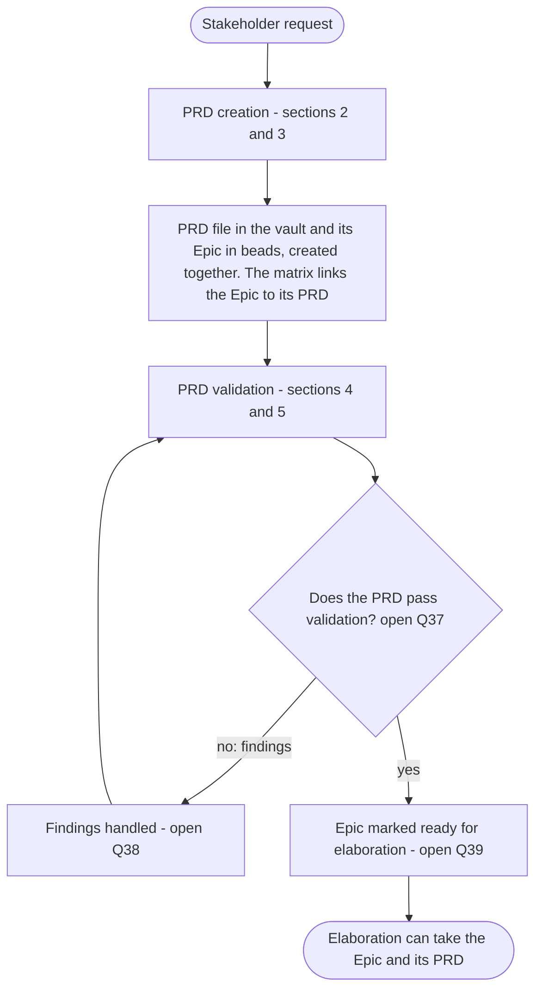
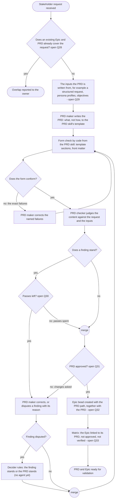
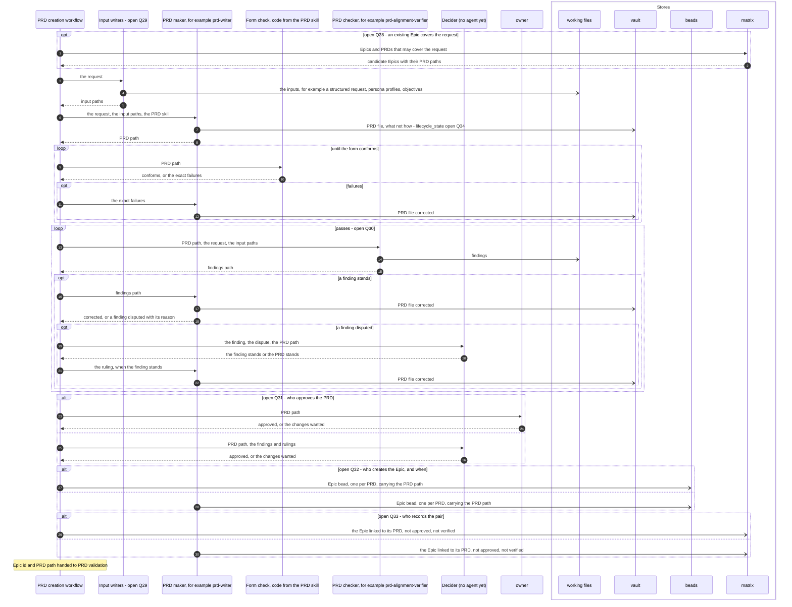
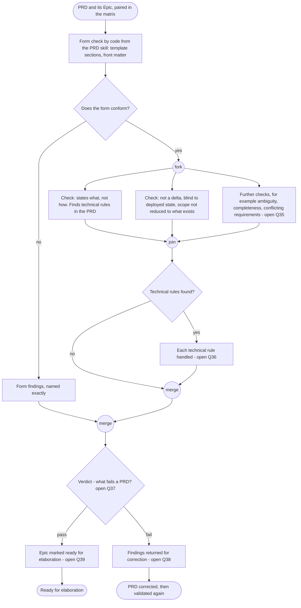
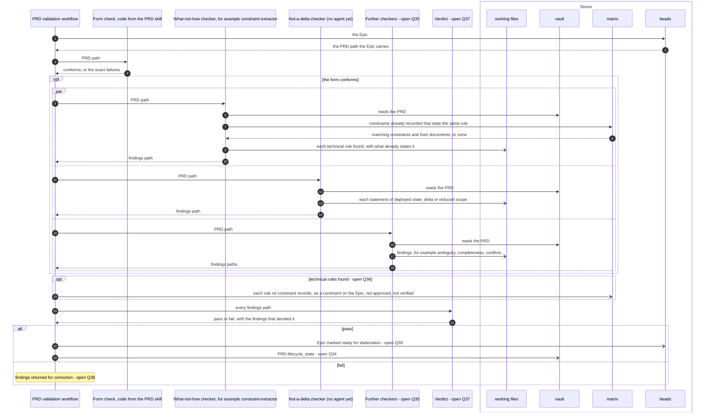
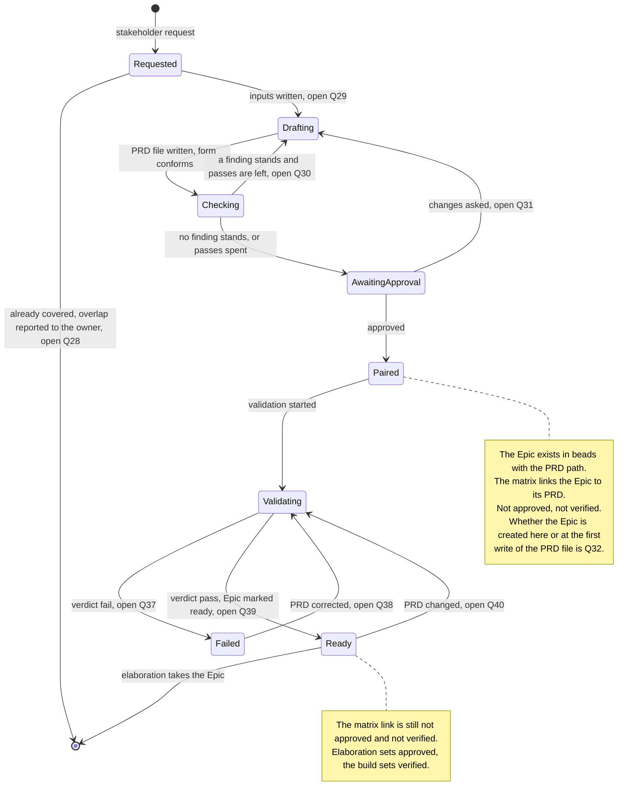

# The pipelines: PRD creation and PRD validation

Parent: [The pipelines: overview](pipelines.md)

PRD creation takes a stakeholder request and produces a PRD and its Epic, created together, with
the matrix linking the Epic to its PRD. PRD validation takes that PRD and its Epic and decides
whether elaboration can take the Epic. Together they run from a stakeholder request to an Epic
that is ready for elaboration ([The pipelines: elaboration](pipelines-elaboration.md) starts
from "A ready Epic and its PRD", [requirements/pipelines.md](../requirements/pipelines.md)). This
document draws both **as the owner wants them**. The sources are the vault's `docs/sdlc/sdlc.md`
("A PRD and its Epic are created together - one Epic bead per PRD", "A PRD states what"), the
owner's messages of 2026-10-19 (on the matrix, on agents, on contracts and on review loops), the
SkillSpoke repository's root `AGENTS.md` (maker, checker and approver kept separate; how a PRD may
change) and [requirements/matrix.md](../requirements/matrix.md) where it agrees with the owner's
words. The owner has said little about how a PRD is authored and checked, so most of the steps
that do the work are drawn as open questions, listed at the end with a recommendation for each.

## Legend

| Notation | Meaning |
|---|---|
| `A ->> B` (sequence) | A calls or starts B: B does work for A |
| `B -->> A` (sequence) | B returns its result to A |
| `A -) Store` (sequence) | A writes to a store; nothing is returned |
| `alt` / `opt` / `par` / `loop` (sequence) | Alternatives, an optional part, concurrent parts, a repeated part; each carries its condition, each loop its exit |
| `box` (sequence) | The stores |
| `([...])` (activity) | Start or end |
| `{...?}` (activity) | A decision; every outgoing edge is labelled with its guard |
| "fork" / "join" (activity) | Work that runs concurrently, and the point where all of it has finished |
| "merge" (activity) | Alternative paths coming back together; no waiting |
| "open Qn" | The owner has not said what is wanted here. The question, a recommendation and its reason are under "Open questions" |
| vault | The `skillspoke-docs` vault; PRDs live in `sdlc/mvp-1/prds/` (`docs/sdlc/sdlc.md`, "Where Each Lives") |
| arc42 (vault) | The arc42 architecture and design documents in the vault |
| beads | The issue tracker that holds the Epic |
| matrix | The record of how Epics, PRDs, architecture documents, resources, stacks, repositories and more relate ([requirements/matrix.md](../requirements/matrix.md)) |
| working files | The files each agent writes its output to, handed on by path |
| "(no agent yet)" | A role the design has that no agent file covers today |

Agents are named by role. Where a role has an agent in the plugin's `agents/` folder whose own
file gives it a reason to be used, the agent is named "for example"; which agent is used is
decided by reasoning, not by code (the owner: "What I do not want is python code deciding which
specialists to use").

## 1. From a request to a ready Epic

**Subject:** the path from one stakeholder request to an Epic elaboration can take.
**Scope:** PRD creation and PRD validation, and what passes between them.
**Purpose:** the order of the two pipelines and the hand-off from one to the other and to
elaboration.
**Boundary:** each pipeline is drawn in detail in sections 2 to 5. Selection of a ready Epic by
the driver, and elaboration, are outside ([The pipelines: elaboration](pipelines-elaboration.md)).
**Sources:** `docs/sdlc/sdlc.md` "The Chain": "A PRD and its Epic are created together - one Epic
bead per PRD, and a PRD's work may span several repositories." The owner: "The matrix stores
relations between Epic (PRDs), architecture (docuemnts), resources, stacks, repos, infra, and
more)". [requirements/pipelines.md](../requirements/pipelines.md): elaboration "Takes in: A ready
Epic and its PRD".

Notes on the diagram:

- The loop from validation back through the findings ends when the PRD passes. How many times it
  may go round is part of Q38.
- The PRD is never cut down to what exists: "A PRD states what: pure requirements, blind to
  deployed state, which never reduces its scope. There are no delta PRDs, and no document merges
  deployed state into requirements." (`docs/sdlc/sdlc.md`, "The Chain").

## 2. PRD creation: the activity

**Subject:** the creation of one PRD and its Epic.
**Scope:** from a stakeholder request to a PRD file in the vault, its Epic in beads, and the
matrix link between them.
**Purpose:** every step and decision of creation, and where the owner has not decided.
**Boundary:** who is started and what each receives and produces is section 3; validation is
sections 4 and 5.
**Sources:** `docs/sdlc/sdlc.md`: "A PRD states what", "A PRD and its Epic are created together",
"Documents are handed between agents as paths recorded on the owning Beads issue (Epic or Story),
never as content", "Authoring and validation use the `agent-teams-workforce` arc42, TRD, PRD, and
spec skills." SkillSpoke `AGENTS.md`: "bounded specialist agents that run the SDLC through
workflow scripts, with maker, checker and approver kept separate." The owner, on contracts:
"i'm a huge fan of the contracs being deterministic in files and code, and for agents, a skill
can contain both schemas and een the code to read and write and verify the schemas." and "One
agent would ignore the specifics of a results contract, and then it's reviewer wouldn't pass the
review because of small difference in a json string." On review loops: "When agents were
supposed to follow patterns where they had reviewers, and use adversarial reviewers, and could
create alterntive results and then decide amongts themself until they agreed, and would employ
itteration until goals were met... A simple request or task could take hours to complete." On
agents: "Ever agent needs to have a reason to be used."

Notes on the diagram:

- The form check is code, from the PRD skill's schema and template, so a difference in form is
  named exactly and never decided by a reviewer's judgment (the owner's point about "small
  difference in a json string"). The form loop ends when the form conforms.
- The checker and the decider are agents other than the maker (SkillSpoke `AGENTS.md`: "maker,
  checker and approver kept separate"). The content loop ends when no finding stands or when the
  passes are spent; how many passes there are is open (Q30), because of the
  owner's warning that review and iteration "could take hours".
- No agent today rules on a disputed PRD finding: `spec-decider`'s own file is about spec review
  findings, so it is not the example here.
- The PRD file's `lifecycle_state` through these steps is open (Q34).

## 3. PRD creation: who is started, and what each receives and produces

**Subject:** the agents and code of PRD creation, their inputs and outputs, and the stores.
**Scope:** the same steps as section 2.
**Purpose:** what each participant is given and returns, and where the vault, beads and the
matrix are read and written.
**Boundary:** the decisions are drawn in section 2; this diagram draws the messages.
**Sources:** as section 2, and the owner: "I do prefer to spin up agents in headless claude
sessions to do work, and then get out." and "There can be nested subagents." On the matrix:
"arc42 is both input and out. The matrix is both input and output." and "The matrix is like an
index that help map requirement, architecture, services, repos, and more together". On approval:
"Once an Epic flows through elaboration, and validates and fills out the architecture and design
(lower-level details) for the Epic, and then all of that is approved, and when information in the
matrix is filled out or corrected for that Epic, then if gets set to approved." and "The verified
flag remain false or unverified." SkillSpoke `AGENTS.md`: "How one of the owner's requirements
documents (a PRD, a business or a technical requirements document) may change is governed by its
front matter in the `skillspoke-docs` vault (lifecycle state, authority) and by the PRD-writing
agents."

Notes on the diagram:

- Every agent writes its output to a file and returns its path; paths, not content, are handed
  on (`docs/sdlc/sdlc.md`, "Documents are handed between agents as paths recorded on the owning
  Beads issue (Epic or Story), never as content"). Each agent runs in its own session and ends
  when its file is written.
- The Epic carries the PRD path (`docs/sdlc/sdlc.md`, as above). The matrix link between them is
  recorded neither approved nor verified: approved is set by elaboration and verified by the
  build (the owner, quoted above).
- Whether the PRD's requirements are also recorded in the matrix at this point is part of
  Q33. The owner: "In the pipeline, the architecture can look at the requirements
  and features as a shortcut, but remember, that only exists because we seeded the information. In
  the future, that would not have been done yet."
- The PRD reads no arc42 document and no stack or deployed resource: "A PRD states what: pure
  requirements, blind to deployed state" (`docs/sdlc/sdlc.md`).

## 4. PRD validation: the activity

**Subject:** the validation of one PRD whose Epic exists.
**Scope:** from the PRD and its Epic, paired in the matrix, to a verdict.
**Purpose:** which checks have a source, which are open, and what follows the verdict.
**Boundary:** who is started and what each receives is section 5; the states of the pair are
section 7.
**Sources:** `docs/sdlc/sdlc.md`: "A PRD states what: pure requirements, blind to deployed state,
which never reduces its scope. There are no delta PRDs, and no document merges deployed state into
requirements. A TRD states how: the obligations the architecture places on what the delta adds or
changes." [requirements/matrix.md](../requirements/matrix.md), its glossary: a technical
requirement or constraint is "One obligation that architecture places on a design". The owner:
"arc42 holds archutecture and design documents. This can include standards, constraints,
diagrams, or more." and "The solutions architect is responsible for all architecture". On agents:
"Ever agent needs to have a reason to be used.", "I also do not want a pipeline that blindly sends
everything to ever agent, whether it applies or not", "Without spreading the work to specialist
agents, a generic agent ends of doing way too much of the work". On time: "I need a working
pipeline ... and dosn't take 2 hours to run through a single Epic".

Notes on the diagram:

- The two checks drawn without a question come from `docs/sdlc/sdlc.md`: a PRD states what, and
  there are no delta PRDs. A technical rule found in a PRD is an obligation on the design, which
  the matrix's glossary places with the architecture, not with the PRD.
- The checks run at the same time, so the validation of one PRD takes as long as its slowest check,
  not the sum of them.
- A form failure goes straight to the verdict: the content checks are not run on a PRD whose form
  does not conform. The PRD's work spanning several repositories is not a finding
  (`docs/sdlc/sdlc.md`: "a PRD's work may span several repositories").

## 5. PRD validation: who is started, and what each receives and produces

**Subject:** the agents and code of PRD validation, their inputs and outputs, and the stores.
**Scope:** the same steps as section 4.
**Purpose:** what each participant is given and returns, and where the vault, beads and the
matrix are read and written.
**Boundary:** the decisions are drawn in section 4.
**Sources:** as section 4, and the owner: "The matrix is to help speed up gathering what we
alrdeady know, but it can't show us what we not uet knnow.", "Normally no infomration will be in
the matrix at all for an Epic, and it gets populated as the pipelines run, where each learnine
piece of information is to help the next step in the pipelines." [requirements/matrix.md](../requirements/matrix.md) R10: "The matrix
records the requirements and constraints that arc42 documents place on an Epic's design".

Notes on the diagram:

- `constraint-extractor` is the example for the what-not-how check because its own file is about
  technical constraints in a PRD. No agent's file covers the not-a-delta check.
- The matrix is read for what is already known; the seeded entries for an Epic are "not approved"
  (the owner), so a match found there is evidence, not approval.
- The write to the matrix is drawn inside the open question it belongs to: whether a
  technical rule is recorded, reported, or both is not decided.

## 6. Where the PRD file, the Epic and the matrix are read and written

**Subject:** every read and write of the stores in both pipelines.
**Scope:** sections 2 to 5.
**Purpose:** one place to check a diagram or an implementation against.
**Boundary:** arc42 (vault), git / GitHub and AWS dev are touched by neither pipeline: a PRD is
"blind to deployed state" (`docs/sdlc/sdlc.md`), and the architecture is elaboration's.
**Sources:** sections 2 to 5.

| Store | Read by | Written by | What |
|---|---|---|---|
| vault | PRD checker, validation checkers | PRD maker | The PRD file in `sdlc/mvp-1/prds/`, its front matter (`lifecycle_state`, `authority`); `lifecycle_state` values open (Q34) |
| beads | PRD validation workflow | creation, open who (Q32); validation marks ready (Q39) | One Epic per PRD, carrying the PRD path |
| matrix | creation, open (Q28); the what-not-how checker | creation, open who (Q33); validation, open (Q36) | The Epic linked to its PRD, not approved, not verified; technical rules as constraints, if Q36 so decides |
| working files | the next participant, by path | every agent | Inputs, findings, rulings |

## 7. The PRD and its Epic, from request to ready for elaboration

**Subject:** the states the PRD and its Epic pass through together.
**Scope:** from the stakeholder request to the Epic that elaboration can take.
**Purpose:** what each pipeline changes, and the state of the matrix link at each point.
**Boundary:** the states elaboration sets, and the approved and verified flags it and the build
set, are in [The pipelines: architecture and matrix states](pipelines-architecture-states.md).
**Sources:** sections 1 to 5, and the owner: "The matrix has 2 flag fields that help determine the
states the information in the matrix. ... there is one for verified, and one for approved." and
"Once all of the tasks for all of the stories for and Epic have been built and tested (including
CI (CDK), which means deployemen must also work), then all of the architecture and rellationships
for the Epic can be set to verified."

Notes on the diagram:

- `AwaitingApproval` exists only if the PRD has an approver other than its checker
  (Q31).
- The PRD file's own `lifecycle_state` in each state is open (Q34); the states here
  are the pair's, not a front matter field.

## Open questions

1. **Q28. Does PRD creation look in the matrix for an existing Epic and PRD that
   already covers the request, and what happens when one does?** Appears in sections 2, 3 and 7.
   Recommendation: yes; the workflow asks the matrix for Epics and PRDs that may cover the request
   (Epic and PRD entries only, nothing of the architecture), and an overlap is reported to the
   owner with the Epic's id instead of a second PRD being written. Reason: the matrix exists so that
   no step rediscovers what is known (the owner: "every step of every pipeline doesn't need to
   research and scan or rediscover"), a second PRD for the same need would be designed twice, and
   whether a request extends an existing PRD or is new is the scope of the work, which is the
   owner's (`making-decisions.md`, "What goes back"). Reading only Epic and PRD entries keeps the
   PRD "blind to deployed state".
2. **Q29. Which inputs is a PRD written from, and which agents produce them?**
   Appears in sections 2, 3 and 7. Recommendation: the request is always structured first by an
   agent whose file is about that (for example `stakeholder-request-intake-writer`), and that agent
   records whether the persona profiles and objectives already in the vault cover the request;
   `persona-profile-writer` and `okr-writer` run only when they do not. Reason: "Ever agent needs to
   have a reason to be used." and "I also do not want a pipeline that blindly sends everything to
   ever agent"; the decision to use them is an agent's reasoning, not code.
3. **Q30. How many check passes does the PRD draft get, and what ends the
   loop?** Appears in sections 2, 3 and 7. Recommendation: one check; the maker corrects or disputes
   once; a disputed finding goes to the decider once, and the corrected PRD goes on to approval with
   any finding still standing listed beside it. Reason: the owner's warning that reviewers,
   adversarial reviewers and iteration until goals were met made "A simple request or task ...
   take hours to complete", and "I need more fault-tolerance for the pipeline, and need more
   trust."
4. **Q31. Who approves the PRD: the owner, a decider agent, or both?** Appears in
   sections 2, 3 and 7. Recommendation: the owner approves the PRD; a decider agent rules only on a
   finding the maker disputes. Reason: a PRD states what the product must do, which is the scope of
   the work and the owner's (`making-decisions.md`, "What goes back"); the PRD is "one of the owner's
   requirements documents" (SkillSpoke `AGENTS.md`); and approver kept separate from maker and
   checker is met either way.
5. **Q32. Who creates the Epic bead, and at which point?** Appears in sections 2,
   3, 6 and 7. Recommendation: a script step of the PRD creation workflow creates the Epic with
   `bd`, carrying the PRD path, in the same step that ends creation, after approval; a rerun finds
   the Epic that carries the PRD path and creates no second one. Reason: creating a bead from a
   known title and path needs no reasoning, so it is code (`efficient-workflows.md` rule 1); in one
   step the two are "created together" (`docs/sdlc/sdlc.md`); and an Epic for a PRD that is never
   approved would be a bead for work nobody agreed to.
6. **Q33. Who records the Epic and PRD in the matrix, and are the PRD's
   requirements recorded then too?** Appears in sections 2, 3 and 6. Recommendation: the same
   script step records the Epic linked to its PRD, not approved and not verified, through
   `atw-matrix`; the PRD's requirements and features are recorded by elaboration, not here. Reason:
   the link is mechanical; the owner said the requirements and features exist in the matrix only
   "because we seeded the information. In the future, that would not have been done yet.", and
   "Normally no infomration will be in the matrix at all for an Epic, and it gets populated as the
   pipelines run".
7. **Q34. Which `lifecycle_state` does the PRD file carry through creation and
   validation?** Appears in sections 2, 3, 5, 6 and 7. Recommendation: `draft` while it is written
   and checked, `in-review` from approval through validation, `effective` once validation passes,
   from the vault's own vocabulary (the `document-classification` skill: `draft`, `in-review`,
   `approved`, `effective`). Reason: the vault already governs how a PRD may change through its
   front matter (SkillSpoke `AGENTS.md`), and one vocabulary keeps the PRD's state readable the same
   way as every other vault document.
8. **Q35. Which checks does validation run besides what-not-how and
   not-a-delta, and how are the checking agents chosen?** Appears in sections 4 and 5.
   Recommendation: ambiguity, completeness and conflicting requirements, each by the agent whose
   file is about it (for example `ambiguity-detector`, `completeness-checker`,
   `requirements-conflict-detector`), run at the same time on every PRD. Reason: each of these
   applies to every PRD, which is each agent's reason to be used; specialists keep each context
   small (the owner: "Specific instructions and skills and expertise and tools, small context, and
   focused scope and responsabilities"); running them concurrently keeps validation as short as its
   slowest check.
9. **Q36. What happens to a technical rule found in a PRD?** Appears in sections 4,
   5 and 6. Recommendation: it is a finding on the PRD; the PRD keeps the business requirement the
   rule serves, written as what; and the rule is recorded in the matrix as a constraint on the
   Epic, not approved and not verified, unless a constraint already records it, so the solutions
   architect finds it. Reason: a technical rule is "One obligation that architecture places on a
   design" ([requirements/matrix.md](../requirements/matrix.md)), "The solutions architect is
   responsible for all architecture" (the owner), and a rule dropped from the PRD and recorded
   nowhere would be lost; recording it not approved leaves the architect's due diligence to judge
   it.
10. **Q37. What fails a PRD, and who gives the verdict?** Appears in sections 1,
    4, 5 and 7. Recommendation: code gives the verdict from the findings files; a PRD fails on a
    form failure, on a statement of deployed state or a delta, and on a finding a checker marks as
    blocking (for example two requirements that cannot both hold); a technical rule handled as
    Q36 recommends does not fail it on its own. Reason: once each finding carries
    its severity in its contract, pass or fail is arithmetic, and code decides it the same way
    every time (the owner: contracts "deterministic in files and code"); the sdlc rules are the only
    stated properties of a PRD, so they are the stated grounds to fail one.
11. **Q38. After a failed validation, who corrects the PRD, and how many times
    does validation run again?** Appears in sections 1, 4, 5 and 7. Recommendation: the findings go
    to the PRD maker once, a finding that needs a fact only the owner has (for example what a vague
    requirement means) goes to the owner as a question, and the corrected PRD is validated once
    more; a PRD that fails again goes to the owner with its findings. Reason: the meaning of a
    requirement is the owner's (`making-decisions.md`: "facts only the owner has"), and an unbounded
    correct-and-revalidate loop is the hours-long iteration the owner warned against.
12. **Q39. What marks the Epic ready for elaboration, and who sets it?** Appears
    in sections 1, 4, 5, 6 and 7. Recommendation: the validation workflow, by code, sets the Epic's
    elaboration state in beads to ready when the verdict is pass, and nothing else sets it. Reason:
    elaboration takes "A ready Epic and its PRD" ([requirements/pipelines.md](../requirements/pipelines.md)),
    readiness then means exactly "its PRD passed validation", and one setter keeps one source of
    truth for it.
13. **Q40. When a ready Epic's PRD changes, is it validated again before
    elaboration takes it?** Appears in section 7. Recommendation: yes; a change to the PRD file
    returns the Epic to validation, and only a pass makes it ready again. Reason: elaboration
    builds everything from the PRD, so an unvalidated change would reach the architecture
    unchecked; "There are no delta PRDs" (`docs/sdlc/sdlc.md`), so the whole changed PRD is what is
    validated.
