# The pipelines: PRD creation and PRD validation

Parent: [The pipelines: overview](pipelines.md)

PRD creation turns a raw stakeholder request into a PRD and the specification of the Epic bead
that is created with it; PRD validation inspects one PRD, whose Epic already exists, through seven
lenses and records in the matrix each technical rule the PRD states that no arc42 document
states. Each is one workflow script: `workflows/prd-creation.js` (phases Intake, Persona & OKR,
PRD Draft) and `workflows/prd-validation.js` (phase Validate). Neither is part of the Epic
pipeline: no step of an Epic's journal runs either one (`orchestrator/specs/epic/prd-validation.md`,
`orchestrator/specs/epic/INDEX.md` "Owner-run portfolio and PRD flows"), and an orchestrating
Claude Code session runs them (`workflows/ROUTING.md`, the driver table). Neither uses
`workflows/gate-enforce.js`. Their requirements live in the vault's `docs/sdlc/sdlc.md` (the PRD,
its Epic, where documents live and how they are handed on) and in
`blueprint/requirements/matrix.md` (the PRD-Epic pair, requirements and constraints in the
matrix); `blueprint/requirements/pipelines.md` names neither pipeline, so most of what follows is
as built only and is labelled so.

## Legend

| Notation | Meaning |
|---|---|
| `A ->> B` | A calls or dispatches B: A starts the work |
| `B -->> A` | The return of that call |
| `A -) Store` | A writes to a store, or sends a message, with no reply |
| `alt` / `opt` / `loop` / `par` | Alternative, optional, repeated and concurrent parts; each carries its condition, and each loop its exit |
| `box` | A group of participants: the run files, or a store |
| Stadium `([ ])` | Start or end of an activity |
| Diamond `{ }` | A decision; every outgoing edge carries its guard |
| "fork" / "join" | Concurrent work starts and ends |
| Cylinder `[( )]` | A store: "arc42 (vault)", "matrix", "beads", "vault", "git / GitHub", or the run's files |
| "differs from required" | A note where the code differs from the owner's written requirements |
| "assumption" | An element neither the requirements nor the code specifies |
| runner | A `workflow-command-runner` session (sonnet, effort low): the only way a workflow script runs a command or reads a file (the checked relay, `scripts/portfolio/relayrun.py`) |

Element names used throughout: the workflows `prd-creation.js` and `prd-validation.js`; the
agents `stakeholder-request-intake-writer`, `persona-profile-writer`, `okr-writer`, `prd-writer`,
`prd-alignment-verifier`, `spec-decider`, `prd-validation-analyst` and `workflow-command-runner`;
the caller (the orchestrating session that runs a workflow, `workflows/ROUTING.md`); the owner.

## 1. Where the two pipelines sit

**Subject:** the path from a stakeholder request to an Epic that elaboration may select.
**Scope:** both workflows, the caller's work between and after them, and the stores each touches.
**Purpose:** show the order of the pieces and the hand-offs between them before the detailed diagrams.
**Boundary:** elaboration (`prd-to-spec`) and the driver's selection of an Epic are outside; only the point where an Epic becomes selectable is shown.
**Basis:** as built: `workflows/prd-creation.js:815-843,1154-1171`, `workflows/prd-validation.js:673-680`,
`workflows/ROUTING.md` (driver table), `orchestrator/specs/epic/prd-validation.md`,
`ops/sdlc-automation/elabstate.py:160-210` (control repository). The caller's steps after
`prd-creation.js` returns are stated by the workflow's result (`epic`, `note`) and are not code;
the parts no source states are marked assumption.

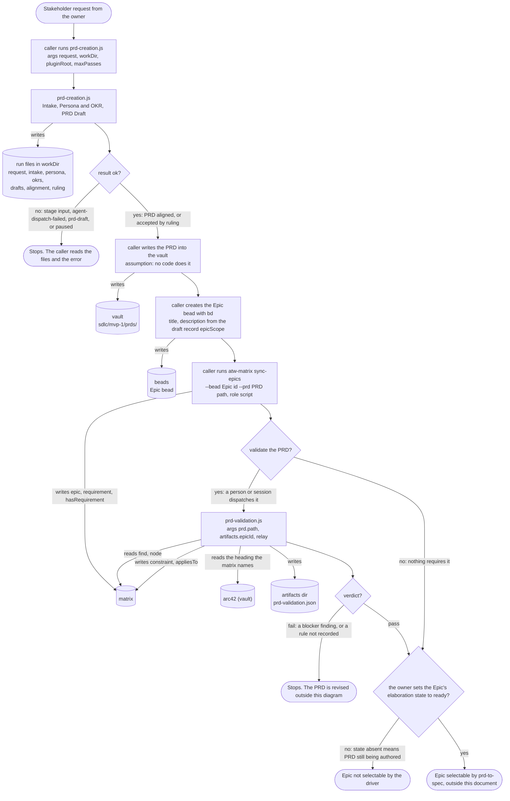

Differences from the requirements:

- `docs/sdlc/sdlc.md` ("The Chain"): "A PRD and its Epic are created together". As built,
  `prd-creation.js` writes neither: it returns the Epic's specification and the matrix command,
  and the caller writes the bead and runs the command (`prd-creation.js:1148-1171`). No command
  or code of the plugin performs the caller's part.
- `docs/sdlc/sdlc.md` ("Where Each Lives"): the PRD lives in `sdlc/mvp-1/prds/`. As built the
  PRD is written only to `workDir/drafts/pass-N.md`; moving it into the vault is unstated.
- `blueprint/requirements/matrix.md` R6 and section 3.1 ("Every Epic and its PRD is in the
  matrix"): as built the pair reaches the matrix only when the caller runs `sync-epics` by hand;
  until then the Epic exists in beads with no PRD in the matrix.

Assumptions: the caller writes the PRD into the vault before running `sync-epics` (that command
reads the PRD file under the vault, `scripts/portfolio/matrixsync.py:1109`).

## 2. What the owner requires of PRD creation and validation

**Subject:** the required outcome of creating and validating a PRD.
**Scope:** the PRD, its Epic, the matrix pair and how documents are handed on.
**Purpose:** give the yardstick the as-built diagrams are compared against.
**Boundary:** how the PRD is authored (agents, loops) is not required by any source and is not shown.
**Basis:** required: `docs/sdlc/sdlc.md` "The Chain", "Documents Are Written to Disk as They're
Produced", "Where Each Lives"; `blueprint/requirements/matrix.md` Q1, R3, R6, R10, R13, section 4
("Filled in and corrected"); the owner statement "i'm a huge fan of the contracs being
deterministic in files and code, and for agents, a skill can contain both schemas and een the
code to read and write and verify the schemas." No requirement covers PRD validation as a step;
the only requirement that bears on its findings is `sdlc.md` "A PRD states what: pure
requirements".

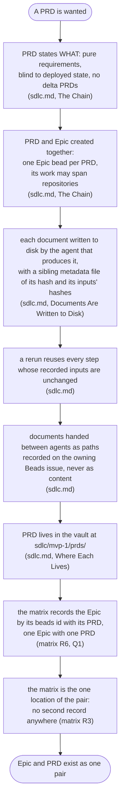

## 3. The authoring step every file goes through

**Subject:** how one agent-authored file of either workflow is produced, checked and reused.
**Scope:** `author()` in `prd-creation.js` and the same calls in `prd-validation.js`
(`relayKit.artifactRevision`, `relayKit.authorArtifact`, `relayKit.acceptArtifact`).
**Purpose:** the main sequences below show this step as one line; this diagram is what that line does.
**Boundary:** what each maker writes is in sections 4, 5 and 8.
**Basis:** as built: `workflows/prd-creation.js:884-893` (`author`), the relay shared block
`prd-creation.js:207-757` (`exec` 482-534, `acceptArtifact` 700-718, `authorArtifact` 719-728,
`artifactRevision` 729-745), canonical source `scripts/shared-blocks/relay.js`;
`skills/artifact-handoff/schemas/checkpoint.schema.json`. The required counterpart is `sdlc.md`
"Documents Are Written to Disk" (hash and input hashes, reuse on rerun).

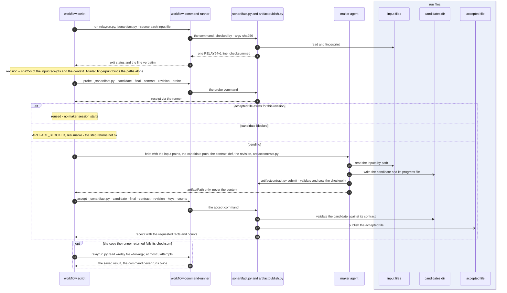

Differences from the requirements:

- `sdlc.md` asks for "a sibling metadata file recording its content hash and the hashes of the
  inputs it was built from". As built the binding is the revision (one hash over the input
  receipts) held in the candidate's checkpoint sidecar and the relay file, not a per-document
  metadata file beside the accepted file.

## 4. PRD creation: intake, persona and objective

**Subject:** the first two phases of `prd-creation.js`.
**Scope:** from the caller's dispatch to the persona and the objective being accepted.
**Purpose:** show who is started, what each receives and writes, and where the run stops.
**Boundary:** each "author" line is the step of section 3; the PRD Draft phase is section 5.
**Basis:** as built: `workflows/prd-creation.js:844-1016`;
`skills/artifact-handoff/schemas/prd-creation.schema.json` (`Request`, `Intake`, `Persona`,
`Okrs`); `agents/stakeholder-request-intake-writer.md`, `agents/persona-profile-writer.md`,
`agents/okr-writer.md` (each `model: sonnet`). No requirement covers these phases.

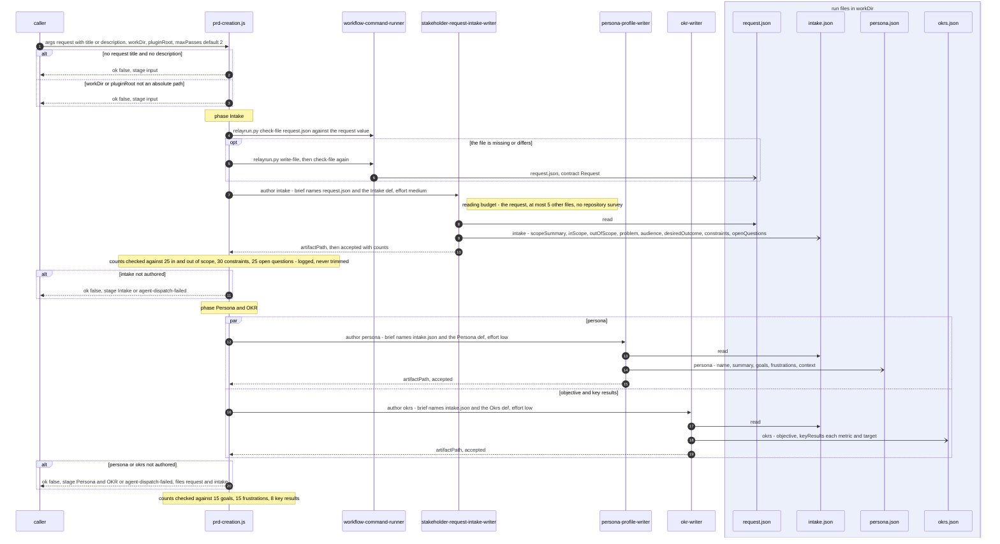

## 5. PRD creation: the draft, its check and the deadlock ruling

**Subject:** the PRD Draft phase: maker `prd-writer`, checker `prd-alignment-verifier`, decider `spec-decider`.
**Scope:** every pass of the bounded loop, the ruling, and the result returned to the caller.
**Purpose:** show the maker-checker-decider loop, its bound, its exits and what the result carries.
**Boundary:** the author lines are section 3; what the caller does with the result is section 7.
**Basis:** as built: `workflows/prd-creation.js:1017-1205`; `prd-creation.schema.json`
(`Draft`, `Alignment`, `DeadlockRuling`); `agents/prd-writer.md` (`model: opus`),
`agents/prd-alignment-verifier.md` (`model: sonnet`), `agents/spec-decider.md` "PRD deadlock
ruling" (`model: opus`); `skills/prd-writer/SKILL.md`. Required: `sdlc.md` "The Chain" for
WHAT-not-HOW and for one Epic per PRD.

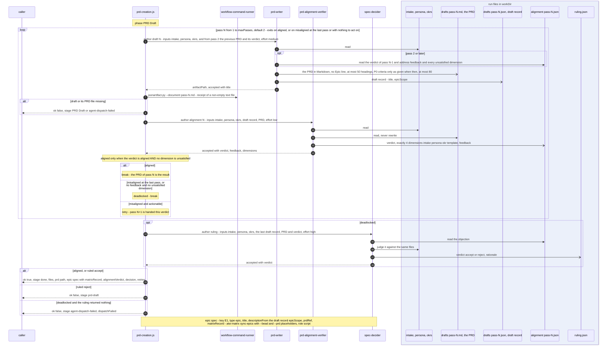

Differences from the requirements:

- `sdlc.md` asks that documents be "handed between agents as paths recorded on the owning Beads
  issue". As built the paths are handed in each agent's brief, and nothing is recorded on a bead:
  the Epic bead does not exist yet while the workflow runs.

## 6. PRD creation: control flow and failure paths

**Subject:** every decision `prd-creation.js` takes and every result stage it can return.
**Scope:** the whole workflow, from argument checks to the returned result.
**Purpose:** show the failure paths the sequences abbreviate, including the dispatch interruption.
**Boundary:** the inside of each authoring step is section 3.
**Basis:** as built: `workflows/prd-creation.js:73-205` (bounded dispatch policy, `settleAgent`:
transient failures retried up to 3 attempts within 300 seconds of waiting; account quota or an
unavailable API interrupts and every later dispatch returns nothing), `:853-863`, `:894-899`
(`notAuthored`), `:1071-1145`, `:1174-1205`.

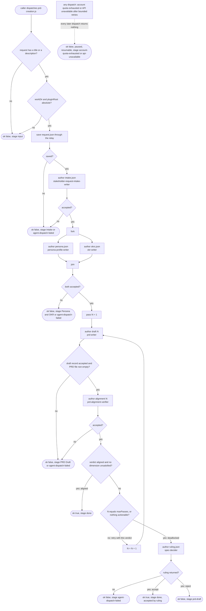

## 7. PRD creation: the draft pass as a state machine

**Subject:** the durable state of one PRD draft across passes, as the run files record it.
**Scope:** `drafts/pass-N.*`, `alignment/pass-N.json`, `ruling.json` in one workDir.
**Purpose:** show why a rerun with the same workDir resumes: an accepted file whose inputs are
unchanged is reused, so a stopped run continues from the first file not accepted.
**Boundary:** the files of the Intake and Persona and OKR phases follow the same rule and are not drawn.
**Basis:** as built: `workflows/prd-creation.js:884-893,1071-1145`, `authorArtifact`
`prd-creation.js:719-728`.

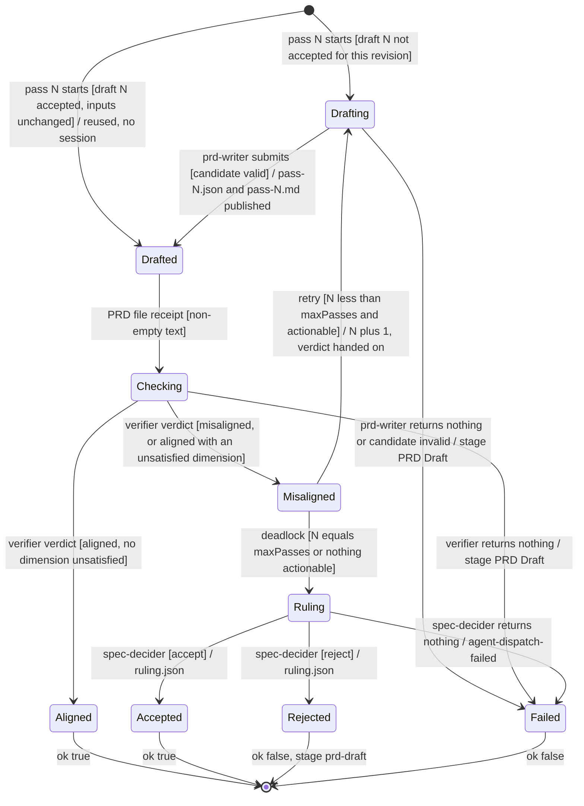

## 8. After PRD creation: the Epic bead, the vault and the matrix pair

**Subject:** what turns the workflow's result into an Epic and its PRD.
**Scope:** the caller's work after `prd-creation.js` returns ok, and the PRD-to-Epic sync the
`prd-writer` skill asks for.
**Purpose:** show where beads, the vault and the matrix are written for the pair, and the
conflict between the two ways the code records it.
**Boundary:** setting the Epic's elaboration state, and elaboration, are section 11 and beyond.
**Basis:** as built: `workflows/prd-creation.js:1148-1171,1202-1203` (the caller writes the bead
and runs `epic.matrixRecord.command`); `scripts/portfolio/matrixsync.py:1-20,1109-1180`
(`sync_epics`); `agents/prd-writer.md` "The PRD and Its Epic Are One Entity";
`skills/prd-writer/SKILL.md:35-83,148`; `ops/prd-epic-sync.py:1-40` in the control repository
(the command `ATW_PRD_EPIC_SYNC` names, `ops/sdlc-automation/atw.py:40-42,69-70`). Required:
`sdlc.md` "The Chain" and "Where Each Lives"; `matrix.md` Q1, R3, R6.

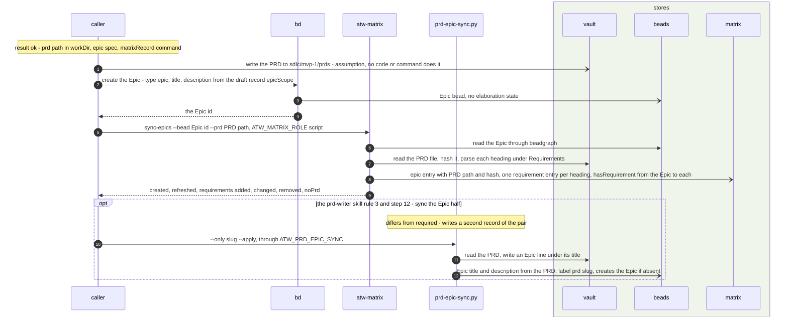

Differences from the requirements:

- `matrix.md` R3: "No second record of them is kept anywhere". `ops/prd-epic-sync.py` records
  the pair on both sides, an `**Epic:**` line in the PRD and a `prd:` label on the bead, and the
  `prd-writer` skill tells the writer to run it (`SKILL.md` rule 3, step 12), while
  `agents/prd-writer.md` and the same skill also say to write neither pointer.
  `matrixsync.py` `sync_epics` falls back to the `prd:` labels when no PRD is given or recorded.
- Inside `prd-creation.js` the `prd-writer` writes only to `workDir`, and the Epic does not yet
  exist, so the sync the skill asks for has no vault PRD and no Epic to act on. Which of the two
  creates the Epic bead, the caller or `prd-epic-sync.py`, is not settled by the code.
- `sdlc.md` "A PRD and its Epic are created together": the bead, the vault file and the matrix
  pair are three separate later steps of the caller, with no code that runs them together.

Assumptions: the caller writes the PRD into the vault before `sync-epics`; the slug the sync
script takes is the PRD file name without `.md` (`prd-epic-sync.py` docstring).

## 9. PRD validation: the analysis and the matrix records

**Subject:** `prd-validation.js`: one `prd-validation-analyst` session, the recording of the
analysis, and the recording of each technical rule no document states.
**Scope:** from the caller's dispatch to the verdict.
**Purpose:** show what the analyst receives and writes, where the matrix and arc42 are read, and
where the matrix is written.
**Boundary:** the authoring step is section 3; consolidation and the verdict are section 10.
**Basis:** as built: `workflows/prd-validation.js:673-908`;
`skills/artifact-handoff/schemas/prd-validation-analysis.schema.json` (`Analysis`,
`TracedAnalysis`, `RequirementClass`, `Severity`); `agents/prd-validation-analyst.md`
(`model: sonnet`); `orchestrator/specs/epic/prd-validation.md`; `blueprint/design/matrix.md`
row A2. Required: none places validation in a pipeline; `matrix.md` R10 (constraints an Epic's
design must meet are recorded) and Q13 (links with nothing at the other end) bear on the
constraints it records.

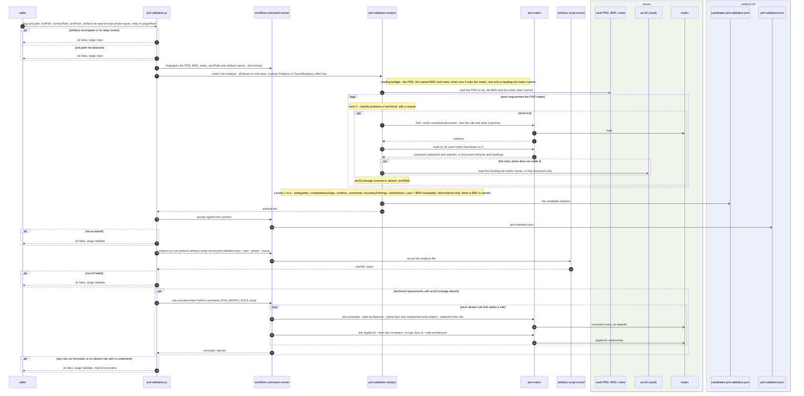

Differences from the requirements:

- No requirement makes PRD validation a step of any pipeline, and nothing chains it to PRD
  creation, although `agents/prd-alignment-verifier.md` says "prd-validation runs after
  prd-creation". It runs only when dispatched.
- `matrix.md` section 4 names the elaboration pipeline as what fills in the matrix and the seeding
  work as what seeds it; it names no PRD validation step as a writer. As built this workflow
  writes `constraint` entries and `appliesTo` relationships (design row A2 records this).
- `matrix.md` R13: "The content of a design stays in its arc42 document". As built the rule's
  text is held as the constraint's `statement` in the matrix, because no document states it.
  Whether that is a "short statement that identifies a thing" is not settled by the requirement.

Assumptions: the matrix already holds the entry `epic:<Epic id>` (written by `sync-epics`,
section 8) when `link appliesTo` runs; nothing in the workflow checks this before the link.

## 10. PRD validation: control flow and the verdict

**Subject:** the decisions of `prd-validation.js` and how findings become a verdict.
**Scope:** argument checks, analysis, recording, constraint recording, consolidation.
**Purpose:** show every failure path and the rule that decides pass or fail.
**Boundary:** the analyst's reading is section 9.
**Basis:** as built: `workflows/prd-validation.js:69-94` (an account-quota or API failure
interrupts with no retry), `:739-744`, `:780-800`, `:838-857`, `:859-908`;
`prd-validation-analysis.schema.json` `Severity` (`blocker`, `major`, `minor`, `info`). Required:
`sdlc.md` "A PRD states what: pure requirements".

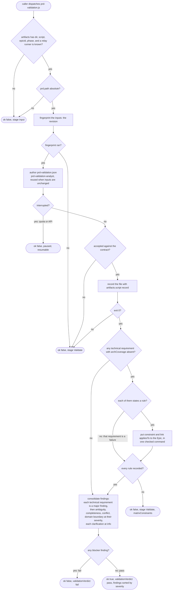

Differences from the requirements:

- `sdlc.md` "A PRD states what: pure requirements". As built a technical requirement is a
  `major` finding and never fails the PRD; only a `blocker` finding does, so a PRD that states
  technical requirements passes validation.
- `prd-writer`'s charter names "Gate 1" and `phase-gate-enforcer` as the independent review of a
  PRD; neither workflow runs `gate-enforce.js` or any gate. This is a difference inside the as-built
  code; no requirement names such a gate.

## 11. The Epic between creation and elaboration

**Subject:** the states an Epic passes through from the request to being selectable by elaboration.
**Scope:** the Epic bead, its matrix entry and its elaboration state.
**Purpose:** show what each pipeline changes and what only a person changes.
**Boundary:** `in_progress` and `done`, which elaboration sets, are outside.
**Basis:** as built: `workflows/prd-creation.js:1148-1171`; `scripts/portfolio/matrixsync.py`
`sync_epics`; `workflows/prd-validation.js:814-857`; `ops/sdlc-automation/elabstate.py:59-91,160-210`
(an Epic with no elaboration state is "PRD still being authored" and is skipped until a person
sets it ready); `skills/beads-contract/schemas/bead-metadata.schema.json` `ElaborationState`
(`ready`, `in_progress`, `done`, with `""` for authoring). Required: `matrix.md` R6.

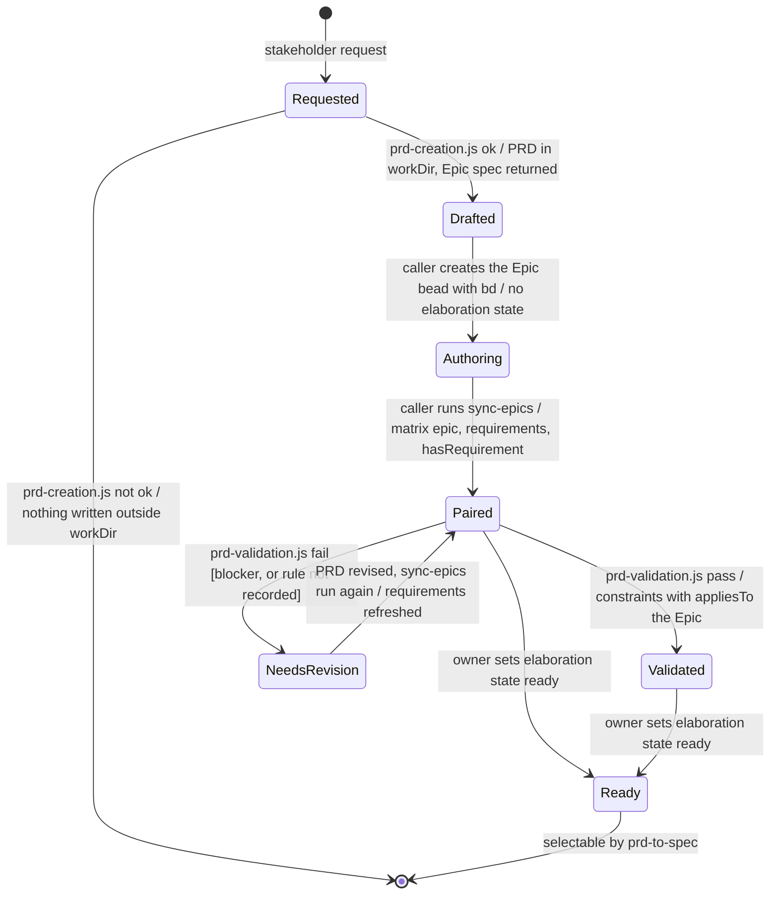

Differences from the requirements:

- `matrix.md` R6 and section 3.1 require every Epic to be in the matrix with its PRD. The state
  Authoring, an Epic bead with no matrix entry, exists until the caller runs `sync-epics`.
- `scripts/portfolio/elaboration.py:15,186-191` takes an absent elaboration state as `ready`,
  while the driver's `elabstate.py` takes it as authoring and skips the Epic. This is a difference
  inside the as-built code; elaboration is outside this document.

Assumptions: "NeedsRevision" and its return are drawn because a failed validation leaves the PRD
to be revised; no code revises it or re-runs `sync-epics` after a revision.

## 12. Where the stores are read and written

**Subject:** every read and write of beads, the vault, arc42, the matrix and the run files in both pipelines.
**Scope:** `prd-creation.js`, the caller's steps after it, `prd-validation.js`.
**Purpose:** one table to check a diagram against.
**Boundary:** git / GitHub is touched by neither workflow; `sync-epics` reads the vault as a git repository (`matrixsync.py`).
**Basis:** as built, from the files cited in sections 3 to 10; required counterparts as noted there.

| Step | Store | Read or write | What | Who |
|---|---|---|---|---|
| Intake to PRD Draft | run files in `workDir` | write | `request.json`, `intake.json`, `persona.json`, `okrs.json`, `drafts/pass-N.md` and `.json`, `alignment/pass-N.json`, `ruling.json`, each candidate under `candidates/`, relay files under `relay/` | the workflow (request), each maker and checker, the runner |
| Each authoring step | run files | read | the input files, fingerprinted for the revision | `jsonartifact.py` through the runner |
| After creation | vault | write | the PRD in `sdlc/mvp-1/prds/` (assumption) | the caller |
| After creation | beads | write | the Epic bead: type epic, title, description from `epicScope` | the caller with `bd`; or `prd-epic-sync.py` (differs from required) |
| After creation | matrix | write | `epic` entry with PRD path and hash, `requirement` entries, `hasRequirement` | `atw-matrix sync-epics`, role `script`, run by the caller |
| After creation | vault | read | the PRD file | `atw-matrix sync-epics` |
| Lens 0 | matrix | read | `find --kinds constraint,document --text`, `node` | `prd-validation-analyst` |
| Lens 0 | arc42 (vault) | read | only the heading the matrix names | `prd-validation-analyst` |
| Validate | vault | read | the PRD, the BRD and the notes when named | `prd-validation-analyst` |
| Validate | artifacts dir | write | `candidates/prd-validation.json`, `prd-validation.json`, its record | the analyst, `jsonartifact.py`, `artifacts.script record` |
| Validate | matrix | write | `constraint` (architecture side, no `statedIn`), `appliesTo` to `epic:<Epic id>` | the workflow's checked command, role `script` |
| Validate | beads | none | neither workflow writes to beads (`orchestrator/specs/epic/INDEX.md`) | |
