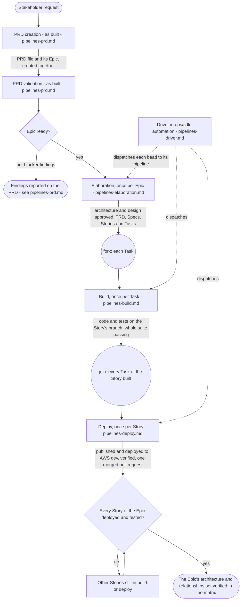
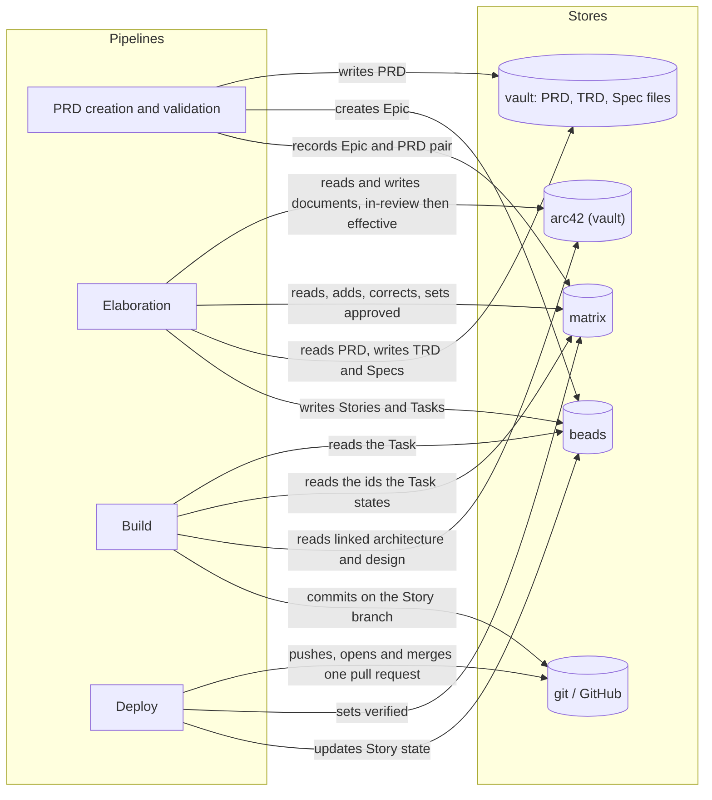

# The pipelines: overview

How the SDLC pipelines of the `agent-teams-workforce` plugin and the driver in
`ops/sdlc-automation` fit together, drawn as diagrams. What the pipelines must do, and why, is in
[requirements/pipelines.md](../requirements/pipelines.md) and
[requirements/matrix.md](../requirements/matrix.md). This document is the parent of the focused
diagram documents listed below; each of them links back here.

## How to read these documents

Every diagram, or every part of one, carries a basis:

- **Basis: required** - drawn from the owner's requirements: the blueprint's requirements
  documents, the vault's `docs/sdlc/sdlc.md`, and the owner's statements of 2026-10-19 recorded in
  Part 1 of the elaboration plan.
- **Basis: as built** - drawn from the current workflows, flows, agents and scripts, with file
  references.

Where the two differ, the document says so under the diagram. The requirement states what is
required; the code is what changes ([README](../README.md), "How it is used").

Each document has its own legend. The common notation:

| Notation | Meaning |
|---|---|
| `A ->> B` (sequence) | A calls or starts B |
| `B -->> A` (sequence) | B returns its result to A |
| `A -) Store` (sequence) | A writes to a store; nothing is returned |
| `{...?}` with labelled edges (activity) | A decision and its guards |
| "fork" / "join", "merge" (activity) | Concurrent work and where it ends; alternative paths rejoining |
| `[*]` and labelled transitions (state machine) | Initial state; event [guard] / effect |
| "owner's open choice" | Not decided by the owner; every branch shown is an option, not a decision |
| "assumption" | Not stated by any source; drawn so the diagram reads |
| arc42 (vault), matrix, beads, vault, git / GitHub | The stores, named the same in every document |

## The documents

| Document | What it draws | Basis |
|---|---|---|
| [pipelines-prd.md](pipelines-prd.md) | PRD creation and PRD validation | required and as built |
| [pipelines-elaboration.md](pipelines-elaboration.md) | Elaboration of one Epic, as the owner requires it | required |
| [pipelines-elaboration-as-built.md](pipelines-elaboration-as-built.md) | Elaboration (`prd-to-spec`) as the code runs it today | as built |
| [pipelines-architecture-states.md](pipelines-architecture-states.md) | arc42 `effective` / `in-review`, matrix approved / verified, versions across Epics | required |
| [pipelines-build.md](pipelines-build.md) | The build of one Task | required and as built |
| [pipelines-deploy.md](pipelines-deploy.md) | The deploy of one Story | required and as built |
| [pipelines-driver.md](pipelines-driver.md) | The driver and the routing of beads to pipelines | required and as built |

## The pipelines end to end

**Subject:** every SDLC pipeline, from a stakeholder request to deployed, verified work.
**Scope:** one PRD and its Epic, its Stories and its Tasks.
**Purpose:** the order of the pipelines, what each takes in and produces, and which document draws
it.
**Boundary:** the inside of each pipeline is in its own document.
**Basis:** required for elaboration, build and deploy and what each takes in and produces
([requirements/pipelines.md](../requirements/pipelines.md), "What the pipelines are"); required
for the PRD and Epic created together and one Spec and one Story per repository (vault
`docs/sdlc/sdlc.md`); required for verified (the owner: "Once all of the tasks for all of the
stories for and Epic have been built and tested (including CI (CDK), which means deployemen must
also work), then all of the architecture and rellationships for the Epic can be set to
verified."); as built for PRD creation and PRD validation as pipelines of their own
(`workflows/prd-creation.js`, `workflows/prd-validation.js`), which the requirements' table does
not list.

Notes on the diagram:

- Elaboration of many Epics can run before anything is built. The owner: "we can process 20 Epics
  through elaboration with out building anything." (drawn in
  [pipelines-elaboration.md](pipelines-elaboration.md), section 7).
- A Bug bead is not pipeline work; a person triages it into an Epic, a Task or a closure
  ([requirements/pipelines.md](../requirements/pipelines.md), "Bugs").
- The "wait" loop exits when the last Story of the Epic is deployed and tested.

## Where the stores are read and written

**Subject:** which pipeline reads and writes which store.
**Scope:** all pipelines.
**Purpose:** a map from each store to the pipelines that touch it.
**Boundary:** the detail of each read and write is in the pipeline's own document.
**Basis:** required: arc42 and the matrix are input and output (the owner: "arc42 is both input
and out. The matrix is both input and output."); the matrix records no Story and no Task and not
what is deployed ([requirements/matrix.md](../requirements/matrix.md) R40, the owner); build and
deploy maintain only the verified mark (R39, R46).

Assumption: "DE sets verified" places the verified write in deploy, after a Story's deployment
works; the per-Epic condition is drawn in
[pipelines-architecture-states.md](pipelines-architecture-states.md), section 3.
