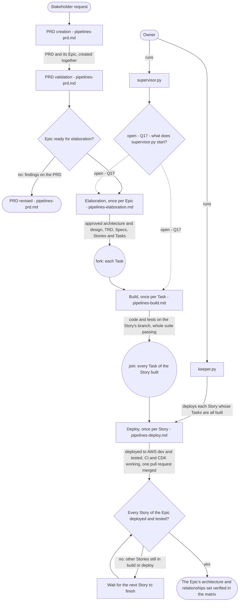
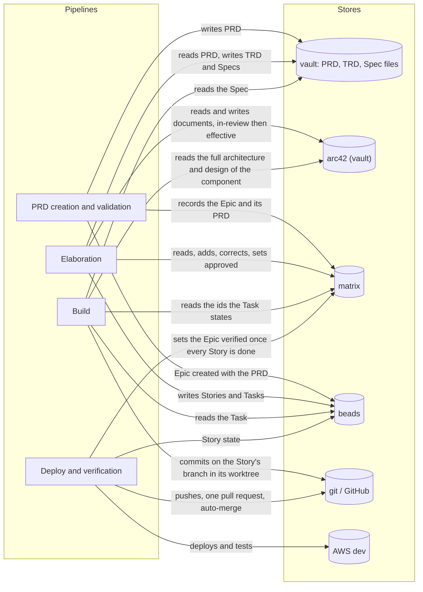

# The pipelines: overview

How the SDLC pipelines of the `agent-teams-workforce` plugin and the driver in
`ops/sdlc-automation` fit together, drawn as diagrams of what the owner wants. What the pipelines
must do, and why, is in [requirements/pipelines.md](../requirements/pipelines.md) and
[requirements/matrix.md](../requirements/matrix.md). This document is the parent of the focused
diagram documents listed below; each of them links back here.

## How to read these documents

Every diagram shows a pipeline as the owner wants it. The sources, in order: the owner's own words
(quoted with their qualifiers), the vault's `docs/sdlc/sdlc.md`, the SkillSpoke repository's root
`AGENTS.md` and `.claude/rules/git-conventions.md`, and the blueprint's requirements documents
where they agree with the owner's words. Where the owner has not said what is wanted, the step is
drawn as an open question and listed at the end of its document with a recommendation. Questions
Q1 to Q16 are the owner's questions from the elaboration plan; Q17 and Q18 are new.

Each document has its own legend. The common notation:

| Notation | Meaning |
|---|---|
| `A ->> B` (sequence) | A calls or starts B |
| `B -->> A` (sequence) | B returns its result to A |
| `A -) Store` (sequence) | A writes to a store; nothing is returned |
| `{...?}` with labelled edges (activity) | A decision and its guards |
| "fork" / "join", "merge" (activity) | Concurrent work and where it ends; alternative paths rejoining |
| `[*]` and labelled transitions (state machine) | Initial state; event [guard] / effect |
| "open - Qn" | Not decided by the owner; every branch shown is an option, not a decision |
| arc42 (vault), matrix, beads, vault, git / GitHub, AWS dev | The stores, named the same in every document |

## The documents

| Document | What it draws |
|---|---|
| [pipelines-driver.md](pipelines-driver.md) | `keeper.py` and `supervisor.py`, which the owner runs, and how beads reach each pipeline |
| [pipelines-prd.md](pipelines-prd.md) | PRD creation and PRD validation |
| [pipelines-elaboration.md](pipelines-elaboration.md) | Elaboration of one Epic: architecture at every level, the TRD, the specs, task decomposition |
| [pipelines-architecture-states.md](pipelines-architecture-states.md) | arc42 `effective` / `in-review`, matrix approved / verified, versions across Epics |
| [pipelines-build.md](pipelines-build.md) | The build of one Task: test first, implement, refactor, integration, quality gates |
| [pipelines-deploy.md](pipelines-deploy.md) | The deploy of one Story, the fix of a failed deploy, the pull request, and verification |

## The pipelines end to end

**Subject:** every SDLC pipeline, from where the owner starts it to deployed, verified work.
**Scope:** one PRD and its Epic, its Stories and its Tasks.
**Purpose:** what the owner starts, the order of the pipelines, what each takes in and produces,
and which document draws it.
**Boundary:** the inside of each pipeline is in its own document.
**Sources:** SkillSpoke `AGENTS.md`, "Pipeline runs belong to the owner": "Only the owner runs
`keeper.py` and `supervisor.py`; their real runs are the test of the pipeline." The owner: "keeper
is what knows to deploy a story." [requirements/pipelines.md](../requirements/pipelines.md): one
elaboration per Epic, one build per Task, one deploy per Story. The vault's `docs/sdlc/sdlc.md`: "A
PRD and its Epic are created together"; one Spec and one Story per repository. The owner on
verification: "Once all of the tasks for all of the stories for and Epic have been built and tested
(including CI (CDK), which means deployemen must also work), then all of the architecture and
rellationships for the Epic can be set to verified." and "we can process 20 Epics through
elaboration with out building anything."

Notes on the diagram:

- What `supervisor.py` starts is the owner's open question Q17. The order Epics and Tasks are
  taken in is drawn in [pipelines-driver.md](pipelines-driver.md).
- A Bug is not pipeline work; a person triages it into an Epic, a Task or a closure
  ([requirements/pipelines.md](../requirements/pipelines.md), "Bugs").
- The wait loop exits when the last Story of the Epic is deployed and tested.

## Where the stores are read and written

**Subject:** which pipeline reads and writes which store.
**Scope:** all pipelines.
**Purpose:** a map from each store to the pipelines that touch it.
**Boundary:** the detail of each read and write is in the pipeline's own document.
**Sources:** the owner: "arc42 is both input and out. The matrix is both input and output.", "The
matrix does not include stories and tasks (it isn't a build tracker), and it doesn't care about what
has actually been deployed.", "Regarding the matrix: It's entire purpose is to mintain a mapping (a
matrix) between things to every step of every pipeline doesn't need to research and scan or
rediscover what pertains the task that step is performing." The vault's `docs/sdlc/sdlc.md`: PRD,
TRD and Spec files live in the vault; Stories live only in beads. `git-conventions.md`: tier 1 work
in a worktree, one pull request through `skillspoke-pr`, merged automatically.

A deterministic step sets the Epic's architecture and relationships verified when the last Story of
the Epic closes ([pipelines-architecture-states.md](pipelines-architecture-states.md), section 3).
