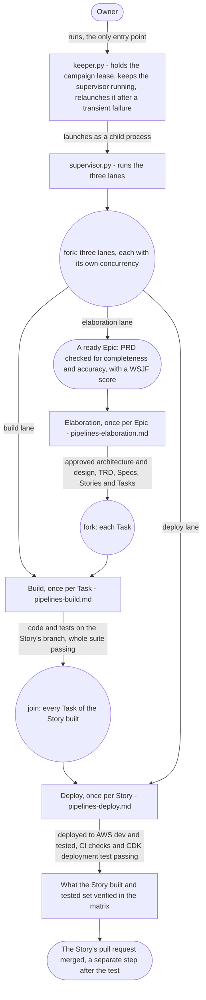
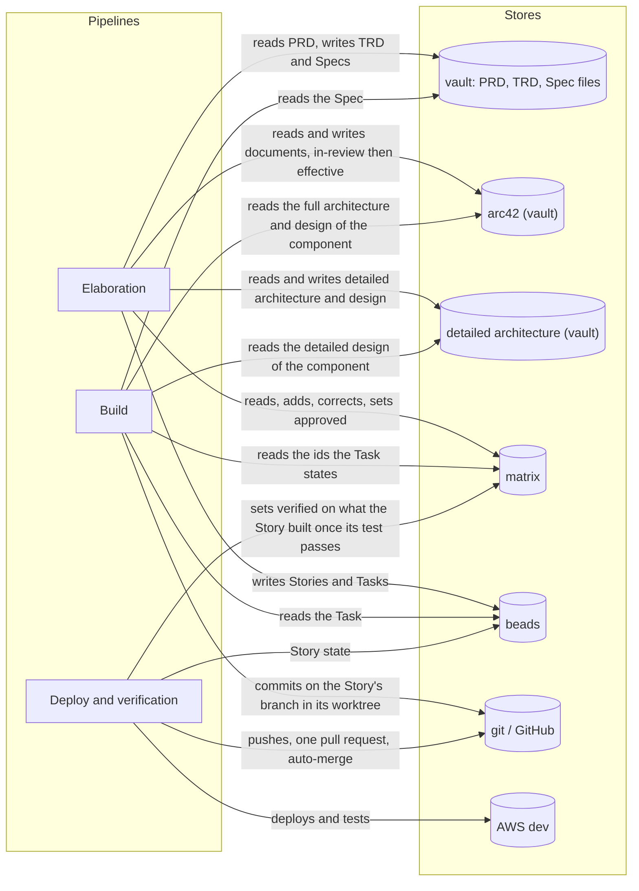

# The pipelines: overview

How the SDLC pipelines of the `agent-teams-workforce` plugin and the driver in
`ops/sdlc-automation` fit together, drawn as diagrams of what the owner wants. What the pipelines
must do, and why, is in [requirements/pipelines.md](../requirements/pipelines.md) and
[requirements/matrix.md](../requirements/matrix.md). This document is the parent of the focused
diagram documents listed below; each of them links back here.

Every pipeline starts at a ready Epic: its PRD has been checked for completeness and accuracy and
has a WSJF score. The owner: "Your scope does not require you to think about anything prior to an
Epic (PRD) becoming ready."

## How to read these documents

Every diagram shows a pipeline as the owner wants it. The sources, in order: the owner's own words
(quoted with their qualifiers), the vault's `docs/sdlc/sdlc.md`, the SkillSpoke repository's root
`AGENTS.md` and `.claude/rules/git-conventions.md`, and the blueprint's requirements documents
where they agree with the owner's words. For `keeper.py` and `supervisor.py`, which already exist,
the code in `ops/sdlc-automation` is the source. Where the owner has not said what is wanted, the step is
drawn as an open question and listed at the end of its document with a recommendation. Questions
Q1 to Q16 are the owner's questions from the elaboration plan.

Each document has its own legend. The common notation:

| Notation | Meaning |
|---|---|
| `A ->> B` (sequence) | A calls or starts B |
| `B -->> A` (sequence) | B returns its result to A |
| `A -) Store` (sequence) | A writes to a store; nothing is returned |
| `{...?}` with labelled edges (activity) | A decision and its guards |
| "fork" / "join", "merge" (activity) | Concurrent work and where it ends; alternative paths rejoining |
| `[*]` and labelled transitions (state machine) | Initial state; event [guard] / effect |
| "open - Qn" | Not decided by the owner; every branch shown is an option, not a decision |
| arc42 (vault), detailed architecture (vault), matrix, beads, vault, git / GitHub, AWS dev | The stores, named the same in every document. "Detailed architecture (vault)" is the architecture and design under the vault's `docs/tech/architecture/` outside `arc42/` |

## The documents

| Document | What it draws |
|---|---|
| [pipelines-driver.md](pipelines-driver.md) | `keeper.py`, which the owner runs, the `supervisor.py` it runs, and how beads reach each pipeline |
| [pipelines-elaboration.md](pipelines-elaboration.md) | Elaboration of one Epic: architecture at every level, the TRD, the specs, task decomposition |
| [pipelines-architecture-states.md](pipelines-architecture-states.md) | arc42 `effective` / `in-review`, matrix approved / verified, versions across Epics |
| [pipelines-build.md](pipelines-build.md) | The build of one Task: test first, implement, refactor, integration, quality gates |
| [pipelines-deploy.md](pipelines-deploy.md) | The deploy of one Story, the fix of a failed deploy, the pull request, and verification |

## The pipelines end to end

**Subject:** every SDLC pipeline, from where the owner starts it to deployed, verified work.
**Scope:** one ready Epic, its Stories and its Tasks.
**Purpose:** what the owner starts, the order of the pipelines, what each takes in and produces,
and which document draws it.
**Boundary:** the inside of each pipeline is in its own document.
**Sources:** the owner: "I never run supervisor directly. I only ever run `keeper.py`." and "keeper
is what knows to deploy a story."; the code of `keeper.py` (it launches `supervisor.py` and relaunches it
after a transient failure) and `supervisor.py` (it runs the elaboration, build and deploy lanes).
[requirements/pipelines.md](../requirements/pipelines.md): one
elaboration per Epic, one build per Task, one deploy per Story. The vault's `docs/sdlc/sdlc.md`: one Spec
and one Story per repository. The owner on
verification: "Once all of the tasks for all of the stories for and Epic have been built and tested
(including CI (CDK), which means deployemen must also work), then all of the architecture and
rellationships for the Epic can be set to verified." and "we can process 20 Epics through
elaboration with out building anything."

Notes on the diagram:

- `keeper.py`, `supervisor.py`, its lanes and the order Epics and Tasks are taken in are drawn in
  [pipelines-driver.md](pipelines-driver.md).
- A Bug is not pipeline work; a person triages it into an Epic, a Task or a closure
  ([requirements/pipelines.md](../requirements/pipelines.md), "Bugs").
- Verified is set per Story when its test passes, on what it built and tested; it waits for no
  other Story and for no merge, because verified belongs to each stack and component, not to an
  Epic ([requirements/matrix.md](../requirements/matrix.md), section 3.5).
- An agent whose definition grants `Agent` or `Workflow` may start subagents and workflows when
  its work needs them, choosing the plugin's own agents from the `find-specialists` catalog
  ([requirements/pipelines.md](../requirements/pipelines.md), "Agents may start agents";
  `skills/subagent-contract/SKILL.md`, "Starting subagents and workflows"). No agent elaboration
  starts grants either: the scripts start every agent elaboration needs, so its session carries
  no agent listing, only its own agent's MCP servers, and only the skills its definition names
  (`orchestrator/DESIGN.md`, section 5.2).
- Each agent output has one home for its shape: the schema the orchestrator or the workflow
  checks it against. The agent definition, and the skill that states the output, point at that
  schema (file and `$defs` entry) with the rule to write exactly that shape and no other fields,
  and say only what goes in each field. `skills/artifact-handoff/agent-outputs.json` pairs each
  file output with its agents, its schema and the code that makes the pairing, and
  `scripts/check-agent-output-formats.mjs` checks every pairing, the structured-output schemas
  the workflows dispatch included, and that every session an orchestrator flow validates is
  paired, in the pre-commit hook, so a mismatch fails the commit. A request's answer, which any
  catalog agent may write, carries its schema and the rule in the session's brief. An answer
  written to an earlier contract by a session of an earlier definition sends its writer's step to
  run again when the architect's Decide step reads it
  ([requirements/pipelines.md](../requirements/pipelines.md), "Choosing specialists takes reasoning, and every agent has a reason to be used", the paragraph on contracts).

## Where the stores are read and written

**Subject:** which pipeline reads and writes which store.
**Scope:** all pipelines.
**Purpose:** a map from each store to the pipelines that touch it.
**Boundary:** the detail of each read and write is in the pipeline's own document.
**Sources:** the owner: "arc42 is both input and out. The matrix is both input and output.", "The
matrix does not include stories and tasks (it isn't a build tracker), and it doesn't care about what
has actually been deployed.", "Regarding the matrix: It's entire purpose is to mintain a mapping (a
matrix) between things to every step of every pipeline doesn't need to research and scan or
rediscover what pertains the task that step is performing." The vault's `docs/sdlc/sdlc.md`: PRD,
TRD and Spec files live in the vault; the owner: detailed architecture lives under the vault's
`docs/tech/architecture/` outside `arc42/`; Stories live only in beads. `git-conventions.md`: tier 1 work
in a worktree, one pull request through `skillspoke-pr`, merged automatically.

A deterministic step sets verified on what a Story built and tested when the Story's test passes,
before and apart from its merge ([pipelines-architecture-states.md](pipelines-architecture-states.md),
section 3).
