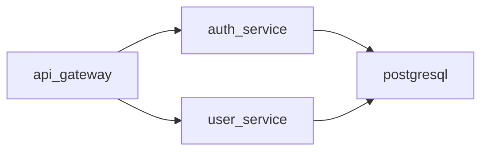

# Senior Architect

Architecture design and analysis tools for making informed technical decisions.

## Table of Contents

- [Quick Start](#quick-start)
- [Tools Overview](#tools-overview)
  - [Architecture Diagram Generator](#1-architecture-diagram-generator)
  - [Dependency Analyzer](#2-dependency-analyzer)
  - [Project Architect](#3-project-architect)
- [Decision Workflows](#decision-workflows)
  - [Database Selection](#database-selection-workflow)
  - [Architecture Pattern Selection](#architecture-pattern-selection-workflow)
  - [Monolith vs Microservices](#monolith-vs-microservices-decision)
- [Reference Documentation](#reference-documentation)
- [Tech Stack Coverage](#tech-stack-coverage)
- [Common Commands](#common-commands)

---

## Quick Start

```bash
# Generate architecture diagram from project
python scripts/architecture_diagram_generator.py ./my-project --format mermaid

# Analyze dependencies for issues
python scripts/dependency_analyzer.py ./my-project --output json

# Get architecture assessment
python scripts/project_architect.py ./my-project --verbose
```

---

## Tools Overview

### 1. Architecture Diagram Generator

Generates architecture diagrams from project structure in multiple formats.

**Solves:** "I need to visualize my system architecture for documentation or team discussion"

**Input:** Project directory path
**Output:** Mermaid diagram source, for a view written in Markdown

**Supported diagram types:**
- `component` - Shows modules and their relationships
- `layer` - Shows architectural layers (presentation, business, data)
- `deployment` - Shows deployment topology

**Usage:**
```bash
# Component view
python scripts/architecture_diagram_generator.py ./project --format mermaid --type component

# Layer view
python scripts/architecture_diagram_generator.py ./project --format mermaid --type layer

# Save to file
python scripts/architecture_diagram_generator.py ./project -o architecture.md
```

**Example output:**


Architecture diagrams are Mermaid in Markdown, so people read them in Obsidian and agents read and edit them like any other file. A generated diagram is a starting point: it goes into a view with the prose around it and the view's catalog frontmatter, in the section folder the architecture documentation model names.

---

### 2. Dependency Analyzer

Analyzes project dependencies for coupling, circular dependencies, and outdated packages.

**Solves:** "I need to understand my dependency tree and identify potential issues"

**Input:** Project directory path
**Output:** Analysis report (JSON or human-readable)

**Analyzes:**
- Dependency tree (direct and transitive)
- Circular dependencies between modules
- Coupling score (0-100)
- Outdated packages

**Supported package managers:**
- npm/yarn (`package.json`)
- Python (`requirements.txt`, `pyproject.toml`)
- Go (`go.mod`)
- Rust (`Cargo.toml`)

**Usage:**
```bash
# Human-readable report
python scripts/dependency_analyzer.py ./project

# JSON output for CI/CD integration
python scripts/dependency_analyzer.py ./project --output json

# Check only for circular dependencies
python scripts/dependency_analyzer.py ./project --check circular

# Verbose mode with recommendations
python scripts/dependency_analyzer.py ./project --verbose
```

**Example output:**
```
Dependency Analysis Report
==========================
Total dependencies: 47 (32 direct, 15 transitive)
Coupling score: 72/100 (moderate)

Issues found:
- CIRCULAR: auth → user → permissions → auth
- OUTDATED: lodash 4.17.15 → 4.17.21 (security)

Recommendations:
1. Extract shared interface to break circular dependency
2. Update lodash to fix CVE-2020-8203
```

---

### 3. Project Architect

Analyzes project structure and detects architectural patterns, code smells, and improvement opportunities.

**Solves:** "I want to understand the current architecture and identify areas for improvement"

**Input:** Project directory path
**Output:** Architecture assessment report

**Detects:**
- Architectural patterns (MVC, layered, hexagonal, microservices indicators)
- Code organization issues (god classes, mixed concerns)
- Layer violations
- Missing architectural components

**Usage:**
```bash
# Full assessment
python scripts/project_architect.py ./project

# Verbose with detailed recommendations
python scripts/project_architect.py ./project --verbose

# JSON output
python scripts/project_architect.py ./project --output json

# Check specific aspect
python scripts/project_architect.py ./project --check layers
```

**Example output:**
```
Architecture Assessment
=======================
Detected pattern: Layered Architecture (confidence: 85%)

Structure analysis:
  ✓ controllers/  - Presentation layer detected
  ✓ services/     - Business logic layer detected
  ✓ repositories/ - Data access layer detected
  ⚠ models/       - Mixed domain and DTOs

Issues:
- LARGE FILE: UserService.ts (1,847 lines) - consider splitting
- MIXED CONCERNS: PaymentController contains business logic

Recommendations:
1. Split UserService into focused services
2. Move business logic from controllers to services
3. Separate domain models from DTOs
```

---

## Decision Workflows

### Database Selection Workflow

Use when choosing a database for a new project or migrating existing data.

**Step 1: Identify data characteristics**
| Characteristic | Points to SQL | Points to NoSQL |
|----------------|---------------|-----------------|
| Structured with relationships | ✓ | |
| ACID transactions required | ✓ | |
| Flexible/evolving schema | | ✓ |
| Document-oriented data | | ✓ |
| Time-series data | | ✓ (specialized) |

**Step 2: Choose among the project's stores.** The stores the project allows, and who owns each, are in its solution strategy and constraints (arc42 sections 4 and 2); read them first. A serverless AWS project typically chooses persistence per data set from three stores, each owned by one service:
- **DynamoDB (on-demand)** → key-value and document data with known access patterns, session records, idempotency records (`dynamodb`)
- **Aurora PostgreSQL Serverless v2 through the RDS Data API** → relational data, joins, transactions, temporal facts, vectors with pgvector, graph-shaped data in most cases (`aurora-postgresql`, which also states when a graph database is justified)
- **Versioned S3** → documents, files and large content

A store outside the project's stated stack is not chosen without a stated need the architecture accepts; an always-on cache (ElastiCache, Redis) is deployed only when a measured need appears. Size to the development context the project instructions state; do not design for hypothetical scale.

**Step 3: Check consistency requirements**
- Strong consistency or multi-row transactions required → Aurora PostgreSQL, or DynamoDB transactions and strongly consistent reads within one table's partition
- Eventual consistency acceptable → DynamoDB (GSIs are eventually consistent), or a read model built from the project's events

**Step 4: Describe the result in the architecture**
Make the chosen design part of the architecture description, as current state: update the views that show the elements it changes, at every scope they appear in (a pattern used across services is a crosscutting concept in section 8), with:
- What the design is
- The reason for it, where it departs from an established pattern
- The limits and trade-offs it accepts

**Quick reference (the three serverless stores):**
```
DynamoDB (on-demand)          → Key-value and document data, known access patterns
Aurora PostgreSQL (Data API)  → Relational data, transactions, pgvector
Versioned S3                  → Files, documents, large results
```

---

### Architecture Pattern Selection Workflow

Use when designing a new system or refactoring existing architecture.

**Where the project's architectural style is decided** (its solution strategy, arc42 section 4), the workflow below does not reopen it. For a style such as a serverless, event-driven microservices platform decomposed by bounded context, each service one CDK app with its own stores and coordinating through events, pieces are consolidated only when they always change and deploy together, have one owner and have no reason to scale or fail independently; use the workflow below only to apply that consolidation rule or to choose patterns inside one service (DDD, CQRS, hexagonal), and the team-size guidance does not reopen the style. Where no style is decided yet, it applies in full.

**Step 1: Assess team and project size**
| Team Size | Recommended Starting Point |
|-----------|---------------------------|
| 1-3 developers | Modular monolith |
| 4-10 developers | Modular monolith or service-oriented |
| 10+ developers | Consider microservices |

**Step 2: Evaluate deployment requirements**
- Single deployment unit acceptable → Monolith
- Independent scaling needed → Microservices
- Mixed (some services scale differently) → Hybrid

**Step 3: Consider data boundaries**
- Shared database acceptable → Monolith or modular monolith
- Strict data isolation required → Microservices with separate DBs
- Event-driven communication fits → Event-sourcing/CQRS

**Step 4: Match pattern to requirements**

| Requirement | Recommended Pattern |
|-------------|-------------------|
| Rapid MVP development | Modular Monolith |
| Independent team deployment | Microservices |
| Complex domain logic | Domain-Driven Design |
| High read/write ratio difference | CQRS |
| Audit trail required | Event Sourcing |
| Third-party integrations | Hexagonal/Ports & Adapters |

See `references/architecture_patterns.md` for detailed pattern descriptions.

---

### Monolith vs Microservices Decision

**Choose Monolith when:**
- [ ] Team is small (<10 developers)
- [ ] Domain boundaries are unclear
- [ ] Rapid iteration is priority
- [ ] Operational complexity must be minimized
- [ ] Shared database is acceptable

**Choose Microservices when:**
- [ ] Teams can own services end-to-end
- [ ] Independent deployment is critical
- [ ] Different scaling requirements per component
- [ ] Technology diversity is needed
- [ ] Domain boundaries are well understood

**Hybrid approach:**
Start with a modular monolith. Extract services only when:
1. A module has significantly different scaling needs
2. A team needs independent deployment
3. Technology constraints require separation

---

## Reference Documentation

Load these files for detailed information:

| File | Contains | Load when user asks about |
|------|----------|--------------------------|
| `references/architecture_patterns.md` | 9 architecture patterns with trade-offs, code examples, and when to use | "which pattern?", "microservices vs monolith", "event-driven", "CQRS" |
| `references/system_design_workflows.md` | 6 step-by-step workflows for system design tasks | "how to design?", "capacity planning", "API design", "migration" |
| `references/tech_decision_guide.md` | Decision matrices for technology choices | "which database?", "which framework?", "which AWS services?", "which cache?" |

---

## Tech Stack Coverage

**The project's stack** is the one its architecture constraints and solution strategy state; read it there. This skill's serverless AWS guidance covers: Python Lambdas on `aws-lambda-powertools`; API Gateway REST API v1 spec-first in OpenAPI and the WebSocket API; DynamoDB, Aurora PostgreSQL Serverless v2 through the RDS Data API, versioned S3; events onto EventBridge; Cognito; SES; Bedrock and AgentCore; CDK in Python, values across stacks through SSM Parameter Store; CloudWatch, X-Ray and ADOT; Next.js and React Native; GitHub Actions.

**General knowledge for other systems:** TypeScript, Go, Swift, Kotlin, Rust; Vue, Angular, Flutter; Node.js, Express, GraphQL; MySQL, MongoDB, Redis, Cassandra; Docker, Kubernetes, Terraform; GitLab CI, CircleCI, Jenkins. These describe systems you may read; they are choices only where the project's architecture makes them.

---

## Common Commands

```bash
# Architecture visualization
python scripts/architecture_diagram_generator.py . --format mermaid

# Dependency analysis
python scripts/dependency_analyzer.py . --verbose
python scripts/dependency_analyzer.py . --check circular
python scripts/dependency_analyzer.py . --output json

# Architecture assessment
python scripts/project_architect.py . --verbose
python scripts/project_architect.py . --check layers
python scripts/project_architect.py . --output json
```

---

## Getting Help

1. Run any script with `--help` for usage information
2. Check reference documentation for detailed patterns and workflows
3. Use `--verbose` flag for detailed explanations and recommendations
